# Markdown-editor voor Hypha

**Functioneel, grafisch en technisch ontwerp: het schrijfproces van een content-auteur**

> [!info] Over dit document
> Dit document beschrijft wat de auteur ziet en doet (functioneel en grafisch ontwerp) en hoe het wordt gebouwd op PHP 8.2 (technisch ontwerp, [§13](#13-technisch-ontwerp-proeven-en-keuzes)). Het ontwerp hoort bij issue [PlanBCode/hypha#520](https://github.com/PlanBCode/hypha/issues/520) *Replace WYMeditor and improve the authoring experience*.
> Elke technische keuze is met een proef getoetst; de scripts staan in [`20261026_MARKDOWN_EDITOR/proeven/`](20261026_MARKDOWN_EDITOR/proeven/). De tests volgen in de bouw. Een **klikbaar prototype** staat in [`20261026_MARKDOWN_EDITOR/prototype/index.html`](20261026_MARKDOWN_EDITOR/prototype/index.html): het start met een verzonnen voorbeeldartikel en bewaart alleen in de localStorage van je browser.
> De schermschetsen staan in [`20261026_MARKDOWN_EDITOR/img/`](20261026_MARKDOWN_EDITOR/img/) als SVG en zijn met elke browser te bekijken. Ze gebruiken de huisstijl van **De Stadsbron** ([test.destadsbron.nl](https://test.destadsbron.nl)) en een **verzonnen** voorbeeldartikel: *Vertrekkend raadslid Bram Hoekstra: twintig jaar strijd voor open bestuur*. De persoon, de partij Open Eemstad, de plaats Eemstad, de auteur (persona Sanne de Vries), de beoordelaars en de paginanamen bestaan niet; foto's zijn placeholders. Er staat geen inhoud van een echte site in dit ontwerp, conform [`CLAUDE.md`](../../../CLAUDE.md). Van elke schets is er ook een **Engelse versie** in [`20261026_MARKDOWN_EDITOR/img/en/`](20261026_MARKDOWN_EDITOR/img/en/) (zie [§8](#engelstalige-schetsen)). Alle afbeeldingen staan op **100%**: de computerschermen zijn 1200 px breed, iPhone en iPad zijn op ware grootte. De schermafdrukken van iPad Air en iPhone zijn gemaakt van het werkende prototype. De schetsen zijn met een generator gemaakt; de SVG-bestanden zijn het resultaat en de generator staat niet in de repository.

## Inhoud

1. [Samenvatting](#1-samenvatting)
2. [Huidige situatie](#2-huidige-situatie)
3. [Het probleem: wat auteurs ervaren](#3-het-probleem-wat-auteurs-ervaren)
4. [Bekeken mogelijkheden](#4-bekeken-mogelijkheden)
5. [De gekozen oplossing](#5-de-gekozen-oplossing)
6. [Ontwerpprincipes](#6-ontwerpprincipes)
7. [Het schrijfproces in één oogopslag](#7-het-schrijfproces-in-één-oogopslag)
8. [Stap voor stap, met schermschetsen](#8-stap-voor-stap-met-schermschetsen)
9. [Artikelvelden: Hypha-XML, editor en Markdown-bestand](#9-artikelvelden-hypha-xml-editor-en-markdown-bestand)
10. [Ondersteunde Markdown-syntaxis](#10-ondersteunde-markdown-syntaxis)
11. [Krantenartikel-elementen (zoals op nrc.nl)](#11-krantenartikel-elementen-zoals-op-nrcnl)
12. [Technische keuzes (PHP 8.2)](#12-technische-keuzes-php-82)
13. [Technisch ontwerp: proeven en keuzes](#13-technisch-ontwerp-proeven-en-keuzes)
14. [Projectie op de XML-opslag](#14-projectie-op-de-xml-opslag)
15. [Bedrijfsregels als constraints](#15-bedrijfsregels-als-constraints)
16. [Klikbaar prototype](#16-klikbaar-prototype)
17. [Handleiding van Hypha](#17-handleiding-van-hypha)
18. [Scope en begroting](#18-scope-en-begroting)
19. [Risico's en open vragen](#19-risicos-en-open-vragen)
20. [Besluiten](#20-besluiten)
21. [Volgende stappen](#21-volgende-stappen)
22. [Uitkomst van de bouw](#22-uitkomst-van-de-bouw)

---

## 1. Samenvatting

**Probleem.** Auteurs van De Stadsbron schrijven lange, journalistieke artikelen in Hypha met **WYMeditor 1.1.1** op **jQuery 1.7.1** uit 2011. Dat gaat moeizaam:

1. vier losse, kleine tekstvakken onder elkaar;
2. een werkbalk met pictogrammen zonder uitleg;
3. geen voorbeeld van het resultaat;
4. opmaak die verspringt na plakken uit Word;
5. op iPhone en iPad lastig selecteren en scrollen.

Foto's met bijschrift, kaders, tabellen en diagrammen kosten veel handwerk of kunnen niet. De techniek is verouderd en wordt niet meer bijgewerkt. Het oorspronkelijke team, met een journalistieke achtergrond, was redactiesystemen met een minder vriendelijke interface gewend; de auteurs van nu zijn dat niet ([§3](#3-het-probleem-wat-auteurs-ervaren)).

**Positie.** Hypha is een klein open-sourceproject.

1. Bestaande artikelen moeten blijven werken, zonder migratie.
2. Lezers en zoekmachines houden dezelfde HTML, zodat de SEO gelijk blijft.
3. De oplossing draait op PHP 8.2 of hoger, zonder Node.js op de server.
4. Alleen componenten met een permissieve licentie.
5. Zo weinig mogelijk wijzigingen in bestaande PHP.
6. Toegankelijk volgens WCAG 2.1 AA en bruikbaar volgens de Apple-stijlgids.

Zie [§3.4](#34-randvoorwaarden-waar-een-oplossing-aan-moet-voldoen).

**Mogelijkheden.** Vijf richtingen zijn bekeken ([§4](#4-bekeken-mogelijkheden)):

1. WYMeditor opknappen;
2. WYMeditor vervangen door een andere opmaakeditor;
3. een Markdown-editor **naast** WYMeditor, met twee weergaven op dezelfde tekst;
4. schrijven buiten Hypha (Obsidian, HedgeDoc) en importeren;
5. alle artikelen omzetten naar Markdown.

**Keuze.** Richting 3: een nieuwe editor naast WYMeditor, voor nieuwe *artikelen met review* en nieuwe *tekstpagina's* ([§5](#5-de-gekozen-oplossing)).

1. De bron is Markdown (*Hypha-Markdown 1.0*). De auteur kiest per moment **Opmaak** (zoals Word) of **Markdown**; wisselen verliest niets.
2. Artikelkop (met een eigen veld *rubriek*), bijsluiter en bronnen staan als vaste blokken in de tekst, zonder tabbladen. Het webadres volgt uit de titel.
3. De editor biedt voorbeeld, checklist, beeld met bijschrift, citaten, kaders, tabellen en diagrammen in Mermaid-notatie (getekend met Pele).
4. Codemarkering en wiskundige formules horen bij de eerste oplevering.
5. De server zet de Markdown om naar dezelfde XHTML als nu (league/commonmark); oude artikelen blijven HTML.
6. Erbij komt een **Nederlandse handleiding van Hypha** in Markdown, te openen en te publiceren met Obsidian ([§17](#17-handleiding-van-hypha)).
7. Getest wordt met een **gouden dataset van 10.000 verzonnen artikelen**, met **unit tests** en **integratietests** ([§12.13](#1213-testen-gouden-dataset-unit-tests-en-integratietests)).
8. **Docker** blijft een ondersteunde manier om Hypha te draaien, ook met de nieuwe editor, en staat beschreven in de handleiding ([§12.14](#1214-docker-blijft-mogelijk)).
9. **Versies** van een artikel vallen buiten de scope (besluit, issue #241).
10. Tekst uit **Word, Google Docs en LibreOffice** komt via het klembord vrijwel ongewijzigd in de Markdown: vet, schuin, koppen, tabellen, formules en lijsten, met behoud van de betekenis ([§12.15](#1215-acceptatiecriteria-plakken-uit-word-google-docs-en-libreoffice)).
11. **Snel**: typen binnen 100 ms op het scherm, bewaren binnen 1 seconde, de leesweergave binnen 250 ms op een iPhone 16, de editor de tweede keer binnen 3 seconden open, en elke **Lighthouse**-score 95 of hoger ([§12.16](#1216-prestatie-eisen)).
12. **Migratie**: nieuwe artikelen en tekstpagina's openen altijd in de nieuwe editor; de oude editor blijft voor oude inhoud. Omzetten naar Markdown kan ooit, als de nieuwe editor zich heeft bewezen, maar valt buiten de scope ([§5.2](#52-migratie-de-oude-editor-blijft-voor-oude-artikelen)).
13. **Flexibiliteit** in twee niveaus: eigen HTML uit een toegestane lijst, en ingesloten inhoud van zoveel mogelijk diensten met JavaScript alleen in een afgeschermd blok. Hypha-macro's en vrije JavaScript in de pagina komen niet in de code ([§10.1](#101-flexibiliteit-eigen-html-javascript-en-uitbreidingen)).
14. **Getoetste techniek** ([technisch ontwerp](#13-technisch-ontwerp-proeven-en-keuzes)): league/commonmark op de server, een eigen HTML-filter, CodeMirror 6 voor Markdown, ProseMirror voor Opmaak, markdown-it voor het voorbeeld en de eigen plakomzetting.

De begroting is **107 dagen** (93 werk en 14 reserve), AI-ondersteund, binnen een maximum van 160 ([§18](#18-scope-en-begroting)). De besluiten staan in [§20](#20-besluiten).

## 2. Huidige situatie

Dit hoofdstuk beschrijft hoe een artikel nu wordt geschreven en opgeslagen, wie er schrijft en in welke huisstijl. Het probleem dat auteurs daarbij ervaren, staat in [§3](#3-het-probleem-wat-auteurs-ervaren).

### 2.1 Zo ziet artikel bewerken er nu uit

De onderstaande schermafbeelding (100%, 1200 px breed) is gemaakt in een **draaiende Hypha op PHP 8.2** (Docker-image `hypha-combined:php8.2`), het thema `destadsbron`, een eigen testgebruiker en het verzonnen voorbeeldartikel, dat daarvoor als pagina *Afscheid_Hoekstra* in een lokale kopie van de data is gezet (`/nl/Afscheid_Hoekstra/edit`). De data zelf staat niet in de repository. Het scherm is opgebouwd door `createEditForm()` in [`peer_reviewed_article.php`](../../../system/datatypes/peer_reviewed_article.php) en [`editor.php`](../../../system/core/editor.php).

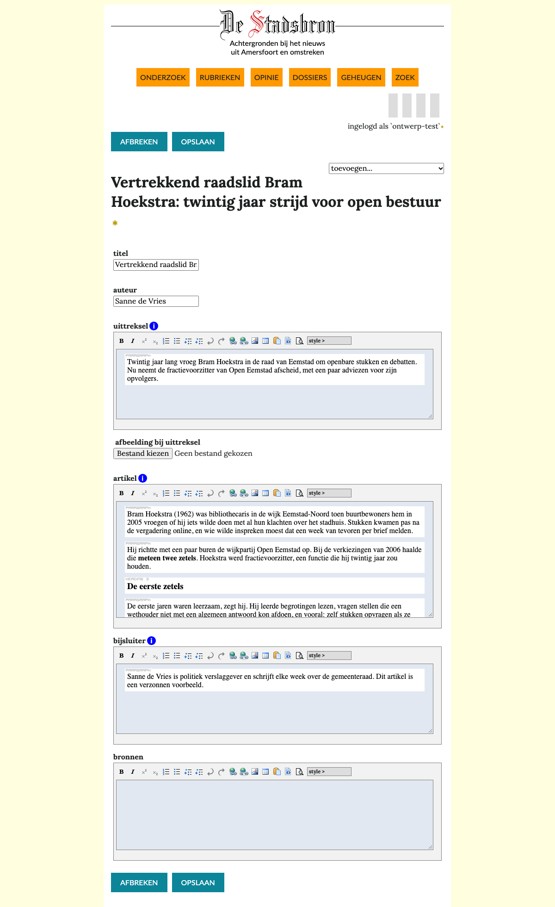

**Wat we van Hypha overnemen**: veldnamen vet en in kleine letters („titel”, „auteur”, „uittreksel”), de knoppen „afbreken” en „opslaan” en de bestaande termen („schets”, „breekpunt”, „geef goedkeuring”, „publiceer”, „bijsluiter”).

### 2.2 Wie er schrijft: de auteurs

De typische auteur heeft een **mbo- of hbo-opleiding in de alfa- of gammawetenschappen**: communicatie, journalistiek, geschiedenis, sociologie, bestuurskunde, taal. Zo iemand schrijft goed, werkt dagelijks met Word of Google Docs en soms met een notitie-app, maar is geen programmeur.

> [!example] Persona: Sanne de Vries (34)
> hbo Communicatie, schrijft als freelancer één à twee lange achtergrondstukken per maand voor De Stadsbron.
> **Wil**: rustig schrijven zonder dat de opmaak in de weg zit; zien hoe het eruit komt te zien; een stuk ’s avonds op de iPad afmaken.
> **Ergert zich aan**: kleine knopjes zonder uitleg, opmaak die verspringt na plakken uit Word, Engelse termen, „wat doet dit symbool?”.
> **Kent** Markdown een beetje van WhatsApp (`*vet*`) en van een notitie-app die een collega gebruikt. Schrijft liever in **Opmaak**, maar gebruikt Markdown voor lange stukken.

> [!example] Tweede persona: Ahmed el Idrissi (24)
> mbo Media & Vormgeving, vrijwilliger bij de redactie. Werkt vooral op zijn **iPhone**, maakt foto's bij raadsvergaderingen en tijdlijnen en vult artikelen van anderen aan.

In de schetsen is de ingelogde auteur Sanne de Vries, de schrijver van het voorbeeldartikel. De persona's beschrijven de doelgroep breder.

Gevolgen voor het ontwerp:

1. **Woorden boven symbolen**: werkbalkknoppen hebben een pictogram én een Nederlands woord („Citaat”, „Kader”, „Beeld”).
2. **Markdown leer je terloops**: knoppen zetten de tekens neer en je ziet ze gedimd staan. Na een paar keer typ je `###` zelf.
3. **Foutmeldingen zeggen wat je moet doen**, niet wat er mis is in technische termen („Zet een dubbele punt tussen het jaartal en de gebeurtenis”).
4. **Geen jargon** in de interface: „Tekst-editor” in plaats van „Markdown”, „eigenschappen” in plaats van „YAML-Frontmatter”, „diagram” in plaats van „Mermaid”. De technische termen staan alleen in de hulp, voor wie ze wil weten.

### 2.3 Techniek: wat er nu is

1. **PHP**: Hypha draait op **PHP 8.2 tot en met 8.5** (na upstream #475); de README noemt 8.2 als minimum (zie ook [`CLAUDE.md`](../../../CLAUDE.md) en [`REQUIREMENTS.md`](../../reference/REQUIREMENTS.md)). Hypha gebruikt **geen Composer**: bibliotheken staan als losse bestanden in `system/`. `hypha.php` pakt alle bestanden in tot één installatiebestand.
2. **Editor**: WYMeditor (`system/wymeditor`, circa 370 kB geminificeerd) met jQuery 1.7.1. Hij wordt geactiveerd door `loadEditor()` als de pagina een `<editor>`-element bevat; dat wordt vervangen door een `<textarea class="wymeditor">`. De plugins `image_upload` (route `upload/image`) en `site_links` zijn op maat voor Hypha.
3. **Opslag**: XHTML in XML-bestanden. `storeWikiContent()` bewaart versies als diff ten opzichte van de vorige versie, en `wikify_html()` maakt links relatief en zet paginalinks om naar pagina-id's.

### 2.4 Hoe een artikel in de XML-database staat

Elk *artikel met review* heeft een eigen XML-bestand. De structuur wordt aangemaakt in `ensureStructure()`:

```xml
<article status="draft|review|approved|published"
         author="Sanne de Vries" created_by="…" created_at="t…"
         updated_at="t…" published_at="t…">
  <content>
    <text>…XHTML…</text>          <!-- 'artikel' -->
    <sources>…XHTML…</sources>    <!-- 'bronnen' -->
  </content>
  <context>
    <title>…</title>              <!-- 'titel' -->
    <excerpt>…XHTML…</excerpt>    <!-- 'uittreksel' -->
    <featured_image>…</featured_image> <!-- 'afbeelding bij uittreksel' -->
    <method>…XHTML…</method>      <!-- 'bijsluiter' -->
  </context>
</article>
<discussions><review/><public/></discussions>  <!-- beoordelingsopmerkingen, reacties, breekpunten -->
<approves/>                                    <!-- goedkeuringen (3 nodig) -->
```

Tags staan niet in dit bestand maar bij de pagina in `hypha.xml` (`HyphaTags`). Taal en het vinkje *privé* staan daar ook.

### 2.5 Huisstijl van De Stadsbron

De schetsen volgen het thema `destadsbron` zoals dat draait op [test.destadsbron.nl](https://test.destadsbron.nl). De editor gebruikt de **CSS-variabelen van het thema**, zodat hij op een andere Hypha-site vanzelf de kleuren van dat thema krijgt.

| Rol | CSS-variabele (thema) | Waarde | Gebruik in de editor |
|---|---|---|---|
| Tekst | `--black` / `--textcolor` | `#1d2021` | lopende tekst, koppen |
| Menu en accent | `--orange` / `--menulinkback` | `#fe9900` | menuknoppen, actieve keuze, citaatlijn, tags, „aanbevolen”-stip |
| Blauwgroen (merk) | `--bluegreen` / `--linkcolor` | `#0c8599` | vlakken, randen van kaders en vaste blokken; **niet** voor tekst: 4,3:1 op wit, net onder WCAG AA |
| Blauwgroen donker | nieuw: `--action` | `#0B7285` | links, primaire knoppen (zoals „DRAAG BIJ!”), focusrand: 5,6:1 op wit (WCAG AA). Advies: ook in het thema `--linkcolor` hierop zetten |
| Donker blauwgroen | `--formheaderback` | `#226765` | titel van een kader |
| Rood | `--red` | `#be0709` | verplicht veld, fout, „breekpunt”, de S in het logo |
| Grijs | `--grey`, `--darkgrey`, `--lightgrey` | `#505458`, `#666`, `#ddd` | hulpteksten, lijnen |
| Knopgrijs | nieuw | `#5F656A` | knop „afbreken”, witte tekst 5,9:1 |
| Gedimd | nieuw: `--dim` | `#6E7781` | Markdown-tekens in het schrijfvlak, 4,6:1 (lichter dan de tekst, maar nog leesbaar) |
| Groen | nieuw: `--ok` | `#237A35` | „in orde” in de checklist, 5,3:1 |
| Reacties | – | lichtgeel | beoordelingsopmerkingen, net als de reactieblokken op de site |
| Serif | `--serif` | Lora, Georgia | schrijfvlak, koppen en leestekst, net als op de site |
| Schreefloos | `--sans` | Lato, Helvetica | werkbalk, labels, tussenkoppen (H3), menu |

**Kleuren van diagrammen.** Diagrammen in artikelen (tijdlijn, staaf- en taartdiagram, geldstromen) gebruiken een **rustig deelpalet** rond de huiskleuren blauwgroen en oranje, in plaats van de felle standaardkleuren van Pele (onder andere geel `#eeca3b` en rood `#e45756`). De zes kleuren hebben ongeveer dezelfde helderheid, zodat geen reeks eruit springt. Ze zijn getoetst op kleurenblindheid (buurparen ΔE ≥ 8 in OKLab) en hebben een contrast van ten minste 4,5:1 met witte tekst. Het thema zet ze als CSS-variabelen, die Pele leest; een zevende en achtste reeks zijn grijs.

| Reeks | CSS-variabele | Waarde | Lichte tint (vlak) |
|---|---|---|---|
| 1 blauwgroen | `--pele-series-1` | `#007A8F` | `#E1F2F5` |
| 2 oker-oranje | `--pele-series-2` | `#9C6410` | `#F8EEDF` |
| 3 staalblauw | `--pele-series-3` | `#3A5FA8` | `#E6ECF6` |
| 4 groen | `--pele-series-4` | `#3B7F34` | `#E8F3E6` |
| 5 pruim | `--pele-series-5` | `#9E4C76` | `#F5E8EF` |
| 6 olijf | `--pele-series-6` | `#7D641E` | `#F3EEE1` |
| 7 en 8 | `--pele-series-7`, `--pele-series-8` | `#5F656A`, `#8A9096` | – |

Lijnen, randen en vlakken van diagrammen volgen de grijzen van het thema (`--pele-line` `#505458`, `--pele-border` `#9AA1A6`, `--pele-surface` `#F2F6F7`), de accentkleur is `#0B7285`.

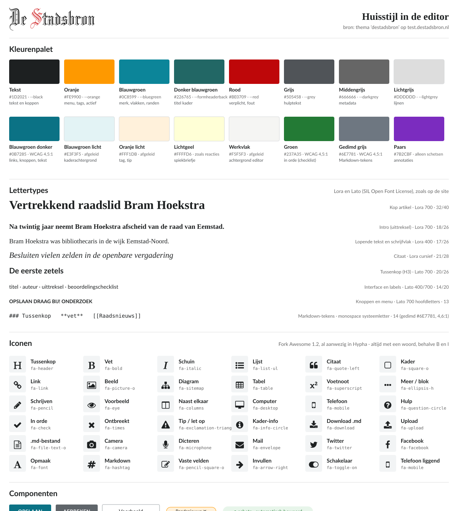

#### Lettertypes

| Element | Lettertype | Grootte / regelhoogte | Gewicht |
|---|---|---|---|
| Kop van het artikel | Lora | 32 / 40 px | 700 |
| Intro (uittreksel) | Lora | 18 / 26 px | 700 |
| Lopende tekst en schrijfvlak | Lora | 17 / 26 px | 400 |
| Citaat | Lora cursief | 21 / 28 px | 400 |
| Tussenkop (H3) | Lato | 20 / 26 px | 700 |
| Interface, labels, checklist | Lato | 14 / 20 px | 400 en 700 |
| Knoppen en menu | Lato, hoofdletters | 13 px | 700 |
| Markdown-tekens | monospace van het systeem (Menlo, Consolas) | 14 px | 400, gedimd `#6E7781` |

Lora en Lato zijn de webfonts van het thema van De Stadsbron (SIL Open Font License). In de schetsen zijn ze ingebed, zodat ook een SVG die als afbeelding wordt getoond de juiste letter heeft.

#### Iconen

De editor gebruikt **Fork Awesome 1.2**. Die zit al in het standaardthema van Hypha (`data/themes/default/css/fork-awesome.css`) en wordt ook door het thema van De Stadsbron geladen; er komt dus geen nieuwe afhankelijkheid bij. Regels:

1. Elk icoon staat **met een Nederlands woord** erbij (Lijst, Citaat, Kader, Link, Beeld, Diagram). Alleen **B** en *I* staan zonder woord, die zijn algemeen bekend.
2. Op touchschermen is elk aanraakvlak minimaal **44 × 44 pt**.
3. Kleur: tekstkleur `#1d2021` in rust, donker blauwgroen `#0B7285` als actief.
4. **Tooltips**: elke knop, elk veld en elke keuze heeft een `title` (tooltip bij aanwijzen met de muis) én een toegankelijke naam (`aria-label` of zichtbare tekst). Op een touchscherm bestaan tooltips niet; daar zorgen zichtbare woorden, de hulp en het spiekbriefje voor uitleg. Statusiconen: groen ✓ (`fa-check`), rood ✕ (`fa-times`), oranje ⚠ (`fa-exclamation-triangle`).

| Functie | Icoon | Functie | Icoon | Functie | Icoon |
|---|---|---|---|---|---|
| Tussenkop | `fa-header` | Link | `fa-link` | Schrijven | `fa-pencil` |
| Vet | `fa-bold` | Beeld | `fa-picture-o` | Voorbeeld | `fa-eye` |
| Schuin | `fa-italic` | Diagram | `fa-sitemap` | Naast elkaar | `fa-columns` |
| Lijst | `fa-list-ul` | Tabel | `fa-table` | Computer / telefoon | `fa-desktop` / `fa-mobile` |
| Citaat | `fa-quote-left` | Voetnoot | `fa-superscript` | Hulp | `fa-question-circle` |
| Kader | `fa-square-o` / `fa-info-circle` | Meer / blokmenu | `fa-ellipsis-h` | Download / open .md | `fa-download` / `fa-file-text-o` |
| Opmaak | `fa-font` | Markdown | `fa-hashtag` | Vaste velden (artikelkop) | `fa-lock` |
| Invullen (ga naar) | `fa-arrow-right` | Telefoon liggend | `fa-mobile` (gedraaid) | Schakelaar | iOS-achtige *toggle* |
| Afbeelding verwijderen | `fa-times` (rond, op de foto) | | | | |

#### Logo en paginaopbouw

Het logo („De Stadsbron – Achtergronden bij het nieuws uit Amersfoort en omstreken”) staat linksboven in de bewerkschermen en gecentreerd boven de leespagina, met daaronder de oranje menuknoppen ONDERZOEK · RUBRIEKEN · OPINIE · DOSSIERS · GEHEUGEN · ZOEK. De **genummerde bolletjes** in de schetsen zijn paars (`#7B2CBF`), zodat ze niet verward worden met de oranje en blauwgroene elementen van de huisstijl. Ze horen niet bij het ontwerp.

## 3. Het probleem: wat auteurs ervaren

Auteurs en beoordelaars van De Stadsbron lopen tegen twee soorten problemen aan: het bewerken zelf is moeizaam, en de techniek eronder is verouderd. Daaruit volgen de randvoorwaarden voor een oplossing.

### 3.1 Moeilijk bewerken

1. **Het schrijfvlak is klein en versnipperd.** Uittreksel, artikel, bijsluiter en bronnen zijn vier losse editors onder elkaar. Een lang artikel scrol je in een venster van circa 220 px hoog.
2. **Knoppen zonder woorden.** Zeventien pictogrammen van 16 px, zonder tekst; op een iPhone moeilijk te raken, voor nieuwe auteurs moeilijk te begrijpen. De stijlkeuze heet „style >”, en blokken krijgen Engelstalige labels als *PARAGRAPH* en *HEADING 2*.
3. **Geen zicht op het resultaat.** Er is geen voorbeeld van het artikel zoals de lezer het ziet; de checklist staat pas op de leespagina.
4. **Plakken uit Word gaat mis.** Opmaak verspringt of blijft achter, tenzij je een aparte knop gebruikt (hulptekst `help-art-text`).
5. **De afbeelding bij het uittreksel** is een kale bestandskeuze, zonder voorbeeld, bijschrift of fotograaf.
6. **Krantenelementen ontbreken.** Een foto met bijschrift en fotograaf, een citaat in de marge, een kader, een tabel zoals in Word of een tijdlijn: het kan niet, of alleen met HTML.
7. **Op iPhone en iPad werkt het slecht.** Selecteren, scrollen en het toetsenbord gedragen zich onvoorspelbaar in het `iframe` met `designMode`. Een stuk ’s avonds op de iPad afmaken lukt daardoor niet goed.
8. **De tekst is niet draagbaar.** De opslag is HTML; wie in een notitie-app of in Markdown schrijft, moet de tekst omzetten en opnieuw opmaken.

Zie de schermafbeelding in [§2.1](#21-zo-ziet-artikel-bewerken-er-nu-uit). De persona's in [§2.2](#22-wie-er-schrijft-de-auteurs) noemen dezelfde ergernissen: kleine knopjes zonder uitleg, verspringende opmaak na plakken en Engelse termen.

### 3.2 Verouderde techniek

1. **WYMeditor 1.1.1** (`system/wymeditor`, circa 370 kB) is van rond 2015; sindsdien is er geen nieuwe uitgave verschenen (*te verifiëren bij het project*). In hetzelfde bestand zitten lodash 2.4.2 en underscore 1.4.4.
2. **jQuery 1.7.1** (`system/assets/jquery-1.7.1.min.js`) is uit 2011. jQuery-versies vóór 3.5.0 hebben bekende kwetsbaarheden, zoals CVE-2020-11022 en CVE-2020-11023.
3. De editor werkt met `designMode` in een `iframe` en `document.execCommand`. Dat laatste staat in de browserdocumentatie als verouderd (*deprecated*); browsers kunnen het gedrag ervan veranderen.
4. Hypha gebruikt geen Composer en geen build-stap. Een vervanger moet dus als losse bestanden mee te leveren zijn.

### 3.3 Gevolgen voor redactie en beheer

1. **Redactie**: artikelen kosten meer tijd, de opmaak is per artikel anders, en beoordelaars zien pas na publicatie hoe het eruitziet.
2. **Nieuwe auteurs**: de drempel is hoog voor wie gewend is aan Word, Google Docs of een notitie-app.
3. **Beheer**: verouderde JavaScript-bibliotheken met bekende kwetsbaarheden, die niet los te vervangen zijn zonder de editor te raken.

**Waarom het nu meer knelt dan vroeger.** Het oorspronkelijke team rond De Stadsbron had een meer **journalistieke achtergrond**. Die makers waren gewend aan de redactiesystemen (*authoring systems*) van kranten en omroepen, met een gebruikersinterface die mogelijk minder vriendelijk was, en namen de eigenaardigheden van de editor daarom voor lief. De auteurs van nu zijn vaker vrijwilligers uit de alfa- en gammahoek ([§2.2](#22-wie-er-schrijft-de-auteurs)), die Word, Google Docs en apps op hun telefoon gewend zijn. Voor hen is dezelfde editor een drempel. Het probleem is dus niet alleen de editor zelf, maar ook dat de groep die ermee schrijft is veranderd.

### 3.4 Randvoorwaarden: waar een oplossing aan moet voldoen

| Randvoorwaarde | Wat het betekent voor het ontwerp |
|---|---|
| PHP 8.2 als minimum | De integratie gaat uit van Hypha op PHP 8.2 of hoger; alle gekozen PHP-componenten moeten daarop zonder meldingen werken. Getest in Docker met de image `hypha-combined:php8.2` (PHP 8.2.35). |
| Zo weinig mogelijk wijzigingen in bestaande PHP | De nieuwe editor komt grotendeels of vrijwel geheel **naast** de bestaande code te staan: nieuwe bestanden in nieuwe mappen, die Hypha automatisch laadt. Bestaande PHP-bestanden worden niet of alleen met kleine, toevoegende regels gewijzigd. Zo zijn risico's en impact op bestaande code makkelijk te overzien en is de editor er ook weer uit te halen. Zie [§12.11](#1211-naast-de-bestaande-code). |
| Apple-stijlgids | Op iPhone en iPad volgt de editor de Apple Human Interface Guidelines: aanraakvlakken ≥ 44 pt, aanpassing aan de schermbreedte (*size classes*), werkbalk boven het toetsenbord. Zie [§12.12](#1212-toets-aan-de-apple-human-interface-guidelines). |
| Geen Node.js op de server, gewoon JavaScript | Op de server draait alleen PHP. De client-code is **gewoon JavaScript** (ES-modules), zonder TypeScript en zonder build-stap bij installatie. De bibliotheken (CodeMirror 6, ProseMirror, markdown-it) worden eenmalig op de ontwikkelmachine gebundeld tot één bestand per bibliotheek met de versie in de naam; de eigen code van Hypha laadt via een kleine *import map* (Safari 16.4+, Chrome en Edge 89+). Diagrammen tekent de browser van de auteur; lezers krijgen SVG ([§13.12](#1312-meeleveren-en-laden-zonder-build-stap-bij-installatie)). |
| Toegankelijk: WCAG 2.1 AA | Editor en gepubliceerde artikelen voldoen aan WCAG 2.1 niveau AA: contrast ≥ 4,5:1, alles met het toetsenbord, zichtbare focus, toegankelijke namen, meldingen voor schermlezers, bruikbaar op 320 px breed en met 200% zoom. Zie [§12.9](#129-toegankelijkheid-wcag-21-aa). |
| AI-vriendelijke HTML | De HTML van een artikel is zo opgebouwd dat ook taalmodellen en andere software hem goed begrijpen: semantische elementen, één heldere kopstructuur, gestructureerde gegevens (schema.org) en geen inhoud die alleen via JavaScript bestaat. Zie [§12.10](#1210-ai-vriendelijke-html). |
| SEO blijft hetzelfde | Lezers en zoekmachines krijgen dezelfde server-gerenderde HTML als nu: dezelfde URL's, paginatitels, koppen, tekst, afbeeldingen met alt-tekst en links. De Markdown-bron is alleen voor de editor; voor een zoekmachine is er geen verschil tussen een HTML- en een Markdown-artikel. |
| Flexibiliteit voor gevorderd gebruik (doel) | De Markdown mag geen dichte doos zijn. Wat de editor niet kent, blijft ongewijzigd in de bron staan. Eigen HTML uit een toegestane lijst, ingesloten inhoud van zoveel mogelijk diensten (video, kaart, grafiek) en eigen JavaScript in een afgeschermd blok zijn mogelijk, in twee niveaus en met een veilige standaard. Hypha-macro's en vrije JavaScript in de pagina worden niet gebouwd (besluit 17). Notities uit **HedgeDoc** zijn grotendeels over te nemen. Als modules erbij: codemarkering voor meerdere talen en wiskundige formules in LaTeX-notatie. Zie [§10.1](#101-flexibiliteit-eigen-html-javascript-en-uitbreidingen) en [§10.2](#102-hedgedoc-compatibiliteit). |
| Docker-deployment blijft mogelijk | Hypha draait ook met de nieuwe editor in een container met **Docker** of Podman, op PHP 8.2 tot en met 8.5, met de bestanden in `docs/container/`. De nieuwe bestanden komen vanzelf mee in het image. De werkwijze staat in de handleiding ([§12.14](#1214-docker-blijft-mogelijk)). |
| Toetsbaar | Elke wijziging is te toetsen met **unit tests** en **integratietests** op een **gouden dataset** van 10.000 verzonnen artikelen, zonder persoonsgegevens ([§12.13](#1213-testen-gouden-dataset-unit-tests-en-integratietests)). |
| Plakken uit tekstverwerkers | Tekst uit Word, Google Docs en LibreOffice komt via het klembord vrijwel ongewijzigd in de Markdown, met behoud van de betekenis: vet, schuin, kop 1 tot en met 3, tabel, formule, lijst met opsommingstekens en genummerde lijst. Plaatjes overnemen valt buiten de scope. Zie [§12.15](#1215-acceptatiecriteria-plakken-uit-word-google-docs-en-libreoffice). |
| Snel | Typen staat binnen 100 ms op het scherm; bewaren duurt minder dan 1 seconde; een gepubliceerd artikel staat binnen 250 ms op een iPhone 16 in een anoniem venster; de editor is de tweede en volgende keer binnen 3 seconden bruikbaar. Zie [§12.16](#1216-prestatie-eisen). |
| Lighthouse 95+ | Elke Lighthouse-score (prestaties, toegankelijkheid, goede werkwijzen, SEO) is 95 of hoger, op telefoon en computer, voor gepubliceerde artikelen en tekstpagina's van de nieuwe editor; voor de editor zelf alle scores behalve SEO. Zie [§12.16](#1216-prestatie-eisen). |
| Bestaande inhoud ongemoeid | Oude artikelen en tekstpagina's blijven HTML en blijven met de opmaakeditor bewerkbaar. Geen conversie, geen migratie van de XML. |
| Geen wijziging in architectuur of complexiteit | Het `<editor>`-element, `loadEditor()`, de formulieren, de XML-opslag met versies, `wikify_html()` en de reviewstroom blijven zoals ze zijn. De Markdown-editor is een tweede *weergave* van hetzelfde formulierveld. Geen database, geen Node.js op de server en geen build-stap bij installatie. |
| iPhone, iPad en Chromium | Ontwerp eerst voor touch (knoppen ≥ 44 pt) en daarna voor toetsenbord. De editor gebruikt het native tekstinvoermodel, zodat iOS-autocorrectie, dicteren en spellingcontrole blijven werken. Test op Safari iOS/iPadOS en Chrome/Edge. |
| Alleen open source met een permissieve licentie (vergelijkbaar met Apache 2.0 of de PHP-licentie) | Toegestaan: MIT, BSD-2/3, Apache-2.0 en ISC. **Uitgesloten**: GPL/LGPL/AGPL en commerciële licenties, en daarmee o.a. TinyMCE 7 (GPLv2+ of commercieel) en CKEditor 5 (GPL of commercieel). |
| Bij voorkeur geschikt voor Nederlandstaligen | Alle labels, hulpteksten en foutmeldingen in het Nederlands (taalniveau B2), via de bestaande taalbestanden `system/languages/nl.php` en `en.php`. Nederlandse spellingcontrole via de browser (`lang="nl"`, `spellcheck="true"`). Nederlandse aanhalingstekens („…”) mogelijk. |
| Doorlooptijd (AI-ondersteund) | **Maximaal 160 dagen.** Begroting in [§18](#18-scope-en-begroting): 93 dagen werk plus 14 dagen reserve = 107 dagen. |

## 4. Bekeken mogelijkheden

De richtingen zijn licht verkend: genoeg om een keuze te onderbouwen, niet uitputtend. De vergelijking van componenten staat in [§12.1](#121-server-markdown-naar-xhtml-in-php) (server) en [§12.2](#122-browser-editorcomponent) (browser).

### 4.1 Vijf richtingen

| # | Richting | Voor | Tegen | Oordeel |
|---|---|---|---|---|
| 1 | **WYMeditor opknappen**: jQuery bijwerken, grotere knoppen, Nederlandse labels | kleine ingreep; vertrouwd | de basis (`designMode`, `execCommand`) blijft; iOS-problemen en plakken uit Word blijven; geen draagbare tekst | afgevallen |
| 2 | **Andere opmaakeditor** in plaats van WYMeditor | vertrouwd, zoals Word | TinyMCE en CKEditor vallen af door de licentie; met Tiptap of ProseMirror blijft HTML de bron; vervangen raakt alle bestaande artikelen | afgevallen als vervanging; ProseMirror wel als basis voor *Opmaak* |
| 3 | **Markdown-editor naast WYMeditor**, met de weergaven Opmaak en Markdown op dezelfde bron | draagbare tekst; bestaande artikelen ongemoeid; past bij HedgeDoc en Obsidian; goed op iOS | meer werk (twee weergaven); twee soorten artikelen naast elkaar | **gekozen** |
| 4 | **Schrijven buiten Hypha** (Obsidian, HedgeDoc) en importeren | sterke editors, die sommige auteurs al kennen | geen reviewstroom, checklist of artikelkop; HedgeDoc valt onder AGPL; dubbel werk bij elke correctie | afgevallen als hoofdroute; import en export van `.md` blijven ([§12.4](#124-import-en-export-van-markdown)) |
| 5 | **Alles omzetten naar Markdown** | één soort artikel | conversie van HTML verliest opmaak; groot risico voor het archief; niet nodig voor het doel | afgevallen |

### 4.2 Afweging

1. Richting 3 lost de problemen uit [§3.1](#31-moeilijk-bewerken) op zonder de bestaande artikelen te raken: oude artikelen blijven HTML en openen in WYMeditor.
2. Ze past binnen alle randvoorwaarden: permissieve licenties, PHP 8.2, geen Node.js, vrijwel geen wijzigingen in bestaande PHP.
3. Ze laat de verouderde techniek in één keer achter zich voor nieuwe artikelen; WYMeditor en jQuery 1.7.1 kunnen later apart worden opgeruimd.
4. Het nadeel, twee soorten artikelen naast elkaar, is te beheersen met één signaal in de opslag ([§12.5](#125-opslag-oude-artikelen-blijven-html-signaal-voor-markdown)) en een regressietest.

## 5. De gekozen oplossing

Dit hoofdstuk beschrijft de gekozen richting; de hoofdstukken erna werken haar uit: principes, schrijfproces, schermen, velden, syntaxis, techniek, opslag, bedrijfsregels, prototype en handleiding.

Hypha krijgt **naast** de huidige WYMeditor een **nieuwe editor** voor artikelen en tekstpagina's. De bron van een nieuw artikel of een nieuwe tekstpagina is **Markdown**, maar de auteur kiest zelf de manier van schrijven, met de schakelaar **Bewerken als** bovenaan het tekstkader (zoals *Bekijk als* in het voorbeeld):

1. **Opmaak**: bewerken zoals in Word; je ziet direct vet, koppen, foto's en kaders.
2. **Markdown**: bewerken met eenvoudige tekens (`###`, `**`); de knop **(?)** opent een spiekbriefje.

De editor **start in Opmaak, in de weergave Schrijven**. Er zijn **geen tabbladen**: titel, auteur, uittreksel, rubriek, tags, afbeelding, **bijsluiter** en **bronnen** staan in Markdown als vaste Frontmatter en in Opmaak als vaste, open- en dichtvouwbare blokken (artikelkop bovenaan, bijsluiter en bronnen onderaan).

Beide zijn twee weergaven van dezelfde tekst; wisselen kan altijd en verliest niets. **Bestaande artikelen blijven zoals ze zijn**: ze staan als HTML opgeslagen en openen in de vertrouwde opmaakeditor. Een signaal in de opslag geeft aan of een artikel een Markdown-bron heeft (zie [§12.5](#125-opslag-oude-artikelen-blijven-html-signaal-voor-markdown)). De nieuwe editor is herkenbaar aan een band in de merkkleuren boven de werkbalk.

**Titel, auteur, uittreksel, rubriek, tags, de afbeelding bij het uittreksel, bijsluiter en bronnen** horen bij de tekst zelf: in Markdown als vaste *Frontmatter* bovenaan (regel 1 titel, regel 2 auteur, regel 3 uittreksel, regel 4 rubriek, daarna de tags als lijst en de vier eigenschappen van de afbeelding), in Opmaak als een vaste **artikelkop** boven de tekst. Wie wisselt tussen Opmaak en Markdown, houdt de cursor op dezelfde plek.

De editor is bedoeld voor **lange, journalistieke artikelen** zoals op nrc.nl en De Stadsbron: rubriek, kop, intro, grote foto, tussenkoppen, citaten, kaders, voetnoten, bijsluiter, bronnen en diagrammen. De tekst is **gewone Markdown**, versie *Hypha-Markdown 1.0*: CommonMark 0.31.2 met GFM en gangbare uitbreidingen ([§10](#10-ondersteunde-markdown-syntaxis)), dus ook in andere Markdown-programma's te openen.

Een *tekstpagina* krijgt dezelfde editor zonder artikelkop, bijsluiter, bronnen en reviewstroom: alleen de tekst, met de versies en vertalingen die Hypha bij tekstpagina's al heeft.

Het ontwerp volgt de bestaande opbouw van een *artikel met review* in Hypha: dezelfde velden uit de XML-database (titel, auteur, uittreksel, afbeelding bij uittreksel, artikel, bijsluiter, bronnen, tags), plus een eigen veld *rubriek*, dezelfde beoordelingschecklist en dezelfde statussen (schets → in beoordeling → goedgekeurd → gepubliceerd).

### 5.1 Technische richting

Het [technisch ontwerp](#13-technisch-ontwerp-proeven-en-keuzes) heeft elke keuze met een proef getoetst:

1. **Ernaast bouwen**: de nieuwe editor komt in nieuwe bestanden. Twee bestaande klassen (`peer_reviewed_article` en `textpage`) krijgen elk een paar regels die doorschakelen als een artikel of pagina een Markdown-bron heeft ([§12.11](#1211-naast-de-bestaande-code)).
2. In de browser **gewoon JavaScript**: CodeMirror 6 voor Markdown, ProseMirror met prosemirror-markdown voor Opmaak, en markdown-it voor het voorbeeld, met één set Hypha-uitbreidingen voor beide.
3. Op de server rendert **league/commonmark** (BSD-3) de Markdown naar dezelfde XHTML die Hypha nu al opslaat. Een eigen filter op masterminds/html5 houdt alleen toegestane HTML, SVG en MathML over.
4. Diagrammen in Mermaid-notatie tekent **Pele** (MIT) in de browser van de auteur; lezers krijgen SVG.
5. Integratie in Hypha met **PHP 8.2 als minimum** (getoetst op 8.2 en 8.4), toegankelijk volgens **WCAG 2.1 AA**, getoetst aan de **Apple Human Interface Guidelines** en met elke **Lighthouse**-score 95 of hoger.

Begroting: **93 dagen plus 14 dagen reserve = 107 dagen**, AI-ondersteund, binnen een maximum van 160 ([§18](#18-scope-en-begroting)). **Versies** van een artikel vallen buiten de scope (issue #241).

### 5.2 Migratie: de oude editor blijft voor oude artikelen

1. **De oude editor blijft.** WYMeditor blijft behouden om bestaande artikelen te bewerken. Wie een oud artikel opent, krijgt de vertrouwde opmaakeditor met de vier velden; er verandert niets aan de opslag van dat artikel.
2. **Nieuwe artikelen en nieuwe tekstpagina's openen altijd in de nieuwe editor**, met een Markdown-bron. De oude editor is er alleen nog voor bestaande inhoud (besluit 18).
3. **Geen omzetting nu.** Oude artikelen worden niet naar Markdown omgezet. Dat kan **ooit** gebeuren, als de nieuwe editor zich heeft bewezen en iedereen er tevreden over is. Die omzetting valt **buiten de scope** van dit ontwerp (besluit 16 in [§20](#20-besluiten)).
4. **Wat de omzetting later makkelijker maakt**: het signaal in de opslag ([§12.5](#125-opslag-oude-artikelen-blijven-html-signaal-voor-markdown)) laat per artikel zien of het al een Markdown-bron heeft, de plakomzetting ([§12.15](#1215-acceptatiecriteria-plakken-uit-word-google-docs-en-libreoffice)) zet HTML al om naar Markdown, en de 3.000 oude HTML-artikelen in de gouden dataset ([§12.13](#1213-testen-gouden-dataset-unit-tests-en-integratietests)) zijn een kant-en-klare testset.

## 6. Ontwerpprincipes

1. **Naast, niet in plaats van.** De oude opmaakeditor blijft voor bestaande artikelen; de nieuwe editor komt erbij, ook in de code.
2. **Herkenbaar nieuw.** Een band in oranje en blauwgroen boven de werkbalk laat zien dat je in de nieuwe editor werkt, zonder extra knop of label.
3. **Kies je eigen manier.** Een schakelaar *Bewerken als: Opmaak | Markdown* bovenaan het tekstkader; de keuze wordt onthouden.
4. **Herkenbaar Hypha en herkenbaar De Stadsbron.** Dezelfde velden en termen als nu; kleuren, lettertypes en knoppen komen uit het thema van de site (zie [§2](#2-huidige-situatie)).
5. **De tekst staat centraal.** Het schrijfvlak gebruikt een leesletter (serif) en een regelbreedte van circa 70 tekens, zoals in een krant.
6. **Tekens dimmen, niet verbergen.** In Markdown zijn de tekens (`###`, `**`) grijs (contrast 4,6:1): zichtbaar, maar rustig.
7. **Altijd zien hoe het eruit komt te zien.** *Schrijven*, *Voorbeeld* of *Naast elkaar*; het voorbeeld volgt de plek waar je typt. *Naast elkaar* gebruikt de volle breedte van het scherm, met een versleepbare scheiding tussen tekst en voorbeeld. Op een smal scherm wissel je tussen invoer en voorbeeld.
8. **Alleen tonen wat aandacht vraagt.** De checklist laat standaard alleen problemen zien; een schakelaar toont ook wat in orde is.
9. **Nooit werk kwijt.** Concepten worden lokaal in de browser bewaard tot je opslaat. Bij tekstpagina's is elke opslag een nieuwe Hypha-versie; bij een *artikel met review* bewaart Hypha alleen de laatste stand (BR-74). Versies van een artikel vallen buiten de scope (#241).
10. **Touch eerst.** Aanraakvlakken ≥ 44 pt, werkbalk boven het toetsenbord op iPhone, sneltoetsen voor wie een toetsenbord heeft.
11. **Draagbare tekst.** Wat je schrijft is een gewoon `.md`-bestand, leesbaar in elk Markdown-programma.
12. **Veilig standaard, vrij waar nodig.** Gewone auteurs krijgen een veilige set eigen HTML. Ingesloten inhoud en JavaScript in een afgeschermd blok staan aan en zijn per rol uit te zetten. Niets wat de editor niet begrijpt gaat verloren.

## 7. Het schrijfproces in één oogopslag

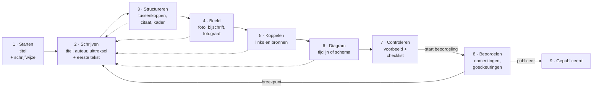

Stap 3 tot en met 6 zijn geen vaste volgorde: een auteur wisselt tussen schrijven, structureren, beeld en links. De stippellijnen geven dat aan. De statussen komen ongewijzigd uit Hypha:

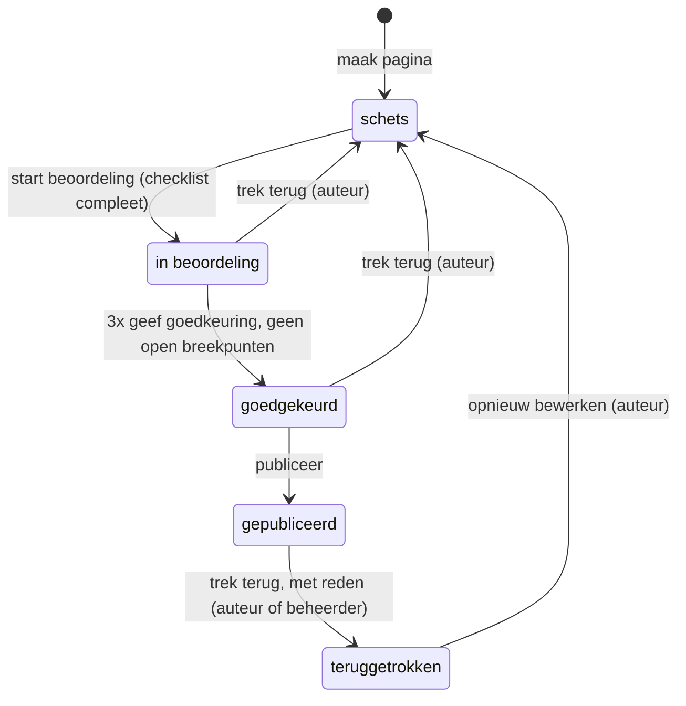

Verwachte beleving van de auteur per stap. Het ontwerp richt zich vooral op de dalen: beeld, diagram en controleren.

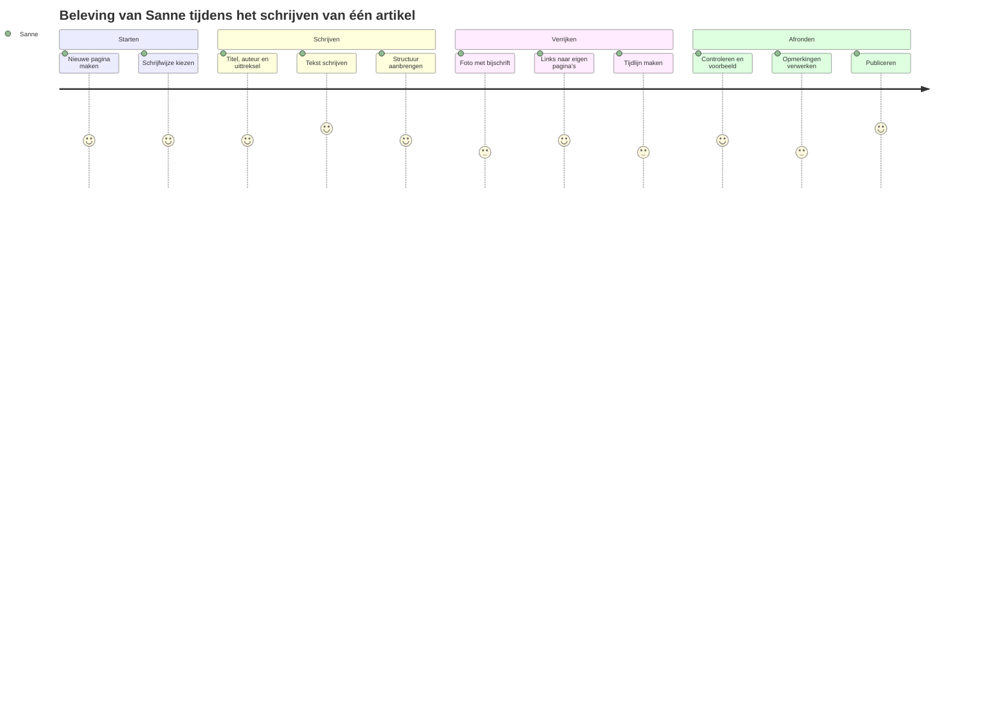

## 8. Stap voor stap, met schermschetsen

De paarse genummerde bolletjes in de schetsen verwijzen naar de toelichting onder elke schets; daar staat hetzelfde bolletje in dezelfde kleur. Het voorbeeldartikel en alle namen zijn verzonnen.

### Stap 1 – Starten: titel, webadres en de gewone manier van schrijven

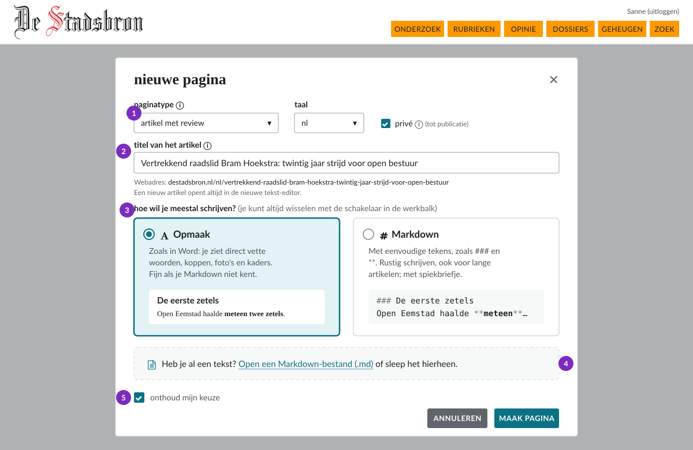

| # | Toelichting |
|---|---|
|  | De bestaande Hypha-popup *nieuwe pagina* met paginatype **artikel met review** (of **tekstpagina**), taal en *privé*. Artikelen zijn privé tot ze gepubliceerd zijn (dat dwingt Hypha nu al af). |
|  | **Titel van het artikel** in plaats van een paginanaam. Het **webadres** volgt er automatisch uit: de woorden in kleine letters met koppeltekens ertussen, zonder accenten, hoogstens 80 tekens, zoals `vertrekkend-raadslid-bram-hoekstra-twintig-jaar-strijd-voor-open-bestuur`. Bestaat het adres al, dan komt er `-2` achter. Het adres staat direct onder de titel, zodat je ziet wat het wordt. De regels staan in het [§13.14](#1314-paginanaam-uit-de-titel). Een **nieuw artikel opent altijd in de nieuwe editor**; de oude editor is er alleen voor bestaande artikelen. |
|  | **Nieuw**: „hoe wil je meestal schrijven?” met **Opmaak** (zoals in Word) en **Markdown** (met tekens). Twee kaarten met een miniatuur, zodat het verschil zichtbaar is. Dit is alleen de begininstelling: in de editor wissel je altijd met de schakelaar. |
|  | Een bestaand Markdown-bestand (`.md`) openen of erheen slepen. De Frontmatter bovenaan het bestand vult de artikelvelden (zie [§9](#9-artikelvelden-hypha-xml-editor-en-markdown-bestand)). |
|  | „Onthoud mijn keuze” zet een voorkeur bij de gebruiker; daarna verschijnt de vraag niet meer. De keuze geldt per gebruiker (besluit 22). |

Na het aanmaken ligt het webadres vast. Verandert de titel vóór publicatie flink, dan geeft de checklist een tip met een knop om het adres bij te werken; na publicatie verandert het nooit meer, zodat links blijven werken.

Een **bestaand** artikel opent altijd in de editor die bij de opslag hoort: zonder Markdown-signaal is dat de oude opmaakeditor, zoals nu. Omzetten van een oud HTML-artikel naar Markdown is niet voorzien.

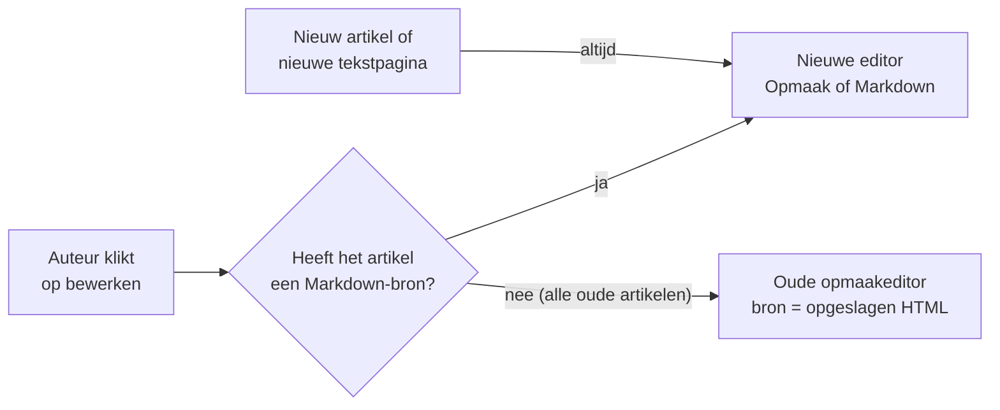

### Stap 2 – Schrijven in Markdown: vaste Frontmatter en de eerste tekst

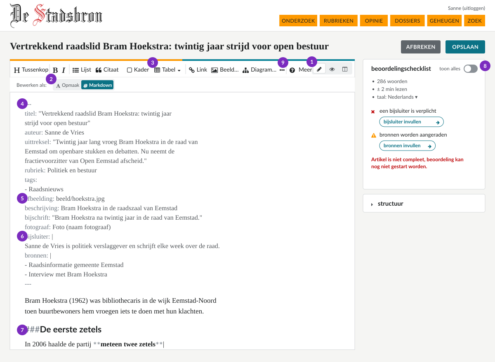

| # | Toelichting |
|---|---|
|  | **Schrijven \| Voorbeeld \| Naast elkaar** aan de rechterkant van de werkbalk. Er is geen regel met tabbladen; alle ruimte gaat naar de tekst. Is de werkbalk krap, dan toont de weergave alleen iconen (met tooltip). De werkbalk blijft bovenaan in beeld als je scrolt. |
|  | **Bewerken als: Opmaak \| Markdown**, bovenaan het tekstkader, net zoals *Bekijk als: Computer, Telefoon staand, Telefoon liggend* bovenaan het voorbeeld staat. De editor **start in Opmaak**. |
|  | De werkbalk met woorden (Tussenkop, **B**, *I*, Lijst, Citaat, Kader, **Tabel ▾**, Link, **Beeld…**, **Diagram…**, ⋯). Drie puntjes betekenen dat er een venster opent (de gewone conventie, ook in de Apple HIG); ▾ opent een menu. De werkbalk blijft altijd **één regel**: wat niet past, verhuist in dezelfde volgorde naar **Meer ▾**. Boven de werkbalk de band in oranje en blauwgroen: zo zie je dat dit de nieuwe editor is. Elke knop heeft een tooltip. |
|  | **Vaste Frontmatter** bovenaan de tekst: regel 1 `titel`, regel 2 `auteur`, regel 3 `uittreksel`, regel 4 `rubriek` (één rubriek uit de lijst van de site), daarna `tags` als lijst. De volgorde ligt vast; de editor zet de regels zo neer en leest ze bij elke wijziging terug in de velden. Klopt de Frontmatter niet meer (bijvoorbeeld een ontbrekende `---`), dan meldt de checklist welke regel en blijven de laatste goede waarden staan. **Tags** komen uit de vaste lijst van de site; een onbekende tag meldt de checklist (alleen een beheerder maakt nieuwe). |
|  | De **afbeelding bij het uittreksel**, met vier vaste eigenschappen: `afbeelding` (het bestand), `beschrijving` (voor voorleessoftware), `bijschrift` en `fotograaf`. Een andere foto kies je met **Beeld…** en plaatsing *Bovenaan*, of in Opmaak in de artikelkop. |
|  | **Bijsluiter** en **bronnen** als laatste eigenschappen, elk als blok van meerdere regels (`bijsluiter: \|` met de tekst twee spaties ingesprongen). Zo staan alle vaste gegevens van het artikel op één plek, zonder tabbladen. |
|  | In Markdown zijn de tekens **gedimd** (`###`, `**`); in Opmaak zie je ze niet en is de tekst direct opgemaakt. |
|  | De **beoordelingschecklist** met rechts van de titel de schakelaar **toon alles**. Bovenaan de statistieken als opsomming (woorden, leestijd) en de **taal** van het artikel als keuze (*Nederlands*, *English*, of de andere talen van de site). De taal bepaalt het webadres (`nl/…`, `en/…`), de `lang` van de tekst en dus de spellingcontrole; na publicatie ligt hij vast. Daaronder **alleen wat aandacht vraagt**: rood (ontbreekt) boven geel (advies), binnen elke kleur op alfabet. Een knop als **bijsluiter invullen →** zet de cursor in het veld. De **extra tips** verschijnen alleen als er iets te verbeteren is (of met *toon alles*). Het blok **structuur** staat standaard **dichtgevouwen**. De hele rechterkolom blijft in beeld als je scrolt. |
|  | **(?)** opent het **spiekbriefje** met de Markdown-tekens. Die knop is er alleen in Markdown; in Opmaak zijn er geen tekens om te onthouden. Hij blijft altijd op de regel, ook als andere knoppen naar *Meer* gaan. |

Sneltoetsen: ⌘/Ctrl + B (vet), I (schuin), K (link), S (opslaan), Z (ongedaan maken).

**Naast elkaar op een breed scherm.** In *Naast elkaar* gebruikt de editor de **volle breedte** van het scherm; alleen de checklist houdt haar eigen kolom. Tussen tekst en voorbeeld staat een **scheiding** die je versleept om de breedte te verdelen:

1. van 20% tot 80% voor de tekst;
2. met het toetsenbord: de scheiding krijgt de focus met Tab, de pijltjes verschuiven haar per 5%, Home en End naar 20% en 80%;
3. dubbelklikken of Enter zet haar terug op de helft;
4. de verdeling wordt per gebruiker onthouden;
5. voor schermlezers is het een `separator` met de huidige verdeling als waarde („tekst 60%, voorbeeld 40%”).

### Stap 2b – Schrijven in Opmaak: vaste blokken voor artikelkop, bijsluiter en bronnen

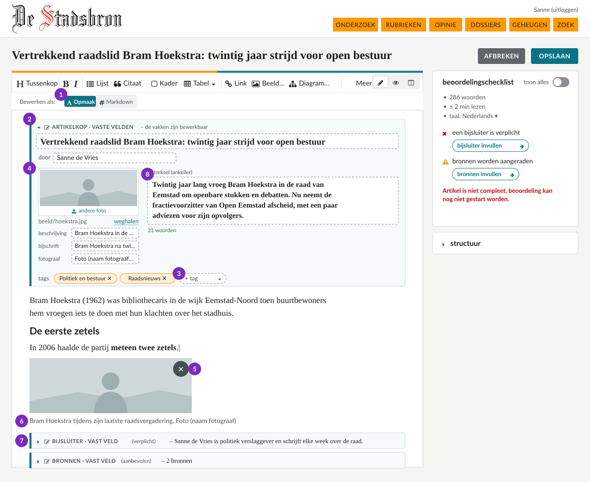

| # | Toelichting |
|---|---|
|  | **Bewerken als** staat op **Opmaak**: bewerken zoals in Word, zonder zichtbare tekens. Zo start de editor. De knop (?) voor het spiekbriefje is er in Opmaak niet. |
|  | De **artikelkop** als vast blok: **titel** en **door** auteur, daaronder op één rij de afbeelding en de ankeiler, en onderaan de rubriek en de tags. Elk veld is een **wit vak met een gestippelde rand**, zodat je ook zonder cursor ziet wat bewerkbaar is; met de muis erop wordt de rand doorgetrokken. Het blok is **open- en dichtvouwbaar** (▾); dichtgevouwen staat de titel ernaast. De volgorde ligt vast en het blok is niet te verplaatsen of te verwijderen. Een Enter in de titel maakt geen nieuwe regel. |
|  | **tags** als labels met ✕, en een keuzelijst **+ tag ▾** met alleen de tags van de site die het artikel nog niet heeft. Alleen een beheerder ziet daarin *nieuwe tag…*. Daarboven de **rubriek** als eigen keuzelijst: precies één rubriek uit de lijst van de site (besluit 21). |
|  | De **afbeelding bij het uittreksel** links: een miniatuur met **andere foto**, en **eronder** de velden *beschrijving*, *bijschrift* en *fotograaf* als bewerkbare vakken. Met *weghalen* verdwijnt de afbeelding. |
|  | **Foto of diagram bewerken en verwijderen**: elke foto en elk diagram in de tekst heeft rechtsboven twee ronde knoppen (44 pt, met tooltip en toegankelijke naam): ✎ **bewerken** en ✕ **verwijderen**. Dubbelklikken werkt ook als bewerken. Na verwijderen verschijnt een melding met **ongedaan maken**. |
|  | Het **bijschrift** met fotograaf staat onder de foto en is direct te bewerken. |
|  | **Bijsluiter** en **bronnen** als twee vaste blokken aan het eind van het artikel, net als de artikelkop open- en dichtvouwbaar. Dichtgevouwen toont het blok de eerste woorden van de bijsluiter of het aantal bronnen. Open zijn het opgemaakte tekstvakken (vet, links, lijsten). *bijsluiter invullen →* in de checklist opent het blok en zet de cursor erin. |
|  | De **ankeiler** (het uittreksel) **rechts van de afbeelding**, op dezelfde rij, iets smaller dan de volle breedte. In de smalle kolom van *Naast elkaar* en op een telefoon komt de ankeiler onder de afbeelding. |

Wisselen tussen Opmaak en Markdown verliest niets: de artikelkop, de bijsluiter en de bronnen worden de Frontmatter en omgekeerd. **De cursor blijft op dezelfde plek**: de editor telt de blokken (alinea's, koppen, kaders, figuren, tabellen) in beide weergaven op dezelfde manier en zoekt binnen het blok dezelfde letter op, waarbij Markdown-tekens als `**` en `###` worden overgeslagen. Staat de cursor in de Frontmatter, dan gaat hij naar het bijbehorende veld van de artikelkop, en terug.

### Stap 3 – Structureren: tussenkoppen, citaat, kader en voetnoot

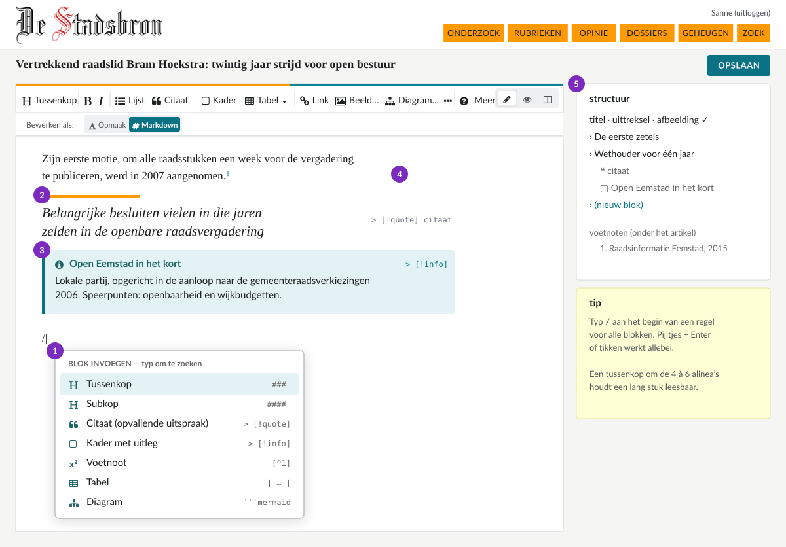

| # | Toelichting |
|---|---|
|  | Een **`/` aan het begin van een regel** opent het blokmenu (in Markdown). Typen filtert de lijst („str” → *Citaat*). Rechts staat de Markdown die wordt ingevoegd, zodat de auteur die leert. In Opmaak doen de knoppen van de werkbalk hetzelfde. |
|  | **Citaat** (opvallende uitspraak) = `> [!quote]`. Oranje lijn erboven, Lora cursief. Is er tekst geselecteerd, dan gaat die tekst het citaat in; zonder selectie komt er een voorbeeldtekst. |
|  | **Kader** = `> [!info] Titel`, lichtblauwgroen met een blauwgroene rand. Voor achtergrond, „zo deden we het”, cijfers. Ook hier gaat geselecteerde tekst (een deel van een alinea of meerdere alinea's) het kader in; daarna staat de titel van het kader geselecteerd, zodat je die meteen overtypt. Dit werkt in Opmaak en in Markdown. |
|  | **Voetnoot** `[^1]`: het nummer verschijnt direct; de tekst van de voetnoot komt onder het artikel. Tussenkoppen zijn `###` (H3), zoals in de bestaande artikelen. |
|  | **Structuur**: een inhoudsoverzicht van tussenkoppen en blokken. Tikken springt naar die plek. |

### Stap 3b – Tabel zoals in Word

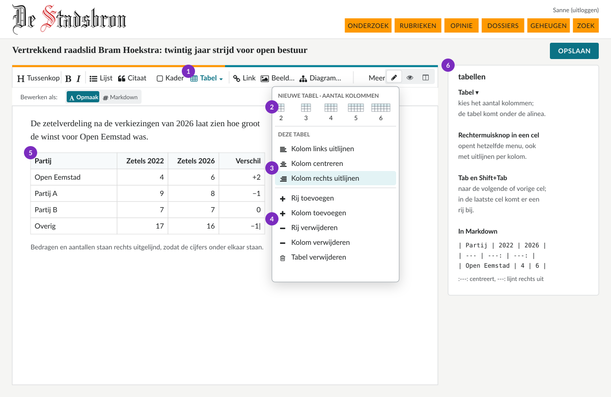

| # | Toelichting |
|---|---|
|  | De knop **Tabel ▾** in de werkbalk opent een menu, in Opmaak en in Markdown. |
|  | **Nieuwe tabel**: kies het aantal kolommen (2 tot 6) aan de hand van een miniatuur. De tabel komt onder de alinea waarin de cursor staat, met een kopregel en twee lege rijen; de cursor staat in de eerste kopcel. |
|  | **Deze tabel**: de kolom waarin de cursor staat **links uitlijnen**, **centreren** of **rechts uitlijnen** (handig voor bedragen). Staat de cursor niet in een tabel, dan zijn deze keuzes grijs. |
|  | **Rij** of **kolom toevoegen** en **verwijderen**, en de hele **tabel verwijderen**. |
|  | In Opmaak een gewone tabel met een kopregel. **Tab** en **Shift+Tab** gaan naar de volgende of vorige cel; Tab in de laatste cel voegt een rij toe. |
|  | De **rechtermuisknop** in een cel opent hetzelfde menu. Op iPad, waar een rechtermuisknop meestal ontbreekt, werkt de knop *Tabel* net zo. In Markdown is het een GFM-tabel; de uitlijning staat in de tweede regel: `:---` links, `:---:` midden, `---:` rechts. |

### Stap 4 – Beeld: foto met beschrijving, bijschrift en fotograaf

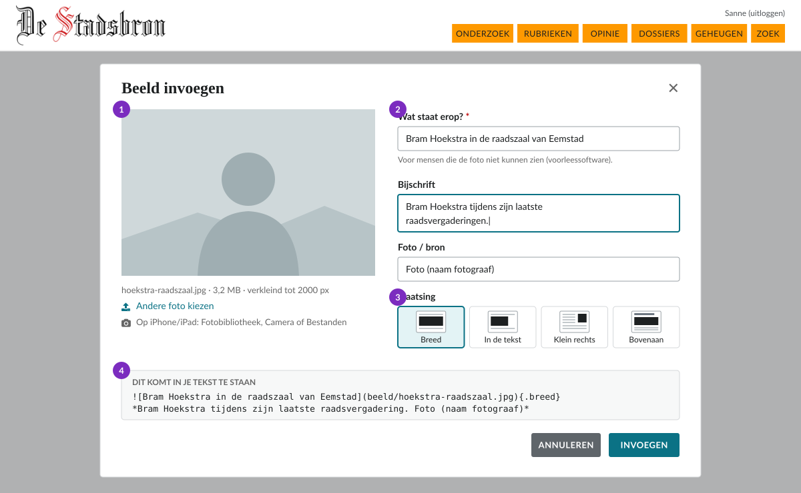

| # | Toelichting |
|---|---|
|  | Foto kiezen of slepen. Op iPhone/iPad opent de standaardkeuze van iOS (*Fotobibliotheek*, *Camera*, *Bestanden*). De upload gebruikt de bestaande Hypha-route `upload/image`; grote foto's worden verkleind. Een bestaande foto **bewerk** je met dezelfde dialoog (titel *Foto bewerken*, knop *bijwerken* en *verwijderen*): in Opmaak met ✎ of een dubbelklik, in Markdown door de cursor in de regel van de foto of het bijschrift te zetten; de knop in de werkbalk heet dan **Beeld bewerken**. |
|  | Drie velden in gewone taal: **wat staat erop?** (verplicht, voor voorleessoftware), **bijschrift** en **foto / bron**. |
|  | **Plaatsing**, elk met een pictogram dat met een zwart blok in een kader laat zien waar het beeld in het artikel komt: **breed**, **in de tekst**, **klein rechts** en **bovenaan** (als afbeelding bij het uittreksel, in de Frontmatter). Elke keuze heeft een tooltip. |
|  | „Dit komt in je tekst te staan” laat de Markdown zien. Het bijschrift is een cursieve regel direct onder de afbeelding; dat is leesbaar in elk Markdown-programma en wordt in Hypha een `<figure>` met `<figcaption>`. Een afbeelding op een eigen regel wordt altijd een `<figure>` op de breedte van de tekst, ook zonder bijschrift; anders zou een grote foto op zijn eigen grootte verschijnen. |

### Stap 5 – Koppelen: interne links en bronnen

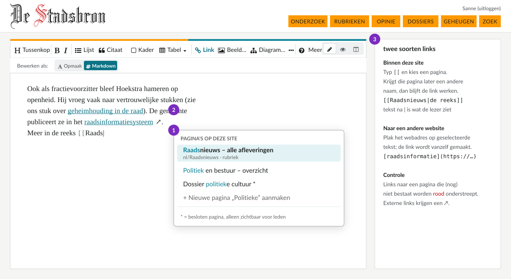

| # | Toelichting |
|---|---|
|  | **`[[`** opent een zoeklijst met pagina's van deze site, bijvoorbeeld de rubriek *Raadsnieuws*. Dat is dezelfde lijst als nu in de WYMeditor-plugin *site_links*, met privépagina's gemarkeerd met `*`. Je kunt ook direct een nieuwe pagina aanmaken. |
|  | Externe links: selecteer tekst en plak een webadres; de link wordt vanzelf gemaakt. Externe links krijgen in het voorbeeld een ↗. |
|  | Uitleg in gewone taal, met een controle: links naar niet-bestaande pagina's worden rood onderstreept. |

> [!note] Aandachtspunt voor het technisch ontwerp
> Hypha bewaart links naar eigen pagina's als **pagina-id** (`wikify_link()`), zodat ze blijven werken als een pagina een andere naam krijgt. Bij `[[Paginanaam]]` moet dat behouden blijven: in Hypha moet een hernoemde pagina werken, terwijl in een geëxporteerd `.md`-bestand een leesbare naam moet staan.

### Stap 6 – Diagram: een tijdlijn in Mermaid-notatie, getekend met Pele

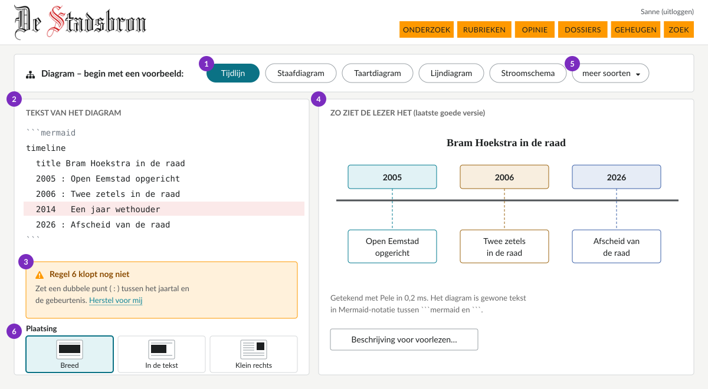

| # | Toelichting |
|---|---|
|  | Begin altijd met een **voorbeeld**. De vijf soorten die in een lokaal nieuwsartikel het vaakst nodig zijn, staan als knop: **tijdlijn**, **staafdiagram**, **taartdiagram**, **lijndiagram** en **stroomschema**. Niemand hoeft de notatie uit het hoofd te kennen. |
|  | Links de **tekst van het diagram** in Mermaid-notatie tussen ` ```mermaid ` en ` ``` `; gangbaar in Markdown-programma's en op GitHub en GitLab. |
|  | **Foutmelding in gewone taal** met regelnummer (Pele geeft regel en kolom mee) en, waar mogelijk, *Herstel voor mij*. Rechts blijft de laatste goede versie zichtbaar. |
|  | **Voorbeeld** zoals de lezer het ziet, getekend door Pele in een fractie van een milliseconde, plus een veld *beschrijving voor voorlezen*. Een bestaand diagram **bewerk** je in dezelfde dialoog (*Diagram bewerken*): in Opmaak met ✎ of een dubbelklik, in Markdown met de cursor in het blok en de knop **Diagram bewerken**. |
|  | **meer soorten ▾**: nog 31 soorten, waarvan elf technische, zie [stap 6b](#stap-6b--meer-soorten-diagrammen). |
|  | **Plaatsing** met dezelfde pictogrammen als bij een foto: breed, in de tekst of klein rechts. In Markdown staat de plaatsing achter het openingsteken: ` ```mermaid {.klein-rechts} `; andere Markdown-programma's negeren dat. |

### Stap 6b – Meer soorten diagrammen

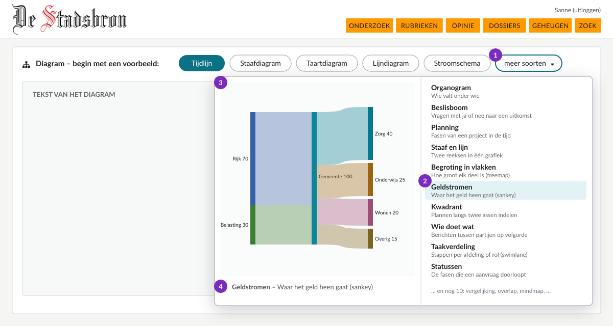

| # | Toelichting |
|---|---|
|  | **meer soorten ▾** opent een lijst met 31 soorten, gesorteerd op hoe vaak ze naar verwachting nodig zijn (tabel hieronder). Onderaan staan onder het kopje **Technisch** de technische soorten. De schets toont het begin van de lijst. |
|  | Elke soort met een **Nederlandse naam** en een korte uitleg in gewone taal. Pijltjes omhoog en omlaag, Enter en Esc werken ook. |
|  | **Links het voorbeeld** van de soort onder de muis of de toetsenbordkeuze, meteen getekend door Pele. Zo zie je wat een *sankey* of *treemap* is voordat je kiest. |
|  | De naam en uitleg van het getoonde voorbeeld. Een klik zet het voorbeeld in het tekstvak, waar je het aanpast. |

De soorten komen uit de [voorbeelden van Pele](https://pele.run/examples). Nummer 1 tot en met 25 zijn soorten die in een lokaal journalistiek artikel waarschijnlijk zijn, met voorbeelden uit de gemeentepolitiek. Nummer 26 tot en met 36 zijn **technische soorten**, voor de kleine groep auteurs die over software, data, techniek of organisatie schrijft; hun voorbeelden gaan over Hypha zelf.

| # | Naam in de editor | Mermaid | Waarvoor |
|---|---|---|---|
| 1 | Tijdlijn | `timeline` | gebeurtenissen op volgorde van datum |
| 2 | Staafdiagram | `xychart` (bar) | aantallen of percentages vergelijken |
| 3 | Taartdiagram | `pie` | verdeling van een geheel, zoals zetels |
| 4 | Lijndiagram | `xychart` (line) | ontwikkeling door de tijd |
| 5 | Stroomschema | `flowchart LR` | hoe een besluit of procedure verloopt |
| 6 | Organogram | `flowchart TD` | wie valt onder wie |
| 7 | Beslisboom | `flowchart TD` | vragen met ja of nee naar een uitkomst |
| 8 | Planning | `gantt` | fasen van een project in de tijd |
| 9 | Staaf en lijn | `xychart` | twee reeksen in één grafiek |
| 10 | Begroting in vlakken | `treemap-beta` | hoe groot elk deel is |
| 11 | Geldstromen | `sankey` | waar het geld heen gaat |
| 12 | Kwadrant | `quadrantChart` | plannen langs twee assen indelen |
| 13 | Wie doet wat | `sequenceDiagram` | berichten tussen partijen op volgorde |
| 14 | Taakverdeling | `swimlane-beta` | stappen per afdeling of rol |
| 15 | Statussen | `stateDiagram-v2` | de fasen die een aanvraag doorloopt |
| 16 | Vergelijking | `radar-beta` | partijen of plannen op meerdere punten |
| 17 | Overlap | `venn-beta` | wat groepen gemeen hebben |
| 18 | Mindmap | `mindmap` | onderwerpen rond één thema |
| 19 | Oorzaken | `ishikawa-beta` | oorzaken van een probleem (visgraat) |
| 20 | Ervaring | `journey` | hoe iemand een traject beleeft |
| 21 | Stand van zaken | `kanban` | toezeggingen: open, bezig, klaar |
| 22 | Samenstelling | `block` | onderdelen naast elkaar |
| 23 | Netwerk | `flowchart LR` | wie met wie verbonden is |
| 24 | Indeling | `treeView-beta` | hoofdstukken of onderdelen als boom |
| 25 | Gegevens | `erDiagram` | hoe gegevens samenhangen (datajournalistiek) |
| | **Technisch** | | |
| 26 | Klassen | `classDiagram` | klassen en hun overerving (UML) |
| 27 | Systeemcontext | `C4Context` | een systeem met gebruikers en koppelingen (C4) |
| 28 | Architectuur | `architecture-beta` | diensten en hun verbindingen |
| 29 | Versiebeheer | `gitGraph` | takken en samenvoegingen (git) |
| 30 | Bitindeling | `packet` | de velden van een bestand of netwerkpakket |
| 31 | Eisen | `requirementDiagram` | eisen en wat eraan voldoet |
| 32 | Gebeurtenissen | `eventmodeling` | schermen, opdrachten en gebeurtenissen (event modeling) |
| 33 | Verwerkingsstappen | `agentflow-beta` | stappen in een geautomatiseerde verwerking |
| 34 | Notatie | `railroad-ebnf-beta` | de opbouw van een taal of notatie (spoorwegdiagram) |
| 35 | Waardeketen | `wardley-beta` | onderdelen naar zichtbaarheid en volwassenheid (Wardley) |
| 36 | Soorten problemen | `cynefin-beta` | problemen indelen naar aanpak (Cynefin) |

Alle 36 voorbeelden zijn getest met Pele 1.10.1: ze tekenen zonder fout, in de browser en in de proeven van het technisch ontwerp. Soorten met `-beta` zijn in Mermaid nog in ontwikkeling; hun notatie kan nog veranderen.

### Stap 7 – Controleren: voorbeeld en checklist

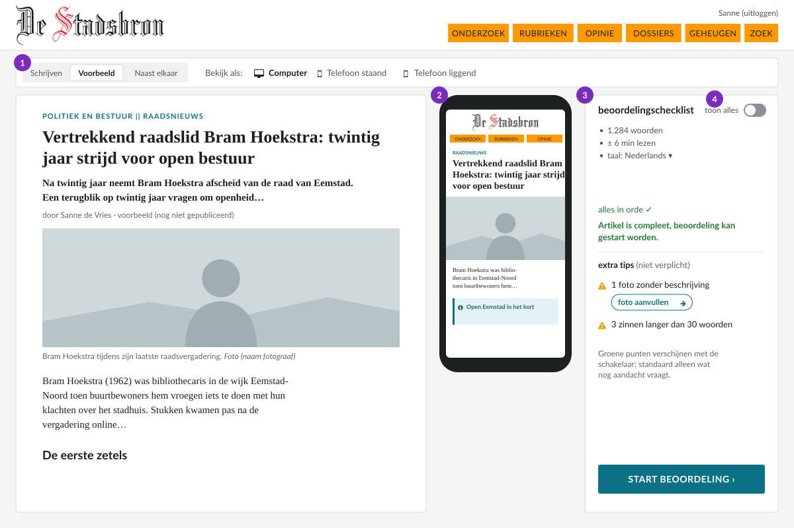

| # | Toelichting |
|---|---|
|  | **Voorbeeld** in de echte sitestijl, te bekijken als **computer**, **telefoon staand** of **telefoon liggend**. Een liggende telefoon wordt zo nodig verkleind tot hij in het voorbeeldvlak past. |
|  | Telefoonweergave: hoe het artikel op een smal scherm valt (foto, kader, citaat onder elkaar). |
|  | De **beoordelingschecklist**: bovenaan status en statistieken, daaronder alleen wat aandacht vraagt. Is alles in orde, dan staat er „alles in orde ✓”. De melding „Artikel is compleet, beoordeling kan gestart worden.” is ongewijzigd. |
|  | De schakelaar **toon alles**, rechts van de titel van de checklist, laat ook de groene punten zien. Downloaden als `.md` zit in de werkbalk boven de tekst. |

Spelling: de spellingcontrole van de browser of iOS doet zijn werk in het schrijfvlak (rode kronkels). Hypha voegt geen eigen woordenboek toe.

### Stap 8 – Beoordelen: opmerkingen, goedkeuren met het redactiestatuut, terugtrekken

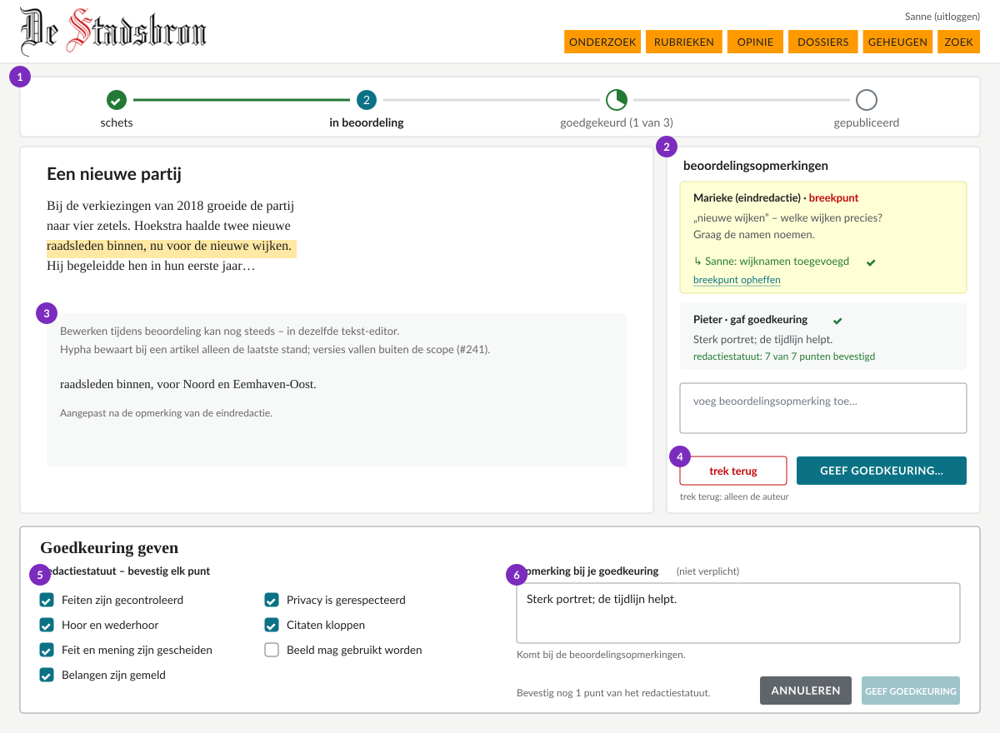

| # | Toelichting |
|---|---|
|  | De bestaande statussen als stappenbalk: schets → in beoordeling → goedgekeurd → gepubliceerd. Bij **1 of 2 van de 3 goedkeuringen** is het rondje van *goedgekeurd* voor een derde of twee derde **gevuld**, zodat je de voortgang ziet. |
|  | **beoordelingsopmerkingen** met **breekpunten**, zoals nu. Het opgemerkte tekstdeel wordt gemarkeerd. |
|  | De auteur verwerkt opmerkingen in dezelfde editor. Hypha bewaart bij een artikel met review **geen versies** (`Xml::versionsOff`), alleen de laatste stand. Versies van de Markdown-bron vallen **buiten de scope** (besluit, issue #241, BR-74); de schets toont daarom geen versievergelijking. |
|  | **trek terug** (alleen voor de auteur) en **geef goedkeuring…** (alleen voor beoordelaars: **de auteur keurt het eigen artikel niet goed**, BR-94). In werkelijkheid ziet ieder alleen zijn eigen knop; de schets toont ze voor de uitleg naast elkaar. Terugtrekken kan in *in beoordeling* en *goedgekeurd*: het artikel gaat terug naar *schets*, de goedkeuringen vervallen, de opmerkingen blijven staan (doorgestreept bij de vervallen goedkeuringen). |
|  | **Redactiestatuut**: wie goedkeurt, bevestigt elk punt. *Geef goedkeuring* werkt pas als alle punten zijn aangevinkt. In de beoordelingschecklist staat het redactiestatuut als eigen blok met per punt „bevestigd door n van 3”. De punten hier zijn voorbeelden uit gangbare journalistieke codes; elke site zet de eigen punten uit haar redactiestatuut in de instellingen. |
|  | **Opmerking bij je goedkeuring** (niet verplicht). Die komt bij de beoordelingsopmerkingen, zoals een gewone opmerking nu ook; Hypha bewaart nu bij een goedkeuring zelf geen tekst. |

### Stap 9 – Voorbeeld in krantenstijl, en het gepubliceerde artikel

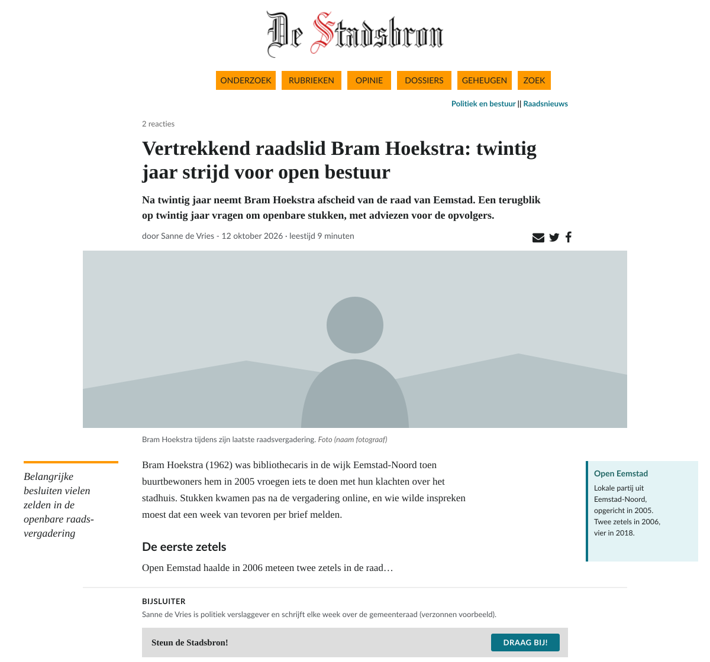

Het **voorbeeld voor de auteur** in de editor, zoals De Stadsbron er nu al uitziet, aangevuld met krantenelementen: logo en oranje menu, tags rechtsboven (*Politiek en bestuur || Raadsnieuws*), aantal reacties, grote **kop** in Lora, vette **intro** (het uittreksel), „door Sanne de Vries - datum” met leestijd en deelknoppen, **brede foto** met bijschrift en fotograaf, tussenkoppen, **citaat** in de marge, **kader** naast de tekst, en onderaan **BIJSLUITER**, het blok *Steun de Stadsbron!* met de knop **DRAAG BIJ!** en de reacties.

> [!note] Gepubliceerde leesweergave blijft zoals ze is
> De **leesweergave van een gepubliceerd artikel verandert niet** (besluit 20): de afbeelding en het uittreksel blijven in overzichten staan, zoals nu. Het **voorbeeld voor de auteur** toont wel de intro en de hoofdfoto bovenaan, met citaat en kader in de marge, zodat de auteur ziet hoe het stuk als krantenartikel valt. Kaders, citaten, figuren en diagrammen staan in de XHTML en krijgen in het gepubliceerde artikel de opmaak die het thema voor die elementen heeft. Voor de Lighthouse-eis krijgt de kop van de pagina wel `lang`, een `meta description` en scripts met `defer` ([§13.15](#1315-lighthouse)); dat is niet te zien.

### Onderweg – iPhone en iPad

De schetsen zijn op **ware grootte** in punten (pt): iPhone 15 staand (393 × 852 pt) en iPad Air 11" (820 × 1180 pt staand, 1180 × 820 pt liggend). Op een Retina-scherm is 1 pt gelijk aan 2 of 3 pixels. Op een smal scherm (iPhone staand) staan tekst en voorbeeld **nooit naast elkaar**: je wisselt tussen *Schrijven* en *Voorbeeld*.

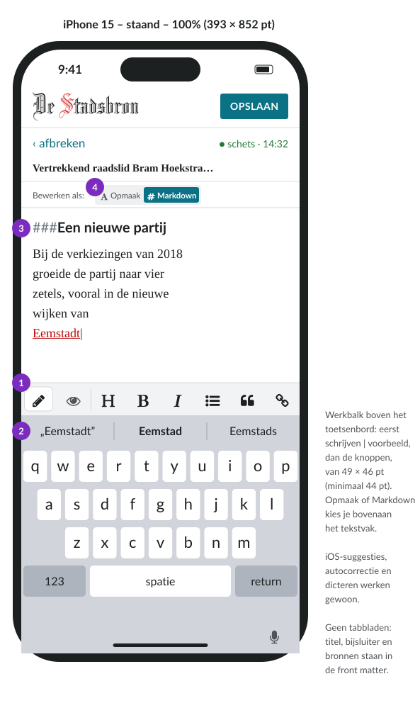

| # | Toelichting |
|---|---|
|  | **Werkbalk boven het toetsenbord**: eerst **schrijven \| voorbeeld**, dan de knoppen van 49 × 46 pt (Tussenkop, **B**, *I*, Lijst, Citaat, Link, …); de balk schuift opzij voor de rest. |
|  | Het gewone iOS-toetsenbord met **suggestiebalk**: autocorrectie, suggesties en dicteren blijven werken. Dat is een harde eis bij de keuze van de editorcomponent. |
|  | **Geen tabbladen**: titel, bijsluiter en bronnen staan in de Frontmatter van de tekst. Lopende tekst in Lora 18 pt. |
|  | **Bewerken als: Opmaak \| Markdown** bovenaan het tekstvak, ook op de telefoon; de balk blijft bovenaan staan bij scrollen. |

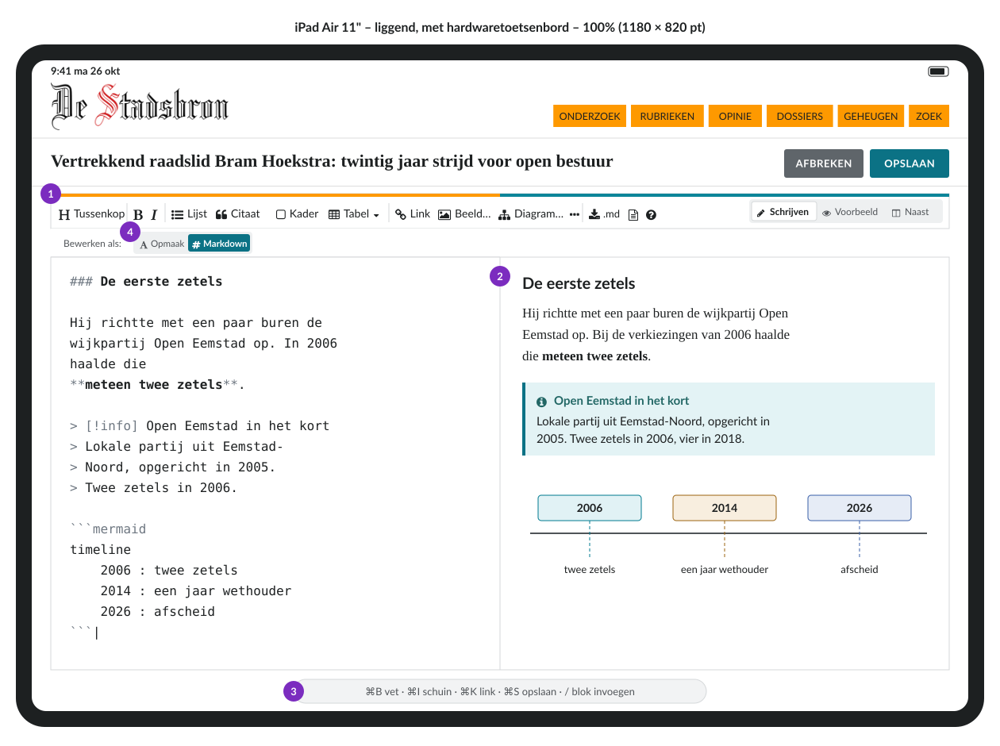

| # | Toelichting |
|---|---|
|  | Dezelfde werkbalk als op de computer: iconen met woorden, download, en rechts de weergave. |
|  | **Naast elkaar** vanaf 1024 pt breed; het voorbeeld volgt de plek waar je typt en scrolt gelijk op. |
|  | Met een **hardwaretoetsenbord** dezelfde sneltoetsen als op de computer (⌘ op Apple, Ctrl op Windows en Chromebook). |
|  | **Bewerken als** bovenaan het tekstkader, alleen boven de tekst; het voorbeeld rechts scrolt gelijk op met de tekst. |

#### Engelstalige schetsen

Alle schetsen bestaan ook in het Engels, met dezelfde maten en nummering. Ze zijn met dezelfde generator gemaakt, met een vertaaltabel; namen, code en de huisstijl blijven gelijk.

| Stap | Engelse schets |
|---|---|
| Huisstijl | [00-huisstijl.svg](20261026_MARKDOWN_EDITOR/img/en/00-huisstijl.svg) |
| 1 Starten | [01-starten.svg](20261026_MARKDOWN_EDITOR/img/en/01-starten.svg) |
| 2 Schrijven in Markdown | [02-schrijven.svg](20261026_MARKDOWN_EDITOR/img/en/02-schrijven.svg) |
| 2b Schrijven in Opmaak | [02b-opmaak.svg](20261026_MARKDOWN_EDITOR/img/en/02b-opmaak.svg) |
| 3 Structureren | [03-structureren.svg](20261026_MARKDOWN_EDITOR/img/en/03-structureren.svg) |
| 3b Tabel | [03b-tabel.svg](20261026_MARKDOWN_EDITOR/img/en/03b-tabel.svg) |
| 4 Beeld | [04-beeld.svg](20261026_MARKDOWN_EDITOR/img/en/04-beeld.svg) |
| 5 Koppelen | [05-koppelen.svg](20261026_MARKDOWN_EDITOR/img/en/05-koppelen.svg) |
| 6 Diagram | [06-diagram.svg](20261026_MARKDOWN_EDITOR/img/en/06-diagram.svg) |
| 6b Meer soorten diagrammen | [06b-diagramsoorten.svg](20261026_MARKDOWN_EDITOR/img/en/06b-diagramsoorten.svg) |
| 7 Controleren | [07-controleren.svg](20261026_MARKDOWN_EDITOR/img/en/07-controleren.svg) |
| 8 Beoordelen | [08-beoordelen.svg](20261026_MARKDOWN_EDITOR/img/en/08-beoordelen.svg) |
| 9 Gepubliceerd | [09-gepubliceerd.svg](20261026_MARKDOWN_EDITOR/img/en/09-gepubliceerd.svg) |
| iPhone | [10-iphone.svg](20261026_MARKDOWN_EDITOR/img/en/10-iphone.svg) |
| iPad | [11-ipad.svg](20261026_MARKDOWN_EDITOR/img/en/11-ipad.svg) |

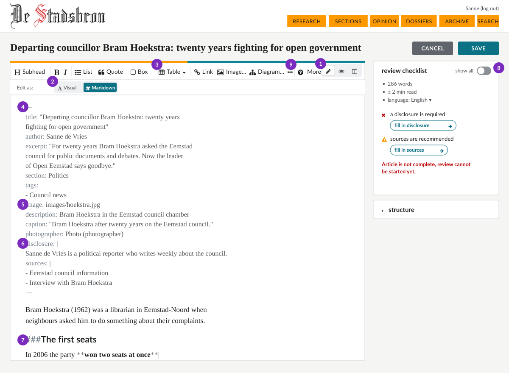

#### Schermafdrukken van het prototype

Gemaakt van het werkende prototype met de schermmaten van iPad Air 11" en iPhone 15 (100%, touch-emulatie, dus met aanraakvlakken van 44 pt):

| iPad Air liggend (1180 × 820 pt) | iPad Air staand (820 × 1180 pt) |
|---|---|
| 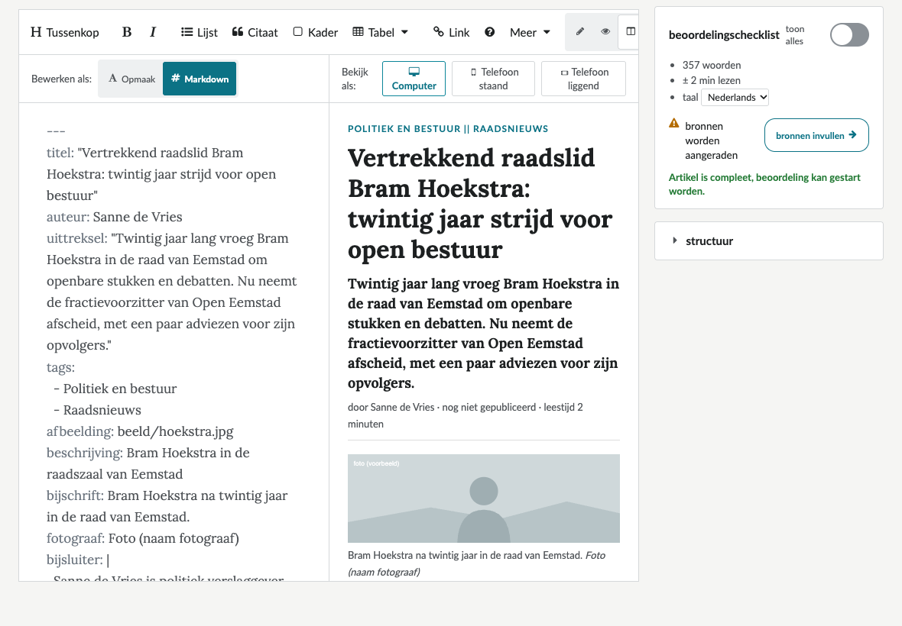 | 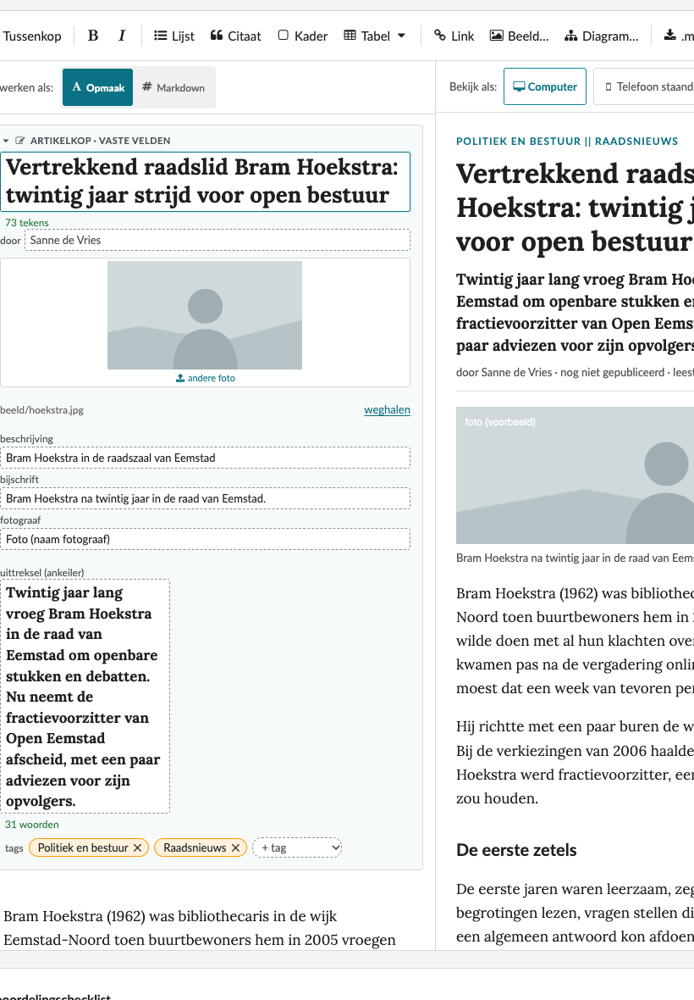 |

Op iPad Air **liggend** en **staand** (820 pt, nog een brede *size class*) staan tekst en voorbeeld naast elkaar en scrollen ze gelijk op; staand staat de checklist onder de editor.

| iPhone 15: schrijven (393 × 852 pt) | iPhone 15: voorbeeld |
|---|---|
| 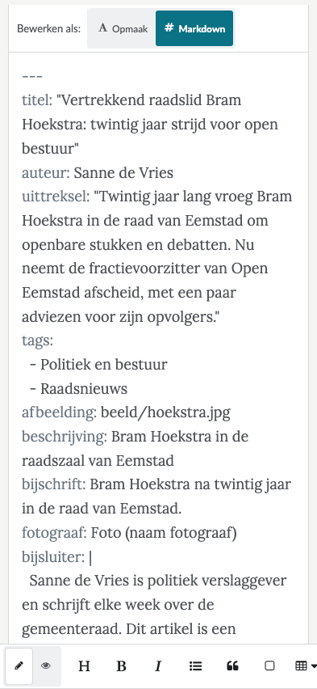 | 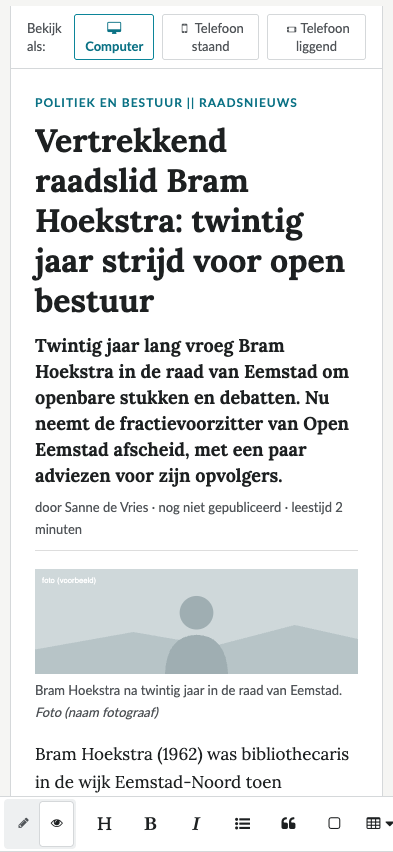 |

## 9. Artikelvelden: Hypha-XML, editor en Markdown-bestand

| XML (artikel met review) | Label in Hypha | In de nieuwe editor | In het `.md`-bestand |
|---|---|---|---|
| `context/title` | titel | Frontmatter regel 1 / artikelkop | eigenschap `titel` (regel 1) |
| `article/@author` | auteur | Frontmatter regel 2 / artikelkop | eigenschap `auteur` (regel 2) |
| `context/section` (nieuw) | rubriek | Frontmatter regel 4 / keuzelijst in de artikelkop | eigenschap `rubriek` (regel 4) |
| tags (`hypha.xml`) | tags | Frontmatter als lijst / labels in de artikelkop | eigenschap `tags` (lijst, na regel 4) |
| `context/excerpt` | uittreksel | Frontmatter regel 3 / artikelkop | eigenschap `uittreksel` (regel 3) |
| `context/featured_image` | afbeelding bij uittreksel | Frontmatter na de tags / afbeelding in de artikelkop | eigenschappen `afbeelding`, `beschrijving`, `bijschrift`, `fotograaf` (na de tags) |
| `content/text` | artikel | de tekst onder de Frontmatter / het artikel | de hoofdtekst |
| `context/method` | bijsluiter | Frontmatter `bijsluiter` (blok) / vast blok onderaan in Opmaak | eigenschap `bijsluiter` |
| `content/sources` | bronnen | Frontmatter `bronnen` (blok) / vast blok onderaan in Opmaak | eigenschap `bronnen` |
| taal (`hypha.xml`, `<language id>`) | taal | keuze in de checklist; vast na publicatie | – (bij export als `lang` in de Frontmatter) |
| `article/@status`, datums | status | statusbalk | eigenschappen `status`, `gepubliceerd` (alleen bij export) |
| discussies, goedkeuringen | – | blijven in Hypha | niet geëxporteerd |

In de editor bestaat de Frontmatter altijd uit precies deze eigenschappen, in deze volgorde: `titel`, `auteur`, `uittreksel`, `rubriek` (elk op één regel), `tags` (een lijst), de afbeelding bij het uittreksel (`afbeelding`, `beschrijving`, `bijschrift`, `fotograaf`), en `bijsluiter` en `bronnen` (elk een blok van meerdere regels). Bij export komt de status erbij. Hoe dit in de XML terechtkomt, staat in [§14](#14-projectie-op-de-xml-opslag). Andere eigenschappen (bijvoorbeeld `robots`, `lang` of `description` uit een HedgeDoc-notitie) blijven ongewijzigd bewaard, onder de vaste eigenschappen; de checklist meldt dat Hypha ze niet gebruikt. Zo ziet een geëxporteerd artikel eruit: gewone Markdown met Frontmatter, callouts, voetnoten en een diagram in Mermaid-notatie:

````markdown
---
titel: "Vertrekkend raadslid Bram Hoekstra: twintig jaar strijd voor open bestuur"
auteur: Sanne de Vries
uittreksel: "Twintig jaar lang vroeg Bram Hoekstra in de raad van Eemstad om openbare stukken en debatten. Nu neemt de fractievoorzitter van Open Eemstad afscheid."
rubriek: Politiek en bestuur
tags:
  - Politiek en bestuur
  - Raadsnieuws
afbeelding: beeld/hoekstra.jpg
beschrijving: Bram Hoekstra in de raadszaal van Eemstad
bijschrift: Bram Hoekstra na twintig jaar in de raad van Eemstad.
fotograaf: Foto (naam fotograaf)
bijsluiter: |
  Sanne de Vries is politiek verslaggever en schrijft elke week over de gemeenteraad.
bronnen: |
  - Raadsinformatie gemeente Eemstad (voorbeeldbron).
status: schets
---

Bram Hoekstra (1962) was bibliothecaris in de wijk Eemstad-Noord toen
buurtbewoners hem in 2005 vroegen iets te doen met hun klachten over het stadhuis.

### De eerste zetels

Hij richtte met een paar buren de wijkpartij Open Eemstad op. Bij de verkiezingen
van 2006 haalde die **meteen twee zetels**.[^1]

> [!quote] Citaat
> Een raadslid dat de stukken niet leest, controleert niemand

> [!info] Open Eemstad in het kort
> Lokale partij uit Eemstad-Noord, opgericht in 2005. Twee zetels in 2006, vier in 2018.

Meer over de raad in de reeks [[Raadsnieuws]].

%% beschrijving: tijdlijn van Bram Hoekstra in de gemeenteraad van Eemstad %%
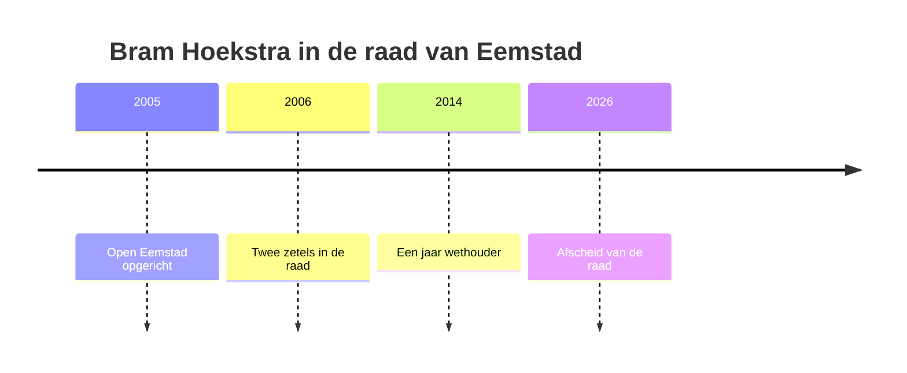

[^1]: Raadsinformatie gemeente Eemstad, 2006 (voorbeeldbron).
````

Een **tekstpagina** heeft alleen een `titel` in de Frontmatter (de paginanaam zoals Hypha hem toont); de rest is tekst.

## 10. Ondersteunde Markdown-syntaxis

**Versie.** De editor gebruikt het profiel **Hypha-Markdown 1.0**:

| Laag | Versie | Bron |
|---|---|---|
| CommonMark | **0.31.2** (januari 2024, de laatste versie van de specificatie) | [spec.commonmark.org/0.31.2](https://spec.commonmark.org/0.31.2/) |
| GitHub Flavored Markdown | **0.29-gfm** (april 2019): tabellen, doorhalen, takenlijsten, autolinks | [github.github.com/gfm](https://github.github.com/gfm/) |
| Uitbreidingen | YAML-Frontmatter (vaste eigenschappen), voetnoten, callouts `> [!type]`, `[[…]]`, `==…==`, `{.klasse}` achter een afbeelding, `%% … %%`, Mermaid-notatie | hieronder |

Op de server is dat **league/commonmark ≥ 2.5.3** (volgt CommonMark 0.31.1; 0.31.2 verschilt alleen in de datering), in de browser een parser die dezelfde specificatie volgt. De versie staat in de bron als attribuut (`<source format="markdown" profile="hypha-1.0">`), zodat een latere versie oude teksten herkent.

De basis is **CommonMark** met de uitbreidingen van **GitHub Flavored Markdown** (GFM). Daarbovenop een paar gangbare uitbreidingen die veel Markdown-programma's kennen; waar een ander programma ze niet kent, blijven ze leesbare tekst.

| Syntaxis | Voorbeeld | Hypha | Elders | Fase |
|---|---|---|---|---|
| CommonMark-basis (koppen, vet, schuin, lijsten, citaat, code, links, afbeeldingen) | `### Kop`, `**vet**` | ✓ | standaard | 1 |
| GFM-tabellen, doorhalen, takenlijst, autolinks | `\| a \| b \|`, `~~x~~`, `- [ ]` | ✓ | standaard (GFM) | 1 |
| Uitlijnen per kolom in een tabel | `\| :--- \| :---: \| ---: \|` | ✓ via het menu *Tabel* | standaard (GFM) | 1 |
| Voetnoten | `tekst[^1]` | ✓ | gangbaar (o.a. GFM) | 1 |
| Frontmatter (YAML) | `---\ntitel: …\nauteur: …\nuittreksel: …\nrubriek: …\ntags:\n  - …\nafbeelding: …\nbeschrijving: …\nbijschrift: …\nfotograaf: …\nbijsluiter: \|\n  …\nbronnen: \|\n  …\n---` | ✓ vaste eigenschappen bovenaan de tekst; `\|` voor een blok van meerdere regels | gangbaar | 1 |
| Links naar pagina's | `[[Pagina]]`, `[[Pagina\|tekst]]` | ✓ → Hypha-pagina-id | gangbare uitbreiding (wikilinks) | 1 |
| Callouts | `> [!info] Titel`, `> [!quote]`, `> [!warning]` | ✓ → kader / citaat | gangbaar; GitHub kent vergelijkbare *alerts* | 1 |
| Markeren | `==tekst==` | ✓ → `<mark>` | gangbare uitbreiding | 1 |
| Subscript en doorhalen | `~sub~`, `~~weg~~` | ✓ enkele tilde zonder spatie is subscript (HedgeDoc), dubbele is doorhalen (bouw; GFM kent ook enkele tilde als doorhalen) | gangbaar | 1 |
| Diagram (Mermaid-notatie) | ` ```mermaid `, met plaatsing ` ```mermaid {.klein-rechts} ` | ✓ (Pele), 36 soorten met voorbeeld | gangbaar (o.a. GitHub, GitLab); de plaatsing wordt elders genegeerd | 1 |
| Bijschrift | cursieve regel direct onder een afbeelding | ✓ → `<figcaption>` | leesbaar als cursieve tekst | 1 |
| Plaatsing van beeld | `{.breed}` achter de afbeelding | ✓ | attributen-uitbreiding (league/commonmark *Attributes*); elders zichtbaar als tekst | 1 |
| Notitie | `%% notitie %%` | ✓ niet getoond aan lezers | uitbreiding; elders zichtbaar als tekst | 1 |
| Tags in de tekst | `#gemeenteraad` | – (tags via het tagveld) | uitbreiding | later |
| Wiskunde | `$E=mc^2$`, `$$…$$` | ✓ als MathML (Temml), zie [§10.1](#101-flexibiliteit-eigen-html-javascript-en-uitbreidingen) | gangbaar (GitHub, HedgeDoc, Obsidian) | 1 |
| Codemarkering | ` ```php `, ` ```sql ` | ✓ kleuren per taal (highlight.php, in de editor highlight.js), zie [§10.1](#101-flexibiliteit-eigen-html-javascript-en-uitbreidingen) | standaard (taal achter ```) | 1 |
| Eigen HTML | `<details>`, `<kbd>`, `<span class>` | ✓ uit een toegestane lijst, zie [§10.1](#101-flexibiliteit-eigen-html-javascript-en-uitbreidingen) | standaard (CommonMark) | 1 |
| Hypha-macro's | `<macro name="pagelist" tags="Raadsnieuws"/>` | – niet gebouwd (besluit 17): blijft letterlijk in de bron, niet in de XHTML | alleen Hypha | – |
| Ingesloten inhoud | een losse link naar YouTube, Vimeo, OpenStreetMap, Datawrapper | ✓ niveau 2 | gangbaar (HedgeDoc 2, Obsidian) | 2 |
| Interactief blok | ` ```html interactief {hoogte=420} ` met HTML, CSS en JavaScript | ✓ niveau 2, in een afgeschermd iframe | elders zichtbaar als code | 2 |
| HedgeDoc-kaders | `:::info` … `:::` | ✓ als kader, zie [§10.2](#102-hedgedoc-compatibiliteit) | HedgeDoc | 2 |

### 10.1 Flexibiliteit: eigen HTML, JavaScript en uitbreidingen

**Doel.** Voor gevorderd gebruik moet de Markdown uitbreidbaar zijn: eigen HTML, ingesloten inhoud en eigen JavaScript in het resultaat. Tegelijk mag een gewone auteur niet per ongeluk of met opzet de site of de sessie van een collega kunnen aantasten. Dit doel staat in de randvoorwaarden ([§3.4](#34-randvoorwaarden-waar-een-oplossing-aan-moet-voldoen)).

**Uitgangspunten.**

1. CommonMark staat HTML-blokken en inline-HTML toe; Hypha laat eigen HTML door **uit een toegestane lijst**, met één filter op de server ([§13.5](#135-html-filter-voor-niveau-1-en-2)).
2. Het voorbeeld in de editor gebruikt dezelfde lijst, zodat de auteur ziet wat de lezer krijgt.
3. **Onbekende blokken blijven letterlijk staan**: wat de editor niet kent, gaat bij wisselen en opslaan ongewijzigd terug in de bron.
4. Eigenschappen in de Frontmatter die Hypha niet kent (bijvoorbeeld uit HedgeDoc), blijven bewaard.
5. Diagrammen alleen in Mermaid-notatie via Pele, zonder JavaScript-callbacks; Graphviz en ABC blijven codeblokken.
6. **Geen inhoud die alleen via JavaScript bestaat** ([§12.10](#1210-ai-vriendelijke-html)): JavaScript mag alleen iets toevoegen aan inhoud die er al staat.
7. De opslag is **XHTML in XML**: het filter schrijft welgevormde XHTML en de bron staat in CDATA.
8. Hypha's eigen controle (`validateHtmlField()` in `system/core/document.php`) weigert alleen `<script>`. Die blijft ongewijzigd; de nieuwe editor heeft een eigen, explicieter beleid.
9. Hypha's eigen interface gebruikt inline `onclick` en `<script>`, dus een strenge Content-Security-Policy is nu niet mogelijk. JavaScript van auteurs draait daarom **alleen in een afgeschermd iframe**.

**Wat de gekozen componenten ondersteunen.**

| Component | Eigen HTML | JavaScript | Uitbreiden | Bron |
|---|---|---|---|---|
| CommonMark 0.31.2 (specificatie) | ja: zeven soorten HTML-blokken en inline-HTML | niet apart geregeld: `<script>` is een HTML-blok | – | [spec](https://spec.commonmark.org/0.31.2/#html-blocks) |
| GFM *tagfilter* | filtert `title`, `textarea`, `style`, `xmp`, `iframe`, `noembed`, `noframes`, `script`, `plaintext` | `<script>` geblokkeerd | – | [GFM](https://github.github.com/gfm/#disallowed-raw-html-extension-) |
| **league/commonmark 2.x** (server) | `html_input`: standaard doorlaten, of `escape` of `strip`; *Disallowed Raw HTML* met een **instelbare** lijst; *Attributes* (`{#id .klasse}`) | `allow_unsafe_links` staat standaard aan (`javascript:`-links); de documentatie raadt `strip`/`escape` en `false` aan voor onbetrouwbare invoer | eigen blok- en inline-parsers en renderers; extensies *Embed* (oEmbed), *Table of Contents*, *Heading Permalinks*, *Smart Punctuation* | [security](https://commonmark.thephpleague.com/2.x/security/), [extensies](https://commonmark.thephpleague.com/2.x/extensions/overview/) |
| markdown-it (voorbeeld en Opmaak) | laat HTML door met `html: true` | filtert zelf niets; het voorbeeld gaat door DOMPurify met de lijst van Hypha | plug-ins voor blokken en inline-elementen | [markdown-it](https://github.com/markdown-it/markdown-it) |
| DOMPurify (voorbeeld) | standaard veilige set; uit te breiden met `ADD_TAGS` en `ADD_ATTR` | verwijdert `<script>` en `on…`-attributen; met *hooks* kan bijvoorbeeld een `<iframe>` alleen voor bepaalde domeinen | instellingen en hooks | – |
| CodeMirror 6 (Markdown-weergave) | bewerkt elke tekst; HTML en code in Markdown krijgen eigen kleuren | voert niets uit | volledig uitbreidbaar | – |
| ProseMirror met prosemirror-markdown (Opmaak-weergave) | onbekende HTML wordt in het schema van Hypha een ondeelbaar blok met de **broncode zichtbaar**, dat bij terugschrijven ongewijzigd teruggaat | voert niets uit | eigen nodes en markdown-it-plug-ins (kaders, ingesloten inhoud, figuren) | [prosemirror-markdown](https://github.com/ProseMirror/prosemirror-markdown) |
| Pele (diagrammen) | – | negeert JavaScript-callbacks; ontsnapt tekst, filtert links en stijlen | alleen Mermaid-notatie | [pele.run](https://pele.run) |
| Hypha | XHTML met **macro's**: `<macro name="pagelist" …/>` en `now`, bij het tonen uitgevoerd | weigert alleen `<script>` in editorvelden | nieuwe macro's als PHP-bestand in `system/macros/` | `system/core/macros.php` |

**Twee niveaus van vrijheid.** Niveau 2 staat aan; een beheerder kan het per rol uitzetten. Het niveau van een artikel wordt bij opslaan vastgelegd en is zichtbaar in de checklist.

| Niveau | Wie | Wat mag | Hoe |
|---|---|---|---|
| **1. Standaard** | alle auteurs | Hypha-Markdown 1.0 plus eigen HTML uit een toegestane lijst: `details`, `summary`, `kbd`, `abbr`, `sub`, `sup`, `ins`, `del`, `mark`, `small`, `figure`, `figcaption`, `table` en onderdelen, `span` en `div` met `class` | eigen filter op de server ([§13.5](#135-html-filter-voor-niveau-1-en-2)): geen `on…`, geen `style` in HTML, geen `javascript:` |
| **2. Ingesloten inhoud en interactieve blokken** (**standaard voor De Stadsbron**) | alle auteurs; per rol uit te zetten | (a) een losse link naar een bekende dienst wordt een ingesloten speler of kaart, voor **zoveel mogelijk diensten** (besluit 23): YouTube via `youtube-nocookie.com`, Vimeo, OpenStreetMap, Datawrapper, Flourish, Infogram, Google Maps, Spotify, SoundCloud, Mixcloud, PeerTube, Internet Archive, Bandcamp, Scribd en DocumentCloud; (b) een **interactief blok** met eigen HTML, CSS en **JavaScript**, dat in een afgeschermd `<iframe>` draait (zie hieronder) | (a) `<iframe>` alleen naar die domeinen, met `sandbox`, `loading="lazy"`, `referrerpolicy` en een titel; de lijst is instelbaar. Diensten die alleen via een eigen script insluiten (zoals X en Instagram), kunnen niet als `<iframe>`. (b) `<iframe sandbox="allow-scripts" srcdoc="…">` zonder `allow-same-origin` |

**Niet gebouwd** (besluit 17): Hypha-macro's in de tekst en vrije HTML met `<script>` of `<style>` in de pagina. Staat zoiets in een Markdown-bron (bijvoorbeeld na het openen van een `.md`-bestand), dan blijft het letterlijk in de bron staan, maar haalt het filter het uit de XHTML. In Opmaak verschijnt het als grijs blok „HTML (bewerk in Markdown)”, en de checklist meldt dat het niet wordt getoond.

**Besluit: niveau 2 is de standaard, met JavaScript in een afgeschermd iframe.** Op niveau 2 kan een auteur eigen JavaScript gebruiken, maar alleen in een **interactief blok**. Dat blok draait in een `<iframe>` met `sandbox="allow-scripts"` en **zonder** `allow-same-origin`. De browser geeft het daardoor een eigen, anonieme herkomst:

1. het script kan niet bij de cookies, de inlogsessie, de `localStorage` of de pagina van Hypha, en dus niet bij de sessie van een beoordelaar of beheerder;
2. het kan de pagina niet wegsturen (geen `allow-top-navigation`), geen formulieren versturen (geen `allow-forms`) en geen pop-ups openen (geen `allow-popups`);
3. het mag wel tekenen, rekenen en reageren op klikken: een rekenhulp, een interactieve grafiek met een bibliotheek als D3 of Chart.js, een kwis, een kaart.

In Markdown is het een codeblok met een eigen taal, zodat andere Markdown-programma's het gewoon als code tonen:

````markdown
%% beschrijving: rekenhulp: wat betaal je aan afvalstoffenheffing in 2027? %%
```html interactief {hoogte=420}
<label>Aantal personen <input id="n" type="number" value="2"></label>
<p id="uit"></p>
<script>
  const t = { 1: 312, 2: 389 };
  const r = () => uit.textContent = '€ ' + (t[n.value] ?? 425);
  n.oninput = r; r();
</script>
```
````

Regels voor het interactieve blok:

1. **Beschrijving verplicht**: de `%% beschrijving %%` wordt de titel van het iframe (voor voorleessoftware) en de tekst die lezers zonder JavaScript, zoekmachines en AI zien. Zo blijft de eis „geen inhoud die alleen via JavaScript bestaat” overeind.
2. **Hoogte**: vast met `{hoogte=…}`, of het blok meldt zijn hoogte met `postMessage`; Hypha luistert alleen naar berichten van dat ene iframe.
3. **Externe scripts**: standaard alleen van een instelbare lijst (bijvoorbeeld cdnjs en jsDelivr), via een Content-Security-Policy in de `srcdoc` zelf.
4. **Opslag**: de broncode staat in de Markdown; in de XHTML staat het `<iframe>` met de code in het `srcdoc`-attribuut, dus zonder `<script>` in de pagina. De bestaande controle van Hypha op `<script>` blijft daardoor kloppen.
5. **Editor**: in Opmaak een grijs blok „interactief blok” met een knop *bewerken* (codevenster links, werkend voorbeeld rechts, net als de diagramdialoog); de checklist meldt een interactief blok zonder beschrijving.

Let op: een `srcdoc`-iframe neemt een Content-Security-Policy van de pagina over. Hypha heeft nu geen CSP; komt die er, dan moet ze rekening houden met deze blokken.

**Eis: niets gaat verloren.** Wat de editor niet begrijpt, blijft letterlijk in de Markdown staan. In Opmaak verschijnt het als grijs blok „HTML (bewerk in Markdown)”; heen en terug wisselen verandert de bron niet. Een auteur voor wie niveau 2 uit staat, ziet interactieve blokken en ingesloten inhoud wel, maar kan ze niet wijzigen.

**Modules codemarkering en wiskunde.** Beide horen bij de eerste oplevering ([§18](#18-scope-en-begroting), onderdelen 14 en 15).

| Wat | Voorstel | Licentie | Lezers zonder JavaScript |
|---|---|---|---|
| **Codemarkering** voor een aantal talen (bijv. PHP, JavaScript, SQL, Python, HTML, CSS, JSON, YAML, Bash, XML) | op de server met **highlight.php** (`scrivo/highlight.php`, PHP-versie van highlight.js) bij het renderen; in de editor via CodeMirror 6 (`@codemirror/language-data`). Alternatief: highlight.js of Prism in de browser | BSD-3 (highlight.php, highlight.js), MIT (Prism, CodeMirror) | ja, als het op de server gebeurt; de kleuren komen uit het thema |
| **Wiskundige formules** in LaTeX-notatie: `$…$` inline en `$$…$$` als blok (zoals HedgeDoc, GitHub en Obsidian) | in de browser van de auteur omzetten naar **MathML** en die bij opslaan meesturen, net als de diagram-SVG (optie B in [§12.3](#123-diagrammen-mermaid-notatie-getekend-met-pele)). Kandidaten: **Temml** (klein, alleen MathML) of **KaTeX** met uitvoer `mathml`; MathJax als terugvaloptie | MIT (Temml, KaTeX), Apache-2.0 (MathJax) | ja: MathML tonen Chrome, Edge, Safari en Firefox zonder JavaScript; ook voorleessoftware leest het voor |

Beide passen in de randvoorwaarden: geen Node.js op de server, permissieve licentie, en de LaTeX-bron blijft in de Markdown staan.

Uitwerking:

1. **Wiskunde.** De notatie volgt de regel van pandoc en GitHub: na de openende `$` geen spatie, voor de sluitende `$` geen spatie en direct erna geen cijfer, dus `$10 tot $20` is geen formule. Binnen code (`` `…` `` en codeblokken) is `$` gewoon een teken. `$$` op een eigen regel opent en sluit een blok. De keuze valt op **Temml** (MIT, ca. 170 kB, alleen MathML): kleiner dan KaTeX en zonder eigen lettertypes, omdat de browser de MathML zelf zet. De editor zet de formule om bij typen; bij opslaan gaat de MathML mee en de server laat alleen MathML-elementen uit een allowlist door (zoals bij de diagram-SVG). In Opmaak is een formule één blokje: een dubbelklik opent de LaTeX, de knop *Formule* voegt er een toe. Een formule die niet klopt, staat rood in de tekst met de melding als tooltip, en de checklist geeft een tip (BR-46).
2. **Codemarkering.** Een codeblok met een taal achter de ```` ``` ```` krijgt kleuren per taal: in de editor met **highlight.js** (BSD-3), op de server met **highlight.php** (BSD-3), dat dezelfde taaldefinities en klassenamen gebruikt, zodat voorbeeld en gepubliceerd artikel gelijk zijn. Een onbekende taal blijft gewone code. De kleuren komen uit het thema en halen een contrast van ten minste 4,5:1 op de achtergrond van het codeblok (WCAG 1.4.3).
3. **Prototype.** Het klikbare prototype bevat beide: Temml 0.14.0 en highlight.js 11.12.0, de knop *Formule* in de werkbalk, *Formule* en *Code* in het `/`-menu, regels in het spiekbriefje en een formule in het voorbeeldartikel.

### 10.2 HedgeDoc-compatibiliteit

[HedgeDoc](https://hedgedoc.org) is een open-source editor om samen Markdown te schrijven. De code valt onder **AGPLv3**, die buiten de licentie-eis valt ([§3.4](#34-randvoorwaarden-waar-een-oplossing-aan-moet-voldoen)); er wordt dus geen code van overgenomen. De **notatie** (*HedgeDoc Flavored Markdown*, HFM) is wel na te bouwen met permissieve componenten, zodat notities uit HedgeDoc grotendeels over te nemen zijn:

| HedgeDoc (HFM 1) | In Hypha | Niveau |
|---|---|---|
| YAML-metadata `title`, `tags`, `description`, `lang`, `robots`, `breaks` | `title` en `tags` worden de vaste velden; de rest blijft bewaard | 1 |
| `:::info`, `:::success`, `:::warning`, `:::danger` … `:::` | kader; bij export als `> [!info]` | 1 |
| `==gemarkeerd==`, `~~doorgehaald~~`, voetnoten, takenlijsten, definitielijsten, afkortingen | grotendeels al ondersteund; definitielijsten en afkortingen via league/commonmark-extensies | 1 |
| `++ingevoegd++`, `^super^`, `~sub~` | als `<ins>`, `<sup>`, `<sub>` | 1 |
| `[TOC]` | inhoudsopgave (extensie *Table of Contents*) | 1 |
| afbeeldingsgrootte `` | omzetten naar breedte en hoogte | 1 |
| ` ```mermaid ` | Pele | 1 |
| ` ```sequence `, ` ```flow `, ` ```graphviz `, ` ```abc ` | blijven codeblokken (Pele tekent ze niet) | – |
| `$…$`, `$$…$$` | wiskunde als MathML | 1 |
| ` ```javascript=101 ` (regelnummers) | codemarkering; regelnummers optioneel | 1 |
| ``, ``, ``; in HFM 2 een losse link | ingesloten inhoud | 2 |
| eigen HTML (HedgeDoc 1 laat via de `xss`-bibliotheek o.a. `style` en `iframe` toe, geen `script`) | volgens de niveaus hierboven | 1–2 |
| `type: slide` (presentatiemodus) | niet ondersteund; de tekst blijft leesbaar | – |

## 11. Krantenartikel-elementen (zoals op nrc.nl)

| Element | Oplossing in Hypha | Bron in de XML |
|---|---|---|
| Rubriek (kicker) | eigen veld *rubriek*, één keuze uit de rubrieken van de site (besluit 21); in het voorbeeld klein boven de kop | `section` (nieuw) |
| Kop | titel | `title` |
| Intro (chapeau) | uittreksel, vet onder de kop | `excerpt` |
| Auteur, datum, leestijd | „door … · datum tijd · leestijd x min” (leestijd berekend) | `@author`, `@published_at` |
| Hoofdfoto met bijschrift en fotograaf | afbeelding bij uittreksel | `featured_image` |
| Tussenkoppen | `###` (H3), zoals in de huidige artikelen; `####` voor een subkop. H1 is de paginatitel, H2 gebruikt Hypha voor *bijsluiter* en *opmerkingen* | `text` |
| Citaat (in kranten ook *streamer* of *pull quote*) | callout `> [!quote]` | `text` |
| Kader / infobox | callout `> [!info]`, `> [!tip]`, `> [!warning]` | `text` |
| Foto in de tekst met bijschrift | afbeelding + cursieve regel | `text` |
| Grafiek of tijdlijn | Mermaid-blok | `text` |
| Tabel | GFM-tabel, met uitlijnen per kolom; in Opmaak via het menu *Tabel* | `text` |
| Voetnoten | `[^1]` | `text` |
| Over de auteur / verantwoording | bijsluiter | `method` |
| Bronnen | bronnen | `sources` |
| Lees ook | `[[…]]`-links, eventueel als kader | `text` |

## 12. Technische keuzes (PHP 8.2)

> Dit hoofdstuk beschrijft de eisen en de mogelijkheden. Elke keuze is met een proef getoetst en vastgelegd in het [technisch ontwerp](#13-technisch-ontwerp-proeven-en-keuzes); de uitkomst staat er hier bij.

### 12.1 Server: Markdown naar XHTML in PHP

| Bibliotheek | Licentie | PHP | Kenmerken | Beoordeling |
|---|---|---|---|---|
| **league/commonmark 2.x** | BSD-3 | ≥ 7.4 | Volledig CommonMark + GFM, extensies voor voetnoten, attributen, inhoudsopgave en eigen extensies (geschikt voor `[[…]]`, callouts, `==…==`). Actief onderhouden. | **Gekozen** (T1): 652 van 652 voorbeelden van CommonMark 0.31.2, 24 van 24 van GFM, geen meldingen op PHP 8.2 en 8.4, 35 ms voor 18.000 woorden. Zeven afhankelijkheden, meegeleverd zonder Composer op de server. |
| Parsedown + ParsedownExtra | MIT | 7.x/8.x | Eén bestand, snel, Markdown Extra (voetnoten, attributen). | Afgevallen: 341 van 652 voorbeelden; ParsedownExtra geeft ruim 6.000 meldingen op PHP 8.2. |
| michelf/php-markdown (Extra) | BSD-3 | ≥ 7.4 | Markdown Extra, voetnoten, attributen. Stabiel. | Afgevallen: 391 van 652 voorbeelden, 2 van 24 van GFM. |
| cebe/markdown | MIT | 5.4+ | GFM-variant, klein. | Niet getoetst: nauwelijks onderhoud. |

**Waarom op de server renderen**: lezers krijgen gewone HTML (ook zonder JavaScript en voor zoekmachines, dus de **SEO blijft gelijk**), de bestaande diff, versies en `wikify_html()` blijven werken op XHTML, en er is één plek om onveilige HTML te filteren.

### 12.2 Browser: editorcomponent

De editor heeft **twee weergaven op dezelfde Markdown-bron**: *Markdown* (tekst met gedimde tekens) en *Opmaak* (zoals Word). Daarvoor is een combinatie nodig, in gewoon JavaScript.

| Component | Licentie | iOS/iPadOS | Rol | Geen build nodig | Opmerkingen |
|---|---|---|---|---|---|
| **CodeMirror 6** (+ eigen Hypha-laag) | MIT | goed: `contenteditable` met native invoer | **Markdown**-weergave met gedimde tekens | ja, als ES-modules met een import map | **Gekozen** (T4): typen bij 20.000 woorden in 4,5 ms (mediaan), syntaxboom, alleen het zichtbare deel getekend. |
| **ProseMirror** met prosemirror-markdown, op markdown-it | MIT | goed | **Opmaak**-weergave | na eenmalig bundelen | **Gekozen** (T5): 15 pakketten, één parser met het voorbeeld; eigen schema en serializer voor Hypha-Markdown. |
| Milkdown (op ProseMirror) | MIT | goed | Opmaak, met Markdown als opslag | na eenmalig bundelen | Afgevallen: 87 pakketten en 228 modules; verandert zonder eigen uitbreidingen 39 tot 55% van de regels, waaronder formules; de Hypha-uitbreidingen zouden dubbel moeten. |
| Tiptap (op ProseMirror) | MIT (kern) | goed | Opmaak | ja | Niet gekozen: Markdown-ondersteuning is een extensie, en een deel van de extensies is commercieel. |
| Toast UI Editor | MIT | redelijk | beide weergaven in één | ja | Kant-en-klaar met beide modi, maar groot en weinig onderhoud sinds enkele jaren. |
| EasyMDE (op CodeMirror 5) | MIT | matig | Markdown | ja | Niet gekozen: CodeMirror 5 wordt niet meer ontwikkeld. De terugvaloptie is de textarea van het prototype. |
| OverType | MIT | goed (gewone `<textarea>`) | Markdown | ja | Zonder afbeeldingen, tabellen en geneste lijsten; niet geschikt voor krantenartikelen. |
| TinyMCE 7, CKEditor 5 | GPL of commercieel | – | – | – | **Uitgesloten** door de licentie-eis. |

Het **prototype** gebruikt bewust eenvoudiger techniek: een `<textarea>` met een opgemaakte laag eronder voor Markdown, en `contenteditable` met een eigen omzetting naar Markdown voor Opmaak. Dat volstaat om het gebruik te toetsen (heen en terug wisselen gaf in de test geen verschil in de Markdown), maar is niet bedoeld voor productie.

Eis aan elke kandidaat, te toetsen in het technisch prototype: **op iOS werken autocorrectie, woordsuggesties, dicteren en tekst selecteren met de vergrootloep**, in beide weergaven. Verder moet de component een **plakhaak** hebben voor de omzetting van [§12.15](#1215-acceptatiecriteria-plakken-uit-word-google-docs-en-libreoffice) en de **prestatie-eisen** van [§12.16](#1216-prestatie-eisen) halen.

### 12.3 Diagrammen: Mermaid-notatie, getekend met Pele

**Pele** ([pele.run](https://pele.run), [npm-pakket](https://www.npmjs.com/package/pele), MIT) is een JavaScript-bibliotheek die Mermaid-notatie naar SVG tekent, zonder afhankelijkheden:

1. **Klein en snel**: 230 kB gzip tegen 1,6 MB voor mermaid.js. In het prototype gemeten (Chromium, mediaan van 7): **0,1 ms** (taart) tot **0,7 ms** (stroomschema) per diagram; alleen de eerste keer kost laden en opwarmen circa 200 ms. Mermaid.js deed er in dezelfde test 24–84 ms over.
2. **Synchroon**: `render(tekst)` geeft direct de SVG terug.
3. **Foutmeldingen met regel en kolom** (`PeleError.line`, `.column`, `.code`), handig voor Nederlandse foutmeldingen in de diagramdialoog.
4. **Thema via CSS-variabelen**, dus aan te sluiten op het thema van de site.
5. **Alle diagramtypen van Mermaid 12.1**, behalve externe plug-ins (zoals ZenUML). Pele gebruikt een eigen layout, dus een diagram ziet er net iets anders uit dan in mermaid.js. JavaScript-callbacks in diagrammen worden genegeerd (veiliger).
6. **Soorten in de editor**: 36 soorten met een Nederlands voorbeeld, de vijf meest gebruikte als knop en 31 in een lijst met voorbeeld, waarvan elf technische (zie [stap 6b](#stap-6b--meer-soorten-diagrammen)).
7. **Editor**: Pele heeft een eigen *Playground* op pele.run (tekst en tekening naast elkaar). Inbouwen is niet nodig: de diagramdialoog in dit ontwerp doet hetzelfde. Een link naar de Playground stuurt de diagramtekst naar die site en staat daarom standaard uit.
8. **Risico**: het project is jong (eerste versies in oktober 2026, soms meerdere releases per dag). Daarom een vaste versie meeleveren (in het prototype `1.10.1`) en mermaid.js als terugvaloptie houden.

**Diagramtekst in een attribuut.** DOMPurify (vanaf 3.1) verwijdert attribuutwaarden met `-->`, en die pijl staat in elk stroomschema. Waar de diagramtekst in een attribuut staat (in de editor), staat hij daarom URI-gecodeerd. Op de server komt de SVG in de XHTML en de bron in de Markdown, dus daar speelt het niet.

**Hoe vaak wordt een diagram bijgewerkt?** Kort nadat je stopt met typen (*debounce*):

| Waar | Wachttijd na laatste toets | Tekenen | Totaal |
|---|---|---|---|
| Diagramdialoog | 120 ms | 0,1–0,7 ms | ± 120 ms |
| Voorbeeld naast de tekst | 250 ms, plus ± 13 ms voor de Markdown | alleen als de tekst van dát diagram veranderde, anders uit de cache | ± 265 ms |

**Renderen zonder Node.js op de server.** Pele draait in de browser. De opties:

| Optie | Hoe | Oordeel |
|---|---|---|
| A. In de browser van de lezer | Pele tekent bij het lezen; de diagramtekst en de beschrijving staan in de HTML | werkt, maar lezers zonder JavaScript, zoekmachines en AI zien geen tekening |
| **B. In de browser van de auteur, bij opslaan** | de editor tekent het diagram voor het voorbeeld; bij *opslaan* gaat de SVG mee naar de server, gekoppeld aan de SHA-256 van de bron, en gaat door het filter | **gekozen** (T8): lezers krijgen een kant-en-klare SVG, geen Node.js op de server, geen diagrambibliotheek naar elke lezer |
| C. Externe dienst | de server stuurt de diagramtekst naar een dienst die een plaatje teruggeeft | afgewezen: inhoud naar een derde partij en afhankelijk van een externe dienst |
| D. Pele of mermaid-cli op de server | server rendert zelf | afgewezen: vraagt een JavaScript-runtime (Node.js) op de server |

### 12.4 Import en export van Markdown

1. **Markdown naar HTML**: zie [§12.1](#121-server-markdown-naar-xhtml-in-php).
2. **Import en export** van `.md`-bestanden geldt alleen voor artikelen met een Markdown-bron.
3. **Geen conversie van oude artikelen**: HTML-artikelen worden niet omgezet naar Markdown; de oude editor blijft voor hen ([§5.2](#52-migratie-de-oude-editor-blijft-voor-oude-artikelen)). Op de server is daarom geen HTML-naar-Markdown-omzetter (zoals league/html-to-markdown) nodig.
4. **Plakken** uit Word, Google Docs en LibreOffice is wel een omzetting van HTML naar Markdown, maar dan in de browser, met de **eigen omzetter** (T7); zie [§12.15](#1215-acceptatiecriteria-plakken-uit-word-google-docs-en-libreoffice).

### 12.5 Opslag: oude artikelen blijven HTML, signaal voor Markdown

Uitgangspunten:

1. **Oude artikelen blijven precies zoals ze zijn** en zijn alleen als HTML te bewerken, met de opmaakeditor.
2. **Elk artikel blijft ook HTML bevatten.** Leesweergave, uittreksels in overzichten, versies, verschillen, checks en zoeken blijven op de XHTML werken.
3. Bij een artikel met een Markdown-bron is er een **signaal** dat Hypha vertelt dat het artikel met de tekst-editor wordt bewerkt, en welke bron daarbij hoort.

Mogelijke signalen:

| Signaal | Hoe | Voordeel | Nadeel |
|---|---|---|---|
| **Direct**: attribuut | `<article format="markdown" …>`; ontbreekt het attribuut, dan is het artikel HTML | één plek om te controleren, ook zichtbaar in overzichten en bij digest | moet bij elke opslag consistent blijven met de bron |
| **Indirect**: aanwezigheid van de bron | een apart element met de Markdown-bron per veld, bijvoorbeeld `<source format="markdown"><text>…</text><excerpt>…</excerpt><method>…</method><sources>…</sources></source>` naast `<content>` en `<context>` | het signaal kan niet „los” raken van de bron | elke lezer van de XML moet het afleiden |
| **Combinatie** (gekozen) | attribuut als signaal, bron-element als inhoud; bij twijfel (attribuut zonder bron) valt Hypha terug op HTML en de opmaakeditor | duidelijk én veilig | iets meer om te controleren |

Zo ziet een nieuw artikel met Markdown-bron eruit:

```xml
<article format="markdown" status="draft" author="Sanne de Vries" …>
  <content>
    <text>…gerenderde XHTML, zoals nu…</text>
    <sources>…XHTML…</sources>
  </content>
  <context>
    <title>Vertrekkend raadslid Bram Hoekstra: …</title>
    <excerpt>…XHTML…</excerpt>
    <featured_image>…</featured_image>
    <method>…XHTML…</method>
  </context>
  <source format="markdown" profile="hypha-1.0">
    <text><![CDATA[Begin deze eeuw werkte Bram Hoekstra …
### De eerste zetels
…]]></text>
    <excerpt><![CDATA[Na twintig jaar neemt Bram Hoekstra afscheid …]]></excerpt>
    <method><![CDATA[Sanne de Vries is politiek verslaggever …]]></method>
    <sources><![CDATA[- Interview met Bram Hoekstra]]></sources>
  </source>
</article>
```

De **Frontmatter** wordt niet in de bron bewaard: bij opslaan gaan titel, auteur, uittreksel, rubriek en tags naar hun plek (`context/title`, `@author`, `context/excerpt`, `context/section`, de tags in `hypha.xml`), en bij bewerken zet de editor ze weer bovenaan. Zo blijft er één plek per gegeven. Bij opslaan rendert de server de Markdown naar XHTML en schrijft hij beide weg. De volledige projectie van elk veld op de XML staat in [§14](#14-projectie-op-de-xml-opslag). Bij bewerken laadt de tekst-editor de bron. Voor **tekstpagina's** met versies (`storeWikiContent()`) krijgt de bron een eigen knooppunt per taal, dat met dezelfde `storeWikiContent()` wordt bewaard. Bij elke versie van de inhoud hoort zo een versie van de bron met hetzelfde tijdstip ([§13.13](#1313-paginatype-en-opslag)).

Afgewezen: *alleen Markdown opslaan en bij elke weergave renderen*. Dat raakt weergave, diff, checks en uittreksels op veel plekken en is een architectuurwijziging. Ook afgewezen: *alleen HTML opslaan en bij bewerken terugvertalen*; daarbij gaan callout-types, `[[…]]` en de Mermaid-bron verloren.

### 12.6 Nederlandse taal

1. Interfaceteksten via `__()` en de bestaande taalbestanden. De editor krijgt zijn labels van PHP mee, dus geen apart vertaalsysteem.
2. `lang="nl"` op het schrijfvlak zorgt dat de browser en iOS Nederlands controleren.
3. Optioneel: typografische aanhalingstekens („…” en ‘…’) en een harde spatie voor eenheden („343 soorten”, „1 km”).
4. Hulpteksten en foutmeldingen op taalniveau B2. Het spiekbriefje (?) en de Mermaid-sjablonen in het Nederlands.

### 12.7 Licenties op een rij

De kolom **al in Hypha** zegt of een onderdeel nu al met Hypha wordt meegeleverd. Voor die onderdelen is de licentie toen al geaccepteerd; alleen de nieuwe onderdelen vragen nu een akkoord.

| Component | Licentie | Al in Hypha | Toegestaan? |
|---|---|---|---|
| WYMeditor 1.1.1 (oude editor, blijft voor oude inhoud) | MIT (of GPL, naar keuze; Hypha gebruikt MIT) | **ja**, `system/wymeditor/` | ✓ |
| jQuery 1.7.1 (met WYMeditor) | MIT | **ja**, `system/assets/` | ✓ |
| Bowser | MIT | **ja**, `system/bowser/` | ✓ |
| Fork Awesome 1.2 (iconen) | SIL OFL 1.1 (lettertype), MIT (CSS) | **ja**, standaardthema | ✓ |
| Lora en Lato (lettertypes van het thema van De Stadsbron) | SIL OFL 1.1 | **ja**, in het thema van de site | ✓ |
| CodeMirror 6 (Markdown-weergave) | MIT | nee | ✓ |
| ProseMirror en prosemirror-markdown (Opmaak-weergave) | MIT | nee | ✓ |
| markdown-it en plug-ins (voorbeeld, Opmaak) | MIT | nee | ✓ |
| DOMPurify (voorbeeld in de editor) | Apache-2.0 of MPL-2.0 (Hypha gebruikt Apache-2.0) | nee | ✓ |
| league/commonmark met league/config, dflydev/dot-access-data, psr/event-dispatcher, symfony/deprecation-contracts en symfony/polyfill-php80 | BSD-3 en MIT | nee | ✓ |
| nette/schema en nette/utils (afhankelijkheden van league/commonmark) | BSD-3, GPL-2.0 of GPL-3.0, naar keuze; Hypha kiest **BSD-3** | nee | ✓ |
| masterminds/html5 (HTML-filter) | MIT | nee | ✓ |
| Pele (diagrammen) | MIT | nee | ✓ |
| Temml (wiskunde als MathML) | MIT | nee | ✓ |
| highlight.js (editor) en highlight.php (`scrivo/highlight.php`, server), codemarkering | BSD-3 | nee | ✓ |
| mermaid.js (terugvaloptie voor Pele) | MIT | nee | ✓ |
| TinyMCE 7 / CKEditor 5 | GPL of commercieel | nee | ✗ |

Hypha zelf valt onder de Simple Public License 2.0. MIT-, BSD- en Apache-componenten zijn daarmee te combineren; de licentieteksten worden meegeleverd in `system/mdeditor/vendor/LICENSES/` en `system/vendor/LICENSES/`. Alleen op de ontwikkelmachine gebruikt (niet meegeleverd): Composer, esbuild en Node.js.

### 12.8 Gevolgen voor installatie en grootte

1. Nieuwe map `system/mdeditor/` met de eigen JavaScript-modules en CSS en, in `vendor/`, één gebundeld bestand per bibliotheek (CodeMirror 6, ProseMirror, markdown-it, DOMPurify, Pele, Temml, highlight.js). Plus `system/vendor/` met league/commonmark, masterminds/html5 en highlight.php en een classmap-autoloader: circa 430 PHP-bestanden en 1,3 MB. Er is geen build-stap nodig bij installatie ([§13.12](#1312-meeleveren-en-laden-zonder-build-stap-bij-installatie)).
2. `hypha.php` moet de nieuwe mappen meenemen (dezelfde aanpak als bij `system/wymeditor`).
3. Pele wordt alleen geladen in de editor; lezers krijgen de SVG (optie B in [§12.3](#123-diagrammen-mermaid-notatie-getekend-met-pele)).

### 12.9 Toegankelijkheid (WCAG 2.1 AA)

Het prototype is gecontroleerd met **axe-core 4.10.2** (regels voor WCAG 2.0 en 2.1, niveau A en AA) in acht toestanden: Markdown, Opmaak, checklist met groene punten, met `[[`-suggesties open, beelddialoog, diagramdialoog en hulp. Resultaat: **0 overtredingen** (16 tot 37 geslaagde regels per toestand). De maatregelen, en wat met de hand is gecontroleerd:

| WCAG 2.1 | Maatregel |
|---|---|
| 1.1.1 Niet-tekstuele content | beschrijving verplicht bij elke foto; diagram krijgt `role="img"` met de beschrijving als naam én een `<figcaption>`; decoratieve iconen `aria-hidden` |
| 1.3.1 Info en relaties | groepen met labels (artikelkop, bijsluiter, bronnen als `<details>` met een samenvatting), de staat van een verplicht veld ook als tekst voor schermlezers, niet alleen als kleur; tabellen met kopcellen |
| 1.4.1 Gebruik van kleur | checklist en stippen hebben naast kleur ook een vorm (✓, ✕, ⚠, ●, ○) en verborgen tekst („In orde:”, „Ontbreekt:”) |
| 1.4.3 Contrast (minimum) | alle tekst ≥ 4,5:1: donker blauwgroen `#0B7285`, gedimd `#6E7781`, knopgrijs `#5F656A`, groen `#237A35`; nummers van nog niet bereikte stappen in grijs in plaats van wit op wit |
| 1.4.10 Reflow | getest op 320 px breed: geen horizontaal scrollen |
| 1.4.11 Contrast niet-tekst | focusrand 3 px in `#0B7285`; randen van invoervelden `#9AA1A6` |
| 2.1.1 Toetsenbord | alles bedienbaar: werkbalk (met *Meer*), weergave, de open- en dichtvouwbare blokken (Enter of spatie), `/`-menu en `[[`-suggesties (pijltjes, Enter, Esc), plaatsing van beeld (keuzerondjes), fotokeuze (een echte knop in plaats van een label), de scheiding van *Naast elkaar* (`role="separator"`, pijltjes, Home, End, Enter) |
| 2.4.1 Blokken omzeilen | link *Naar de tekst* als eerste element |
| 2.4.7 Focus zichtbaar | `:focus-visible` op alle bedienbare elementen; het schrijfvlak krijgt een rand |
| 3.3.2 Labels of instructies | elk veld een label; uitgeschakelde knop *invoegen* zegt waarom („Vul eerst in wat er op de foto staat.”) |
| 4.1.2 Naam, rol, waarde | toegankelijke naam op elke knop; suggestielijst als `listbox` met `aria-activedescendant` |
| 4.1.3 Statusberichten | „opgeslagen” en meldingen via `aria-live`/`role="status"` |
| Windows-modus hoog contrast | het tekstveld wordt dan zelf zichtbaar (de opgemaakte laag gaat uit) |

**Nog niet gedaan:** een test met echte schermlezers (VoiceOver op iPhone en iPad, NVDA op Windows) en met 200% tekstvergroting op iOS. Dat hoort in de testronde ([§21](#21-volgende-stappen)). Automatische controles vinden niet alles; de handmatige controle blijft nodig.

**Bevinding voor het thema:** het merk-blauwgroen `#0c8599` als linkkleur haalt op wit 4,3:1 en voldoet daarmee net niet aan WCAG AA. Advies: `--linkcolor` in het thema `destadsbron` op `#0B7285` zetten.

### 12.10 AI-vriendelijke HTML

Eis: de HTML van een artikel is voor mensen, zoekmachines én taalmodellen eenduidig te lezen. Dat levert ook betere toegankelijkheid op. Concreet:

1. **Semantische elementen**: `<article>`, `<header>` met kop, intro en byline, `<h1>` voor de titel en daaronder een gesloten kopstructuur (`<h3>` tussenkoppen, zoals nu; geen niveaus overslaan binnen de tekst), `<p>`, `<figure>` met `<figcaption>`, `<blockquote>` voor het citaat, `<aside>` met label voor een kader, `<section aria-label="Voetnoten">` met `<ol>` en terugverwijzingen, `<time datetime="…">` voor de datum.
2. **Gestructureerde gegevens**: JSON-LD van het type `NewsArticle` (schema.org) met kop, beschrijving (uittreksel), auteur, datum, rubriek, trefwoorden (tags), taal, aantal woorden en hoofdfoto. Plus `<meta name="description">` uit het uittreksel en `lang="nl"`.
3. **Geen inhoud die alleen via JavaScript bestaat**: tekst, bijschriften en diagrammen staan in de HTML die de server stuurt. Een diagram als SVG met `<title>`/`<desc>` (optie B in [§12.3](#123-diagrammen-mermaid-notatie-getekend-met-pele)), plus de beschrijving als `<figcaption>` en de Mermaid-tekst als `<pre>` in een uitklapbaar `<details>`.
4. **Schone opmaak**: geen lege `<p>`, geen inline-stijlen of editorresten (zoals nu soms `&#13;` en `<br/>`-reeksen uit WYMeditor), stabiele `id`'s op tussenkoppen zodat er naar een paragraaf gelinkt kan worden.
5. **Optioneel**: een alternatieve Markdown-weergave van het artikel (`<link rel="alternate" type="text/markdown" href="…">`) voor artikelen met een Markdown-bron. Dit is alleen-lezen en verandert niets aan de SEO.

Het prototype past dit toe in het voorbeeld (`<header>`, `<time>`, `<blockquote>`, `<aside>`, `<figure>`, voetnoten-`<section>`, JSON-LD); de leespagina van Hypha volgt in de bouw.

### 12.11 Naast de bestaande code

Randvoorwaarde: zo weinig mogelijk wijzigingen aan de bestaande PHP-code. Dat kan, omdat Hypha **elk PHP-bestand in `system/core/` automatisch laadt** (`index.php`) en **elk datatype in `system/datatypes/`** (`hypha_getDataTypes()`). Nieuwe bestanden daar worden dus zonder wijziging van bestaande code actief.

| Nieuw (ernaast) | Doel |
|---|---|
| `system/core/mdeditor.php` | eigen postprocessing (`registerPostProcessingFunction`) voor een nieuw element `<mdeditor>`; laadt de JavaScript-modules en de import map. `editor.php` (WYMeditor) blijft onaangeroerd. |
| `system/core/markdown_article.php` | trait `MarkdownArticle`: bewerkformulier, opslaan, Markdown naar XHTML, filter, SVG en MathML van de browser, rubriek, paginanaam uit de titel. Staat in `system/core/`, omdat Hypha die map vóór de datatypes laadt. |
| `system/core/markdown_page.php` | trait `MarkdownPage`: hetzelfde voor tekstpagina's, met de bron per versie en per taal |
| `system/core/markdown/` | de Hypha-uitbreidingen voor league/commonmark en het HTML-filter |
| `system/mdeditor/` | JavaScript (ES-modules), CSS en de gebundelde bibliotheken, met licenties |
| `system/vendor/` | league/commonmark, masterminds/html5 en highlight.php, met een classmap-autoloader |

| Bestaand bestand | Wijziging |
|---|---|
| `system/core/editor.php` | **geen** |
| `system/datatypes/peer_reviewed_article.php` | **circa zes regels**: `use MarkdownArticle;`, een doorschakeling aan het begin van `editView()` en `editAction()` als het artikel `format="markdown"` heeft, en in `ensureStructure()` `format="markdown"` voor een nieuw artikel. Plus de controle van BR-94 (de auteur keurt niet goed), die ook voor oude artikelen geldt |
| `system/datatypes/text.php` | **circa vijf regels**: `use MarkdownPage;` en de doorschakeling in bewerken, opslaan, vertalen en terugzetten |
| `system/core/tags.php` | **aanbevolen, niet verplicht**: één controle op beheerder in `tagNewCallback()` (BR-98); de nieuwe editor controleert het zelf al |
| `system/languages/nl.php`, `en.php` | alleen **nieuwe** teksten toevoegen (namen, knoppen, hulp) |
| `hypha.php` | 3 regels voor de nieuwe mappen, en `index()` daalt eerst af in submappen (bouw: anders werd `system/mdeditor/vendor` als bestand gezien) |
| `.htaccess` | **geen** |
| `index.php` | **1 regel** (bouw): `system/mdeditor/` serveren met lange cache |
| `system/core/pages.php` | **2 regels** (bouw): teruggetrokken artikelen uit de overzichten (BR-86) |
| `system/core/database.php` | **26 regels** (bouw): `diff()` en `patch()` houden tekst met `@@` heel in oudere versies (upstream #571 / PR #572); `serveFile()` laat Apache comprimeren (upstream #573 / PR #574) |

Het **paginatype blijft** `peer_reviewed_article` (en `textpage`); het **signaal** is `format="markdown"` met het bron-element in de XML ([§12.5](#125-opslag-oude-artikelen-blijven-html-signaal-voor-markdown)). Een nieuw type zou de opmaak breken: Hypha zet het type als klasse `type_peer_reviewed_article` op de pagina. Het standaardthema gebruikt die klasse op 11 plekken, en de macro `pagelist` filtert op het type ([§13.13](#1313-paginatype-en-opslag)).

Eruit halen is eenvoudig: de nieuwe bestanden en de doorschakelregels weghalen. Artikelen met een Markdown-bron houden hun XHTML, blijven leesbaar en openen dan in de oude editor.

### 12.12 Toets aan de Apple Human Interface Guidelines

Getoetst aan de Apple Human Interface Guidelines (HIG) voor iPhone en iPad, op het prototype en de schetsen:

| HIG-richtlijn | Ontwerp | Oordeel |
|---|---|---|
| Drie puntjes (…) bij een opdracht die een venster opent | *Beeld…*, *Diagram…*, *geef goedkeuring…*; een menu krijgt ▾ | ✓ |
| Aanraakvlakken minimaal 44 × 44 pt | knoppen in werkbalk, weergaveknoppen, schakelaar Opmaak/Markdown, *invullen →*-knoppen en de checklist-schakelaar zijn op touchscherm ≥ 44 pt | ✓ |
| Lay-out past zich aan de schermbreedte aan (*size classes*) | smal (iPhone staand): één kolom en **wisselen** tussen schrijven en voorbeeld, nooit naast elkaar; breed (iPad): naast elkaar, spiekbriefje alleen als er ruimte is | ✓ |
| Staand en liggend | iPad Air staand en liggend getoond (schermafdrukken); telefoon staand en liggend in het voorbeeld | ✓ |
| Werkbalk bij het toetsenbord | op iPhone staat de werkbalk direct boven het schermtoetsenbord (*input accessory*), meebewegend met `visualViewport` | ✓ |
| Gesegmenteerde besturing voor een keuze uit weinig opties | *Opmaak \| Markdown* en *Schrijven \| Voorbeeld \| Naast elkaar* als segmented control | ✓ |
| Schakelaar (*toggle*) voor aan/uit | *toon alles* als iOS-achtige schakelaar, 51 × 31 pt op touch | ✓ |
| Geen informatie alleen via aanwijzen (hover) | tooltips zijn extra; elke knop heeft ook een zichtbaar woord of een toegankelijke naam | ✓ |
| Tekstgrootte en leesbaarheid | lopende tekst 17–18 pt (iOS-standaard *body* is 17 pt), kleinste tekst 11 pt | ✓ |
| Systeemgedrag behouden | gewone tekstinvoer: autocorrectie, dicteren, vergrootloep, kopiëren en plakken | ✓ (eis aan de component) |
| VoiceOver | toegankelijke namen, rollen en statusmeldingen (zie [§12.9](#129-toegankelijkheid-wcag-21-aa)) | ✓ automatisch getoetst; met VoiceOver nog te testen |
| Veilige zones (*safe areas*) | `viewport-fit=cover` en `env(safe-area-inset-bottom)` onder de werkbalk | ✓ |
| Toetsenbord en aanwijzer op iPad | sneltoetsen ⌘B, ⌘I, ⌘K, ⌘S; aanwijzer werkt op alle knoppen | ✓ |
| **Dynamic Type** (tekstgrootte uit de iOS-instellingen) | tekst volgt de zoom van Safari, maar niet automatisch de iOS-tekstgrootte | **aandachtspunt**: in de bouw `font: -apple-system-body` of `rem`-maten op basis daarvan overwegen |
| **Donkere modus** | de editor en het thema zijn licht | **aandachtspunt**: thema De Stadsbron heeft geen donkere variant; voor de editor zelf in de bouw `prefers-color-scheme: dark` overwegen |
| Beweging beperken | geen animaties behalve een korte schakelaar-overgang | ✓ |

### 12.13 Testen: gouden dataset, unit tests en integratietests

**Gouden dataset.** Een vaste verzameling van **10.000 verzonnen artikelen**, met per artikel de verwachte uitkomst. „Gouden” betekent: de uitkomst is één keer nagekeken en vastgelegd, en elke latere versie van Hypha moet precies die uitkomst weer geven.

1. **Verzonnen, zonder persoonsgegevens**: namen, plaatsen, partijen en teksten zijn gegenereerd, zoals het voorbeeldartikel over Eemstad ([`CLAUDE.md`](../../../CLAUDE.md)). Er komt geen inhoud van een echte site in.
2. **Reproduceerbaar**: een generator met een vaste *seed* maakt de dataset opnieuw. In git staan de generator, de profielen en een manifest met per artikel de SHA-256 van de verwachte XHTML; de dataset zelf (geschat 150 MB) wordt gegenereerd en niet ingecheckt.
3. **Samenstelling**:
   1. circa 6.000 **Markdown-artikelen** en 1.000 **Markdown-tekstpagina's** met versies en vertalingen, met alle onderdelen van Hypha-Markdown 1.0 ([§10](#10-ondersteunde-markdown-syntaxis)): Frontmatter, tussenkoppen, beeld met bijschrift en plaatsing, citaten, kaders, voetnoten, tabellen, de 36 diagramsoorten, formules, code in tien talen, HedgeDoc-notatie, HTML van niveau 1 en 2, en macro's en scripts die het filter moet weghalen;
   2. circa 3.000 **oude HTML-artikelen en -tekstpagina's** zoals WYMeditor ze maakt, met de bekende eigenaardigheden (zoals `&#13;` en lege alinea's), voor de regressie;
   3. alle **statussen** (schets tot en met teruggetrokken), met discussies, breekpunten en goedkeuringen;
   4. **randgevallen**: een heel lang artikel (20.000 woorden), lege velden, kapotte Frontmatter, een diagram of formule die niet klopt, Unicode en emoji, `-->` in diagramtekst, een onbekende tag.
4. **Gebruik**: de dataset is ook een `data/`-map, zodat Hypha er in een container op draait ([§12.14](#1214-docker-blijft-mogelijk)).

**Unit tests** toetsen één onderdeel los:

1. **PHP**, in de stijl van de bestaande `tests/HyphaRequestTest.php` (een eigen runner, zonder Composer en PHPUnit): Markdown naar XHTML met de Hypha-uitbreidingen, het HTML-filter per vrijheidsniveau, het lezen en schrijven van de Frontmatter, het signaal `format="markdown"` en de bedrijfsregels uit [§15](#15-bedrijfsregels-als-constraints), elk met een geval dat slaagt en een dat faalt.
2. **JavaScript**, als testpagina in gewoon JavaScript die in een browser draait (headless Chromium op de ontwikkelmachine; geen Node.js op de server): heen en terug tussen Opmaak en Markdown zonder verschil, de cursorpositie bij wisselen, de checklist, tabellen, en formules en diagrammen die wel en niet kloppen.
3. Elke gouden casus is ook een unit test: Markdown erin, de vastgelegde XHTML eruit. Een **pariteitstest** vergelijkt de HTML van league/commonmark met die van markdown-it, zodat het voorbeeld gelijk blijft aan het gepubliceerde artikel.
4. De vastgelegde klembord-HTML van Word, Google Docs en LibreOffice gaat door de plakomzetting en moet letter voor letter de verwachte Markdown geven ([§12.15](#1215-acceptatiecriteria-plakken-uit-word-google-docs-en-libreoffice)).

**Integratietests** toetsen Hypha als geheel, in een container op PHP 8.2 tot en met 8.5:

1. de gouden dataset als `data/` laden en elke pagina opvragen, anoniem en als lid, in de stijl van `docs/container/smoke_test.py`: statuscode, verwachte HTML en geen nieuwe PHP-meldingen in het logboek;
2. de schrijf- en reviewstroom van begin tot eind via HTTP: artikel maken, opslaan, beoordeling starten, opmerking met breekpunt, drie goedkeuringen, publiceren, terugtrekken; met de regels dat de auteur niet goedkeurt (BR-94) en alleen een beheerder een tag maakt (BR-98);
3. de editor in een browser (headless Chromium): artikel schrijven in beide weergaven, beeld uploaden, opslaan en het resultaat vergelijken met de gouden uitkomst;
4. regressie: oude HTML-artikelen openen, bewerken en opslaan zonder wijziging in hun XML-structuur;
5. plakken in de editor in beide weergaven, met dezelfde klembord-HTML als de unit tests;
6. tijd en geheugen: de prestatie-eisen van [§12.16](#1216-prestatie-eisen) (typen binnen 100 ms, bewaren binnen 1 seconde, de editor de tweede keer binnen 3 seconden open), ook met de begrenzing van twee Apache-werkers in 256 MB.

De tests draaien met één opdracht per PHP-versie, lokaal en in een CI-omgeving, en staan beschreven in `docs/technical/TESTING.md`.

### 12.14 Docker blijft mogelijk

1. Het image in `docs/container/Containerfile` (officieel `php:<versie>-apache`, Docker en Podman) blijft de manier om Hypha in een container te draaien. De nieuwe editor bestaat uit gewone bestanden in `system/`, dus ze komen vanzelf mee; er is geen build-stap en geen Node.js in het image.
2. Het image wordt bij elke oplevering getest op PHP 8.2 tot en met 8.5, met de integratietests van [§12.13](#1213-testen-gouden-dataset-unit-tests-en-integratietests).
3. `compose.yaml` blijft werken met `docker compose` en `podman compose`.
4. De handleiding beschrijft het in het Nederlands, op de pagina [*Installatie, ook met Docker*](../../../docs/handleiding/techniek/02-installatie.md): bouwen, een nieuwe site, een bestaande site, logboek, NGINX ervoor en bijwerken.

### 12.15 Acceptatiecriteria: plakken uit Word, Google Docs en LibreOffice

Dit zijn vaste eisen (besluit 14 in [§20](#20-besluiten)), geen verkenning. Auteurs schrijven vaak eerst in een tekstverwerker. Wat ze via het klembord overnemen, moet **vrijwel ongewijzigd** in de Markdown komen, **met behoud van de betekenis**: een kop blijft een kop, een genummerde lijst blijft een genummerde lijst. Het uiterlijk (lettertype, kleur, regelafstand) valt weg; dat bepaalt het thema.

**Programma's.** De criteria gelden voor elk van deze drie bronnen, elk met kopiëren (⌘C of Ctrl+C) en plakken (⌘V of Ctrl+V) in de editor:

1. **Microsoft Word** (Microsoft 365, actuele versie) op Windows en macOS;
2. **Google Docs** in Chrome en in Safari;
3. **LibreOffice Writer** (actuele versie en de versie daarvoor) op Windows, macOS en Linux.

Word in de browser en de apps op iPad worden meegetest en gerapporteerd, maar zijn geen voorwaarde voor acceptatie.

**Wat moet overkomen.** Per element, in beide weergaven (*Opmaak* en *Markdown*):

| # | Element in de tekstverwerker | Resultaat in de Markdown | Criterium |
|---|---|---|---|
| 1 | **Vet** | `**tekst**` | ook binnen een lijst of tabelcel; geen lege `****` of losse sterretjes |
| 2 | *Schuin* | `*tekst*` | idem; vet en schuin samen geeft `***tekst***` |
| 3 | Kop 1 (*Heading 1*) | `### Kop` (tussenkop, H3) | de kopstructuur van een artikel begint bij H3, omdat H1 de titel is en H2 bij Hypha hoort ([§11](#11-krantenartikel-elementen-zoals-op-nrcnl)); de **volgorde van de niveaus** blijft gelijk |
| 4 | Kop 2 | `#### Kop` | idem |
| 5 | Kop 3 | `##### Kop` | idem |
| 6 | Tabel | GFM-tabel `\| … \|` met de eerste rij als kop | alle rijen, kolommen en celteksten; vet en schuin in cellen blijven; uitlijning per kolom als die in de bron vastligt |
| 7 | Formule (Word-vergelijking, Google Docs-vergelijking, LibreOffice Math) | `$…$` in de tekst, `$$…$$` als eigen regel | de formule is daarna **bewerkbaar als LaTeX** en Temml tekent hem zonder fout ([§10.1](#101-flexibiliteit-eigen-html-javascript-en-uitbreidingen)); de testformules zijn breuken, machten en indices, wortels, som en integraal met grenzen, Griekse letters en vergelijkingstekens |
| 8 | Lijst met opsommingstekens | `- item` | ook genest tot drie niveaus; een sublijst springt in tot onder de tekst van het item erboven (twee spaties onder `-`, drie onder `1.`) |
| 9 | Genummerde lijst | `1. item` | genest tot drie niveaus; een lijst die bij 3 begint, begint ook in de Markdown bij 3; een gemengde lijst (genummerd met opsommingstekens eronder) blijft gemengd |

**Wat „vrijwel ongewijzigd” betekent.** Een plaktest slaagt als:

1. de tekst **letter voor letter** gelijk is, inclusief Nederlandse aanhalingstekens („…”), apostroffen, gedachtestreepjes, accenten en emoji;
2. **alinea's** gelijk blijven: één lege regel ertussen, geen lege alinea's extra, geen alinea's samengevoegd; een zachte regelovergang (Shift+Enter) wordt een harde regelovergang in de Markdown;
3. er **geen resten** van de tekstverwerker in de Markdown staan: geen `mso-`-stijlen, `class="Mso…"`, `<span style>`, `<o:p>`, `docs-internal-guid`, voorwaardelijk commentaar (`<!--[if …]>`) of vaste spaties waar een gewone spatie hoort;
4. de Markdown na opslaan **dezelfde structuur** geeft als het origineel: dezelfde koppen, lijsten, tabellen en formules, in dezelfde volgorde;
5. **links** behouden blijven, met hun tekst en adres;
6. wat niet wordt ondersteund (onderstrepen, kleur, lettertype, tekstvakken, kop- en voetteksten, opmerkingen en wijzigingen bijhouden) **wegvalt zonder de tekst** te verliezen; de tekst van een tekstvak wordt een gewone alinea;
7. plakken van een document van tien pagina's met alle elementen hierboven **binnen 1 seconde** klaar is;
8. ⌘Z (Ctrl+Z) het plakken in één stap ongedaan maakt;
9. **plakken als platte tekst** (⌘⇧V, Ctrl+Shift+V) de tekst zonder opmaak neerzet, voor wie dat wil.

**Bekende valkuilen, die de omzetting moet afvangen.**

1. **Word** zet lijsten niet als `<ul>` of `<ol>` op het klembord, maar als alinea's met `mso-list:l0 level1 lfo1` en een nep-opsommingsteken in `<![if !supportLists]>`. Het niveau en het soort lijst moeten uit die stijl worden afgeleid.
2. **Word** zet een vergelijking als OMML (`<m:oMath>`) in voorwaardelijk commentaar, met een plaatje als terugval. De omzetting leest de OMML en maakt er LaTeX van, met een eigen omzetter in gewoon JavaScript voor de constructies hierboven. Het XSLT-bestand van Microsoft (OMML2MML) valt af door de licentie.
3. **Google Docs** pakt alles in een `<b style="font-weight:normal" id="docs-internal-guid-…">`. Dat is geen vet. Vet en schuin staan daar in `<span style="font-weight:700">` en `font-style:italic`, en het lijstniveau in `aria-level`.
4. **LibreOffice** geeft koppen met `class="western"`, een sublijst als `<ul><ul><li>` zonder het item erboven, en soms een verkeerd beginnummer (een tweede `<ol start="3">` na een sublijst, waar 5 bedoeld is). Een formule uit LibreOffice Math komt als **plaatje** mee, met de naam `Object1`, `Object2`, …; dat is gezien in de HTML-export van LibreOffice 25.2, die hetzelfde filter gebruikt als het klembord. *Te verifiëren met een echte opname*: welke vorm Google Docs een formule op het klembord meegeeft, en of het klembord van LibreOffice hetzelfde doet als de export. Is dat alleen een plaatje, dan zet de editor op die plek `$\text{formule niet overgenomen}$`, meldt de checklist het, en wordt aan de opdrachtgever gerapporteerd dat het criterium voor dat programma via het klembord niet haalbaar is ([§19](#19-risicos-en-open-vragen)).

**Plaatjes** overnemen valt **buiten de scope**. Lukt het toch, dan is dat mooi meegenomen. Bijvoorbeeld: Google Docs geeft een adres van de afbeelding mee en Word op macOS soms de afbeelding zelf; de editor uploadt hem dan via de bestaande route `upload/image` en zet hem als beeld met een lege beschrijving neer. Lukt het niet, dan blijft de tekst staan en meldt de checklist „afbeelding niet overgenomen: voeg hem toe met **Beeld…**”. Een plaatje mag de plak nooit laten mislukken.

**In het prototype.** De omzetting is gebouwd in [`prototype/plakken.js`](20261026_MARKDOWN_EDITOR/prototype/plakken.js), gewoon JavaScript zonder afhankelijkheden, en werkt in beide weergaven van het prototype. De testpagina [`prototype/plaktest.html`](20261026_MARKDOWN_EDITOR/prototype/plaktest.html) toont de uitslag:

1. **drie testdocumenten**: Word voor Windows en Google Docs (nagebouwd naar de bekende opbouw van hun klembord) en LibreOffice 25.2 (de echte HTML-export van [`plaktest.odt`](20261026_MARKDOWN_EDITOR/prototype/plaktest/plaktest.odt)). Alle drie geven letter voor letter de verwachte Markdown, en elke formule tekent zonder fout in Temml;
2. **24 losse gevallen**, zoals: het omhulsel van Google Docs is geen vet, tekens als `*` en `$` worden geen opmaak, geen lege alinea's extra, samengevoegde cellen, Word-opmerkingen vallen weg, afbeeldingen van de eigen schijf geven een melding, en zes OMML-formules (wortel met graad, integraal, haakjes en functie, Griekse letters, matrix);
3. **snelheid**: ruim 6.000 woorden (zo'n dertien pagina's) worden in circa 15 ms omgezet, ruim binnen de eis van 1 seconde;
4. een **opnameveld**: plak er iets in uit het echte programma en je ziet de HTML van het klembord, de Markdown en het resultaat; met *kopieer als testgeval* komt het in [`plaktest/gegevens.js`](20261026_MARKDOWN_EDITOR/prototype/plaktest/gegevens.js). Zo worden de nagebouwde documenten van Word en Google Docs vervangen door echte opnamen.

In de editor zelf is getest: plakken aan het begin, midden en eind van de tekst en over een selectie, in Opmaak en in Markdown, geeft dezelfde Markdown als de testpagina; een paar woorden midden in een zin blijven in de zin, met hun spaties; ⌘Z maakt het plakken in één stap ongedaan.

**Hoe getoetst.**

1. Een **plaktestdocument** met verzonnen tekst (zonder persoonsgegevens) bevat alle elementen uit de tabel, in Word ([`plaktest.docx`](20261026_MARKDOWN_EDITOR/prototype/plaktest/plaktest.docx)), Google Docs (dezelfde `.docx`, geopend in Google Docs) en LibreOffice ([`plaktest.odt`](20261026_MARKDOWN_EDITOR/prototype/plaktest/plaktest.odt)), met de bron in [`plaktest.md`](20261026_MARKDOWN_EDITOR/prototype/plaktest/plaktest.md).
2. De HTML die elk programma op het klembord zet, wordt per versie één keer vastgelegd als testbestand, met de verwachte Markdown ernaast. Een **unit test** in JavaScript zet de vastgelegde HTML om en vergelijkt het resultaat letter voor letter ([§12.13](#1213-testen-gouden-dataset-unit-tests-en-integratietests)).
3. Een **integratietest** plakt in de editor in een browser (headless Chromium) via een nagebootste plak met dezelfde HTML, in beide weergaven, en slaat op.
4. Bij elke oplevering een **handmatige test** met de echte programma's, met de uitkomst per programma en per element in het testverslag.

**Techniek.** In beide weergaven gaat geplakte HTML door één omzetstap: eerst opschonen (de valkuilen hierboven), dan naar Markdown. Daarvoor dient de **eigen omzetter** uit het prototype, van circa 450 regels inclusief OMML naar LaTeX. Turndown met de GFM-plug-in haalde in de proef 4 van de 19 losse gevallen en geen van de drie documenten ([§13.9](#139-plakken-uit-tekstverwerkers)). In *Opmaak* zit de omzetting in de plakhaak van ProseMirror (`transformPastedHTML`), in *Markdown* in de plakhaak van CodeMirror. Daarna gaat het resultaat door hetzelfde HTML-filter als alle andere tekst ([§10.1](#101-flexibiliteit-eigen-html-javascript-en-uitbreidingen)).

### 12.16 Prestatie-eisen

Ook dit zijn vaste eisen (besluit 15 in [§20](#20-besluiten)). De wachttijden voor diagrammen ([§12.3](#123-diagrammen-mermaid-notatie-getekend-met-pele)) blijven gelden.

| # | Wat | Eis | Hoe gemeten |
|---|---|---|---|
| 1 | **Typen** | wat getikt wordt, staat **binnen 100 ms** op het scherm, bij elke toetsaanslag | van de invoer tot de volgende weergave (*Event Timing API*; in Safari met `requestAnimationFrame` na de invoer), in beide weergaven, ook met *Naast elkaar* aan |
| 2 | **Artikel bewaren** | **minder dan 1 seconde** | van de klik op **opslaan** tot de bevestiging en een editor die weer reageert; inclusief Markdown naar XHTML, het filter, de SVG van de diagrammen en het schrijven van de XML; zonder het uploaden van nieuwe foto's |
| 3 | **Leesweergave** | de HTML van een gepubliceerd artikel staat **binnen 250 ms** op het scherm van een **iPhone 16**, in een **anoniem venster** | van het begin van het laden tot de grootste zichtbare inhoud (*Largest Contentful Paint*: kop, intro of hoofdfoto), in Safari in een privévenster (niet ingelogd, lege cache), via wifi in de testopstelling; daarna verspringt de opmaak niet meer (*Cumulative Layout Shift* ≤ 0,1) |
| 4 | **Editor openen** | de **tweede en volgende keer** binnen **3 seconden** bruikbaar | van de klik op **bewerken** tot de cursor in de tekst staat en typen werkt, met de bestanden van de editor in de cache van de browser; de eerste keer heeft geen eis, maar wordt wel gemeten en gerapporteerd |
| 5 | **Plakken** | een document van tien pagina's binnen 1 seconde | zie [§12.15](#1215-acceptatiecriteria-plakken-uit-word-google-docs-en-libreoffice) |
| 6 | **Lighthouse** | elke score **95 of hoger**: prestaties, toegankelijkheid, goede werkwijzen en SEO | Lighthouse 12 op de telefoon (standaard) en de computer (`--preset=desktop`), voor een gepubliceerd artikel en een gepubliceerde tekstpagina van de nieuwe editor, anoniem; voor de editor zelf alle scores behalve SEO (de editor is niet openbaar). Een leespagina volgens dit ontwerp haalde 99, 98, 96 en 100 ([§13.15](#1315-lighthouse)) |

**Onder welke omstandigheden.**

1. **Apparaten**: een iPhone 16 (Safari), een iPad Air (Safari) en een gewone laptop van vier jaar oud met Chrome of Edge. Elke eis geldt op elk van die apparaten.
2. **Artikelen**: een gewoon artikel uit de gouden dataset (circa 1.500 woorden, drie foto's, een diagram) én het langste randgeval (20.000 woorden, 25 diagrammen, formules en tabellen) ([§12.13](#1213-testen-gouden-dataset-unit-tests-en-integratietests)).
3. **Server**: de container van [§12.14](#1214-docker-blijft-mogelijk) op PHP 8.2, met de begrenzing van twee Apache-werkers in 256 MB, gevuld met de gouden dataset van 10.000 artikelen.
4. **Herhaling**: elke meting minstens tien keer; de eis geldt voor elke meting, niet voor het gemiddelde. Bij typen telt elke toetsaanslag in een reeks van 500 aanslagen.

**Wat dat betekent voor de bouw.**

1. **Typen**: alles wat zwaar is, gebeurt buiten de toetsaanslag. Het voorbeeld, de checklist, de diagrammen en de formules worden bijgewerkt na een korte pauze (*debounce*), het automatisch bewaren in de browser gebeurt als de browser niets te doen heeft (`requestIdleCallback`), en CodeMirror en ProseMirror werken alleen het veranderde stuk bij.
2. **Bewaren**: de server zet alleen de Markdown om; diagrammen komen al als SVG uit de browser mee (optie B in [§12.3](#123-diagrammen-mermaid-notatie-getekend-met-pele)). Is de status gewijzigd, dan valt het versturen van e-mail met `mail()` er wel onder; bij veel leden is dat het eerste aandachtspunt ([§19](#19-risicos-en-open-vragen)).
3. **Leesweergave**: de lezer krijgt kant-en-klare HTML, zonder JavaScript voor de inhoud. Diagrammen zijn SVG en formules MathML, dus Pele, Temml en highlight.js gaan niet naar de lezer. Foto's krijgen `width`, `height` en `loading="lazy"` (behalve de hoofdfoto), lettertypes `font-display: swap`. Wat de lezer van het thema nodig heeft, wordt in de cache gezet. *Te verifiëren*: welke scripts Hypha nu aan anonieme lezers meestuurt (zoals jQuery 1.7.1) en of die met `defer` kunnen.
4. **Editor openen**: de bestanden van de editor hebben een versie in hun naam en worden lang in de cache bewaard (`Cache-Control: max-age=31536000, immutable`); de import map laadt ze met `modulepreload`; Pele, Temml en highlight.js worden pas geladen als het artikel een diagram, formule of codeblok bevat, of als je er een invoegt.
5. **Bewaken**: de integratietests meten bewaren en plakken (eis 2 en 5) en, in headless Chromium, typen, openen en Lighthouse (eis 1, 4 en 6) automatisch, en falen als een eis niet wordt gehaald ([§12.13](#1213-testen-gouden-dataset-unit-tests-en-integratietests)). Op de iPhone 16, de iPad en de laptop worden alle vijf de eisen bij elke oplevering gemeten, met de webinspecteur van Safari en de prestatiemeting van Chrome; de uitkomsten komen in het testverslag.

## 13. Technisch ontwerp: proeven en keuzes

Dit hoofdstuk werkt de technische keuzes van [§12](#12-technische-keuzes-php-82) uit tot keuzes voor de bouw. Elke keuze is **getoetst met een proef**: per keuze staat wat er is gemeten, wat is gekozen en waarom de andere mogelijkheden afvallen. De scripts en de ruwe uitkomsten staan in [`20261026_MARKDOWN_EDITOR/proeven/`](20261026_MARKDOWN_EDITOR/proeven/); [`draai.sh`](20261026_MARKDOWN_EDITOR/proeven/draai.sh) voert ze opnieuw uit. Gedownloade bibliotheken en de specificaties van CommonMark en GFM staan niet in git. Alle teksten in de proeven zijn verzonnen (het voorbeeldartikel over Eemstad).

### 13.1 Samenvatting van de keuzes

| # | Onderwerp | Keuze | Afgevallen | Doorslaggevende meting |
|---|---|---|---|---|
| 1 | Markdown naar XHTML op de server | **league/commonmark 2.10** met eigen Hypha-uitbreidingen | Parsedown, ParsedownExtra, michelf/php-markdown | 652 van 652 voorbeelden van CommonMark 0.31.2 en 24 van 24 van GFM; Parsedown 341, michelf 391; Parsedown(Extra) geeft ruim 6.000 meldingen op PHP 8.2 |
| 2 | HTML-filter | **eigen allowlist-filter** op **masterminds/html5** (MIT) | symfony/html-sanitizer, alleen de GFM-*tagfilter* | 25 van 25 aanvallen afgeweerd en 36 van 36 diagrammen heel; symfony 21 van 25 en 0 van 36 diagrammen (`viewBox` verdwijnt) |
| 3 | Frontmatter op de server | **niet op de server**: de editor stuurt de velden los mee | symfony/yaml | de velden komen al apart binnen; scheelt drie pakketten; symfony/yaml werkte wel (0,05 ms) |
| 4 | Markdown-weergave | **CodeMirror 6** | `<textarea>` met opgemaakte laag (prototype), EasyMDE | typen bij 20.000 woorden: mediaan 4,5 ms, p95 10,8 ms; alleen het zichtbare deel wordt getekend |
| 5 | Opmaak-weergave | **ProseMirror** met **prosemirror-markdown**, op **markdown-it** | Milkdown, eigen `contenteditable` (prototype) | 15 pakketten in plaats van 87; één parser voor Opmaak en voorbeeld; geen weergave verliest uit zichzelf niets, dus eigen uitbreidingen zijn in alle gevallen nodig |
| 6 | Parser in de browser (voorbeeld) | **markdown-it 14** | marked 12, commonmark.js | 652 van 652 voorbeelden; op de voorbeeldartikelen gelijk aan league/commonmark; marked 598 |
| 7 | Plakken uit Word, Google Docs, LibreOffice | **eigen omzetter** (`plakken.js` uit het prototype) | Turndown met GFM-plug-in | 19 van 19 gevallen en 3 van 3 documenten; Turndown 4 van 19 en 0 van 3 |
| 8 | Diagrammen en formules | **in de browser** met Pele en Temml; de server neemt SVG en MathML over, gekoppeld aan de bron | rendering op de server | geen JavaScript-runtime op de server; SVG en MathML gaan door het filter |
| 9 | Codemarkering | **highlight.php** op de server, **highlight.js** in de editor | alleen in de browser | 1 ms per 100 regels; dezelfde klassenamen; geen meldingen op 8.2 en 8.4 |
| 10 | Bibliotheken meeleveren | **eenmalig bundelen** op de ontwikkelmachine, per bibliotheek één bestand met versie; Composer alleen op de ontwikkelmachine | losse ES-modules via een import map | ProseMirror 88 modules, CodeMirror 22, Milkdown 228: een import map daarvan is kwetsbaar en traag |
| 11 | Paginatype | **hetzelfde type** `peer_reviewed_article` (en `textpage`), met `format="markdown"` in de XML | nieuw type `peer_reviewed_article_md` | het type staat als klasse `type_peer_reviewed_article` in 11 regels van het standaardthema en in `pagelist`-macro's |
| 12 | Paginanaam | **uit de titel**: kleine letters, koppeltekens, zonder accenten, hoogstens 80 tekens, uniek met `-2`, `-3` | zelf typen | 7 van 7 testtitels goed op PHP 8.2 en 8.4; `validatePagename()` laat de uitkomst ongemoeid |
| 13 | Lighthouse | elke score **≥ 95** op telefoon en computer | – | een leespagina volgens dit ontwerp: 99, 98, 96 en 100 op de telefoon; de huidige startpagina van Hypha: 60, 75, 75 en 75 |

### 13.2 Hoe er is getoetst

1. **Omgeving.** Ontwikkelmachine: MacBook met Apple silicon. Server: de Hypha-containers op **PHP 8.2.35** en **PHP 8.4.27**. Browser: Chromium in de browser van Claude Code en Google Chrome (headless) voor Lighthouse. Node.js alleen op de ontwikkelmachine, om te bundelen en te meten.
2. **Teksten.**
   1. het voorbeeldartikel uit het prototype ([`start.md`](20261026_MARKDOWN_EDITOR/proeven/data/start.md), 422 woorden, met kaders, voetnoot, formule, foto en tijdlijn);
   2. het plaktestdocument ([`plaktest.md`](20261026_MARKDOWN_EDITOR/proeven/data/plaktest.md)) met koppen, lijsten, tabel en formules;
   3. een proeftekst met **alle** onderdelen van Hypha-Markdown 1.0 ([`kenmerken.md`](20261026_MARKDOWN_EDITOR/proeven/data/kenmerken.md));
   4. lange artikelen: start en plaktest herhaald tot circa **6.000** en **18.000 woorden**.
3. **Specificaties.** De 652 voorbeelden van **CommonMark 0.31.2** en de 24 voorbeelden van de GFM-uitbreidingen, vergeleken na het normaliseren van de HTML, zoals de testsuite van CommonMark dat doet.
4. **Aanvallen.** 25 gevallen in [`vectors.php`](20261026_MARKDOWN_EDITOR/proeven/vectors.php): `<script>`, `on…`-attributen, `javascript:`, ook met entiteiten, `<iframe>` naar onbekende hosts, SVG met script, `foreignObject` of externe `use`, `url()` in een stijl, formulieren, `data:`-links en macro's. Daarnaast HTML die juist moet blijven: `<details>`, `<kbd>`, MathML en SVG met `viewBox`.
5. **Diagrammen.** Alle 36 sjablonen uit het prototype, getekend met Pele 1.10.1.
6. **Herhaling.** Tijden zijn de mediaan van 7 tot 9 metingen; typen is gemeten over 200 tekens.

Wat er níet is getoetst, staat in [§13.16](#1316-wat-nog-niet-is-getoetst).

### 13.3 Architectuur

Het diagram laat zien waar elk onderdeel draait. De browser doet het bewerken en tekent diagrammen en formules; de server zet de Markdown om, filtert en bewaart.

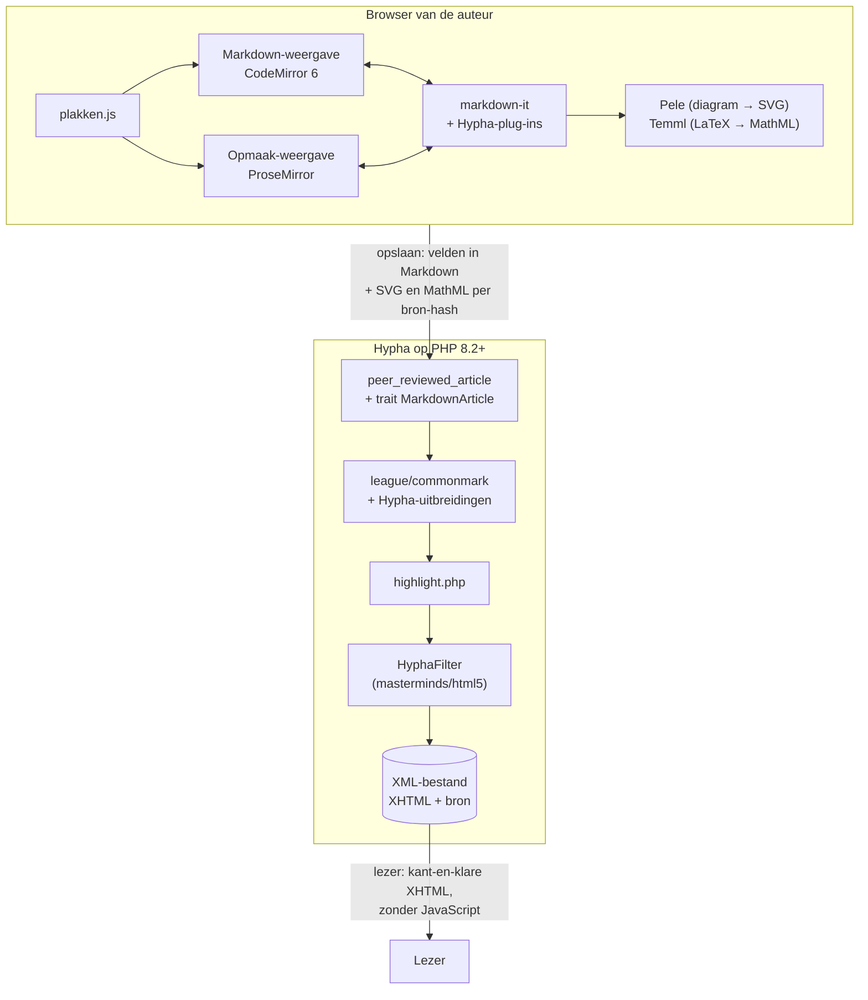

Bij **opslaan** gebeurt dit, in één vergrendelde schrijfactie:

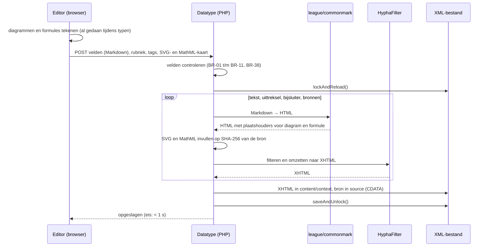

De nieuwe PHP-code staat naast de bestaande. De bestaande klasse krijgt één `use`-regel en een paar doorschakelregels ([§13.13](#1313-paginatype-en-opslag)):

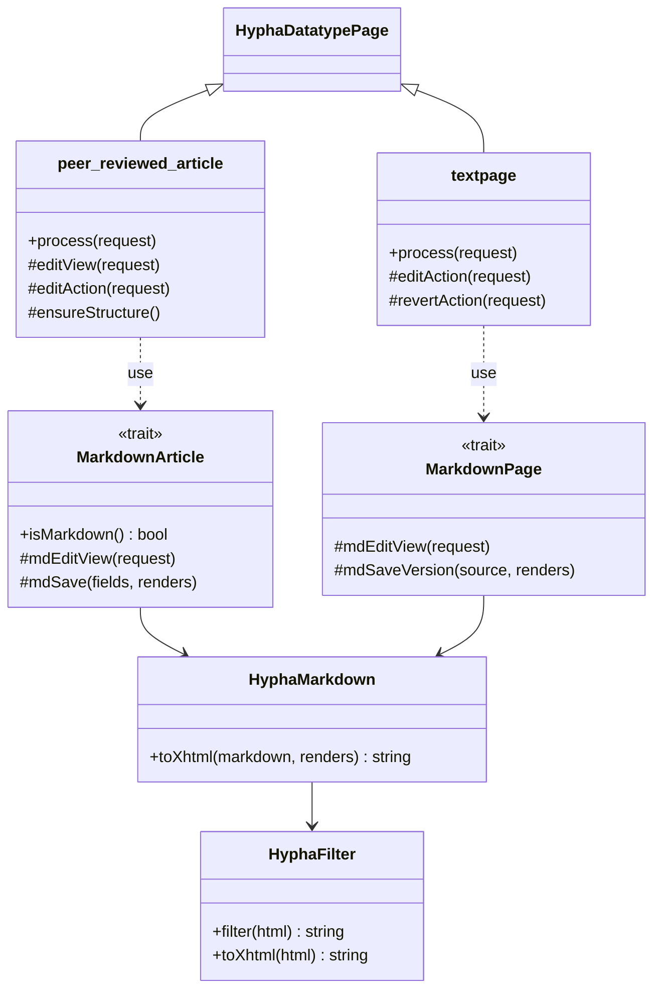

### 13.4 Server: Markdown naar XHTML

#### 13.4.1 Welke parser

| Parser | Licentie | CommonMark 0.31.2 (652) | GFM (24) | 6.000 woorden | 18.000 woorden | Meldingen PHP 8.2 / 8.4 |
|---|---|---|---|---|---|---|
| **league/commonmark 2.10.4** (Hypha-omgeving: CommonMark, GFM, voetnoten, attributen) | BSD-3 | **652** (100%) | **24** | 11,6 ms | 35,5 ms | **0 / 0** |
| erusev/parsedown 1.8 | MIT | 341 (52%) | – | 2,2 ms | 7,3 ms | 0 |
| erusev/parsedown-extra 0.8.1 | MIT | 324 (50%) | 5 | 2,4 ms | 7,4 ms | **ruim 6.000** (`Undefined array key`, `Passing null … is deprecated`) |
| michelf/php-markdown 2.0 (Extra) | BSD-3 | 391 (60%) | 2 | 4,1 ms | 12,9 ms | 0 |

Tijden op PHP 8.2; PHP 8.4 is 5 tot 10% sneller. Piekgeheugen voor alle proeven samen: 14 MB.

**Keuze: league/commonmark.** Waarom:

1. **Het is de enige die de specificatie volgt.** Bij de andere valt een kwart tot de helft van de voorbeelden anders uit, vooral bij nadruk, links, lijsten en HTML-blokken. Juist die komen uit Word en Google Docs en in elk artikel voor. De Markdown in de editor (CodeMirror, markdown-it) volgt de specificatie wel, dus met een andere parser zou het gepubliceerde artikel afwijken van het voorbeeld.
2. **GFM zit erin**: tabellen met uitlijning, doorhalen, takenlijsten, autolinks.
3. **Uitbreidbaar** met eigen blok- en inline-parsers voor de Hypha-onderdelen ([§13.4.2](#1342-hypha-uitbreidingen)).
4. **Snel genoeg**: 35 ms voor 18.000 woorden; samen met filter en XML ruim binnen de eis van 1 seconde ([§13.4.4](#1344-bewaren)).
5. **Geen meldingen** op PHP 8.2 en 8.4.

Waarom niet de snellere Parsedown: het is drie tot vijf keer sneller, maar dat verschil valt weg tegen de eis van 1 seconde. Het geeft 6.000 meldingen op PHP 8.2 (ParsedownExtra) en volgt de specificatie voor de helft.

Nadeel van league/commonmark: **acht pakketten met 389 PHP-bestanden (949 kB)**. Zonder Composer op de server moeten die worden meegeleverd ([§13.12](#1312-meeleveren-en-laden-zonder-build-stap-bij-installatie)). Twee daarvan (`nette/schema`, `nette/utils`) hebben een drievoudige licentie: BSD-3, GPL-2.0 of GPL-3.0. Hypha kiest **BSD-3**, en dat staat in het licentiebestand.

#### 13.4.2 Hypha-uitbreidingen

league/commonmark heeft voetnoten, GFM en attributen al aan boord. Wat er bij komt, als kleine eigen extensies in `system/core/markdown/`:

1. **Kader en citaat**: een blockquote die begint met `[!info]`, `[!tip]`, `[!warning]` of `[!quote]` wordt `<aside class="callout info" aria-label="…">` of een citaat.
2. **Paginalink** `[[Pagina]]` en `[[Pagina|tekst]]`: een inline-parser die de link via de bestaande `wikify_link()` naar het pagina-id omzet. Een hernoemde pagina blijft dus werken. Bij export zet de editor er weer de paginanaam in.
3. **Markeren** `==tekst==` wordt `<mark>`, via een delimiter-processor zoals bij doorhalen.
4. **Notitie** `%% … %%`: verdwijnt uit de XHTML; `%% beschrijving: … %%` direct boven een diagram wordt de beschrijving ervan.
5. **Figuur**: een afbeelding op een eigen regel, met een cursieve regel eronder, wordt `<figure>` met `<figcaption>`; de plaatsing `{.breed}`, `{.in-de-tekst}` of `{.klein-rechts}` gaat via de Attributes-extensie mee als klasse.
6. **Diagram**: een codeblok ` ```mermaid ` wordt `<figure class="diagram">` met de SVG uit de browser ([§13.10](#1310-diagrammen-en-formules)).
7. **Formule**: `$…$` en `$$…$$` worden de MathML uit de browser, volgens de regel van pandoc (geen spatie binnen de dollars, geen cijfer direct na de sluitende).
8. **Interactief blok** ` ```html interactief {hoogte=…} `: wordt na het filter een `<iframe sandbox="allow-scripts" srcdoc="…">`, zonder `allow-same-origin` ([§13.5](#135-html-filter-voor-niveau-1-en-2)).
9. **Ingesloten inhoud**: een losse link naar een dienst van de lijst wordt een `<iframe>` naar die dienst.

Dezelfde uitbreidingen bestaan als **markdown-it-plug-ins** in de browser ([§13.8](#138-browser-het-voorbeeld)). Een **pariteitstest** in de gouden dataset vergelijkt de genormaliseerde HTML van beide kanten. De proef laat zien dat dat werkt: op het voorbeeldartikel zijn league/commonmark en markdown-it gelijk.

#### 13.4.3 XHTML voor de XML-opslag

league/commonmark geeft HTML, geen XML. In de proef liet het voorbeeldartikel zich niet als XML laden: *Entity 'nbsp' not defined*. Daarom gaat de HTML altijd door het filter ([§13.5](#135-html-filter-voor-niveau-1-en-2)), dat haar met een HTML5-parser inleest en als **XHTML** (`saveXML`) wegschrijft. Daarna laadt het in de XML van Hypha zonder fout. De Markdown-bron staat in **CDATA**, zodat `<` en `&` gewoon kunnen.

#### 13.4.4 Bewaren

Gemeten als in de proef: Markdown omzetten, filteren, als XHTML in een artikel-XML zetten, de bron in CDATA erbij, en het bestand wegschrijven.

| Artikel | PHP 8.2 | PHP 8.4 | Grootte XML |
|---|---|---|---|
| circa 6.000 woorden | 22,5 ms | 20,9 ms | 88 kB |
| circa 18.000 woorden | 71,3 ms | 66,0 ms | 278 kB |

De eis is minder dan 1 seconde (prestatie-eis 2 in [§12.16](#1216-prestatie-eisen)). Wat er dan nog bij komt, is het werk van Hypha zelf: vergrendelen, `hypha.xml` voor de tags, en bij een statuswijziging e-mail. Dat laatste is het eerste aandachtspunt bij veel leden.

### 13.5 HTML-filter voor niveau 1 en 2

Alleen **niveau 1** (standaard) en **niveau 2** (ingesloten inhoud en interactieve blokken) worden gebouwd. **Niveau 3 (Hypha-macro's) en 4 (vrije HTML met JavaScript in de pagina) komen niet in de code** (besluit 17). Het filter verwijdert een `<macro>` uit de XHTML; in de Markdown-bron blijft hij letterlijk staan.

| Filter | Aanvallen afgeweerd (25) | Diagrammen heel (36) | MathML heel | Tijd voor 36 diagrammen |
|---|---|---|---|---|
| Alleen de GFM-*tagfilter* van league/commonmark | 11 | 36 | ja | – |
| symfony/html-sanitizer 7.4 (MIT) | 21 | **0** | deels | 15,2 ms |
| **Eigen filter** op masterminds/html5 (MIT), circa 150 regels | **25** | **36** | **ja** | 18,3 ms |

Wat er mis ging bij de andere twee:

1. **GFM-tagfilter**: zet alleen negen elementen om in tekst. `onerror`, `javascript:`-links, `<svg onload>`, `<form>` en `<object>` blijven staan. Dit is geen filter voor onbetrouwbare invoer.
2. **symfony/html-sanitizer**:
   1. haalt `viewBox` weg, omdat het attribuutnamen in kleine letters vergelijkt; geen enkel diagram blijft dan goed;
   2. verwijdert relatieve links (`nl/Raadsnieuws`) en dus elke paginalink;
   3. laat `fill:url(javascript:…)` in een stijl staan;
   4. kan bij een `<iframe>` geen `sandbox` afdwingen.

**Keuze: eigen filter op masterminds/html5.** Waarom:

1. Alleen een **HTML5-parser** houdt de hoofdletters van SVG (`viewBox`, `clipPath`) en de MathML-namen heel. De HTML-parser van libxml (`DOMDocument::loadHTML`) doet dat niet. `Dom\HTMLDocument` bestaat pas vanaf PHP 8.4, en Hypha moet op 8.2 draaien.
2. Een **allowlist** per naamruimte (HTML, SVG, MathML) in één bestand is te overzien en te testen.
3. masterminds/html5 is **één pakket** (20 bestanden, 212 kB, MIT) en wordt ook door Symfony en Drupal gebruikt.

Regels van het filter:

1. alleen elementen en attributen van de lijst blijven, per naamruimte;
2. `href` en `src` alleen met `https`, `http`, `mailto` of een relatief pad; in SVG alleen `#…` (geen externe `use`);
3. `style` alleen in SVG en MathML, en dan zonder `url(`, `expression`, `@import` of `javascript:`;
4. `<script>`, `<style>`, `<form>`, `<object>`, `<embed>`, `<template>`, `<macro>` en `foreignObject` verdwijnen met hun inhoud;
5. een `<iframe>` alleen naar een host van de **lijst met diensten**, met afgedwongen `sandbox`, `loading="lazy"` en `referrerpolicy`; een `srcdoc` van de auteur verdwijnt;
6. externe links krijgen `rel="noopener nofollow"`.

**Ingesloten inhoud: zoveel mogelijk diensten.** De lijst is instelbaar en begint met de diensten die een `<iframe>` over https aanbieden: YouTube (via `youtube-nocookie.com`), Vimeo, OpenStreetMap, Datawrapper, Flourish, Infogram, Google Maps (embed), Spotify, SoundCloud, Mixcloud, PeerTube-instanties van de lijst, Internet Archive, Bandcamp, Scribd en DocumentCloud. Diensten die alleen via een eigen script insluiten (zoals X/Twitter en Instagram), kunnen niet als `<iframe>`; die horen in een interactief blok of als gewone link.

**Volgorde.** Markdown → league/commonmark (`html_input: allow`, `allow_unsafe_links: false`) → Hypha-uitbreidingen → SVG en MathML invullen → **filter over alles** → interactieve blokken als `srcdoc`-iframe invoegen. Het interactieve blok komt pas na het filter, omdat het filter een `srcdoc` van de auteur juist weghaalt. De code staat ge-escaped in `srcdoc` en kan zo niet in de pagina zelf draaien.

### 13.6 Browser: de Markdown-weergave

| Kandidaat | Typen bij 20.000 woorden (mediaan / p95 / hoogste) | Openen bij 20.000 woorden | Grootte (gzip) | Pakketten |
|---|---|---|---|---|
| **CodeMirror 6** met `@codemirror/lang-markdown` | 4,5 / 10,8 / 20,7 ms | 6 ms | 178 kB | 21 |
| `<textarea>` met opgemaakte laag (prototype) | 2,8 / 4,0 / 6,4 ms | tekent de hele tekst | 0 | 0 |

Gemeten als de tijd van een invoeging tot en met de opmaak en de positie van de cursor, in Chromium. De eis is 100 ms; **beide halen die ruim**.

**Keuze: CodeMirror 6.** Waarom, ook al is de textarea sneller:

1. **Een syntaxboom** (Lezer). Gedimde tekens, het `/`-menu, `[[`-suggesties, de structuur en de cursor bij wisselen werken op de boom in plaats van op reguliere expressies, zoals nu in het prototype.
2. **Alleen het zichtbare deel wordt getekend.** Het prototype tekent de opgemaakte laag voor de hele tekst; bij een lang artikel met veel diagrammen groeit dat mee.
3. **Uitbreidbaar** met een plakhaak (voor [§13.9](#139-plakken-uit-tekstverwerkers)), toetsen en een eigen ongedaan-maken per handeling.
4. **Toegankelijk**, en met spellingcontrole, dicteren en invoer via de IME van het systeem.

Terugval: als CodeMirror op iOS tegenvalt bij autocorrectie, dicteren of de vergrootloep ([§13.16](#1316-wat-nog-niet-is-getoetst)), blijft de textarea van het prototype de terugvaloptie. Die is bewezen native.

### 13.7 Browser: de Opmaak-weergave

Eis: heen en terug tussen Opmaak en Markdown verandert de bron niet. De proef zette drie teksten in de weergave en vroeg de Markdown terug. De tabel telt het aantal regels dat anders terugkwam, en wat daarbij de betekenis veranderde.

| Kandidaat | start (49) | plaktest (28) | kenmerken (50) | Betekenis verloren | Grootte (gzip) | Pakketten / modules |
|---|---|---|---|---|---|---|
| Milkdown 7.23 (CommonMark + GFM) | 27 | 11 | 27 | `\%` en `\,` in formules; `[[…]]` en `[!type]` ge-escaped; plaatsing van een diagram | 145 kB | 87 / 228 |
| Milkdown met eigen instellingen en wiskunde-plug-in | 26 | 8 | 21 | `$$…$$` op één regel wordt `$…$`; `[[…]]`, `[!type]`, plaatsing | 225 kB (met KaTeX) | 88 / 260 |
| ProseMirror + prosemirror-markdown (standaard) | 32 | 15 | 45 | tabellen, doorhalen; `[[…]]`, `[!type]` | 123 kB | 15 / 88 |
| Eigen `contenteditable` (prototype) | **0** | 11 | 6 | `` `code` ``, `~~…~~`, takenlijst, `<details>` | 0 | 0 |

Veel verschillen zijn alleen schrijfwijze: `*` in plaats van `-`, tabellen met opvulspaties, inspringen van sublijsten. Die zijn met instellingen of een eigen serializer op te lossen. De verloren betekenis is erger. **Geen enkele kandidaat is uit zichzelf verliesvrij voor Hypha-Markdown**: kaders, paginalinks, plaatsing en formules vragen in elk geval eigen uitbreidingen.

**Keuze: ProseMirror met prosemirror-markdown, op markdown-it.** Waarom:

1. **Eén parser voor Opmaak en voorbeeld.** prosemirror-markdown leest met markdown-it, de parser van het voorbeeld ([§13.8](#138-browser-het-voorbeeld)). Elke Hypha-uitbreiding is dan één markdown-it-plug-in, die zowel het voorbeeld als de Opmaak-weergave gebruikt. Bij Milkdown zou dezelfde uitbreiding er een tweede keer moeten komen, in remark.
2. **Veel minder afhankelijkheden**: 15 pakketten in plaats van 87. Voor een klein project zonder npm op de server telt elk pakket dat bij een beveiligingsmelding moet worden bijgewerkt.
3. **Dezelfde kern als Milkdown.** Milkdown is een laag op ProseMirror; de invoer op iOS (`prosemirror-view`, met de Safari-aanpassingen voor IME) is dus gelijk.
4. **De serializer is van Hypha**: lijsten met `-`, tabellen zonder opvulling, `$$` op een eigen regel, de volgorde van de Frontmatter. Zo komt de bron terug zoals de auteur hem schreef.

Waarom niet Milkdown: het geeft meer uit de doos (GFM-tabellen, doorhalen, taken), maar de Hypha-uitbreidingen moeten toch worden gebouwd, en dan twee keer. Met 87 pakketten en 228 modules is het ook lastig mee te leveren zonder build-stap. Waarom niet de eigen omzetting van het prototype: die leunt op `contenteditable` met `document.execCommand`, de verouderde techniek waar WYMeditor last van heeft ([§3.2](#32-verouderde-techniek)). Ze verliest code, doorhalen, taken en HTML, en heeft geen documentmodel voor ongedaan maken en tabellen.

Het eigen werk: een schema met tabellen (`prosemirror-tables`), doorhalen, taken, voetnoten, kaders, figuur, diagram, formule, paginalink en een blok „HTML (bewerk in Markdown)” voor onbekende HTML. Plus een testset die heen en terug zonder verschil moet blijven, met alle drie de proefteksten en de gouden dataset.

### 13.8 Browser: het voorbeeld

| Parser | CommonMark (652) | GFM (24) | Gelijk aan league/commonmark op start / plaktest | 6.000 woorden |
|---|---|---|---|---|
| **markdown-it 14** | **652** | 14 (taken en voetnoten via plug-ins) | **0 / 3** verschillen (uitlijning als `style` in plaats van `align`) | 1,8 ms |
| marked 12 (GFM) | 598 | 22 | 0 / 3 (alleen witruimte) | 1,6 ms |
| commonmark.js 0.31 | 652 | – | 0 / 12 (geen tabellen) | 1,0 ms |

**Keuze: markdown-it.** Het volgt de specificatie net als league/commonmark, en de drie verschillen op het plaktestdocument zijn één renderregel voor de uitlijning van tabelcellen. marked valt af op 54 voorbeelden, vooral bij links en afbeeldingen; dan zou het voorbeeld soms afwijken van het gepubliceerde artikel. commonmark.js heeft geen GFM. markdown-it is ook de parser van prosemirror-markdown ([§13.7](#137-browser-de-opmaak-weergave)).

### 13.9 Plakken uit tekstverwerkers

| Omzetter | Losse gevallen (19, zonder OMML) | Word / Google Docs / LibreOffice: regels anders | Tijd per document |
|---|---|---|---|
| **eigen omzetter** (`plakken.js`, prototype) | **19** | **0 / 0 / 0** | 0,4–0,8 ms |
| Turndown 7.2 met GFM-plug-in | 4 | 28 / 38 / 78 | 0,8–3,4 ms |

Turndown zet de stijlblokken van Word en LibreOffice als tekst in de Markdown, ziet het omhulsel van Google Docs aan voor vet, en kent de lijsten van Word en de koppen van Hypha (`###` voor kop 1) niet. Om het gelijk te trekken, zouden alle regels van de eigen omzetter als Turndown-regels moeten worden overgedaan.

**Keuze: de eigen omzetter**, zonder Turndown. Hij is in gewoon JavaScript, heeft geen afhankelijkheden en haalt de acceptatiecriteria al. In de Markdown-weergave hangt hij aan de plakhaak van CodeMirror, in Opmaak aan `transformPastedHTML` van ProseMirror (na omzetten naar Markdown leest markdown-it het in).

### 13.10 Diagrammen en formules

1. **Tekenen in de browser.** Pele tekent alle 36 sjablonen zonder fout. Temml zet de testformules om naar MathML. Lezers krijgen het resultaat als SVG en MathML, zonder JavaScript.
2. **Koppeling.** Bij opslaan stuurt de editor per diagram en per formule de uitkomst mee, met als sleutel de **SHA-256 van de bron** (diagramtekst of LaTeX). De server vult ze in op die sleutel. Ontbreekt er een (bijvoorbeeld bij een import zonder browser), dan wordt het diagram een `<pre>` met de bron en een melding in de checklist.
3. **Vertrouwen.** Wat uit de browser komt, is onbetrouwbaar en gaat door het filter. In de proef bleven alle 36 diagrammen en alle formules heel; het filter kost 18 ms voor 36 diagrammen.
4. **Stijlen.** Pele zet kleuren als CSS-variabelen in `style`-attributen (`--_bg:var(--pele-bg,#fff)`). Het filter laat `style` daarom toe in SVG, maar zonder `url(` en dergelijke. Zo blijven de themakleuren werken.
5. **Temml, niet KaTeX.** De wiskunde-plug-in van Milkdown brengt KaTeX mee: 80 kB gzip extra plus lettertypes. Temml maakt alleen MathML, die de browser zelf zet.

### 13.11 Codemarkering

highlight.php 9.18 kleurt 100 regels PHP in **1,0 ms**, met dezelfde klassenamen als highlight.js (`hljs-keyword`, `hljs-title`, `hljs-comment`). Daardoor zien voorbeeld en artikel er gelijk uit. Op PHP 8.2 en 8.4 geeft het geen meldingen. Het pakket is 2,2 MB door 185 taaldefinities in JSON. Hypha levert alleen de tien talen uit [§10.1](#101-flexibiliteit-eigen-html-javascript-en-uitbreidingen) mee (circa 150 kB), en de rest kan erbij.

### 13.12 Meeleveren en laden zonder build-stap bij installatie

| Bibliotheek (gebundeld met esbuild) | Modules | Pakketten | Grootte (gzip) |
|---|---|---|---|
| CodeMirror 6 + Markdown | 22 | 21 | 178 kB |
| ProseMirror + prosemirror-markdown + markdown-it | 88 | 15 | 123 kB |
| markdown-it (alleen) | 77 | 4 | 54 kB |
| Milkdown (ter vergelijking) | 228 | 87 | 145 kB |

**Keuze: eenmalig bundelen op de ontwikkelmachine.**

1. **Browser**: per bibliotheek één ES-modulebestand met de versie in de naam, gemaakt met esbuild en meegeleverd in `system/mdeditor/vendor/` (bijvoorbeeld `codemirror-6.0.2.js`, `prosemirror-1.42.js`). Pele, Temml en highlight.js gaan als hun eigen distributiebestand mee. De **eigen code van Hypha** blijft gewone ES-modules, zonder bundelen, en wordt via een kleine import map geladen. Een import map met 88 of 228 losse bestanden zou bij elke update kunnen breken en geeft veel verzoeken bij het eerste openen.
2. **Server**: Composer draait alleen op de ontwikkelmachine. `system/vendor/` krijgt league/commonmark met zijn zeven afhankelijkheden, masterminds/html5 en highlight.php (met de tien talen), plus een **classmap-autoloader** (`composer dump-autoload --classmap-authoritative`). Samen circa 430 PHP-bestanden en 1,3 MB.
3. **Installatie** blijft zoals nu: bestanden kopiëren of `hypha.php` uitpakken. Er is geen Node.js en geen Composer nodig, en er is geen build-stap.
4. **Cache**: de bestanden met een versie in hun naam krijgen `Cache-Control: max-age=31536000, immutable` (prestatie-eis 4).
5. **Bijwerken**: een script `system/mdeditor/vendor/bundel.sh` bundelt opnieuw; de licentieteksten gaan mee in `system/mdeditor/vendor/LICENSES/`.

### 13.13 Paginatype en opslag

**Getoetst**: waar staat het paginatype in Hypha en in de thema's?

1. `base.php` zet `type_<klasse>` als klasse op de pagina (`get_class($hyphaPage)`).
2. Het **standaardthema** in de repository gebruikt `.type_peer_reviewed_article` op **11 plekken**; in een lokale kopie van een echte site staat het 16 keer in het thema.
3. De macro `pagelist` filtert op `pagetypes="peer_reviewed_article"`; in diezelfde lokale kopie gebeurt dat zes keer in de inhoud.

Een nieuw type `peer_reviewed_article_md` zou de opmaak van alle nieuwe artikelen en de lijsten met artikelen breken. Dat zou alleen te repareren zijn met wijzigingen in thema's en in de inhoud van elke site.

**Keuze: hetzelfde type, met een signaal in de XML.**

1. `peer_reviewed_article` krijgt één regel `use MarkdownArticle;` en een doorschakeling aan het begin van `editView()` en `editAction()`: `if ($this->isMarkdown()) return $this->mdEditView($request);`. In `ensureStructure()` krijgt een **nieuw** artikel `format="markdown"` en een leeg `source`-element, want nieuwe artikelen openen altijd in de nieuwe editor (besluit 18). Samen circa zes regels in de bestaande klasse.
2. De **trait** staat in `system/core/markdown_article.php`. `index.php` laadt `system/core/` vóór de datatypes. Daar moet hij staan, want `hypha_getDataTypes()` laadt de datatypes op alfabet, en een trait in `system/datatypes/` zou na de klasse komen die hem gebruikt.
3. **Tekstpagina's** krijgen hetzelfde (besluit 19): `textpage` krijgt `use MarkdownPage;`. Een tekstpagina heeft versies (`Xml::versionsOn`) en vertalingen. De Markdown-bron komt in een eigen knooppunt naast de inhoud, per taal, en wordt met dezelfde `storeWikiContent()` bewaard. Zo krijgt de bron versies en verschillen op dezelfde manier als de XHTML, en hoort bij elke versie van de inhoud een versie van de bron met hetzelfde tijdstip. *Terugzetten* zet beide terug. Dat het opslaan van CDATA via `setInnerHtml()` goed gaat, wordt in het technisch prototype getoetst ([§13.16](#1316-wat-nog-niet-is-getoetst)).
4. Oude artikelen en pagina's (zonder `format`) gaan precies als nu naar WYMeditor.

Gevolg: `pagelist`, thema's en overzichten blijven werken zonder wijziging. De prijs is een handvol toegevoegde regels in twee bestaande klassen; daarvoor zou de nieuwe editor anders helemaal ernaast staan. Eruit halen blijft eenvoudig: zonder de trait-bestanden valt de doorschakeling weg.

### 13.14 Paginanaam uit de titel

Een nieuw artikel vraagt de **titel**, niet de paginanaam. Het webadres volgt daaruit:

1. leestekens en symbolen eerst als woord: `&` → `en`, `%` → `procent`, `€` → `euro`; `ß`, `æ`, `ø`, `œ` en `ij` uitgeschreven;
2. accenten weg (`café` → `cafe`, `coöperatie` → `cooperatie`), met `Normalizer` als de extensie `intl` er is, en anders `iconv` met `TRANSLIT`; de containers hebben geen `intl`, dus de proef gebruikte `iconv`;
3. kleine letters; alles wat geen letter of cijfer is, wordt één koppelteken; koppeltekens aan begin en eind weg;
4. hoogstens 80 tekens, afgekort op een woordgrens;
5. uniek binnen de taal (BR-50): bestaat de naam al, dan `-2`, `-3`, enzovoort.

| Titel | Paginanaam |
|---|---|
| Vertrekkend raadslid Bram Hoekstra: twintig jaar strijd voor open bestuur | `vertrekkend-raadslid-bram-hoekstra-twintig-jaar-strijd-voor-open-bestuur` |
| Café „De Zwaan” krijgt geen vergunning | `cafe-de-zwaan-krijgt-geen-vergunning` |
| Coöperatie en ruïne: één naïeve vraag | `cooperatie-en-ruine-een-naieve-vraag` |
| Raadsvergadering van 27 oktober (bestaat al) | `raadsvergadering-van-27-oktober-2` |
| 50% minder geld voor de IJsbaan & het zwembad – € 2,4 miljoen | `50-procent-minder-geld-voor-de-ijsbaan-en-het-zwembad-euro-2-4-miljoen` |

Alle zeven testtitels gaven op PHP 8.2 en 8.4 dezelfde uitkomst. De bestaande `validatePagename()` laat ze ongewijzigd. Hypha zoekt paginanamen zonder onderscheid tussen hoofd- en kleine letters op, dus een oude link met hoofdletters blijft werken.

Na het aanmaken ligt de paginanaam vast. Verandert de titel vóór publicatie flink, dan geeft de checklist een tip („het webadres past niet meer bij de titel”) met een knop om het adres bij te werken. Na publicatie verandert het adres nooit meer, zodat links blijven werken.

### 13.15 Lighthouse

Acceptatiecriterium: elke Lighthouse-score is **95 of hoger**: prestaties, toegankelijkheid, goede werkwijzen en SEO. Dat geldt op de telefoon (standaardinstelling van Lighthouse) en op de computer (`--preset=desktop`), voor:

1. een **gepubliceerd artikel** en een **gepubliceerde tekstpagina** die met de nieuwe editor zijn gemaakt, anoniem;
2. de **editor** zelf, ingelogd, behalve SEO (de editor is niet openbaar en krijgt `noindex`).

Gemeten met Lighthouse 12.8:

| Pagina | Prestaties | Toegankelijkheid | Goede werkwijzen | SEO |
|---|---|---|---|---|
| Leespagina volgens dit ontwerp, telefoon | **99** | **98** | **96** | **100** |
| Leespagina volgens dit ontwerp, computer | **100** | **98** | **96** | **100** |
| Huidige startpagina van Hypha (lokale kopie, telefoon) | 60 | 75 | 75 | 75 |

De leespagina volgens dit ontwerp is het voorbeeldartikel als statische pagina met:

1. semantische HTML;
2. de diagrammen als SVG en een formule als MathML;
3. de lettertypes van het thema met `font-display: swap`;
4. JSON-LD, `lang="nl"` en een `meta description`;
5. geen JavaScript.

Bevindingen:

1. **Koppen**: de leespagina verliest 2 punten op toegankelijkheid door de kopvolgorde. Tussenkoppen zijn `<h3>` direct na de `<h1>`, zoals in de bestaande artikelen. Met 98 blijft de eis gehaald; de koppen blijven daarom `<h3>`.
2. **De huidige pagina van Hypha** mist `lang` op `<html>`, een `meta description` en `alt` op afbeeldingen. Ze heeft te weinig contrast en geen geldige `robots.txt`, en laadt jQuery 1.7.1 en andere scripts voor iedere lezer. Dat zijn aanpassingen in de **paginasjabloon en de kop van de pagina**, niet in de opmaak van het artikel. De gepubliceerde leesweergave blijft verder zoals ze is (besluit 20). Het contrast is een kleur in het thema; zie open vraag 1 in [§19](#19-risicos-en-open-vragen).
3. **Lighthouse en de eis van 250 ms** meten iets anders. Lighthouse rekent op de telefoon met een trage 4G-verbinding (LCP 1,8 s in de proef); de eis van 250 ms geldt via wifi op een iPhone 16. Beide worden gemeten.
4. Bij de meting van de huidige pagina waren de statistieken naar buiten geblokkeerd. Eén openbare afbeelding uit de lokale kopie is wel van de echte site opgehaald.

### 13.16 Wat nog niet is getoetst

1. **iOS en iPadOS op een echt apparaat**: autocorrectie, woordsuggesties, dicteren en de vergrootloep in CodeMirror 6 en ProseMirror. Dit is het grootste risico en de eerste taak van het technisch prototype. Terugval voor de Markdown-weergave is de textarea van het prototype.
2. **Echte klembord-HTML** van Word en Google Docs, en de vorm van een formule uit Google Docs.
3. **VoiceOver en NVDA** met CodeMirror 6 en ProseMirror.
4. **PHP 8.3 en 8.5**: alleen 8.2 en 8.4 zijn getoetst.
5. **CDATA via `setInnerHtml()` en `storeWikiContent()`** voor de bron van tekstpagina's met versies.
6. **De Hypha-uitbreidingen** zelf (kaders, paginalinks, figuren) in league/commonmark en markdown-it: de proef toont de basis en de pariteit, niet de uitbreidingen.
7. **De serializer** van ProseMirror voor Hypha-Markdown: de proef meet de standaardinstelling en laat zien wat er nodig is.

### 13.17 Gevolgen voor de begroting

1. **Opmaak-weergave** (onderdeel 6): +2 dagen voor het eigen ProseMirror-schema en de serializer.
2. **Tekstpagina's** met de nieuwe editor, met versies, verschillen, vertalen en terugzetten (besluit 19): +4 dagen, als nieuw onderdeel 22.
3. **Rubriek als apart veld** (besluit 21): +1 dag, binnen onderdeel 7a.
4. **Flexibiliteit** (onderdeel 9a) zonder niveau 3 en 4: −1 dag.
5. **Lighthouse ≥ 95** voor de paginasjabloon (`lang`, `meta description`, `alt`, scripts met `defer`): +1 dag, binnen onderdeel 21.

De begroting in [§18.2](#182-begroting) is daarop bijgewerkt: 93 dagen werk plus 14 dagen reserve is **107 dagen**, binnen het maximum van 160.

### 13.18 Besluiten van het technisch ontwerp

| # | Besluit | Paragraaf |
|---|---|---|
| T1 | Server: **league/commonmark 2.x** met eigen extensies; geen Parsedown of michelf | [§13.4](#134-server-markdown-naar-xhtml) |
| T2 | **Eigen allowlist-filter** op masterminds/html5 voor HTML, SVG en MathML; geen symfony/html-sanitizer | [§13.5](#135-html-filter-voor-niveau-1-en-2) |
| T3 | Geen YAML op de server: de editor stuurt de velden los mee | [§13.1](#131-samenvatting-van-de-keuzes) |
| T4 | Markdown-weergave: **CodeMirror 6**; de textarea van het prototype is de terugvaloptie | [§13.6](#136-browser-de-markdown-weergave) |
| T5 | Opmaak-weergave: **ProseMirror + prosemirror-markdown** met een eigen schema en serializer; geen Milkdown | [§13.7](#137-browser-de-opmaak-weergave) |
| T6 | Voorbeeld: **markdown-it**, met dezelfde Hypha-plug-ins als de Opmaak-weergave; pariteitstest met league/commonmark | [§13.8](#138-browser-het-voorbeeld) |
| T7 | Plakken: de **eigen omzetter** uit het prototype; geen Turndown | [§13.9](#139-plakken-uit-tekstverwerkers) |
| T8 | Diagrammen en formules in de browser; de server vult SVG en MathML in op de SHA-256 van de bron en filtert ze | [§13.10](#1310-diagrammen-en-formules) |
| T9 | Bibliotheken **eenmalig gebundeld** op de ontwikkelmachine, met de versie in de naam; Composer alleen op de ontwikkelmachine met een classmap-autoloader | [§13.12](#1312-meeleveren-en-laden-zonder-build-stap-bij-installatie) |
| T10 | **Hetzelfde paginatype** met `format="markdown"`; traits in `system/core/`, een paar regels in `peer_reviewed_article` en `textpage` | [§13.13](#1313-paginatype-en-opslag) |
| T11 | Paginanaam uit de titel volgens [§13.14](#1314-paginanaam-uit-de-titel) | [§13.14](#1314-paginanaam-uit-de-titel) |
| T12 | Lighthouse ≥ 95 in elke categorie op telefoon en computer als acceptatiecriterium | [§13.15](#1315-lighthouse) |

## 14. Projectie op de XML-opslag

Dit hoofdstuk legt vast hoe wat de auteur ziet (de vaste blokken en de tekst) op de XML van Hypha terechtkomt, waar de Markdown en de HTML landen, en hoe het type van een artikel in de XML staat. Uitgangspunt: de **bestaande structuur blijft**; er komt alleen bij wat de Markdown-bron nodig heeft. Alles wat artikelen leest (de leespagina, overzichten, zoeken, de checklist, e-mails) blijft op de XHTML werken.

### 14.1 Waar elk veld landt

| Veld | In Markdown | In Opmaak | In de XML | Inhoud | Nu in Hypha? |
|---|---|---|---|---|---|
| titel | Frontmatter `titel` | artikelkop | `article/context/title` | tekst | ja |
| auteur | Frontmatter `auteur` | artikelkop | `article/@author` | tekst | ja |
| uittreksel | Frontmatter `uittreksel` | artikelkop | `article/context/excerpt` (XHTML) en `article/source/excerpt` (Markdown) | XHTML + bron | XHTML ja, bron nieuw |
| rubriek | Frontmatter `rubriek` | artikelkop | `article/context/section` | rubriek uit de lijst van de site | **nieuw** |
| tags | Frontmatter `tags` | artikelkop | bij de pagina in `hypha.xml` (tag-ID's uit `tagList`) | ID's | ja |
| afbeelding | Frontmatter `afbeelding` | artikelkop | `featured_image` onder de wortel van het bestand (bouw: daar leest en schrijft de bestaande code haar) | bestandsnaam | ja |
| beschrijving, bijschrift, fotograaf | Frontmatter | artikelkop | attributen `alt`, `caption`, `credit` op `featured_image` | tekst | **nieuw** |
| bijsluiter | Frontmatter `bijsluiter` (blok) | blok onderaan | `article/context/method` (XHTML) en `article/source/method` (Markdown) | XHTML + bron | XHTML ja, bron nieuw |
| bronnen | Frontmatter `bronnen` (blok) | blok onderaan | `article/content/sources` (XHTML) en `article/source/sources` (Markdown) | XHTML + bron | XHTML ja, bron nieuw |
| tekst | onder de Frontmatter | het artikel | `article/content/text` (XHTML) en `article/source/text` (Markdown) | XHTML + bron | XHTML ja, bron nieuw |
| diagram | `` ```mermaid `` in de tekst | figuur | Mermaid-bron in `source/text`; de getekende SVG in de `<figure>` in `content/text` | bron + SVG | nieuw |
| taal | – (bij export `lang`) | checklist | `<language id>` bij de pagina in `hypha.xml` | taalcode | ja |
| status en datums | – | procesbalk | `article/@status`, `@created_at`, `@updated_at`, `@published_at` | | ja |
| terugtrekken | – | procesbalk, melding | `article/retraction` met `@at`, `@by` en de reden als tekst; `@status="retracted"` | | **nieuw** (BR-73) |
| goedkeuring | – | beoordeling | `approves/approve` met `@user`, `@created_at`; nieuw `@statute` (versie van het redactiestatuut dat is bevestigd) | | ja, `@statute` nieuw |
| opmerking bij goedkeuring | – | beoordeling | `discussions/review/discussion` met nieuw `@approve` (verwijzing naar de goedkeuring) | | nieuw (BR-67) |

De **Frontmatter wordt niet als geheel bewaard**: hij is een weergave van de velden hierboven. Bij openen zet de editor hem uit de velden in elkaar; bij opslaan gaan de waarden naar hun eigen plek (BR-84). Eigenschappen die Hypha niet kent (bijvoorbeeld uit HedgeDoc) gaan mee in `article/source/frontmatter`, zodat ze bij openen en exporteren weer terugkomen.

### 14.2 Voorbeeld

````xml
<article format="markdown" status="draft" author="Sanne de Vries"
         created_by="u12" created_at="t1793000000" updated_at="t1793050000" published_at="">
  <content>
    <text>…XHTML van de tekst, met per diagram een &lt;figure&gt; met de SVG…</text>
    <sources><ul><li>Raadsinformatie gemeente Eemstad</li></ul></sources>
  </content>
  <context>
    <title>Vertrekkend raadslid Bram Hoekstra: twintig jaar strijd voor open bestuur</title>
    <section>Politiek en bestuur</section>
    <excerpt><p>Twintig jaar lang vroeg Bram Hoekstra …</p></excerpt>
    <featured_image alt="Bram Hoekstra in de raadszaal van Eemstad"
                    caption="Bram Hoekstra na twintig jaar in de raad van Eemstad."
                    credit="Foto (naam fotograaf)">hoekstra.jpg</featured_image>
    <method><p>Sanne de Vries is politiek verslaggever …</p></method>
  </context>
  <source format="markdown" profile="hypha-1.0">
    <text><![CDATA[Bram Hoekstra (1962) was bibliothecaris …
### De eerste zetels
…
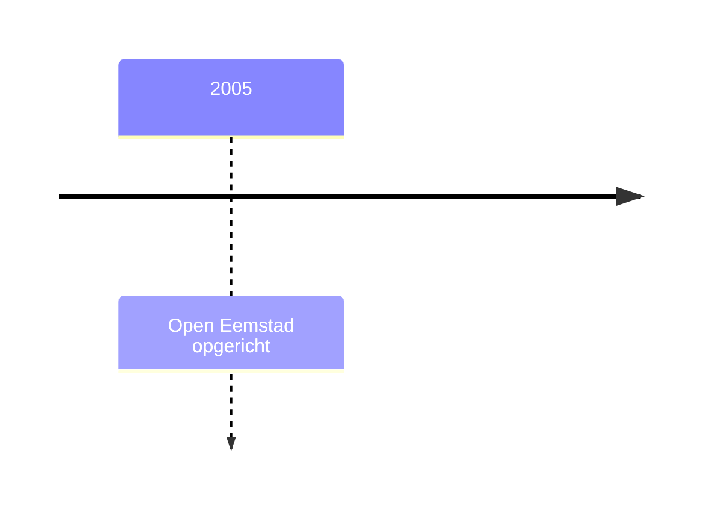
]]></text>
    <excerpt><![CDATA[Twintig jaar lang vroeg Bram Hoekstra …]]></excerpt>
    <method><![CDATA[Sanne de Vries is politiek verslaggever …]]></method>
    <sources><![CDATA[- Raadsinformatie gemeente Eemstad]]></sources>
  </source>
</article>
<discussions><review/><public/></discussions>
<approves/>
````

Een teruggetrokken artikel krijgt daarbij:

```xml
<article format="markdown" status="retracted" …>
  …
  <retraction at="t1793100000" by="u12">Het artikel bevatte een onjuist jaartal; we zoeken het opnieuw uit.</retraction>
</article>
```

### 14.3 Waar de Markdown en de HTML landen

1. **HTML (XHTML)** staat altijd in de **bestaande** elementen: `content/text`, `content/sources`, `context/excerpt` en `context/method`. Daardoor werkt alles wat nu artikelen leest, ongewijzigd, ook voor Markdown-artikelen.
2. **Markdown** staat alleen in het nieuwe element `article/source`, met één kind per veld (`text`, `excerpt`, `method`, `sources`), in CDATA, zodat tekens als `<` en `&` gewoon kunnen.
3. **Bij opslaan** rendert de server elk Markdown-veld naar XHTML (league/commonmark met de Hypha-uitbreidingen en het filter van het vrijheidsniveau, [§10.1](#101-flexibiliteit-eigen-html-javascript-en-uitbreidingen)) en schrijft hij bron en XHTML in **één vergrendelde schrijfactie** (`lockAndReload()` en `saveAndUnlock()`). Zo kunnen ze niet uit elkaar lopen (BR-66).
4. **Bij openen** laadt de nieuwe editor de bron. Is het artikel geen Markdown-artikel (zie [§14.4](#144-hoe-het-type-in-de-xml-staat)), dan opent de oude opmaakeditor met de XHTML, zoals nu.
5. **Titel, auteur, rubriek, tags en taal** hebben geen Markdown-bron: het zijn platte waarden, die op hun bestaande plek staan.

### 14.4 Hoe het type in de XML staat

Het type staat op drie plekken, elk met een eigen doel:

| Waar | Wat | Doel |
|---|---|---|
| `hypha.xml`, de pagina | `type="peer_reviewed_article"` (of `textpage`), **ongewijzigd** | thema's, overzichten en `pagelist` blijven werken ([§12.11](#1211-naast-de-bestaande-code)) |
| het artikel-XML | `<article format="markdown">`; zonder dit attribuut is het artikel HTML (alle oude artikelen) | **het signaal**: de bestaande klasse schakelt hierop door naar de nieuwe editor; ook wie alleen het XML-bestand leest, ziet dat er een Markdown-bron is |
| de bron | `<source format="markdown" profile="hypha-1.0">` | welke Markdown-versie de bron volgt ([§10](#10-ondersteunde-markdown-syntaxis)), zodat een latere versie oude bronnen herkent |

Regels voor het type:

1. `format="markdown"` vraagt een `source`-element. Ontbreekt dat, dan opent het artikel in de oude opmaakeditor met de XHTML en meldt de checklist het (veilige terugval).
2. Een oud artikel (zonder `format`) blijft zoals het is en opent in de oude editor. Omzetten naar Markdown valt buiten de scope ([§5.2](#52-migratie-de-oude-editor-blijft-voor-oude-artikelen)).
3. Een nieuw artikel krijgt bij aanmaken altijd `format="markdown"` en een leeg `source`-element, in `ensureStructure()` (besluit 18). Een nieuwe tekstpagina krijgt hetzelfde.

## 15. Bedrijfsregels als constraints

Dit hoofdstuk zet de bedrijfsregels van een *artikel met review* op een rij, ingedeeld zoals constraints in een database. Bij elke regel staat waar hij vandaan komt en wat de nieuwe editor ermee doet.

**Herkomst**: **H** = bestaande Hypha-code (met bestand en regel), **I** = issue [PlanBCode/hypha#520](https://github.com/PlanBCode/hypha/issues/520), **O** = dit ontwerp (keuze van de opdrachtgever of van het ontwerp), **W** = WCAG 2.1 of Apple HIG. **Afdwinging**: *hard* = de actie lukt niet; *zacht* = melding in de checklist, de auteur mag door. **Nieuwe editor**: *ongewijzigd*, *gewijzigd* of *nieuw*.

De gegevens, in database-termen: **artikel** (XML-bestand per artikel), **pagina** (`hypha.xml`: naam per taal, privé, tags), **gebruiker** (`hypha.xml`), **goedkeuring** en **opmerking** (in het artikel-XML), **afbeelding** (geüpload bestand) en **Markdown-bron** (nieuw, [§12.5](#125-opslag-oude-artikelen-blijven-html-signaal-voor-markdown)).

### 15.1 NOT NULL: verplichte gegevens

| ID | Regel | Afdwinging | Herkomst | Nieuwe editor |
|---|---|---|---|---|
| BR-01 | Het artikel heeft tekst (`content` niet leeg) | hard bij *start beoordeling* en *publiceren* | H [`has-article-body`](../../../system/datatypes/peer_reviewed_article.php#L432) | ongewijzigd |
| BR-02 | De bijsluiter (`method`) is niet leeg | hard, idem | H [`has-method`](../../../system/datatypes/peer_reviewed_article.php#L439) | ongewijzigd; Frontmatter `bijsluiter` en vast blok onderaan |
| BR-03 | Het uittreksel (`excerpt`) is niet leeg | hard, idem | H [`has-excerpt`](../../../system/datatypes/peer_reviewed_article.php#L453) | ongewijzigd; regel 3 van de Frontmatter |
| BR-04 | Het artikel heeft minstens één tag | hard, idem | H [`has-tags`](../../../system/datatypes/peer_reviewed_article.php#L467) | ongewijzigd; `tags` in de Frontmatter |
| BR-05 | Het artikel heeft een titel | Hypha dwingt dit **niet** af: de titel krijgt bij aanmaken de paginanaam (BR-22), maar mag daarna leeg | H [`peer_reviewed_article.php:279`](../../../system/datatypes/peer_reviewed_article.php#L279) (alleen standaardwaarde) | **nieuw**: hard; regel 1 van de Frontmatter en het titelveld van de artikelkop mogen niet leeg |
| BR-06 | Elke foto heeft een beschrijving (alt-tekst), los van het bijschrift | hard bij invoegen (knop *invoegen* uit); zacht in de checklist voor bestaande foto's | I (*Alt text for images*), W 1.1.1 | nieuw |
| BR-07 | Een interactief blok heeft een beschrijving | hard (niveau 2) | O [§10.1](#101-flexibiliteit-eigen-html-javascript-en-uitbreidingen) | nieuw |
| BR-08 | Een diagram heeft een beschrijving voor voorlezen | zacht | W 1.1.1, O | nieuw |
| BR-09 | Een publieke reactie heeft naam, e-mailadres en tekst | hard (formulier) | H [`peer_reviewed_article.php:1755`](../../../system/datatypes/peer_reviewed_article.php#L1755), [1779](../../../system/datatypes/peer_reviewed_article.php#L1779), [1782](../../../system/datatypes/peer_reviewed_article.php#L1782) | ongewijzigd |
| BR-10 | Een goedkeuring bevestigt elk punt van het redactiestatuut van de site | hard: *geef goedkeuring* werkt pas als alle punten zijn aangevinkt | O (opdrachtgever) | nieuw |
| BR-11 | Terugtrekken van een gepubliceerd artikel heeft een reden | hard (*trek terug* werkt pas met een reden) | O | nieuw |
| BR-12 | Het artikel heeft een rubriek | hard bij *start beoordeling* | O (besluit 21) | nieuw |

### 15.2 DEFAULT: standaardwaarden bij aanmaken

| ID | Regel | Herkomst | Nieuwe editor |
|---|---|---|---|
| BR-20 | Status = *schets* (`draft`) | H [`peer_reviewed_article.php:271`](../../../system/datatypes/peer_reviewed_article.php#L271) | ongewijzigd |
| BR-21 | Auteur = volledige naam van de maker | H [`peer_reviewed_article.php:272`](../../../system/datatypes/peer_reviewed_article.php#L272) | ongewijzigd; daarna regel 2 van de Frontmatter |
| BR-22 | Titel = paginanaam | H [`peer_reviewed_article.php:279`](../../../system/datatypes/peer_reviewed_article.php#L279) | **gewijzigd**: omgekeerd; de auteur geeft de titel en de paginanaam volgt eruit (BR-27) |
| BR-23 | Privé = aan, tot publicatie | H [`peer_reviewed_article.php:256`](../../../system/datatypes/peer_reviewed_article.php#L256) | ongewijzigd |
| BR-24 | `created_by`, `created_at`, `updated_at` = maker en tijdstip | H [`peer_reviewed_article.php:273`](../../../system/datatypes/peer_reviewed_article.php#L273) | ongewijzigd |
| BR-25 | Schrijfwijze = voorkeur van de gebruiker (*Opmaak* of *Markdown*) | O stap 1 | nieuw |
| BR-26 | Vrijheidsniveau = 2 (De Stadsbron) | O [§10.1](#101-flexibiliteit-eigen-html-javascript-en-uitbreidingen) | nieuw |
| BR-27 | Paginanaam = de titel in kleine letters, woorden met koppeltekens, zonder accenten, hoogstens 80 tekens; bestaat hij al, dan `-2`, `-3` | O (besluit 18), [§13.14](#1314-paginanaam-uit-de-titel) | nieuw |
| BR-28 | Een nieuw artikel en een nieuwe tekstpagina krijgen `format="markdown"` en openen altijd in de nieuwe editor | O (besluit 18) | nieuw |

### 15.3 CHECK: toegestane waarden

| ID | Regel | Afdwinging | Herkomst | Nieuwe editor |
|---|---|---|---|---|
| BR-30 | Status ∈ {`draft`, `review`, `approved`, `published`, `retracted`} | hard | H [`peer_reviewed_article.php:67`](../../../system/datatypes/peer_reviewed_article.php#L67), [122](../../../system/datatypes/peer_reviewed_article.php#L122): `retracted` bestaat, maar zonder overgang | gewijzigd: `retracted` wordt ondersteund (BR-73) |
| BR-31 | *Goedgekeurd* vraagt **minstens 3 goedkeuringen** | hard | H [`APPROVES_NEEDED`](../../../system/datatypes/peer_reviewed_article.php#L114), [`has-approvals`](../../../system/datatypes/peer_reviewed_article.php#L474) | ongewijzigd |
| BR-32 | *Goedgekeurd* vraagt **geen openstaande breekpunten** | hard | H [`has-no-blocks`](../../../system/datatypes/peer_reviewed_article.php#L482) | ongewijzigd |
| BR-33 | Geen `<script>` in een editorveld | hard | H [`document.php:675`](../../../system/core/document.php#L675) | ongewijzigd; het interactieve blok staat in `srcdoc`, niet als `<script>` in de pagina |
| BR-34 | Afbeelding bij uittreksel: PNG, JPEG, GIF of BMP | alleen in de browser (`accept`) | H [`peer_reviewed_article.php:1690`](../../../system/datatypes/peer_reviewed_article.php#L1690) | ongewijzigd |
| BR-35 | Reactie hoogstens 600 tekens (± 100 woorden) | hard | H [`peer_reviewed_article.php:133`](../../../system/datatypes/peer_reviewed_article.php#L133), [1459](../../../system/datatypes/peer_reviewed_article.php#L1459) | ongewijzigd |
| BR-36 | Reden van modereren ∈ {inappropriate, violation, offtopic, duplicate, spam, other} | hard | H [`peer_reviewed_article.php:105`](../../../system/datatypes/peer_reviewed_article.php#L105) | ongewijzigd |
| BR-37 | Paginanaam: spaties worden `_`, ongeldige tekens vallen weg | hard | H [`pages.php:392`](../../../system/core/pages.php#L392) | ongewijzigd; een naam volgens BR-27 blijft er ongewijzigd door |
| BR-38 | Frontmatter: vaste eigenschappen in vaste volgorde (`titel`, `auteur`, `uittreksel`, `rubriek`, `tags`, `afbeelding`, `beschrijving`, `bijschrift`, `fotograaf`, `bijsluiter`, `bronnen`); andere eigenschappen blijven bewaard | hard bij opslaan; zacht tijdens typen (melding, laatste goede waarden blijven) | O [§9](#9-artikelvelden-hypha-xml-editor-en-markdown-bestand) | nieuw |
| BR-39 | Plaatsing ∈ {breed, in-de-tekst, klein-rechts}; een foto ook *bovenaan* | hard (keuze) | O stap 4 en 6 | nieuw |
| BR-40 | De tekst volgt het profiel Hypha-Markdown 1.0 | hard (parser) | O [§10](#10-ondersteunde-markdown-syntaxis) | nieuw |
| BR-41 | Eigen HTML alleen uit de toegestane lijst; macro's, `<script>` en `<style>` niet (besluit 17); `<iframe>` alleen naar domeinen van de lijst; een interactief blok alleen met `sandbox="allow-scripts"` zonder `allow-same-origin` | hard (filter op de server) | O [§10.1](#101-flexibiliteit-eigen-html-javascript-en-uitbreidingen) | nieuw |
| BR-42 | Een diagram is Mermaid-notatie die Pele kan tekenen | zacht: foutmelding, laatste goede versie blijft | O [§12.3](#123-diagrammen-mermaid-notatie-getekend-met-pele) | nieuw |
| BR-43 | Taal ∈ talen van de site | hard (keuzelijst) | H [`pages.php:197`](../../../system/core/pages.php#L197) (keuze bij nieuwe pagina) | gewijzigd: ook later te kiezen, zie BR-77 |
| BR-44 | Goedkeuring.gebruiker ≠ artikel.`created_by`: de auteur staat niet tussen de goedkeuringen (zie BR-94) | hard (server) | O; H: nu niet gecontroleerd ([`peer_reviewed_article.php:790`](../../../system/datatypes/peer_reviewed_article.php#L790)) | nieuw |
| BR-45 | Elke tag staat in de lijst van de site (`hypha.xml`, `tagList`); de keuzelijst toont alleen tags die het artikel nog niet heeft | hard: een onbekende tag in de Frontmatter blokkeert *start beoordeling* | H: de bestaande tagkeuze toont alleen bestaande tags ([`tags.php:109`](../../../system/core/tags.php#L109)) | ongewijzigd; nu ook voor de Frontmatter |
| BR-46 | Een formule is LaTeX-notatie die Temml kan zetten | zacht: rood in de tekst met de melding, tip in de checklist; opslaan kan wel | O [§10.1](#101-flexibiliteit-eigen-html-javascript-en-uitbreidingen) | nieuw |
| BR-47 | Rubriek ∈ rubrieken van de site; precies één per artikel. De lijst staat in de instellingen van de site en een beheerder beheert haar | hard (keuzelijst) | O (besluit 21) | nieuw |

### 15.4 UNIQUE

| ID | Regel | Herkomst | Nieuwe editor |
|---|---|---|---|
| BR-50 | De combinatie taal + paginanaam is uniek | H [`base.php:623`](../../../system/core/base.php#L623) | ongewijzigd |
| BR-51 | Een gebruiker keurt een artikel hoogstens één keer goed | H [`peer_reviewed_article.php:790`](../../../system/datatypes/peer_reviewed_article.php#L790) | ongewijzigd |
| BR-52 | Per artikelveld is er hoogstens één Markdown-bron | O [§12.5](#125-opslag-oude-artikelen-blijven-html-signaal-voor-markdown) | nieuw |

### 15.5 FOREIGN KEY: verwijzingen

| ID | Regel | Afdwinging | Herkomst | Nieuwe editor |
|---|---|---|---|---|
| BR-60 | Goedkeuring → gebruiker | hard | H [`peer_reviewed_article.php:794`](../../../system/datatypes/peer_reviewed_article.php#L794) | ongewijzigd |
| BR-61 | Artikel (`created_by`) → gebruiker | hard | H [`peer_reviewed_article.php:274`](../../../system/datatypes/peer_reviewed_article.php#L274) | ongewijzigd |
| BR-62 | Tag → tag in `hypha.xml` (`HyphaTags`) | hard | H [`peer_reviewed_article.php:467`](../../../system/datatypes/peer_reviewed_article.php#L467) | ongewijzigd |
| BR-63 | `[[Pagina]]` → bestaande pagina, intern bewaard als pagina-id | zacht: rode onderstreping en tip; bij opslaan kan de pagina worden aangemaakt | H [`pages.php:544`](../../../system/core/pages.php#L544) (`wikify_link`), O stap 5 | gewijzigd: ook in Markdown |
| BR-64 | Foto in de tekst en afbeelding bij uittreksel → geüpload bestand | hard | H (route `upload/image`) | ongewijzigd |
| BR-65 | Breekpunt (blokkerende opmerking) → artikel | hard | H [`peer_reviewed_article.php:482`](../../../system/datatypes/peer_reviewed_article.php#L482) | ongewijzigd |
| BR-66 | De XHTML is afgeleid van de Markdown-bron (*afgeleide kolom*): bij opslaan altijd opnieuw gerenderd, nooit los bewerkt | hard | O [§12.5](#125-opslag-oude-artikelen-blijven-html-signaal-voor-markdown) | nieuw |
| BR-67 | Een opmerking bij een goedkeuring → die goedkeuring; ze wordt bewaard als beoordelingsopmerking (zonder breekpunt) | hard | O; H: Hypha bewaart bij een goedkeuring geen tekst ([`peer_reviewed_article.php:790`](../../../system/datatypes/peer_reviewed_article.php#L790)) | nieuw |

### 15.6 Toestandsovergangen

| ID | Overgang | Voorwaarde | Wie | Herkomst | Nieuwe editor |
|---|---|---|---|---|---|
| BR-70 | schets → in beoordeling | BR-01 t/m BR-04 (en nieuw BR-05) | ingelogde gebruiker | H [`peer_reviewed_article.php:124`](../../../system/datatypes/peer_reviewed_article.php#L124), [753](../../../system/datatypes/peer_reviewed_article.php#L753) | ongewijzigd, plus BR-05 |
| BR-71 | in beoordeling → goedgekeurd | BR-31 en BR-32; **automatisch** na een goedkeuring of het opheffen van een breekpunt | – (trigger) | H [`canBeSetAsApproved`](../../../system/datatypes/peer_reviewed_article.php#L2074), [797](../../../system/datatypes/peer_reviewed_article.php#L797), [983](../../../system/datatypes/peer_reviewed_article.php#L983) | ongewijzigd |
| BR-72 | goedgekeurd → gepubliceerd | checks in orde | **maker of beheerder** | H [`peer_reviewed_article.php:311`](../../../system/datatypes/peer_reviewed_article.php#L311) | ongewijzigd |
| BR-73 | **gepubliceerd → teruggetrokken** | met een reden (BR-11) | **auteur of beheerder** | H: de status bestaat, de overgang niet; terugtrekken gaat nu met de hand in de XML ([`peer_reviewed_article.php:127`](../../../system/datatypes/peer_reviewed_article.php#L127)) | **nieuw**: knop *trek terug…* |
| BR-76 | **in beoordeling of goedgekeurd → schets (terugtrekken)** | altijd; de goedkeuringen vervallen, de opmerkingen blijven | **alleen de auteur** (de maker, `created_by`) | O (opdrachtgever); H: de status `retracted` bestaat, maar de overgang is niet gebouwd ([`peer_reviewed_article.php:71`](../../../system/datatypes/peer_reviewed_article.php#L71), [`128`](../../../system/datatypes/peer_reviewed_article.php#L128)) | nieuw |
| BR-77 | taal wijzigen | alleen vóór publicatie, en de combinatie nieuwe taal + paginanaam moet vrij zijn (BR-50) | auteur | H: taal ligt nu vast na aanmaken; het artikel-XML is eentalig ([`peer_reviewed_article.php:142`](../../../system/datatypes/peer_reviewed_article.php#L142)), de taal staat in `hypha.xml` ([`base.php:607`](../../../system/core/base.php#L607)) | nieuw |
| BR-74 | bewerken | in elke status; Hypha bewaart bij een artikel **geen versies**, alleen de laatste stand | ingelogde gebruiker | H [`peer_reviewed_article.php:142`](../../../system/datatypes/peer_reviewed_article.php#L142) (`Xml::versionsOff`), TODO op [regel 15](../../../system/datatypes/peer_reviewed_article.php#L15) | ongewijzigd; het nieuwe datatype houdt ook `Xml::versionsOff`. **Besluit**: versies van de Markdown-bron vallen buiten de scope (issue #241 in #520) |
| BR-78 | teruggetrokken → schets (*opnieuw bewerken*) | daarna opnieuw beoordelen en publiceren; de reden blijft in de geschiedenis | auteur | O | nieuw |
| BR-75 | wisselen Opmaak ↔ Markdown | in elke status; verandert de bron niet | auteur | O | nieuw |

### 15.7 Triggers: automatische acties

| ID | Wanneer | Wat | Herkomst | Nieuwe editor |
|---|---|---|---|---|
| BR-80 | nieuw artikel | structuur aanmaken, BR-20 t/m BR-24 invullen | H [`ensureStructure`](../../../system/datatypes/peer_reviewed_article.php#L221) | ongewijzigd |
| BR-81 | goedkeuring gegeven of breekpunt opgeheven | status naar *goedgekeurd* als BR-71 geldt | H [`peer_reviewed_article.php:797`](../../../system/datatypes/peer_reviewed_article.php#L797), [983](../../../system/datatypes/peer_reviewed_article.php#L983) | ongewijzigd |
| BR-82 | blokkerende opmerking geplaatst | e-mail naar de betrokkenen | H [`peer_reviewed_article.php:849`](../../../system/datatypes/peer_reviewed_article.php#L849) | ongewijzigd |
| BR-83 | opslaan van een Markdown-artikel | server rendert XHTML (BR-66); diagrammen gaan als SVG mee (optie B) | O [§12.3](#123-diagrammen-mermaid-notatie-getekend-met-pele) | nieuw |
| BR-84 | Frontmatter of artikelkop gewijzigd | titel, auteur, uittreksel, rubriek, tags en afbeelding bij uittreksel gaan naar hun eigen plek in het XML | O [§9](#9-artikelvelden-hypha-xml-editor-en-markdown-bestand) | nieuw |
| BR-85 | terugtrekken (BR-76) | goedkeuringen leeg, status *schets*; beoordelaars krijgen een melding | O | nieuw |
| BR-86 | gepubliceerd artikel teruggetrokken (BR-73) | het artikel verdwijnt uit overzichten en zoekresultaten; het webadres blijft werken en toont de titel met een melding (datum en reden); de tekst blijft bewaard | O | nieuw |

### 15.8 Autorisatie (GRANT)

| ID | Recht | Wie | Herkomst | Nieuwe editor |
|---|---|---|---|---|
| BR-90 | bewerken, beoordelen, goedkeuren, beoordeling starten | ingelogde gebruiker | H ([702](../../../system/datatypes/peer_reviewed_article.php#L702), [747](../../../system/datatypes/peer_reviewed_article.php#L747), [778](../../../system/datatypes/peer_reviewed_article.php#L778)) | ongewijzigd |
| BR-91 | artikel verwijderen | beheerder | H [`peer_reviewed_article.php:630`](../../../system/datatypes/peer_reviewed_article.php#L630) | ongewijzigd |
| BR-92 | publiceren | maker of beheerder | H [`peer_reviewed_article.php:311`](../../../system/datatypes/peer_reviewed_article.php#L311) | ongewijzigd |
| BR-93 | breekpunt opheffen | wie het plaatste, of beheerder | H [`peer_reviewed_article.php:970`](../../../system/datatypes/peer_reviewed_article.php#L970) | ongewijzigd |
| BR-94 | **de auteur keurt het eigen artikel niet goed**: wie het artikel maakte (`created_by`), kan geen van de drie goedkeuringen geven; de knop *geef goedkeuring…* verschijnt niet voor de auteur en de server weigert een goedkeuring van de auteur | iedere beoordelaar behalve de auteur | O (besluit opdrachtgever); H: Hypha controleert dit nu niet ([`peer_reviewed_article.php:790`](../../../system/datatypes/peer_reviewed_article.php#L790)) | **nieuw**, voor alle artikelen met review |
| BR-95 | vrijheidsniveau 2: ingesloten inhoud en interactieve blokken | alle auteurs; een beheerder zet het per rol uit | O [§10.1](#101-flexibiliteit-eigen-html-javascript-en-uitbreidingen) | nieuw |
| BR-96 | terugtrekken | alleen de auteur (de maker); niet de beheerder | O | nieuw |
| BR-97 | een gepubliceerd artikel terugtrekken | auteur of beheerder | O | nieuw |
| BR-98 | **een nieuwe tag maken** | alleen een beheerder | H: de keuzelijst toont *nieuw…* alleen aan een beheerder ([`tags.php:114`](../../../system/core/tags.php#L114)), maar de server controleert dat niet ([`tags.php:212`](../../../system/core/tags.php#L212)) | gewijzigd: de nieuwe editor controleert het ook op de server; voor de bestaande tagkeuze een kleine toevoeging in `tags.php` aanbevolen |

### 15.9 Zachte regels: adviezen in de checklist

| ID | Regel | Herkomst | Nieuwe editor |
|---|---|---|---|
| BR-100 | Bronnen worden aangeraden | H [`has-sources`](../../../system/datatypes/peer_reviewed_article.php#L446) | ongewijzigd |
| BR-101 | Een afbeelding bij uittreksel wordt aangeraden | H [`has-featured-image`](../../../system/datatypes/peer_reviewed_article.php#L460) | ongewijzigd |
| BR-102 | Titel liever korter dan 90 tekens | O | nieuw |
| BR-103 | Uittreksel liever 2 à 3 zinnen (hoogstens 60 woorden) | O | nieuw |
| BR-104 | Zinnen liever korter dan 30 woorden | O | nieuw |
| BR-105 | Elke `[[link]]` wijst naar een bestaande pagina | O | nieuw |
| BR-106 | Elke foto en elk diagram heeft een beschrijving (zie BR-06, BR-08) | W 1.1.1 | nieuw |

**Opvallend.** Drie bestaande regels wijken af van wat je zou verwachten:

1. **BR-05**: Hypha eist geen titel; alleen de standaardwaarde zorgt meestal voor een titel. De nieuwe editor maakt de titel verplicht.
2. **BR-94**: Hypha laat de maker van een artikel nu zelf een van de drie goedkeuringen geven. In het nieuwe ontwerp komen de drie goedkeuringen van drie andere mensen (besluit 3).
3. **BR-34**: het bestandstype van de afbeelding bij uittreksel wordt alleen in de browser gecontroleerd.

## 16. Klikbaar prototype

[`20261026_MARKDOWN_EDITOR/prototype/index.html`](20261026_MARKDOWN_EDITOR/prototype/index.html) is één HTML-bestand in gewoon JavaScript, zonder build-stap, met de plakomzetting in een los bestand ([`plakken.js`](20261026_MARKDOWN_EDITOR/prototype/plakken.js)) dat ook de testpagina [`plaktest.html`](20261026_MARKDOWN_EDITOR/prototype/plaktest.html) gebruikt. Het start met een verzonnen voorbeeldartikel en laat het hele schrijfproces doorlopen:

1. **start in Opmaak, Schrijven**; **geen tabbladen**: bijsluiter en bronnen staan in de Frontmatter en als vaste blokken onderaan; artikelkop, bijsluiter en bronnen zijn **open- en dichtvouwbaar** en hun vakken zien er bewerkbaar uit; de werkbalk met de weergave rechts blijft bovenaan in beeld;
2. titel, auteur, uittreksel, **rubriek**, tags en de afbeelding bij het uittreksel als **vaste Frontmatter** in Markdown en als **vaste artikelkop** in Opmaak, in beide richtingen gesynchroniseerd; bij wisselen blijft de **cursor op dezelfde plek**;
3. de schakelaar **Bewerken als: Opmaak | Markdown** bovenaan het tekstkader; in Markdown gedimde tekens in een gewoon tekstveld en de knop **(?)** voor het spiekbriefje, in Opmaak bewerken zoals in Word en afbeeldingen verwijderen met ✕;
4. werkbalk, sneltoetsen, `/`-menu en `[[`-suggesties; **download als .md** en een `.md`-bestand openen in de werkbalk; tooltips op alle knoppen en velden;
5. **tabellen** via *Tabel ▾* en de rechtermuisknop: aantal kolommen, uitlijnen per kolom, rijen en kolommen toevoegen of verwijderen, Tab tussen cellen;
6. de band in de merkkleuren boven de werkbalk;
7. beeld invoegen met beschrijving, bijschrift, fotograaf en plaatsing (met pictogrammen, ook *bovenaan*); diagram invoegen met 36 sjablonen (5 als knop, 31 in een lijst met voorbeeld, waarvan 11 onder *Technisch*), plaatsing, voorbeeld (Pele) en Nederlandse foutmeldingen met *Herstel voor mij*;
8. weergaven *Schrijven*, *Voorbeeld* en *Naast elkaar*, de laatste over de **volle breedte** met een **versleepbare scheiding** (ook met de pijltjes, onthouden per gebruiker), waarbij het voorbeeld meeloopt met de plek waar je typt en **scrollen gelijk oploopt** (in beide richtingen, zoals in HedgeDoc); voorbeeld als computer, **telefoon staand** of **telefoon liggend**; op een smal scherm alleen wisselen;
9. de beoordelingschecklist met statistieken als opsomming, **alleen problemen** (rood boven geel, op alfabet), de schakelaar *toon alles* rechts van de titel, extra tips alleen als er iets te verbeteren is, de bedrijfsregels uit [§15](#15-bedrijfsregels-als-constraints) (onder meer: titel verplicht) en het blok *structuur*; de rechterkolom blijft in beeld bij scrollen;
10. foto's en diagrammen **bewerken en verwijderen**: in Opmaak met ✎ en ✕ of een dubbelklik, in Markdown met *Beeld bewerken* en *Diagram bewerken*; na verwijderen *ongedaan maken*; *Citaat* en *Kader* zetten geselecteerde tekst in het blok;
11. de statussen schets → in beoordeling → goedgekeurd → gepubliceerd (gesimuleerd), met een **deels gevuld rondje** bij 1 of 2 goedkeuringen; **geef goedkeuring…** opent een venster met het **redactiestatuut** en een opmerking; **trek terug** zet het artikel terug naar schets; met **rol: auteur | collega | beheerder** in de bovenste balk zie je dat de auteur kan terugtrekken en publiceren maar niet goedkeuren, een collega alleen goedkeuren, en dat alleen een beheerder nieuwe tags maakt; een **gepubliceerd** artikel trekt de auteur of een beheerder terug met een **reden**, die lezers als melding zien;
12. de **taal** van het artikel als keuze in de checklist; de werkbalk op één regel met **Meer ▾** voor wat niet past; *Beeld…* en *Diagram…* met drie puntjes;
13. **formules** in LaTeX-notatie (`$\tfrac{4}{37}$` in de tekst, `$$…$$` als blok) als MathML met Temml; in Opmaak de knop *Formule* en bewerken met een dubbelklik; een formule die niet klopt, staat rood en geeft een tip; **code** met kleuren per taal (highlight.js), via het `/`-menu;
14. **plakken uit Word, Google Docs en LibreOffice** in beide weergaven: vet, schuin, koppen, tabellen, formules (uit Word) en lijsten worden Markdown; een melding als een afbeelding of formule niet mee kon ([§12.15](#1215-acceptatiecriteria-plakken-uit-word-google-docs-en-libreoffice)).

Alles wordt **alleen in de localStorage** van de browser bewaard; er gaat niets naar een server. *terug naar het startpunt* zet alles terug. Markdown, opschonen, diagrammen, formules en codekleuren gebruiken marked, DOMPurify, Pele, Temml en highlight.js via jsDelivr en cdnjs (vaste versies), dus het voorbeeld heeft een internetverbinding nodig. Het commentaar in de code staat in het Engels in de Invantive-opmaak:

```js
//
// Tekst van het commentaar, één of meer regels.
//
```

In CSS en HTML, waar `//` geen commentaar is, staat dezelfde opmaak binnen `/* … */` en `<!-- … -->`.

Openen vanuit de root van de repository:

```bash
python3 -m http.server 8766 --bind 127.0.0.1 --directory ~/ws-master/editor/hypha
```

en dan `http://127.0.0.1:8766/ai/design/concept/20261026_MARKDOWN_EDITOR/prototype/index.html`. Gebruik `--directory`: zonder dat serveert de server de map waarin het commando draait, en dan geeft de URL een 404. Het prototype hoort niet bij een draaiende Hypha; open het altijd met deze eenvoudige server. Getest op 2026-10-26 in Chromium op 1280 × 900, iPad Air (1180 × 820 en 820 × 1180) en iPhone 15 (393 × 852), met touch-emulatie; nog niet op een echt iOS-apparaat.

## 17. Handleiding van Hypha

Bij de oplevering hoort een **handleiding van Hypha in het Nederlands**, in Markdown, die je opent en publiceert met **Obsidian**. Ze gaat over heel Hypha, niet alleen over de nieuwe editor. De Engelstalige documentatie in [`docs/`](../../../docs/README.md) is de bron voor de feiten; de handleiding vertaalt die naar taalniveau B1 en vult haar aan.

### 17.1 Doel en lezers

1. **Gebruikshandleiding** voor leden, auteurs, beoordelaars en redactie: hoe je inlogt, pagina's en artikelen maakt, beoordeelt en publiceert, en hoe je beeld, links, tags en het menu gebruikt.
2. **Technische handleiding op hoofdlijnen** voor beheerders en ontwikkelaars: architectuur, installatie, opslag, datatypes, thema's, beheer en beveiliging. Voor de details verwijst ze naar `docs/technical/`.
3. Elke pagina beantwoordt één vraag („Hoe schrijf ik een artikel met review?”) en is los te lezen.

### 17.2 Vorm: Markdown voor Obsidian

1. **Map** `docs/handleiding/` in de repository, te openen als *vault* in Obsidian. De map `.obsidian/` met persoonlijke instellingen komt niet in git.
2. **Gewone Markdown** (CommonMark met GFM), zodat de pagina's ook op GitHub en in elke andere Markdown-viewer goed staan:
   1. links als relatieve Markdown-links naar `.md`-bestanden, niet als `[[wikilinks]]`; Obsidian volgt ze ook;
   2. *callouts* als `> [!tip]` en `> [!warning]`: Obsidian toont ze als kader, GitHub als *alert*;
   3. afbeeldingen in `docs/handleiding/afbeeldingen/`, schermafdrukken op 100% van een verzonnen voorbeeldsite.
3. **Mermaid** voor elk proces en elke structuur: Obsidian en GitHub tekenen ` ```mermaid `-blokken zonder plug-in. Elk diagram krijgt een zin ervoor die zegt wat het laat zien, voor wie het niet kan zien.
4. **Publiceren** met *Obsidian Publish* of als PDF-export uit Obsidian. Obsidian is alleen gereedschap om te lezen en te publiceren; het wordt niet meegeleverd met Hypha, dus de licentie-eis van [§3.4](#34-randvoorwaarden-waar-een-oplossing-aan-moet-voldoen) geldt er niet voor. De bestanden blijven gewone tekst.
5. **Geen persoonsgegevens** en geen inhoud van een echte site, net als in `ai/` en `docs/` ([`CLAUDE.md`](../../../CLAUDE.md)).

### 17.3 Frontmatter

Elke pagina begint met Frontmatter zoals in de Invantive-repositories (en zoals bovenaan dit document): waar de pagina over gaat, de revisie, wanneer ze is geschreven en wanneer ze voor het laatst is nagekeken. Obsidian toont deze velden als *eigenschappen*.

```yaml
---
title: "Een artikel met review schrijven en publiceren"
revision: 1
date_created: 2026-11-02
date_last_review:
---
```

1. `title` staat tussen aanhalingstekens en is gelijk aan de kop van de pagina.
2. `revision` gaat bij elke inhoudelijke wijziging één omhoog.
3. `date_last_review` blijft leeg tot iemand anders dan de schrijver de pagina heeft nagekeken.
4. Een functionele wijziging in Hypha krijgt een regel in `ai/DOCUMENTATION_LOG.md` en een bijgewerkte pagina.

### 17.4 Inhoud

| # | Pagina | Inhoud | Mermaid |
|---|---|---|---|
| 1 | `index.md` | waar de handleiding over gaat, voor wie, en hoe je haar leest | `flowchart`: de pagina's en hun volgorde |
| | **Gebruikshandleiding** | | |
| 2 | `gebruik/01-wat-is-hypha.md` | pagina's, talen, leden, menu, tags, openbaar en privé | `flowchart`: van bezoeker tot beheerder |
| 3 | `gebruik/02-inloggen-en-account.md` | uitnodiging, inloggen, wachtwoord, profiel | `sequenceDiagram`: uitnodigen en aanmelden |
| 4 | `gebruik/03-tekstpagina.md` | een tekstpagina maken en bewerken, versies en verschillen | `flowchart`: nieuw, bewerken, opslaan, versie |
| 5 | `gebruik/04-artikel-schrijven.md` | een artikel met review schrijven in de nieuwe editor: Opmaak en Markdown, artikelkop, beeld, citaat, kader, tabel, diagram, formule | `flowchart`: het schrijfproces |
| 6 | `gebruik/05-beoordelen-en-publiceren.md` | beoordelen, opmerkingen en breekpunten, goedkeuren met het redactiestatuut, terugtrekken, publiceren | `stateDiagram-v2`: de statussen; `sequenceDiagram`: drie goedkeuringen |
| 7 | `gebruik/06-beeld-links-tags.md` | foto's uploaden, links naar pagina's, tags uit de lijst | `flowchart`: een foto van upload tot bijschrift |
| 8 | `gebruik/07-menu-en-navigatie.md` | het menu, talen, de startpagina | `mindmap`: de opbouw van een site |
| 9 | `gebruik/08-andere-paginatypes.md` | mailinglijst en festival | `flowchart` per type |
| 10 | `gebruik/09-vragen.md` | veelgestelde vragen en foutmeldingen in gewone taal | – |
| | **Technische handleiding (hoofdlijnen)** | | |
| 11 | `techniek/01-architectuur.md` | van verzoek tot pagina: `index.php`, de kern, datatypes, macro's, thema | `flowchart`: een verzoek door Hypha |
| 12 | `techniek/02-installatie.md` | eisen (PHP 8.2 tot en met 8.5), installeren in een **container met Docker** of Podman (bouwen, nieuwe site, bestaande site, Compose, logboek, NGINX, bijwerken), met git of met `hypha.php`; de rooktest | `flowchart`: drie manieren van installeren; `flowchart`: wat in de container zit |
| 13 | `techniek/03-opslag.md` | `hypha.xml`, de map `data/`, een artikel in XML, de Markdown-bron | `erDiagram`: site, pagina, artikel, gebruiker |
| 14 | `techniek/04-datatypes-en-macros.md` | tekstpagina, artikel met review, mailinglijst, festival; macro's | `classDiagram`: de datatypes |
| 15 | `techniek/05-themas.md` | thema's, CSS-variabelen, de kleuren van diagrammen | – |
| 16 | `techniek/06-beheer.md` | back-up, logboeken, e-mail, updates | `timeline`: een update stap voor stap |
| 17 | `techniek/07-beveiliging.md` | rollen, vrijheidsniveaus van de editor, HTML-filter, aanbevelingen | `flowchart`: wat er met ingevoerde HTML gebeurt |

**Klaar**: [`index.md`](../../../docs/handleiding/index.md), [`gebruik/04-artikel-schrijven.md`](../../../docs/handleiding/gebruik/04-artikel-schrijven.md), [`gebruik/05-beoordelen-en-publiceren.md`](../../../docs/handleiding/gebruik/05-beoordelen-en-publiceren.md), [`techniek/01-architectuur.md`](../../../docs/handleiding/techniek/01-architectuur.md) en [`techniek/02-installatie.md`](../../../docs/handleiding/techniek/02-installatie.md), samen met vijftien Mermaid-diagrammen, waaronder vier technische over de tekst-editor van binnen. De andere pagina's volgen.

### 17.5 Voorbeeld van een pagina

Zo begint de pagina over beoordelen en publiceren. De statussen staan als diagram in de tekst:

````markdown
---
title: "Een artikel beoordelen en publiceren"
revision: 1
date_created: 2026-11-02
date_last_review:
---

# Een artikel beoordelen en publiceren

Een artikel met review heeft drie goedkeuringen nodig van drie andere leden dan de auteur.
Het diagram laat zien welke stappen een artikel doorloopt en wie elke stap zet.

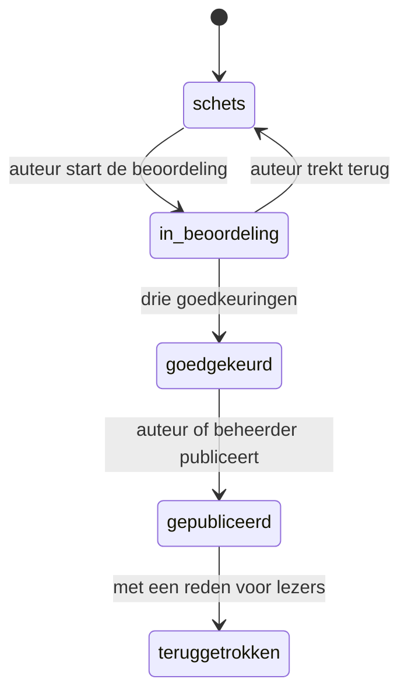

> [!tip] Zie ook
> [Een artikel schrijven](04-artikel-schrijven.md) voor de editor zelf.
````

## 18. Scope en begroting

### 18.1 Binnen en buiten de scope

**Binnen de scope**

1. De nieuwe editor naast WYMeditor voor *artikelen met review* en *tekstpagina's* (met versies en vertalingen): Opmaak en Markdown, vaste artikelkop met rubriek, bijsluiter en bronnen, webadres uit de titel, voorbeeld, checklist, beeld, tabellen, diagrammen, beoordelen en terugtrekken ([§5](#5-de-gekozen-oplossing) tot en met [§16](#16-klikbaar-prototype)).
2. Markdown naar XHTML op de server, de doorschakeling in de bestaande datatypes, het signaal in de opslag ([§12](#12-technische-keuzes-php-82), [§14](#14-projectie-op-de-xml-opslag)).
3. De modules **codemarkering** en **wiskunde** ([§10.1](#101-flexibiliteit-eigen-html-javascript-en-uitbreidingen)).
4. De **handleiding van Hypha** in het Nederlands, als Markdown voor Obsidian ([§17](#17-handleiding-van-hypha)).
5. Een **gouden dataset** van 10.000 verzonnen artikelen, met **unit tests** en **integratietests** ([§12.13](#1213-testen-gouden-dataset-unit-tests-en-integratietests)).
6. **Docker-deployment** blijft mogelijk en staat in de handleiding ([§12.14](#1214-docker-blijft-mogelijk)).
7. **Plakken** uit Word, Google Docs en LibreOffice volgens de acceptatiecriteria ([§12.15](#1215-acceptatiecriteria-plakken-uit-word-google-docs-en-libreoffice)).
8. De **prestatie-eisen** voor typen, bewaren, de leesweergave en het openen van de editor, en **Lighthouse 95+** ([§12.16](#1216-prestatie-eisen)).
9. Toegankelijkheid (WCAG 2.1 AA), Apple-stijlgids, Nederlandse teksten en packaging.

**Buiten de scope**

1. **Versies van een artikel** met verschillen en terugzetten (issue #241). Hypha bewaart bij een artikel nu alleen de laatste stand (`Xml::versionsOff`) en het nieuwe datatype doet dat ook (besluit 8 in [§20](#20-besluiten), BR-74).
2. Omzetten van bestaande HTML-artikelen naar Markdown. De oude editor blijft voor oude artikelen; omzetten kan later, als de nieuwe editor zich heeft bewezen en iedereen er tevreden over is ([§5.2](#52-migratie-de-oude-editor-blijft-voor-oude-artikelen), besluit 16).
3. Samen tegelijk in één artikel schrijven, zoals in HedgeDoc.
4. Het opruimen van WYMeditor en jQuery 1.7.1 voor de oude artikelen.
5. **Plaatjes** overnemen bij plakken uit een tekstverwerker; lukt het toch, dan is dat mooi meegenomen ([§12.15](#1215-acceptatiecriteria-plakken-uit-word-google-docs-en-libreoffice)).
6. **Hypha-macro's** in de tekst en **vrije JavaScript** in de pagina (besluit 17).
7. Een andere **opmaak van de gepubliceerde leesweergave**; alleen het voorbeeld voor de auteur toont de krantenopmaak (besluit 20).

### 18.2 Begroting

In mensdagen, uitgaande van een ontwikkelaar met AI-ondersteuning.

| # | Onderdeel | Dagen |
|---|---|---|
| 1 | Functioneel en grafisch ontwerp (dit document, verwerken van feedback) | 2 |
| 2 | Technisch ontwerp met proeven ([§13](#13-technisch-ontwerp-proeven-en-keuzes)): parser, filter, editorcomponenten, bundelen, paginatype, paginanaam, Lighthouse | 4 |
| 3 | Technisch prototype: beide weergaven, rendering, test op iPhone, iPad en Chromium; definitieve keuze van de componenten | 5 |
| 4 | Server: commonmark meeleveren, uitbreidingen (`[[…]]` naar pagina-id, callouts, `==…==`, bijschriften), filteren van HTML | 6 |
| 5 | Markdown-weergave: CodeMirror 6, Nederlandse werkbalk, /-menu, gedimde tekens, sneltoetsen, spiekbriefje (?), autosave | 6 |
| 6 | Opmaak-weergave (zoals Word) met ProseMirror op dezelfde Markdown-bron: eigen schema en serializer voor Hypha-Markdown, de schakelaar en het verwijderen van afbeeldingen | 8 |
| 7 | Artikelscherm: werkbalk op één regel met *Meer* en de weergave, checklist (alleen problemen, schakelaar), voorbeeld dat meeloopt en gelijk scrolt, *Naast elkaar* over de volle breedte met versleepbare scheiding, telefoon staand en liggend, rechterkolom die meescrolt, structuur dichtgevouwen | 4 |
| 7a | Vaste Frontmatter in Markdown en vaste artikelkop in Opmaak: synchroniseren met titel, auteur, uittreksel, rubriek, tags en de afbeelding bij het uittreksel, foutmelding bij kapotte Frontmatter; webadres uit de titel | 4 |
| 7b | Cursor op dezelfde plek bij wisselen tussen Opmaak en Markdown, tooltips op alle bedieningselementen | 1 |
| 7c | Tabellen: menu met aantal kolommen, uitlijnen per kolom, rijen en kolommen, rechtermuisknop, Tab tussen cellen, in beide weergaven | 2 |
| 8 | Beeld-dialoog (upload, beschrijving, bijschrift, plaatsing) en `[[`-suggesties | 4 |
| 9a | Flexibiliteit: niveau 1 en 2, eigen filter op de server voor HTML, SVG en MathML, ingesloten inhoud van zoveel mogelijk diensten, onbekende blokken bewaren | 2 |
| 9b | HedgeDoc-notatie: kaders `:::`, `[TOC]`, `++ins++`, `^sup^`, `~sub~`, afbeeldingsgrootte, extra metadata | 1 |
| 9c | Interactief blok op niveau 2: `html interactief`, afgeschermd iframe, hoogte, beschrijving, dialoog met codevenster en voorbeeld | 1 |
| 9d | Beoordelen: venster met redactiestatuut en opmerking, terugtrekken door de auteur, taal wijzigen (in het nieuwe datatype, naast de bestaande code) | 3 |
| 9e | Bijsluiter en bronnen in de Frontmatter en als vaste blokken, geen tabbladen; terugtrekken van een gepubliceerd artikel met melding voor lezers | 2 |
| 9 | Diagrammen met Pele: dialoog, 36 sjablonen met voorbeeld in de lijst (waarvan 11 technisch), plaatsing, Nederlandse foutmeldingen, SVG bij opslaan | 3 |
| 10 | Import en export van `.md` voor artikelen met Markdown-bron | 2 |
| 11 | Reviewstroom (en versies en diff bij tekstpagina's): aanpassen en regressietest, inclusief oude HTML-artikelen | 2 |
| 12 | Toegankelijkheid (WCAG 2.1 AA), Apple HIG, Nederlandse teksten (B2), hulppagina | 2 |
| 13 | Testronde op apparaten, `hypha.php`-packaging, documentatie | 3 |
| 14 | Module codemarkering: highlight.php op de server, highlight.js in de editor, kleuren in het thema met voldoende contrast, regelnummers | 2 |
| 15 | Module wiskunde: Temml in de editor en het voorbeeld, formule als blokje in Opmaak met bewerken, MathML door de allowlist van de server, foutmelding en tip, testset | 3 |
| 16 | Handleiding van Hypha in het Nederlands als Markdown voor Obsidian: gebruikshandleiding en technische handleiding op hoofdlijnen, met Frontmatter, Mermaid-diagrammen en schermafdrukken ([§17](#17-handleiding-van-hypha)) | 4 |
| 17 | Gouden dataset: generator met vaste seed, profielen voor 10.000 verzonnen artikelen (Markdown en oud HTML, alle statussen, randgevallen), manifest met de verwachte uitkomst, eenmalig nakijken ([§12.13](#1213-testen-gouden-dataset-unit-tests-en-integratietests)) | 2 |
| 18 | Testcases: unit tests in PHP en JavaScript, integratietests in de container op PHP 8.2 tot en met 8.5 (pagina's, reviewstroom, editor in de browser, regressie, tijd en geheugen), één opdracht per versie | 4 |
| 19 | Docker: image en Compose met de nieuwe editor, test op vier PHP-versies; handleidingpagina *Installatie, ook met Docker* ([§12.14](#1214-docker-blijft-mogelijk)) | 1 |
| 20 | Plakken uit Word, Google Docs en LibreOffice: opschonen, lijsten en koppen, tabellen, OMML naar LaTeX, plaktestdocument, vastgelegde klembord-HTML per programma, unit- en integratietests ([§12.15](#1215-acceptatiecriteria-plakken-uit-word-google-docs-en-libreoffice)) | 3 |
| 21 | Prestaties en Lighthouse: meetopstelling op iPhone 16, iPad en laptop, cache en laden van de editor, leesweergave zonder overbodige scripts, `lang` en `meta description` in de paginasjabloon, metingen in de integratietests ([§12.16](#1216-prestatie-eisen)) | 3 |
| 22 | Tekstpagina's met de nieuwe editor: bron per versie en per taal, verschillen, vertalen en terugzetten, regressie met oude tekstpagina's | 4 |
| | **Subtotaal** | **93** |
| | Reserve (circa 15 %) | 14 |
| | **Totaal** | **107** |

Het maximum is **160 dagen**; de begroting komt uit op **107 dagen**, met een reserve van circa 15 %. Versies van een artikel vallen buiten de scope (#241). Tot 160 dagen blijft ruim 50 dagen over, bijvoorbeeld voor een tweede gebruikerstest of later versies van een artikel.

## 19. Risico's en open vragen

**Risico's**

| Risico | Kans | Gevolg | Maatregel |
|---|---|---|---|
| Editorcomponent werkt slecht met iOS-invoer (autocorrectie, dicteren) | middel | hoog | als eerste toetsen in het technisch prototype op een echt apparaat; de textarea van het prototype als terugvaloptie |
| Twee soorten artikelen naast elkaar (HTML en Markdown) | zeker | middel | één signaal (`format="markdown"`) en terugval op HTML; regressietest met oude HTML-artikelen in een lokale testomgeving (de data blijft buiten de repository) |
| Markdown-bron en HTML lopen uit elkaar (bijv. handmatige wijziging in de XML) | laag | middel | de HTML wordt altijd uit de bron gerenderd bij opslaan; de bron is leidend |
| `[[Pagina]]` versus pagina-id's (hernoemen) | middel | middel | intern het pagina-id via `wikify_link()`, bij export de naam ([§13.4.2](#1342-hypha-uitbreidingen)) |
| Grootte van Pele in de editor | zeker | laag | pas laden als het artikel een diagram heeft of er een wordt ingevoegd; lezers krijgen SVG |
| Opmaak en Markdown lopen uit elkaar bij heen en weer wisselen | middel | middel | ProseMirror met een eigen serializer en één parser (markdown-it); een testset met alle ondersteunde syntaxis die heen en terug gelijk moet blijven |
| Pele is een jong project met snelle releases | middel | laag | vaste versie meeleveren; mermaid.js als terugvaloptie |
| Een lange Frontmatter (met bijsluiter en bronnen) maakt de Markdown-weergave onrustig | middel | laag | de Frontmatter is grijs; in Opmaak zijn het dichtvouwbare blokken; in CodeMirror is de Frontmatter in te klappen |
| Frontmatter wordt met de hand kapotgemaakt (bijv. `---` weggehaald) | middel | laag | de checklist meldt de regel en de laatste goede waarden blijven staan; wisselen naar Opmaak zet de vier regels weer goed |
| Overschrijding van de begroting | laag | middel | reserve van 14 dagen; daarboven ruimte tot 160 dagen |
| Formules of codekleuren zien er in de editor anders uit dan in het gepubliceerde artikel | middel | laag | MathML gaat bij opslaan mee (geen tweede omzetting op de server); highlight.php en highlight.js gebruiken dezelfde taaldefinities; testset met beide |
| De gouden dataset lijkt niet op echte artikelen | middel | middel | profielen afleiden uit de **opbouw** van echte artikelen (lengte, aantal koppen, foto's, kaders, tabellen), nooit uit hun inhoud; randgevallen apart toevoegen |
| Gouden uitkomsten worden klakkeloos bijgewerkt als een test faalt | middel | hoog | een gewijzigde uitkomst vraagt een verklaring in de commit en een tweede paar ogen |
| De tests met 10.000 artikelen duren te lang voor elke wijziging | middel | laag | een snelle selectie van 500 artikelen bij elke wijziging, de volledige set per oplevering en per PHP-versie |
| Handleiding veroudert zodra de editor verandert | middel | laag | elke pagina heeft `date_last_review`; een functionele wijziging krijgt een regel in `ai/DOCUMENTATION_LOG.md` en een bijgewerkte pagina |
| Eigen JavaScript van een auteur draait in de sessie van een beoordelaar of beheerder (*stored XSS*) | laag | hoog | JavaScript alleen in een `<iframe sandbox="allow-scripts">` zonder `allow-same-origin`; geen `<script>` in de pagina (besluit 17); het filter weert 25 van 25 aanvallen uit de proef |
| JavaScript in een interactief blok misbruikt de lezer (bijv. een nepformulier of zware berekening) | laag | middel | afgeschermd iframe zonder formulieren en pop-ups; beoordeling door collega's zoals nu; beheerder kan niveau 2 per rol uitzetten |
| Filter laat te veel of te weinig door | middel | middel | allowlist in plaats van blocklist; testset met HTML uit echte artikelen en HedgeDoc-notities |
| HTML-filter beschadigt een diagram (bijvoorbeeld `viewBox` of `-->`) | middel | middel | HTML5-parser in het filter; testset met alle 36 soorten door het filter van de server (in de proef 36 van 36 heel) |
| Cursor springt bij wisselen naar een verkeerde plek (bijv. bij een tabel of lijst) | middel | laag | blokken in beide weergaven op dezelfde manier tellen; terugvallen op het begin van het blok |
| `-beta`-soorten van Mermaid veranderen van notatie | middel | laag | vaste Pele-versie; sjablonen meetesten bij een update |
| De doorschakeling in de bestaande klassen raakt oude artikelen of tekstpagina's | laag | middel | alleen bij `format="markdown"`; regressietest met de oude inhoud uit de gouden dataset |
| Lighthouse 95 is niet haalbaar door het thema (contrast) of de scripts van Hypha | middel | middel | `lang`, `meta description` en `defer` in de paginasjabloon; voor het contrast een besluit over het thema |
| De bron van een tekstpagina met versies gaat niet goed door `storeWikiContent()` | laag | middel | eerst toetsen in het technisch prototype; anders een eigen versieknooppunt voor de bron |
| Google Docs of LibreOffice geeft een formule alleen als plaatje mee op het klembord | **gezien** bij LibreOffice (export); Google Docs middel | middel | Google Docs als eerste toetsen met een echte opname; zo ja: plaatshouder met een melding in de checklist, en rapporteren aan de opdrachtgever dat het criterium voor dat programma niet haalbaar is |
| De klembord-HTML van Word of Google Docs verandert met een nieuwe versie | middel | middel | vastgelegde klembord-HTML per versie in de tests; handmatige plaktest bij elke oplevering |
| Typen wordt traag bij een lang artikel met veel diagrammen | middel | hoog | zwaar werk buiten de toetsaanslag ([§12.16](#1216-prestatie-eisen)); meten met het langste randgeval van de gouden dataset |
| Bewaren duurt langer dan 1 seconde door e-mail met `mail()` bij een statuswijziging | middel | middel | meten met veel leden; zo nodig e-mail na het antwoord versturen (`fastcgi_finish_request` of een eenvoudige wachtrij) |
| De leesweergave haalt 250 ms niet door scripts of lettertypes van het thema | middel | middel | meten in een privévenster op iPhone 16; scripts met `defer`, lettertypes met `font-display: swap`, hoofdfoto met vaste maten |
| Auteurs vinden Markdown toch te technisch | middel | middel | opmaakeditor blijft; gebruikerstest met twee à drie auteurs in de prototypefase |

**Open vragen voor de opdrachtgever**

1. Mag de linkkleur van het thema van De Stadsbron van het merk-blauwgroen `#0c8599` (4,3:1 op wit) naar `#0B7285` (5,6:1)? Dat is nodig voor WCAG AA en voor de Lighthouse-score op toegankelijkheid; het verandert de kleur van alle links op de site.
2. Welke rubrieken heeft De Stadsbron, en mag de lijst worden overgenomen van de tags die nu als eerste tag worden gebruikt?

## 20. Besluiten

| # | Datum | Besluit | Toelichting |
|---|---|---|---|
| 1 | 2026-10-26 | De nieuwe editor komt **naast** WYMeditor; bestaande artikelen blijven HTML | [§4](#4-bekeken-mogelijkheden), richting 3 |
| 2 | 2026-10-26 | Standaard vrijheidsniveau **2**, met JavaScript alleen in een afgeschermd iframe | [§10.1](#101-flexibiliteit-eigen-html-javascript-en-uitbreidingen) |
| 3 | 2026-10-26 | **De auteur keurt het eigen artikel niet goed**; drie goedkeuringen komen van drie anderen | BR-94, BR-44 |
| 4 | 2026-10-26 | Bijsluiter en bronnen staan in de Frontmatter en als vaste blokken; **geen tabbladen** | [§8](#8-stap-voor-stap-met-schermschetsen) |
| 5 | 2026-10-26 | Tags alleen uit de vaste lijst; een nieuwe tag maakt alleen een beheerder | BR-45, BR-98 |
| 6 | 2026-10-27 | Het maximum voor de doorlooptijd is **160 dagen** | [§18](#18-scope-en-begroting) |
| 7 | 2026-10-27 | **Codemarkering** en **wiskunde** horen bij de eerste oplevering | [§10.1](#101-flexibiliteit-eigen-html-javascript-en-uitbreidingen) |
| 8 | 2026-10-27 | **Versies van Markdown-artikelen vallen buiten de scope** (issue #241); het nieuwe datatype houdt `Xml::versionsOff`, zoals het bestaande | BR-74; [§18.1](#181-binnen-en-buiten-de-scope) |
| 9 | 2026-10-27 | Een **handleiding van Hypha in het Nederlands**, als Markdown voor Obsidian, hoort bij de scope | [§17](#17-handleiding-van-hypha) |
| 10 | 2026-10-27 | Diagrammen gebruiken een **rustig deelpalet** van de huisstijl in plaats van felle contrasten | [§2.5](#25-huisstijl-van-de-stadsbron) |
| 11 | 2026-10-27 | Er komt een **gouden dataset van 10.000 verzonnen artikelen** voor de testcases | [§12.13](#1213-testen-gouden-dataset-unit-tests-en-integratietests) |
| 12 | 2026-10-27 | Er komen testcases met **unit tests** én **integratietests** | [§12.13](#1213-testen-gouden-dataset-unit-tests-en-integratietests) |
| 13 | 2026-10-27 | **Docker-deployment blijft mogelijk** en staat beschreven in de handleiding | [§12.14](#1214-docker-blijft-mogelijk) |
| 14 | 2026-10-27 | **Acceptatiecriteria voor plakken** uit Word, Google Docs en LibreOffice: vet, schuin, kop 1 tot en met 3, tabel, formule en beide soorten lijsten vrijwel ongewijzigd en met behoud van betekenis; plaatjes buiten de scope | [§12.15](#1215-acceptatiecriteria-plakken-uit-word-google-docs-en-libreoffice) |
| 15 | 2026-10-27 | **Prestatie-eisen**: typen binnen 100 ms, bewaren binnen 1 seconde, leesweergave binnen 250 ms op iPhone 16 in een anoniem venster, editor de tweede en volgende keer binnen 3 seconden open | [§12.16](#1216-prestatie-eisen) |
| 16 | 2026-10-27 | **De oude editor blijft** voor het bewerken van bestaande artikelen. Omzetten van oude artikelen naar Markdown kan ooit, als de nieuwe editor zich heeft bewezen en iedereen er tevreden over is, maar valt buiten de scope | [§5.2](#52-migratie-de-oude-editor-blijft-voor-oude-artikelen), [§18.1](#181-binnen-en-buiten-de-scope) |
| 17 | 2026-10-27 | **Niveau 3 en 4 worden niet gebouwd**: geen Hypha-macro's in de tekst en geen vrije JavaScript in de pagina; JavaScript alleen in een afgeschermd interactief blok (niveau 2) | [§10.1](#101-flexibiliteit-eigen-html-javascript-en-uitbreidingen) |
| 18 | 2026-10-27 | **Nieuwe artikelen en tekstpagina's openen altijd in de nieuwe editor**; het webadres volgt uit de titel (kleine letters, koppeltekens) | stap 1, BR-27, BR-28 |
| 19 | 2026-10-27 | De nieuwe editor geldt voor **artikelen met review én tekstpagina's** | [§5](#5-de-gekozen-oplossing), [§18](#18-scope-en-begroting) |
| 20 | 2026-10-27 | De **leesweergave van gepubliceerde artikelen verandert niet**; het voorbeeld voor de auteur toont wel intro en hoofdfoto bovenaan en citaat en kader in de marge | stap 9 |
| 21 | 2026-10-27 | **Rubriek** is een apart veld, één keuze uit de rubrieken van de site | BR-12, BR-47, [§9](#9-artikelvelden-hypha-xml-editor-en-markdown-bestand) |
| 22 | 2026-10-27 | De keuze van de schrijfwijze geldt **per gebruiker**; een beheerder zet haar niet per site vast | BR-25 |
| 23 | 2026-10-27 | Ingesloten inhoud op niveau 2 voor **zoveel mogelijk diensten** die een `<iframe>` over https aanbieden | [§10.1](#101-flexibiliteit-eigen-html-javascript-en-uitbreidingen) |
| 24 | 2026-10-27 | **Lighthouse**: elke score 95 of hoger, op telefoon en computer | [§12.16](#1216-prestatie-eisen) |
| 25 | 2026-10-27 | Hulpteksten en foutmeldingen op **taalniveau B2** | [§12.6](#126-nederlandse-taal) |
| 26 | 2026-10-27 | De technische keuzes T1 tot en met T12 van het technisch ontwerp, elk getoetst met een proef | [§13.18](#1318-besluiten-van-het-technisch-ontwerp) |
| 27 | 2026-10-27 | *Naast elkaar* gebruikt de **volle schermbreedte** met een versleepbare scheiding; het diagramvenster krijgt elf **technische soorten** | stap 2, stap 6b |

## 21. Volgende stappen

1. **Bespreken** van dit ontwerp en beantwoorden van de open vragen.
2. **Technisch ontwerp** bespreken: [§13](#13-technisch-ontwerp-proeven-en-keuzes), met de proeven en de keuzes T1 tot en met T12.
3. **Technisch prototype** met CodeMirror 6, ProseMirror en league/commonmark in Hypha, voortbouwend op het klikbare prototype; als eerste op een echte iPhone en iPad: autocorrectie, dicteren en de vergrootloep.
4. **Testen** op:
   1. iPhone (Safari, iOS actueel en vorige versie), iPad (Safari, met en zonder toetsenbord), Chrome en Edge (Windows/macOS) en een Chromebook;
   2. een gebruikerstest met twee à drie auteurs uit de doelgroep (taken: artikel starten, foto met bijschrift, kader, tijdlijn, beoordeling starten);
   3. import en export van `.md`-bestanden met een ander Markdown-programma;
   4. regressie: oude HTML-artikelen openen, bewerken en opslaan met de opmaakeditor, zonder wijziging in hun XML-structuur;
   5. de plaktest met Word, Google Docs en LibreOffice ([§12.15](#1215-acceptatiecriteria-plakken-uit-word-google-docs-en-libreoffice)), met als eerste de vraag in welke vorm een formule op het klembord komt;
   6. de prestatie-eisen en Lighthouse op iPhone 16, iPad en laptop ([§12.16](#1216-prestatie-eisen)).
5. **Handleiding** aanvullen in `docs/handleiding/`: de eerste vijf pagina's staan er ([§17.4](#174-inhoud)); de andere volgen, zodat de gebruikerstest ze kan meenemen.
6. **Gouden dataset** opbouwen: generator, profielen en manifest, en de uitkomsten eenmalig nakijken ([§12.13](#1213-testen-gouden-dataset-unit-tests-en-integratietests)).
7. **Testcases** schrijven: unit tests in PHP en JavaScript en integratietests in de container op PHP 8.2 tot en met 8.5, ook voor Docker ([§12.14](#1214-docker-blijft-mogelijk)).

---

### Bronnen bij de inventarisatie

1. TinyMCE 7 licentie: [migratiedocumentatie TinyMCE 7](https://www.tiny.cloud/docs/tinymce/7/migration-from-5x/) en [discussie over GPLv2+](https://github.com/tinymce/tinymce/discussions/9496)
2. league/commonmark: [Packagist](https://packagist.org/packages/league/commonmark), [installatie 2.x](https://commonmark.thephpleague.com/2.x/installation/)
3. ink-mde: [npm](https://npmjs.com/package/ink-mde)
4. OverType: [README](https://cdn.jsdelivr.net/npm/overtype@2.4.0/README.md)
5. Huisstijl: [test.destadsbron.nl](https://test.destadsbron.nl) (thema-CSS `data/themes/destadsbron/hypha.css` op die site); het voorbeeldartikel is verzonnen
6. Hypha-broncode: [`system/core/editor.php`](../../../system/core/editor.php), [`system/datatypes/peer_reviewed_article.php`](../../../system/datatypes/peer_reviewed_article.php), [`system/core/database.php`](../../../system/core/database.php), [`system/core/pages.php`](../../../system/core/pages.php), [`system/languages/nl.php`](../../../system/languages/nl.php)

## 22. Uitkomst van de bouw

De bouw (branch `issue520-bouw`, oktober 2026) volgt dit ontwerp. Wat anders is gebouwd, staat met de reden in [`20261026_MARKDOWN_EDITOR/BOUWLOG.md`](20261026_MARKDOWN_EDITOR/BOUWLOG.md#afwijkingen); de tests en hun uitkomsten per taak en het eindverslag ook. De belangrijkste punten:

1. **Doorschakelen** gebeurt aan het begin van `process()` (één regel per klasse), omdat de nieuwe reviewstappen eigen routes hebben; samen raken de wijzigingen 27 regels van `peer_reviewed_article.php` (waaronder exacte zoekpaden, want `//method` en `//title` vinden ook de bron en de `<title>` van een SVG), 3 van `text.php`, 2 van `pages.php` en 1 van `index.php`.
2. **XHTML via XML**: `storeWikiContent()` en `writeToElement()` lezen inhoud met de HTML-parser van libxml, die `viewBox` kleine letters geeft. De nieuwe code leest de XHTML als XML in, ook voor de versies van tekstpagina's (de terugvaloptie van §19).
3. **Tekstpagina's** houden hun paginanaam als titel; het webadres uit de titel geldt voor artikelen.
4. **Goedkeuren met het redactiestatuut** gebeurt in de leesweergave, waar beoordelaars nu al goedkeuren.
5. **Lighthouse**: een gepubliceerd artikel haalt met het standaardthema 96–100 voor prestaties en goede werkwijzen; toegankelijkheid 94 en SEO 91 liggen aan het thema (contrast) en het ontbreken van een `robots.txt`. Met het advies van §12.9 (`#0B7285`) wordt toegankelijkheid 98, met een `robots.txt` SEO 100. De editor haalt op de computer 99 / 95 / 100, op de telefoon (traag 4G) 85–88 voor prestaties, na compressie van de bestanden van Hypha (#573) en later laden van de bibliotheken voor diagrammen en formules; de rest houden jQuery en de css van Hypha en het thema tegen. Over gewoon http (een LAN of intranet) rekent de editor de SHA-256 van tekeningen zelf uit, want `crypto.subtle` bestaat alleen op https.
6. **Container**: met twee Apache-werkers moet keep-alive uit (`docs/container/hypha-vhost.conf`), anders wacht elk bestand seconden.
7. **Gelijktijdig werken** (gemeten met tot 32 verzoeken tegelijk): bron en XHTML lopen nooit uit elkaar, maar zonder controle ging een wijziging van een collega stil verloren. Gebouwd: een versiecontrole bij opslaan (`article/@md_revision`, bij tekstpagina's het tijdstip van de nieuwste bronversie) met een melding wie en wanneer, en *Toch opslaan*; tags na de tekst en alleen door de opslag waarvan de tekst bewaard is; de pagina op id opzoeken na het herladen van `hypha.xml`, met de opdracht `mdLocate` voor een editor waarvan de pagina intussen hernoemd is; statusovergangen opnieuw gecontroleerd onder het slot; concepten per pagina-id en per tabblad. De ACID-eigenschappen per bestand en over bestanden heen staan in `docs/technical/DATA_MODEL.md`.
8. **Thema's**: in het thema van De Stadsbron (smalle kolom van 720 px, geen Fork Awesome) bleek de editor afhankelijk van de schermbreedte en van het thema. Fork Awesome zit nu bij de editor, de indeling volgt de breedte van de editor zelf (container queries) en *naast elkaar* kan alleen als de kolom breed genoeg is.
9. **Unicode**: tekst in elk schrift komt goed door. Hersteld in de editor: `dir`/`lang`/`<bdi>` in het filter, dezelfde slug op server en browser ook zonder intl, NFC voor namen en tags, tellers in tekens zoals een lezer ze ziet. Een titel in een ander schrift dan Latijn geeft het adres `pagina`, zolang paginanamen buiten ASCII in Hypha niet werken (upstream #541, #543).
10. **Capaciteit**: per werker ongeveer 30 MB plus 7,5 MB per 1.000 pagina's; de index duurt boven ongeveer 25.000 pagina's langer dan 1 seconde, de editor boven 50.000 (`docs/handleiding/techniek/06-beheer.md`).
11. **Gevonden in bestaande code** en upstream gemeld met issue en waar mogelijk een pull request: #525–#530, #537, #539–#559, #560, #569, #571 (overzicht in `ai/reference/GITHUB_ISSUES_FILED_2026W44.md`).

