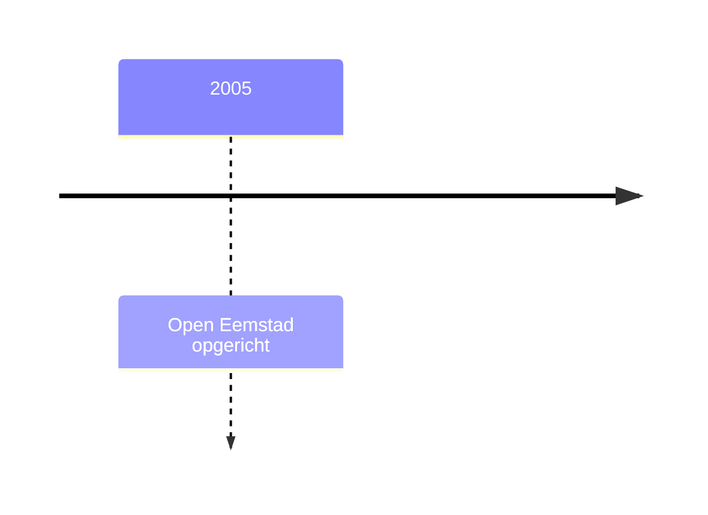

### Tussenkop

Gewone alinea met **vet**, *schuin*, ***beide***, `code`, ==gemarkeerd== en ~~doorgehaald~~.
Een [link](https://www.example.org) en een link naar [[Raadsnieuws]] en [[Raadsnieuws|de reeks]].

#### Subkop

1. een
2. twee
   - genest
   - nog een
3. drie

- [ ] taak open
- [x] taak klaar

> [!quote] Citaat
> Een raadslid dat de stukken niet leest, controleert niemand

> [!info] Open Eemstad in het kort
> Lokale partij uit Eemstad-Noord.

{.in-de-tekst}
*Bram Hoekstra tijdens zijn laatste raadsvergadering. Foto (naam fotograaf)*

| Onderdeel | Kosten | Klaar |
|:---|---:|:---:|
| Fietspad | € 1,6 miljoen | 2027 |

Een voetnoot.[^1] En een formule $\tfrac{4}{37} \approx 11\%$ in de tekst.

$$
\int_0^1 x^2\,dx = \tfrac{1}{3}
$$

%% beschrijving: tijdlijn van Bram Hoekstra %%


```php
<?php echo 'hallo';
```

<details><summary>Meer</summary>Uitklapbare tekst.</details>

---

[^1]: Raadsinformatie gemeente Eemstad (voorbeeldbron).
