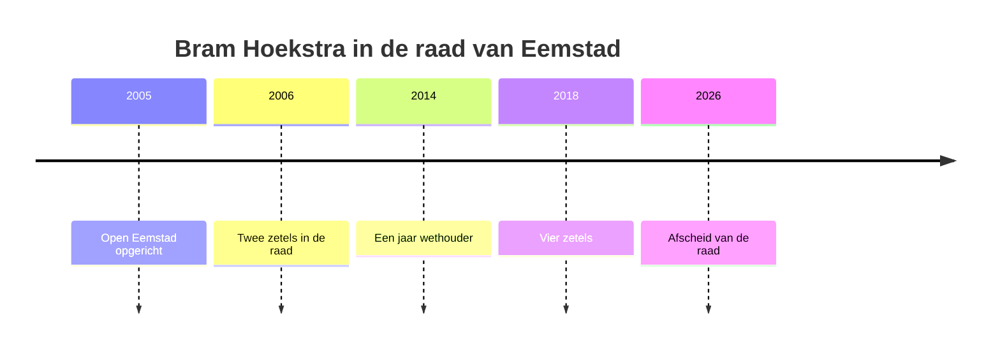

Bram Hoekstra (1962) was bibliothecaris in de wijk Eemstad-Noord toen buurtbewoners hem in 2005 vroegen of hij iets wilde doen met al hun klachten over het stadhuis. Stukken kwamen pas na de vergadering online, en wie wilde inspreken moest dat een week van tevoren per brief melden.

Hij richtte met een paar buren de wijkpartij Open Eemstad op. Bij de verkiezingen van 2006 haalde die **meteen twee zetels**. Hoekstra werd fractievoorzitter, een functie die hij twintig jaar zou houden.

### De eerste zetels

De eerste jaren waren leerzaam, zegt hij. Hij leerde begrotingen lezen, vragen stellen die een wethouder niet met een algemeen antwoord kon afdoen, en vooral: zelf stukken opvragen als ze niet kwamen. Zijn eerste motie, om alle raadsstukken een week voor de vergadering te publiceren, werd in 2007 aangenomen.

> [!quote] Citaat
> Een raadslid dat de stukken niet leest, controleert niemand

> [!info] Open Eemstad in het kort
> Lokale partij uit Eemstad-Noord, opgericht in 2005. Twee zetels in 2006, vier in 2018. Speerpunten: openbaarheid en wijkbudgetten.

### Wethouder voor één jaar

In 2014 werd Hoekstra gevraagd als wethouder voor wonen. Na een jaar stopte hij weer. „Ik merkte dat ik als wethouder minder kon zeggen dan als raadslid”, vertelt hij. Hij keerde terug naar de raad.[^1]

{.in-de-tekst}
*Bram Hoekstra tijdens zijn laatste raadsvergadering. Foto (naam fotograaf)*

### Een nieuwe generatie

Bij de verkiezingen van 2018 groeide Open Eemstad naar vier zetels, $\tfrac{4}{37} \approx 11\%$ van de raad, vooral door jongere kiezers uit de nieuwe wijken. Hoekstra haalde twee nieuwe raadsleden binnen en begeleidde hen in hun eerste jaar.

%% beschrijving: tijdlijn van Bram Hoekstra in de gemeenteraad van Eemstad, van 2005 tot 2026 %%

### ‘Lees je gewoon in’

Zijn advies aan nieuwe raadsleden is eenvoudig: lees de stukken voordat je naar een informatiebijeenkomst gaat. Een onderwerp is pas ==rijp voor besluit== als de raad het zelf heeft kunnen doorgronden, niet na een presentatie en drie vragen.

### Coalitie en controle

Wat hij het meest zal missen? Het debat zelf. Wat hij het minst zal missen: coalitiepartijen die elk voorstel van hun eigen wethouders steunen. Meer over de raad in de reeks [[Raadsnieuws]].

### Wat nu?

Hoekstra gaat terug naar de bibliotheek, als vrijwilliger. „Daar mag iedereen alles lezen.”

[^1]: Raadsinformatie gemeente Eemstad, 2015 (voorbeeldbron).
