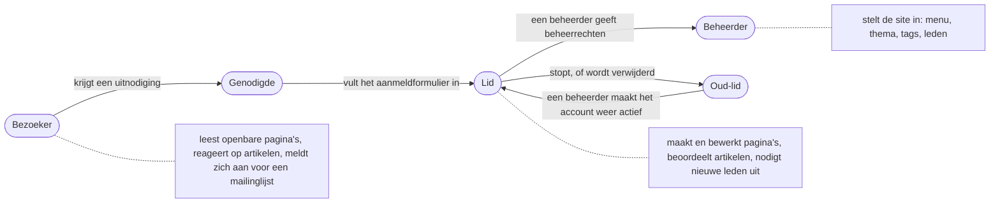

# Wat is Hypha?

Hypha is een website die een groep samen bijhoudt. Elk lid kan pagina's maken en bewerken, zonder dat er één webmaster nodig is. Deze pagina legt de belangrijkste begrippen uit: pagina's, talen, leden, het menu, tags, en het verschil tussen openbaar en privé.

## Wie doet wat?

Op een Hypha-site zijn er vier soorten mensen. Het diagram laat zien hoe iemand van bezoeker lid en beheerder wordt, en wat elke rol mag.

| Rol | Wat je kunt |
|---|---|
| bezoeker | openbare pagina's lezen, reageren op gepubliceerde artikelen, je aanmelden voor een mailinglijst of festival |
| lid | inloggen, pagina's maken en bewerken, privépagina's lezen, artikelen beoordelen, nieuwe leden uitnodigen |
| beheerder | alles wat een lid kan, plus de site instellen, pagina's verwijderen, nieuwe tags maken en leden beheren |
| oud-lid | niets meer; inloggen lukt niet tot een beheerder het account weer actief maakt |

Zelf een account aanmaken kan niet. Je wordt lid via een uitnodiging van een ander lid. Zie [Inloggen en je account](02-inloggen-en-account.md).

## Pagina's

Alles op een Hypha-site is een **pagina**. Elke pagina heeft een **type**, dat je kiest als je de pagina maakt. Het type ligt daarna vast.

| Type in Hypha | Waarvoor |
|---|---|
| webpagina (tekstpagina) | een gewone pagina met tekst, foto's en links; Hypha bewaart elke versie |
| artikel met review | een lang stuk dat pas verschijnt als drie collega's het hebben goedgekeurd |
| mailinglist | een lijst met e-mailadressen en nieuwsbrieven |
| festival pagina | aanmelden, betalen en een programma voor een evenement |

Meer over elk type:

1. [Een tekstpagina maken en bewerken](03-tekstpagina.md);
2. [Een artikel schrijven](04-artikel-schrijven.md) en [Een artikel beoordelen en publiceren](05-beoordelen-en-publiceren.md);
3. [Mailinglijst en festival](08-andere-paginatypes.md).

Een pagina heeft een **paginanaam**. Die naam staat in het webadres, bijvoorbeeld `/nl/Over_ons` voor de pagina *Over ons*. Hypha zet een spatie in het adres om in een liggend streepje. Bij een artikel met review volgt het webadres uit de titel, zoals `/nl/afscheid-van-bram-hoekstra`.

## Talen

Een pagina kan in meer talen bestaan. Elke taal is een **vertaling** met een eigen paginanaam. Het webadres begint met de taal: `/nl/…` voor Nederlands, `/en/…` voor Engels. Bovenaan een pagina zie je in welke talen ze nog meer bestaat.

Er zijn twee soorten taal:

1. de **taal van de inhoud**: in welke taal een pagina is geschreven;
2. de **bedieningstaal**: de taal van de knoppen en meldingen. Die kies je zelf in je account.

## Het menu

Bovenaan elke pagina staat het **menu** met links naar de belangrijkste pagina's. Een beheerder stelt het menu in. Rechtsboven staan de knoppen voor de index (alle pagina's), inloggen, nieuwe pagina en instellingen. Zie [Menu en navigatie](07-menu-en-navigatie.md).

## Tags

Een **tag** is een onderwerp, zoals *Raadsnieuws* of *Verkeer*. Onder een pagina staan haar tags. Klik op een tag en je ziet alle pagina's met die tag. Leden kiezen tags uit een vaste lijst; alleen een beheerder maakt een nieuwe tag. Zie [Beeld, links en tags](06-beeld-links-tags.md).

## Openbaar en privé

1. Een **openbare** pagina kan iedereen lezen, ook zonder in te loggen.
2. Een **privépagina** zien alleen leden die zijn ingelogd. Bezoekers krijgen de melding dat ze moeten inloggen. Je herkent een privépagina aan het sterretje achter de naam.
3. Een **artikel met review** is privé tot het is gepubliceerd. Dan wordt het openbaar.
4. Een link naar een privépagina ziet een bezoeker als gewone tekst, zonder link.

> [!tip] Wat leest een bezoeker?
> Wil je weten wat een bezoeker ziet? Log uit, of open de site in een privévenster van je browser.

## De samenvatting per e-mail

Hypha stuurt de leden regelmatig een **samenvatting** (*digest*) van wat er is veranderd: nieuwe en gewijzigde pagina's, met de verschillen gemarkeerd, en nieuwe leden. Hoe vaak, stelt een beheerder in. Zo blijft iedereen op de hoogte zonder elke dag te kijken.

## Nieuw met de tekst-editor

> [!info] Nieuw met de tekst-editor
> Hypha krijgt een **nieuwe tekst-editor** (issue [#520](https://github.com/PlanBCode/hypha/issues/520)). Daarin schrijf je in **Opmaak**, zoals in Word, of in **Markdown**, met eenvoudige tekens. Nieuwe artikelen en nieuwe tekstpagina's openen in de nieuwe editor. Pagina's en artikelen die al bestaan, openen in de vertrouwde opmaakeditor.

## Meer lezen

1. [Inloggen en je account](02-inloggen-en-account.md)
2. [Veelgestelde vragen](09-vragen.md)
3. [Terug naar de inhoud](../index.md)
