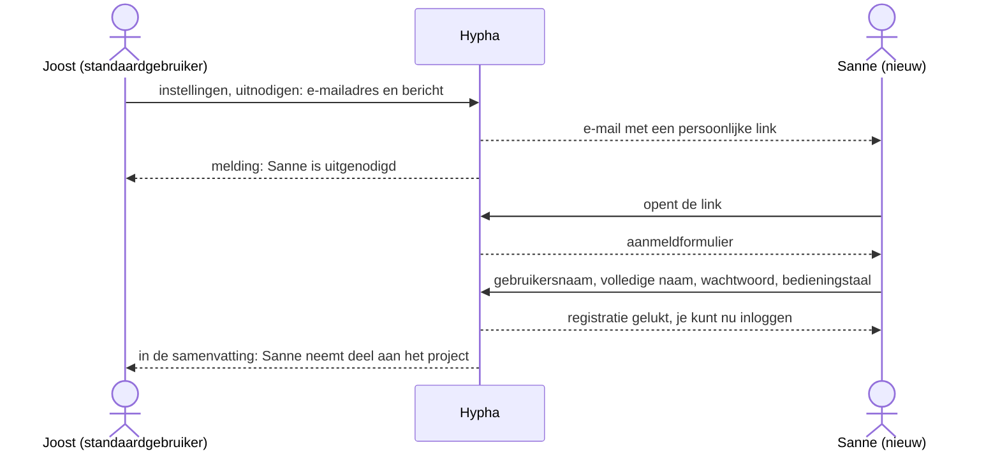
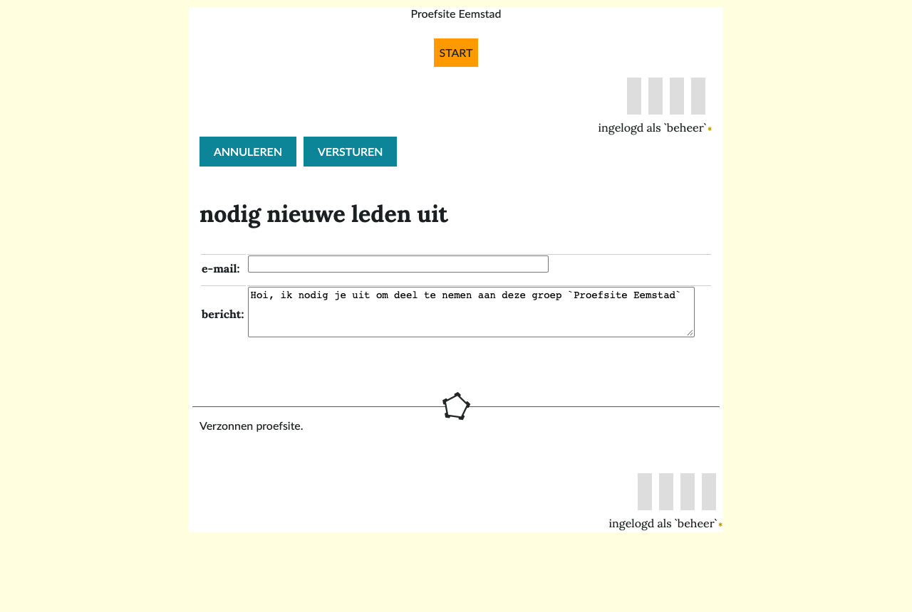
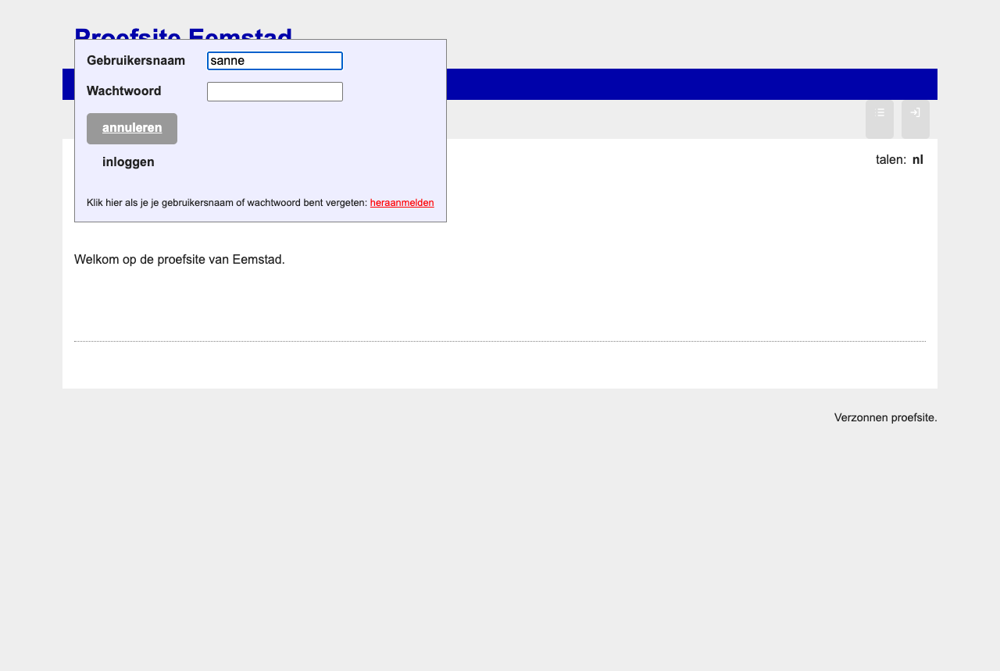
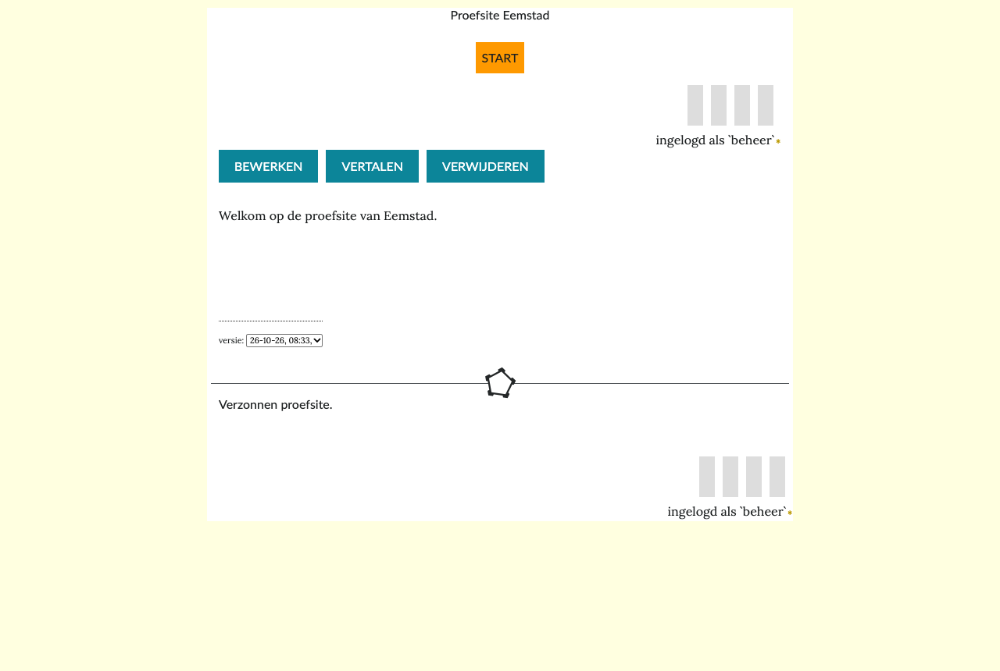
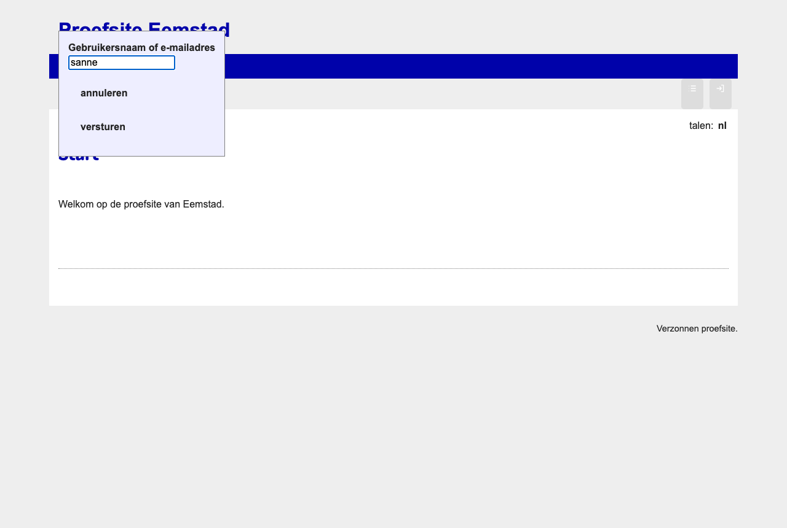
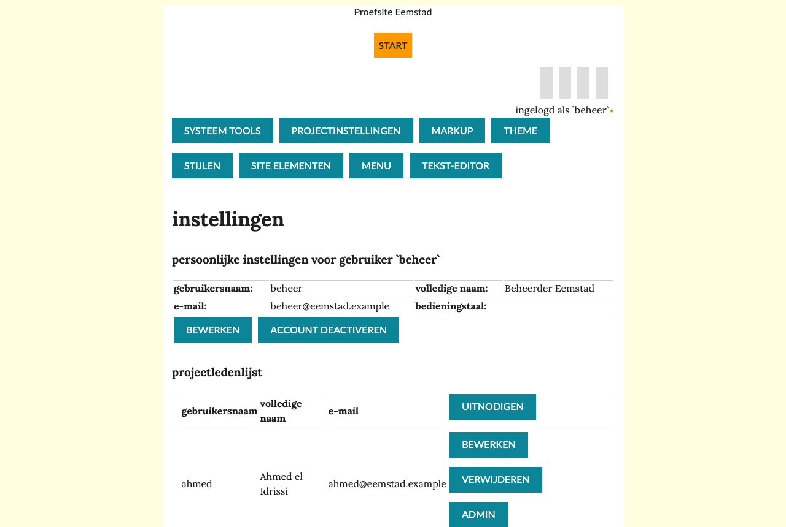
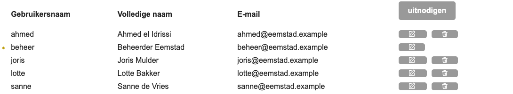

# Inloggen en je account

Om pagina's te maken en te bewerken, heb je een account nodig. Deze pagina legt uit hoe je gebruiker wordt, hoe je inlogt, wat je doet als je je wachtwoord kwijt bent, en hoe je je gegevens wijzigt.

## Gebruiker worden met een uitnodiging

Zelf een account aanmaken kan niet. Een gebruiker van de site nodigt je uit. Het diagram laat zien hoe dat gaat, met Sanne als nieuwe gebruiker en Joost als standaardgebruiker die haar uitnodigt.

### Iemand uitnodigen

1. Log in en klik rechtsboven op **instellingen** (het tandwiel).
2. Klik in de **projectledenlijst** op **uitnodigen**.
3. Vul het **e-mailadres** in, bijvoorbeeld `sanne.devries@eemstad.example`. Meer adressen scheid je met een komma.
4. Pas het **bericht** aan als je wilt, en kies **versturen**.

Zolang de genodigde zich niet heeft aangemeld, staat ze in de projectledenlijst als genodigde. Een geprivilegieerde gebruiker kan haar met **herinneren** nog een keer de link sturen.

### Je aanmelden

1. Open de link uit de e-mail met de uitnodiging.
2. Kies een **gebruikersnaam**. Gebruik alleen letters en cijfers.
3. Vul je **volledige naam** in. Die zien andere gebruikers, bijvoorbeeld bij je artikelen.
4. Kies een **wachtwoord** en typ het nog een keer bij **bevestig wachtwoord**.
5. Kies je **bedieningstaal**: de taal van de knoppen en meldingen.
6. Kies **versturen**. Je bent nu standaardgebruiker en kunt inloggen.

> [!warning] De link is persoonlijk
> Stuur de link uit de uitnodiging niet door. Wie de link heeft, kan het account aanmaken.

## Inloggen en uitloggen

1. Klik rechtsboven op het pictogram om in te loggen. Het venster om in te loggen opent.
2. Vul je **Gebruikersnaam** en **Wachtwoord** in en kies **inloggen**. Met **annuleren** sluit je het venster. Annuleren staat in elk venster links, de knop die iets doet rechts.
3. Je blijft op dezelfde pagina. Rechtsboven staat nu **Aangemeld als** met je gebruikersnaam. Je ziet knoppen als **bewerken**, **nieuwe pagina** en **instellingen**.
4. Uitloggen doe je met het pictogram rechtsboven. Was je op een privépagina, dan ga je naar de startpagina.

> [!info] Inloggen zonder JavaScript
> Inloggen werkt ook als JavaScript in je browser uit staat. Het pictogram is een gewone link: het opent de pagina met `?login` achter het adres, bijvoorbeeld `/nl/Start?login`. Daar staat het venster om in te loggen al open. Alleen **heraanmelden** heeft nog JavaScript nodig.

## Wachtwoord of gebruikersnaam vergeten

1. Klik op inloggen en daarna op **heraanmelden**, onder de knoppen. Het venster lijkt op het venster om in te loggen.
2. Vul je **Gebruikersnaam of e-mailadres** in en kies **versturen**. Met **annuleren** ga je terug naar het venster om in te loggen.
3. Bovenaan de pagina staat of het gelukt is. Je krijgt een e-mail met een link. Open die link.
4. Je ziet hetzelfde formulier als bij het aanmelden. Kies een nieuw wachtwoord en kies **versturen**.

> [!tip] Geen e-mail gekregen?
> Kijk in je map met ongewenste e-mail. Staat de e-mail er niet, vraag dan een geprivilegieerde gebruiker om hulp. Die kan in de projectledenlijst je e-mailadres controleren en een nieuw wachtwoord instellen.

## Je gegevens wijzigen

1. Klik rechtsboven op **instellingen**.
2. Onder **persoonlijke instellingen** zie je je gebruikersnaam, volledige naam, e-mailadres en bedieningstaal.
3. Kies **bewerken**.
4. Wijzig wat je wilt. Laat je de velden voor het wachtwoord leeg, dan blijft je wachtwoord hetzelfde.
5. Kies **opslaan**.

## Stoppen als gebruiker

1. Klik op **instellingen** en daarna op **account deactiveren**.
2. Schrijf eventueel een bericht. Hypha stuurt het naar de andere gebruikers.
3. Kies **versturen** en bevestig. Je wordt uitgelogd.

Je account blijft bestaan, maar je bent dan *geen gebruiker* meer; je pagina's en artikelen blijven staan. Alleen een geprivilegieerde gebruiker kan je account weer actief maken.

## Voor geprivilegieerde gebruikers

In de projectledenlijst heeft een geprivilegieerde gebruiker per gebruiker twee pictogrammen:

| Pictogram | Wat het doet |
|---|---|
| potlood | de gegevens van de gebruiker wijzigen, ook de **Rechten**: geprivilegieerde gebruiker, standaardgebruiker of geen gebruiker |
| prullenbak | de gebruiker wordt *geen gebruiker* en kan niet meer inloggen; de laatste geprivilegieerde gebruiker heeft geen prullenbak |

Bij een genodigde staat ook **herinneren**: de uitnodiging gaat dan nog een keer.

Gebruikers beheren en met de hand een wachtwoord instellen staat in [Gebruikersbeheer](10-gebruikersbeheer.md).

Meer over rollen en beveiliging staat in [Beveiliging](../techniek/07-beveiliging.md).

## Meer lezen

1. [Wat is Hypha?](01-wat-is-hypha.md)
2. [Veelgestelde vragen](09-vragen.md)
