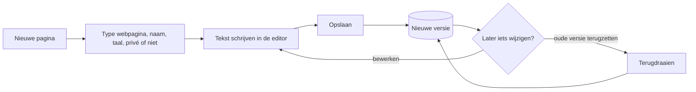
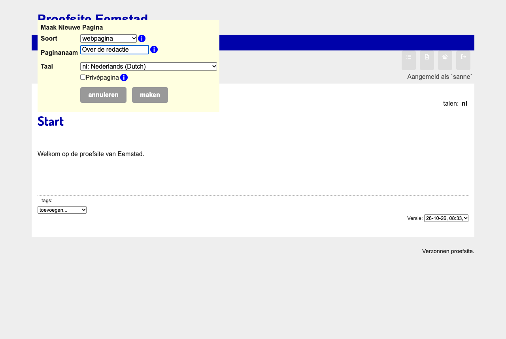
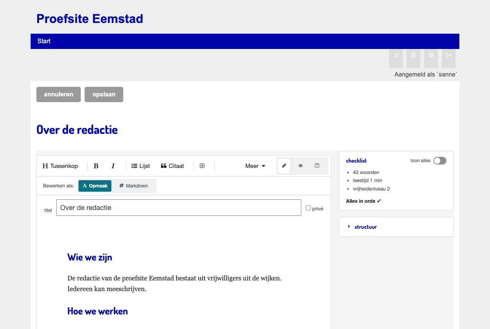
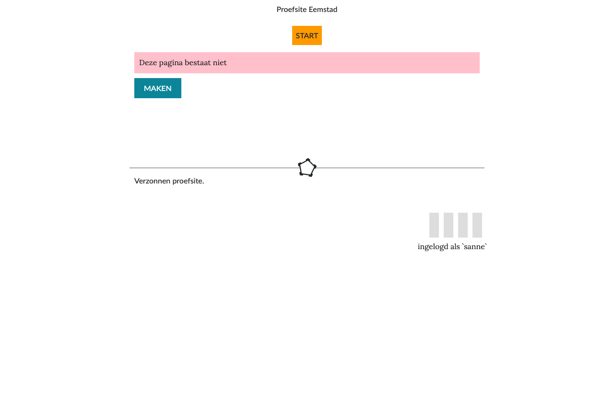
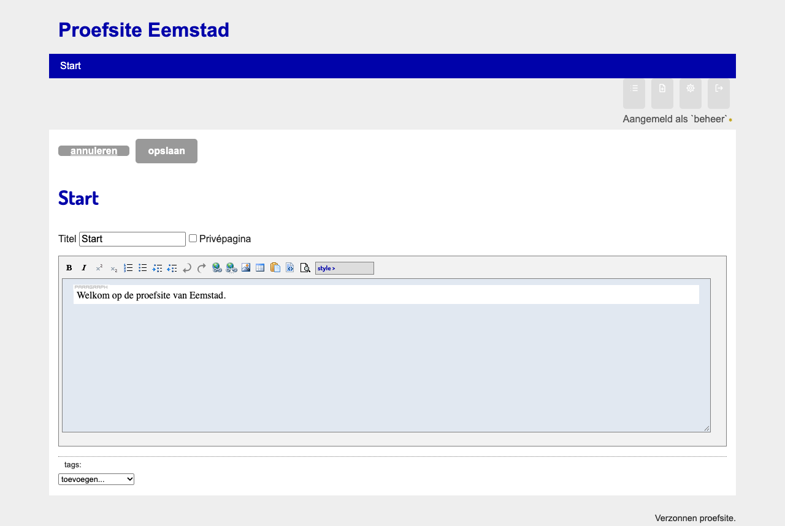

# Een tekstpagina maken en bewerken

Een *tekstpagina* is een gewone pagina met tekst, foto's en links, zoals *Over ons* of *Contact*. In Hypha heet dit type **webpagina**. Elke gebruiker kan een tekstpagina maken en bewerken. Hypha bewaart elke versie, zodat je altijd terug kunt naar een eerdere tekst.

## Wat je nodig hebt

1. Een account als **gebruiker** van de site.
2. Je bent **ingelogd**. Zie [Inloggen en je account](02-inloggen-en-account.md).

## Het proces in het kort

Het diagram laat zien hoe een tekstpagina ontstaat en hoe elke keer opslaan een nieuwe versie maakt.

## Een nieuwe tekstpagina maken

1. Klik rechtsboven op **nieuwe pagina**.
2. Kies als paginatype **webpagina**.
3. Typ de **paginanaam**, bijvoorbeeld `Over ons`. De naam is ook de titel van de pagina.
4. Kies de **taal** van de pagina.
5. Vink **privepagina** aan als alleen ingelogde gebruikers de pagina mogen zien.
6. Kies **maken**. De pagina opent meteen om te bewerken.

Het webadres volgt uit de paginanaam. Spaties worden liggende streepjes: *Over ons* krijgt het adres `/nl/Over_ons`. Leestekens als `?` en `!` kunnen niet in een paginanaam.

> [!info] Nieuw met de tekst-editor
> Een **nieuwe** tekstpagina opent in de **nieuwe tekst-editor**, net als een artikel. Je schrijft in **Opmaak** (zoals in Word) of in **Markdown**, en je kunt altijd wisselen. Anders dan bij een artikel blijft bij een tekstpagina de **paginanaam de titel**: het veld **titel** bovenaan is de naam van de pagina, zoals die in het menu en in het webadres staat. Een tekstpagina heeft geen artikelkop, geen checklist en geen beoordeling.

## De tekst schrijven

In de nieuwe tekst-editor:

1. Bovenaan staan de **titel** (de paginanaam) en het vinkje **privé**.
2. Schrijf de tekst. Een lege regel begint een nieuwe alinea.
3. Gebruik de knoppen voor een tussenkop, vet, een lijst, een citaat of een kader. Typ aan het begin van een lege regel een **/** voor alles wat je kunt invoegen: tabel, beeld, diagram, formule, code.
4. Een foto voeg je toe met **Beeld…**; een link naar een andere pagina met `[[`. Zie [Beeld, links en tags](06-beeld-links-tags.md).
5. Kies **opslaan**.

Hoe de editor verder werkt, met Opmaak en Markdown, het voorbeeld en plakken uit Word, staat in [Een artikel schrijven](04-artikel-schrijven.md). Voor een tekstpagina werkt het hetzelfde.

## Een tekstpagina bewerken

1. Open de pagina en kies **bewerken**.
2. Wijzig de tekst.
3. Wil je de naam van de pagina veranderen? Pas dan de **titel** aan. Het webadres verandert mee. Links naar de pagina blijven werken, omdat Hypha ze bewaart met een vast nummer van de pagina.
4. Kies **opslaan**. Hypha maakt een nieuwe versie.

> [!warning] Twee mensen tegelijk
> Bewerken twee gebruikers dezelfde pagina tegelijk, dan wint wie het laatst opslaat. Het werk van de ander staat dan in een oudere versie. Spreek af wie wat doet, of zet een oude versie terug en voeg de wijzigingen samen.

## Versies en verschillen

Hypha bewaart elke versie van een tekstpagina, per taal.

1. Onder de pagina staat een lijst **versie**, met de datum, de tijd en wie de versie heeft opgeslagen. Alleen ingelogde gebruikers zien die lijst.
2. Kies een oudere versie. Hypha toont de pagina zoals ze toen was.
3. Is dat de tekst die je wilt, kies dan **terugdraaien**. De oude tekst wordt de nieuwste versie. De versies daartussen blijven bewaard.
4. Wil je toch niet terug, kies dan in de lijst weer de bovenste versie.

De **verschillen** tussen versies zie je in de samenvatting die Hypha per e-mail naar de gebruikers stuurt: nieuwe tekst en weggehaalde tekst zijn gemarkeerd, zoals bij *wijzigingen bijhouden* in Word.

## Vertalen

1. Open de pagina en kies **vertalen**.
2. Kies de **taal** van de vertaling en geef de pagina een naam in die taal, bijvoorbeeld `About us`.
3. Vertaal de tekst en kies **opslaan**.

Bovenaan de pagina zie je nu beide talen. Elke taal heeft haar eigen versies.

## Verwijderen

Alleen een **geprivilegieerde gebruiker** kan een pagina verwijderen, met de knop **verwijderen**. Vraag het een geprivilegieerde gebruiker als een pagina weg moet.

## Oudere tekstpagina's

Tekstpagina's die bestonden vóór de nieuwe tekst-editor, zijn opgeslagen als HTML. Ze openen in de oude **opmaakeditor** (WYMeditor), met een veld voor de titel en het vinkje privépagina. Ze worden niet omgezet. Versies, terugdraaien en vertalen werken op dezelfde manier.

## Veelgestelde vragen

1. **Waar staat mijn pagina in het menu?** Nergens, tot een geprivilegieerde gebruiker haar toevoegt. Zie [Menu en navigatie](07-menu-en-navigatie.md). Via de **index** vind je elke pagina.
2. **Kan ik een tekstpagina omzetten in een artikel?** Nee. Het type ligt vast. Maak een nieuw artikel en kopieer de tekst.
3. **Zien bezoekers oude versies?** Nee. Alleen ingelogde gebruikers zien de lijst met versies.
