# Een artikel schrijven

Een *artikel met review* is een lang stuk dat pas verschijnt als drie collega's het hebben goedgekeurd. Deze pagina legt uit hoe je zo'n artikel maakt en schrijft. Hoe het daarna verder gaat, staat in [Een artikel beoordelen en publiceren](05-beoordelen-en-publiceren.md).

> [!info] Nieuw met de tekst-editor
> Deze pagina beschrijft de **nieuwe tekst-editor** voor artikelen, die in ontwikkeling is (issue [#520](https://github.com/PlanBCode/hypha/issues/520)). Artikelen die al bestaan, openen in de vertrouwde opmaakeditor; zie [Oudere artikelen](#oudere-artikelen) onderaan.

## Wat je nodig hebt

1. Een account als **lid** van de site. Je wordt lid via een uitnodiging van een ander lid.
2. Je bent **ingelogd**.
3. De tekst van je artikel, of een idee om mee te beginnen.

## Het schrijfproces in het kort

Het diagram laat de stappen zien, van een nieuwe pagina tot een artikel dat klaar is voor beoordeling.

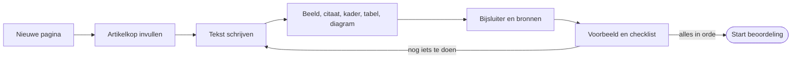

## Stap voor stap

### 1. Een nieuw artikel maken

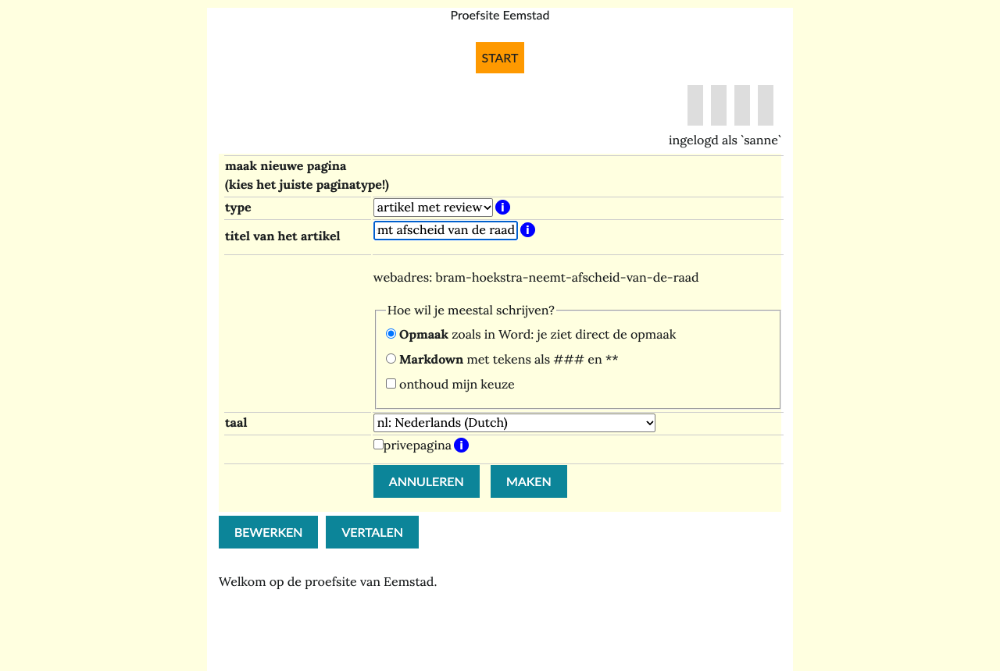

1. Klik op **nieuwe pagina**.
2. Kies als type **artikel met review**.
3. Typ de **titel** van het artikel. Het webadres volgt er vanzelf uit: de woorden in kleine letters, met streepjes ertussen en zonder accenten, bijvoorbeeld `/nl/vertrekkend-raadslid-bram-hoekstra-twintig-jaar-strijd-voor-open-bestuur`. Je ziet het adres meteen onder de titel. Bestaat het al, dan komt er `-2` achter.
4. Een nieuw artikel opent **altijd in de nieuwe tekst-editor**.
5. Kies **maak pagina**. Het artikel heeft nu de status *schets* en is alleen zichtbaar voor leden. Het webadres ligt nu vast; verander je de titel later flink, dan stelt de checklist voor het adres bij te werken, zolang het artikel nog niet gepubliceerd is.

### 2. Kiezen hoe je schrijft

Boven het tekstkader staat de schakelaar **Bewerken als**:

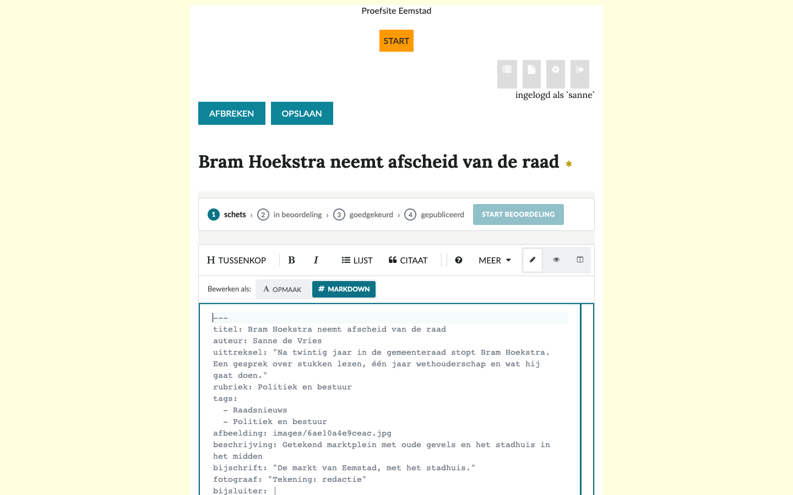

1. **Opmaak**: je schrijft zoals in Word. Vet is vet, een tussenkop is groot, een foto zie je meteen.
2. **Markdown**: je schrijft met eenvoudige tekens, zoals `###` voor een tussenkop en `**vet**` voor vet. De tekens staan grijs, zodat ze niet afleiden. De knop **(?)** opent een spiekbriefje.

Je kunt altijd wisselen; er gaat niets verloren en de cursor blijft op dezelfde plek. De editor begint in **Opmaak**. Je keuze wordt onthouden. Naast elkaar kan alleen als er genoeg ruimte is: een scherm van minstens 1024 pixels breed, en een thema dat de pagina breed genoeg maakt. Het thema van De Stadsbron heeft een smalle kolom; daar toont deze knop het voorbeeld in plaats van de tekst.

Rechts in de werkbalk kies je wat je ziet:

1. **Schrijven**: alleen de tekst;
2. **Voorbeeld**: het artikel zoals de lezer het ziet;
3. **Naast elkaar**: tekst en voorbeeld naast elkaar, over de hele breedte van het scherm. Het voorbeeld scrolt mee met de plek waar je typt. Sleep de streep tussen tekst en voorbeeld om de ruimte anders te verdelen; met de pijltjestoetsen kan het ook, en dubbelklikken zet de streep terug in het midden. Je keuze wordt onthouden.

### 3. De artikelkop invullen

Bovenaan staat de **artikelkop** met vaste velden. Ze horen bij elk artikel:

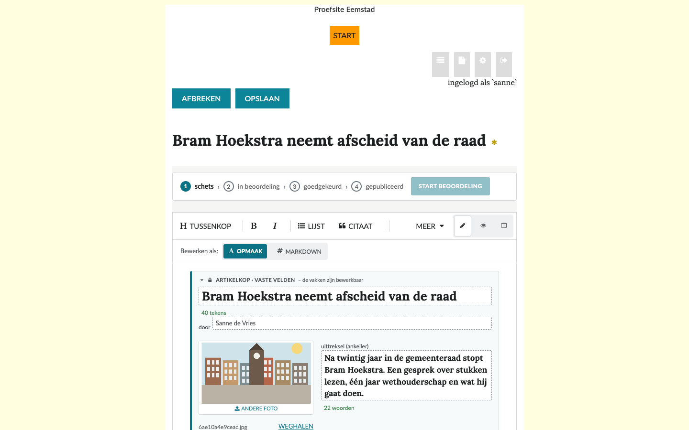

| Veld | Wat je invult | Verplicht |
|---|---|---|
| titel | de kop van het artikel, liefst korter dan 90 tekens | ja |
| auteur | je naam, zoals die boven het artikel komt | ja |
| uittreksel | twee à drie zinnen die lezers naar het artikel trekken (de *ankeiler*) | ja |
| rubriek | de rubriek waar het artikel onder valt, één uit de lijst van de site | ja |
| tags | één of meer onderwerpen uit de vaste lijst van de site | ja |
| afbeelding | een foto bij het uittreksel, met beschrijving, bijschrift en fotograaf | aangeraden |

1. De **rubriek** en de tags kies je uit een lijst. Een artikel heeft precies één rubriek en één of meer tags. Een nieuwe tag kan alleen een beheerder maken; vraag het de redactie als je er een mist.
2. De **beschrijving** van een foto is voor wie de foto niet kan zien, bijvoorbeeld met voorleessoftware. Beschrijf wat er op de foto staat.

In Markdown staan dezelfde velden als *Frontmatter* bovenaan de tekst, tussen twee regels `---`:

```markdown
---
titel: "Vertrekkend raadslid Bram Hoekstra: twintig jaar strijd voor open bestuur"
auteur: Sanne de Vries
uittreksel: "Twintig jaar lang vroeg Bram Hoekstra in de raad van Eemstad om openbare stukken en debatten."
rubriek: Politiek en bestuur
tags:
  - Raadsnieuws
afbeelding: beeld/hoekstra.jpg
beschrijving: Bram Hoekstra in de raadszaal van Eemstad
bijschrift: Bram Hoekstra na twintig jaar in de raad van Eemstad.
fotograaf: Foto (naam fotograaf)
---
```

### 4. De tekst schrijven

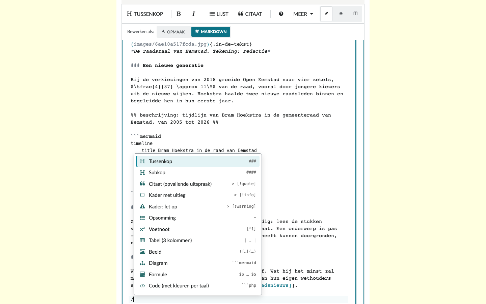

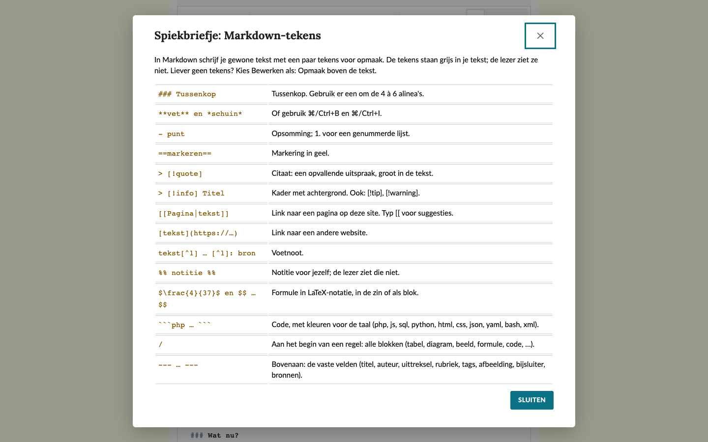

1. Schrijf gewoon. Een lege regel begint een nieuwe alinea.
2. Een **tussenkop** maak je met de knop **Tussenkop**, of in Markdown met `### ` aan het begin van de regel.
3. Typ aan het begin van een lege regel een **/** voor een lijst met alles wat je kunt invoegen: tabel, citaat, kader, diagram, beeld, formule, code.
4. Een link naar een andere pagina van de site maak je met `[[` gevolgd door de naam; de editor stelt pagina's voor.
5. Een **voetnoot** maak je met `[^1]` in de tekst en `[^1]: Bron of uitleg` onderaan.

> [!tip] Plakken uit Word, Google Docs of LibreOffice
> Plak gerust tekst uit Word, Google Docs of LibreOffice. De editor neemt vet, schuin, koppen, tabellen, formules, lijsten en links over en laat de rest weg, zodat de opmaak niet verspringt. Kop 1 wordt een tussenkop. Foto's gaan niet altijd mee: voeg ze dan toe met **Beeld…**; de checklist herinnert je eraan. Wil je alleen de tekst, zonder opmaak? Plak dan met ⌘⇧V (Ctrl+Shift+V).

### 5. Beeld, citaat, kader, tabel en diagram toevoegen

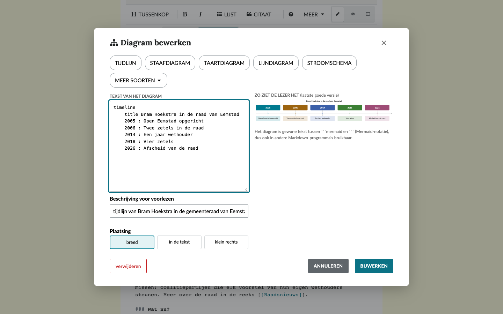

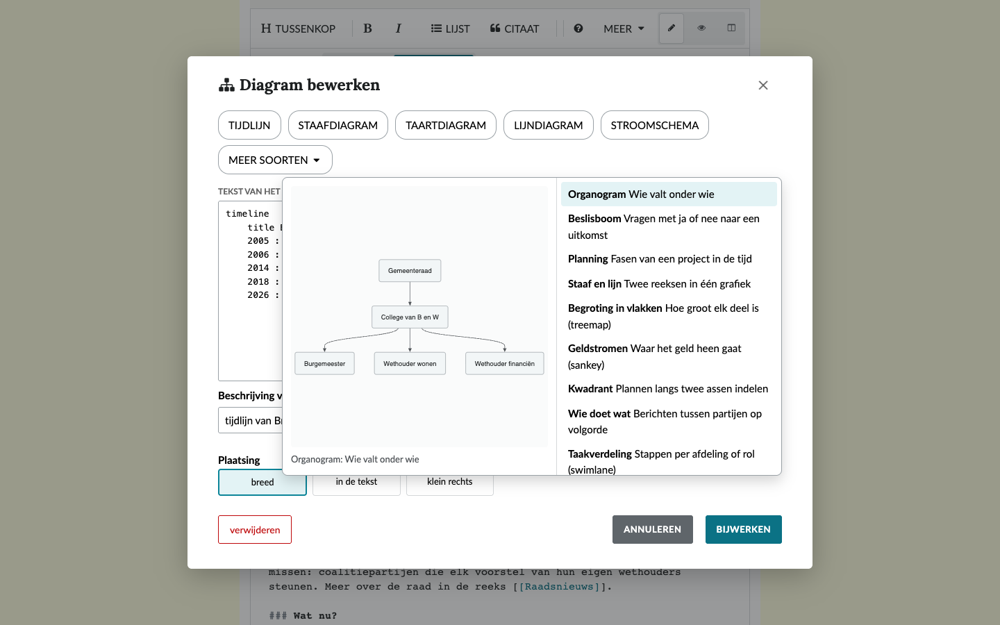

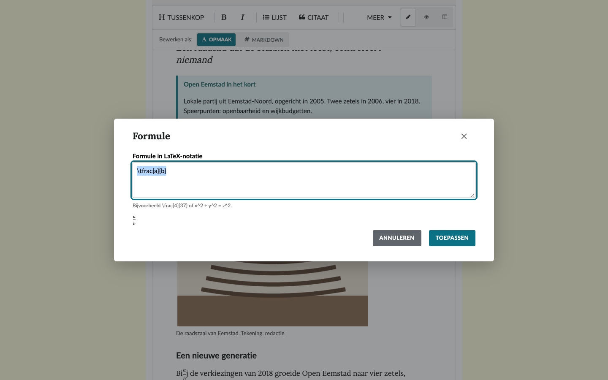

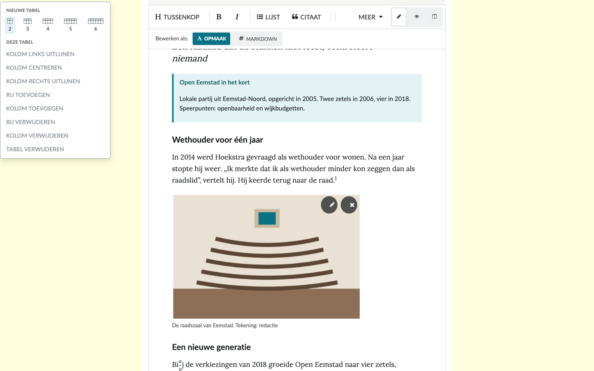

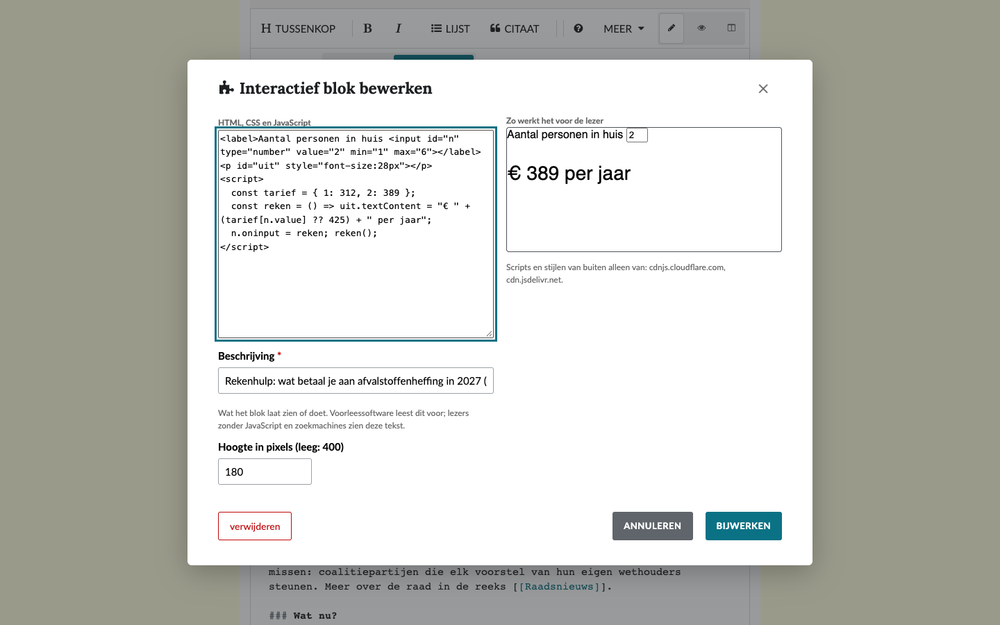

| Wat | Knop | Waarvoor |
|---|---|---|
| foto | **Beeld…** | een foto met beschrijving, bijschrift, fotograaf en plaatsing (breed, in de tekst, klein rechts) |
| citaat | **Citaat** | een uitspraak die je wilt laten opvallen; selecteer eerst de tekst, dan komt die in het citaat |
| kader | **Kader** | achtergrond of uitleg naast het verhaal, met een eigen titel |
| tabel | **Tabel ▾** | cijfers of een overzicht; kies het aantal kolommen, gebruik Tab om naar de volgende cel te gaan |
| diagram | **Diagram…** | een tijdlijn, staafdiagram, stroomschema en meer; onder **Technisch** ook soorten als klassen, architectuur en versiebeheer; kies een voorbeeld en pas de tekst aan |
| formule | **Formule** | een formule in LaTeX-notatie, zoals `$\tfrac{4}{37}$` |

Een foto of diagram **bewerk** je met het potlood of een dubbelklik, en **verwijder** je met het kruisje. Daarna kun je het verwijderen nog ongedaan maken.

Een diagram is gewone tekst. Zo ziet een tijdlijn eruit:

````markdown
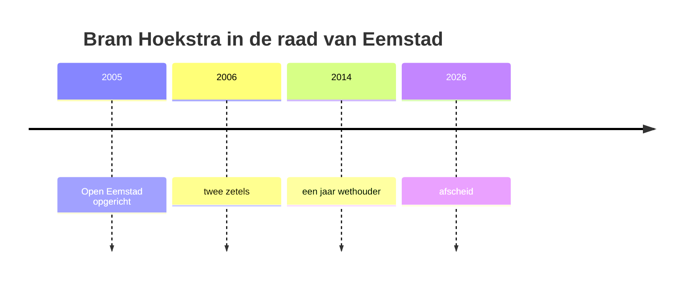
````

Geef elk diagram een korte **beschrijving voor voorlezen**, bijvoorbeeld „tijdlijn van Bram Hoekstra in de gemeenteraad, van 2005 tot 2026”.

### 6. Bijsluiter en bronnen

Onderaan het artikel staan twee vaste blokken:

1. **Bijsluiter** (verplicht): hoe je het onderwerp hebt onderzocht. Bijvoorbeeld met wie je hebt gesproken en welke stukken je hebt gelezen.
2. **Bronnen** (aangeraden): de documenten, websites en gesprekken waarop het artikel steunt.

In Markdown staan ze in de Frontmatter, als `bijsluiter:` en `bronnen:`.

### 7. Controleren met de checklist

Rechts staat de **beoordelingschecklist**. Ze toont alleen wat nog aandacht vraagt; met **toon alles** zie je ook wat in orde is.

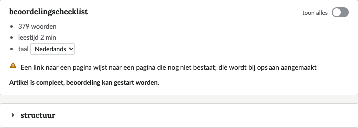

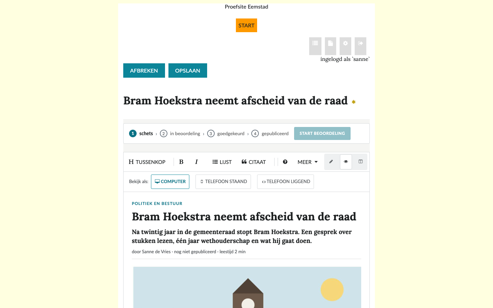

| Controle | Soort |
|---|---|
| heeft artikelinhoud | verplicht |
| heeft een uittreksel | verplicht |
| heeft een bijsluiter | verplicht |
| heeft één of meer tags | verplicht |
| heeft één of meer bronnen | aangeraden |
| heeft een afbeelding bij het uittreksel | aangeraden |

Daarnaast geeft de checklist tips, bijvoorbeeld bij zinnen langer dan 30 woorden, een foto zonder beschrijving of een formule die niet klopt. Een tip houdt je niet tegen.

Zo lang een verplichte controle niet in orde is, kun je de beoordeling niet starten.

### 8. Opslaan en de beoordeling starten

1. Kies **opslaan** (of ⌘/Ctrl+S). Tot je opslaat, bewaart de browser je werk, zodat je niets kwijtraakt als het venster sluit.
2. Is alles in orde, kies dan **start beoordeling**. Het artikel gaat naar de status *in beoordeling* en de leden krijgen bericht.

Verder lezen: [Een artikel beoordelen en publiceren](05-beoordelen-en-publiceren.md).

## Op iPhone en iPad

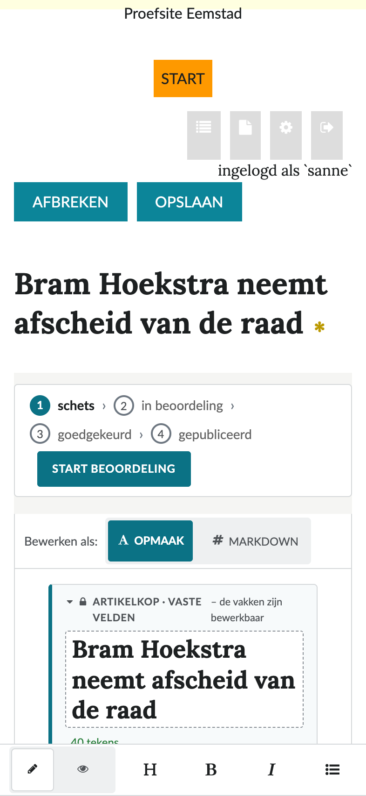

1. De werkbalk staat boven het toetsenbord; elke knop is groot genoeg om met een vinger te raken.
2. Autocorrectie, woordsuggesties en dicteren werken, in Opmaak en in Markdown.
3. Op een smal scherm wissel je tussen **Schrijven** en **Voorbeeld** in plaats van ze naast elkaar te zien.

## Oudere artikelen

Artikelen die zijn gemaakt vóór de nieuwe tekst-editor, zijn opgeslagen als HTML. Ze openen in de oude **opmaakeditor** (WYMeditor), met vier losse velden voor uittreksel, artikel, bijsluiter en bronnen. Ze worden niet omgezet. Alles op deze pagina over de checklist en de beoordeling geldt ook voor hen.

## Veelgestelde vragen

1. **Kan ik een artikel als `.md`-bestand opslaan?** Ja: met **Meer ▾ → download als .md**. Een `.md`-bestand kun je ook openen in de editor.
2. **Wie ziet mijn artikel?** Zolang het niet is gepubliceerd, alleen de leden van de site.
3. **Moet ik Markdown kennen?** Nee. In **Opmaak** werkt alles met knoppen. Markdown leer je terloops, als je wilt.
