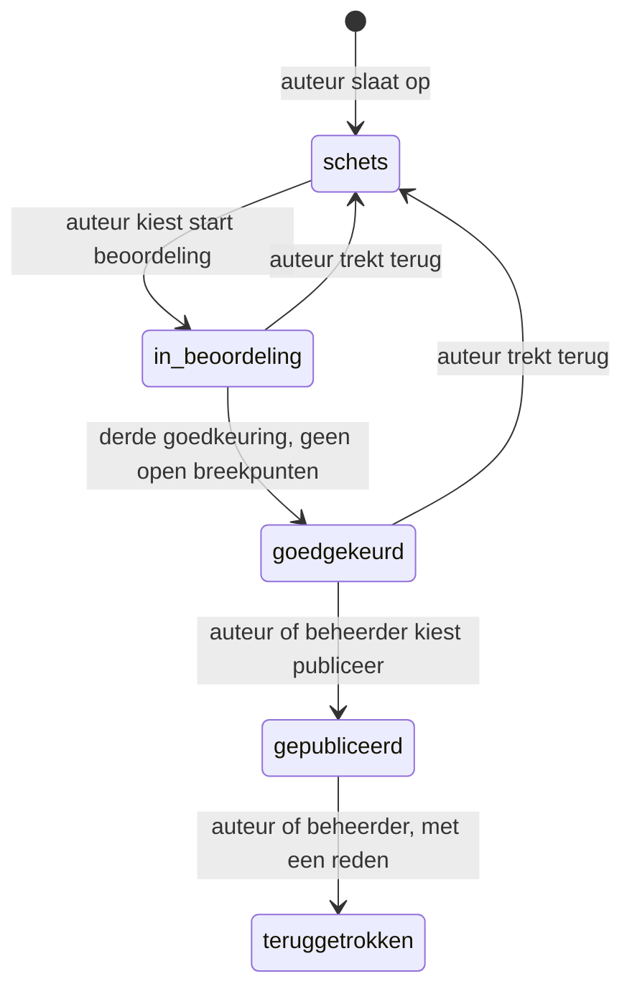
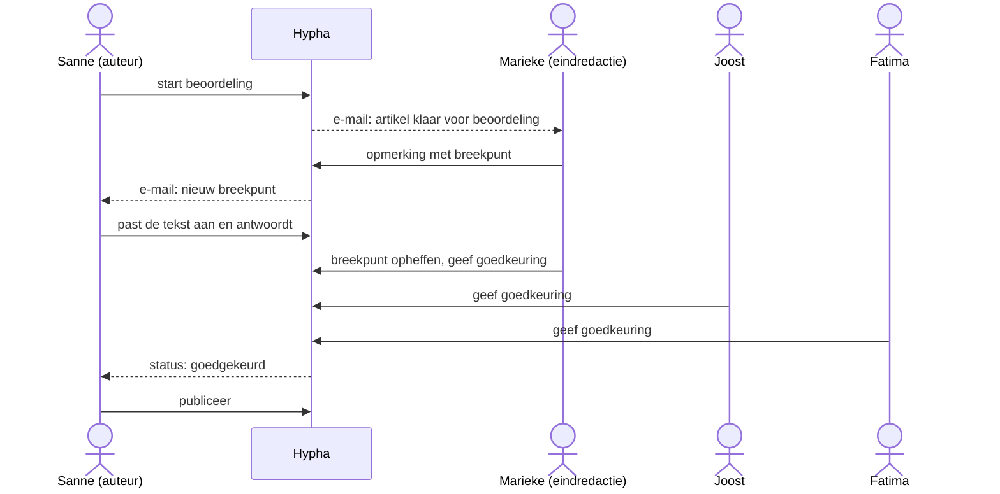

# Een artikel beoordelen en publiceren

Een artikel met review verschijnt pas als **drie andere leden** het hebben goedgekeurd en er geen open breekpunten meer zijn. Deze pagina legt uit hoe dat gaat, voor de auteur en voor wie beoordeelt. Hoe je het artikel schrijft, staat in [Een artikel schrijven](04-artikel-schrijven.md).

## De statussen

Een artikel heeft altijd één status. Het diagram laat zien welke stappen er zijn en wie elke stap zet.

| Status | Wat het betekent | Wie het artikel ziet |
|---|---|---|
| schets | de auteur schrijft nog | leden |
| in beoordeling | collega's lezen mee, plaatsen opmerkingen en keuren goed | leden |
| goedgekeurd | drie goedkeuringen en geen open breekpunten; klaar om te publiceren | leden |
| gepubliceerd | het artikel staat op de site | iedereen |
| teruggetrokken | het artikel is van de site gehaald; lezers zien een melding met de reden | iedereen ziet de melding |

> [!info] Nieuw met de tekst-editor
> **Terugtrekken** (naar schets, en van een gepubliceerd artikel), het **redactiestatuut** bij goedkeuren en een **opmerking bij je goedkeuring** komen met de nieuwe tekst-editor (issue [#520](https://github.com/PlanBCode/hypha/issues/520)). Hypha kent de status *teruggetrokken* al, maar kan er nu nog niet naartoe.

## Voor de auteur

### De beoordeling starten

1. Zorg dat de verplichte controles in de checklist in orde zijn: artikelinhoud, uittreksel, bijsluiter en tags.
2. Kies **start beoordeling**. Is er nog iets niet in orde, dan meldt Hypha: „Artikel is niet compleet, beoordeling kan nog niet gestart worden.”
3. De leden krijgen een e-mail dat het artikel klaar is voor beoordeling.

### Opmerkingen verwerken

1. Je ziet de **beoordelingsopmerkingen** naast het artikel. Het tekstdeel waar een opmerking over gaat, is gemarkeerd.
2. Je kunt het artikel blijven bewerken, ook tijdens de beoordeling, in dezelfde editor.
3. Antwoord op een opmerking om te laten weten wat je hebt gedaan.

Hypha bewaart bij een artikel alleen de laatste stand, geen eerdere versies.

### Terugtrekken

Wil je het artikel nog grondig aanpassen, dan trek je het terug:

1. Kies **trek terug**. Dat kan in *in beoordeling* en *goedgekeurd*.
2. Het artikel gaat terug naar *schets*. De goedkeuringen vervallen; de opmerkingen blijven staan.
3. Alleen de auteur kan een artikel in beoordeling terugtrekken.

### Publiceren

1. Is het artikel *goedgekeurd*, dan kies je **publiceer**. Dat kan de auteur of een beheerder.
2. Het artikel wordt openbaar en krijgt de publicatiedatum van dat moment.
3. Bezoekers kunnen er nu op reageren.

## Voor wie beoordeelt

Het diagram laat zien hoe een beoordeling met drie collega's verloopt.

### Een opmerking plaatsen

1. Open het artikel en kies **voeg beoordelingsopmerking toe**.
2. Selecteer eerst het tekstdeel waar je opmerking over gaat; dat wordt gemarkeerd.
3. Vink **breekpunt** aan als het artikel zo niet mag verschijnen, bijvoorbeeld bij een onjuist feit. Een breekpunt moet worden opgeheven voordat het artikel kan worden gepubliceerd.
4. Wie een breekpunt plaatste, of een beheerder, kan het opheffen met **breekpunt opheffen**.

### Goedkeuren

1. Kies **geef goedkeuring…**. Er opent een venster met de punten uit het **redactiestatuut** van de site, bijvoorbeeld: feiten zijn gecontroleerd, wie aan het woord komt, heeft kunnen reageren, bronnen zijn genoemd.
2. Vink elk punt aan dat je hebt gecontroleerd. De knop werkt pas als alle punten zijn aangevinkt.
3. Schrijf eventueel een **opmerking bij je goedkeuring**. Die komt bij de beoordelingsopmerkingen.
4. Bij de derde goedkeuring, en zonder open breekpunten, gaat het artikel vanzelf naar *goedgekeurd*.

> [!warning] Je eigen artikel keur je niet goed
> De auteur van een artikel kan geen van de drie goedkeuringen geven. De drie goedkeuringen komen van drie andere leden. Wie het artikel maakte, ziet de knop **geef goedkeuring…** niet.

## Na publicatie

1. **Reacties van bezoekers.** Een bezoeker geeft naam en e-mailadres en bevestigt de reactie via een link in een e-mail. Pas dan verschijnt ze.
2. **Modereren.** Leden kunnen een reactie verbergen of verwijderen, met een reden (bijvoorbeeld *ongepast taalgebruik* of *spam*), en dat weer ongedaan maken.
3. **Terugtrekken van een gepubliceerd artikel.** De auteur of een beheerder kiest **trek terug** en geeft een reden. Het artikel verdwijnt van de site; wie het adres opent, ziet de melding met de reden.

## Veelgestelde vragen

1. **Hoeveel goedkeuringen zijn nodig?** Drie, van drie verschillende leden die niet de auteur zijn.
2. **Vervallen goedkeuringen als ik de tekst nog aanpas?** Nee, alleen als je het artikel terugtrekt.
3. **Krijg ik bericht als er iets verandert?** Ja: bij een nieuw breekpunt, een opgeheven breekpunt en elke statuswijziging krijg je een e-mail. Leden zien de wijzigingen ook in de samenvatting (*digest*) per e-mail.
