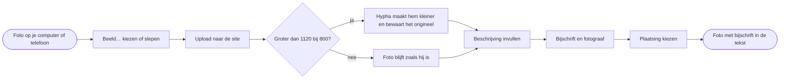
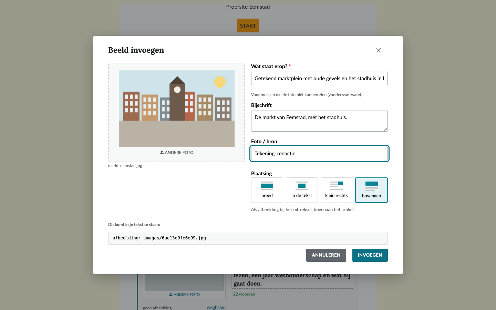
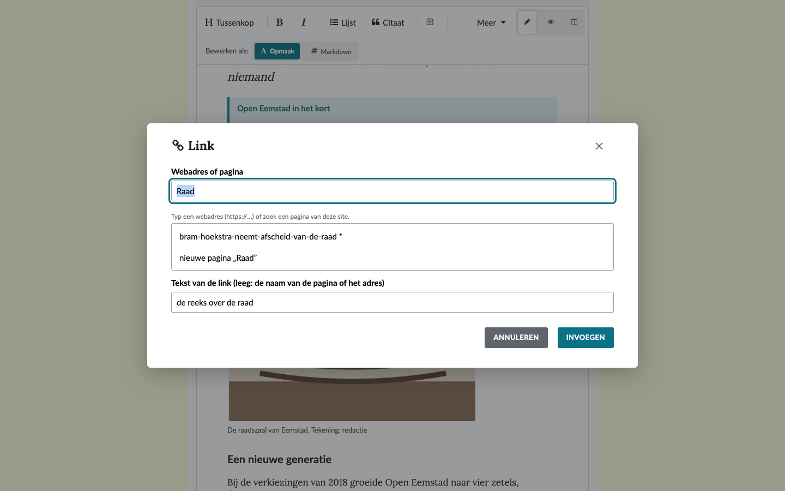
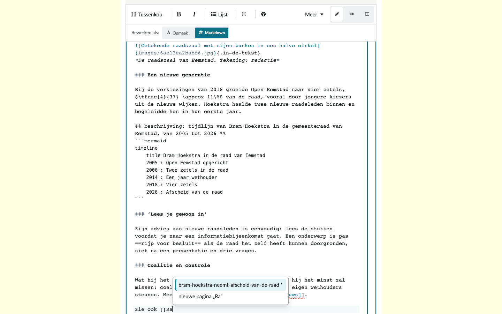

# Beeld, links en tags

Deze pagina legt uit hoe je een foto toevoegt, hoe je naar een andere pagina of website linkt, en hoe je tags aan een pagina geeft. Het geldt voor tekstpagina's en artikelen.

## Een foto toevoegen

Het diagram laat zien wat er gebeurt, van de foto op je computer tot de foto met bijschrift in de pagina.



### In de nieuwe tekst-editor



1. Zet de cursor waar de foto moet komen.
2. Kies **Beeld…** in de werkbalk, of typ **/** aan het begin van een lege regel en kies *beeld*.
3. Kies of sleep een foto. Op iPhone en iPad kies je uit de fotobibliotheek, de camera of bestanden.
4. Vul in **wat er op de foto staat**. Dit is verplicht: mensen die de foto niet kunnen zien, krijgen deze tekst voorgelezen.
5. Vul een **bijschrift** in, en bij **Foto / bron** de naam van de fotograaf, bijvoorbeeld „Foto Pieter Jansen”.
6. Kies de **plaatsing**:
   1. **breed**: over de volle breedte van de tekst;
   2. **in de tekst**: iets smaller dan de tekst;
   3. **klein rechts**: klein, rechts naast de tekst;
   4. **bovenaan** (alleen bij een artikel): de foto wordt de afbeelding bij het uittreksel.
7. Kies **invoegen**. De foto staat nu in de tekst.

Een foto **bewerk** je met het potlood of een dubbelklik; je **verwijdert** hem met het kruisje.

In Markdown ziet een foto er zo uit. De beschrijving staat tussen de rechte haken, de plaatsing tussen accolades, en het bijschrift met de fotograaf schuin op de regel eronder. Bij **breed** staat er geen plaatsing.

```markdown
{.in-de-tekst}
*Bram Hoekstra na twintig jaar in de raad. Foto Pieter Jansen*
```

> [!tip] Welke bestanden?
> Hypha neemt foto's aan als JPG, PNG, GIF of BMP. Een foto groter dan 1120 bij 800 beeldpunten maakt Hypha kleiner; het origineel blijft bewaard. Een foto plakken uit Word lukt niet altijd; voeg hem dan toe met **Beeld…**.

### In de oude opmaakeditor

Bij oudere pagina's en artikelen gebruik je de knop voor een afbeelding in de werkbalk. Kies **upload bestand**, of geef een **afbeeldingsurl**. Vul de **alternatieve tekst** in: wat er op de foto staat.

## Een link naar een andere pagina

### In de nieuwe tekst-editor





1. Selecteer de tekst die de link wordt, en kies **Link** in de werkbalk (of ⌘K, Ctrl+K). In Opmaak kun je ook gewoon `[[` typen.
2. Typ in het venster de eerste letters van de pagina. De editor stelt pagina's van de site voor; een privépagina heeft een `*`. Kies er een met de pijltjes en Enter, of met een tik.
3. Bestaat de pagina nog niet, kies dan **nieuwe pagina „…”**. Bij opslaan maakt Hypha die pagina aan.
4. **Tekst van de link**: laat leeg voor de naam van de pagina, of typ een eigen tekst. In Markdown staat de link er dan als `[[Over ons]]` of `[[Over ons|lees meer over de redactie]]`.
5. Een link weghalen of wijzigen: zet de cursor in de link, kies **Link** en dan **Link weghalen** of pas het venster aan.

Een link naar een pagina die nog niet bestaat, meldt de checklist. Bij opslaan maakt Hypha die pagina aan.

> [!info] Links blijven werken
> Hypha bewaart een link naar een pagina met het vaste nummer van die pagina, niet met haar naam. Krijgt de pagina een andere naam, dan blijft de link werken. Bestaat de pagina in de taal van de lezer, dan gaat de link naar die vertaling. Een link naar een privépagina ziet een bezoeker als gewone tekst.

### In de oude opmaakeditor

Selecteer de tekst en kies de knop voor een link. Kies als **link type** een **lokale pagina** (een pagina van de site) of een **web pagina** (een andere website). Bij **open in** kies je de zelfde tab of een nieuwe tab.

## Een link naar een andere website

1. Selecteer de tekst en kies **Link** (⌘K, Ctrl+K). Typ of plak het webadres in hetzelfde venster; `https://` mag je weglaten.
2. Sneller: selecteer de tekst en plak een webadres eroverheen. De tekst wordt een link.
3. In Markdown kun je ook schrijven: `[tekst](https://www.eemstad.example/raad)`.

Gebruik altijd een volledig adres dat begint met `https://`.

## Tags

Een **tag** is een onderwerp, zoals *Raadsnieuws*. Klik op een tag en je ziet alle pagina's met die tag. Zo vinden lezers verwante pagina's.

### Een tag geven aan een pagina

1. Onder elke pagina staat **tags:** met de tags van de pagina.
2. Kies in de lijst **toevoegen...** een tag. Die staat er meteen bij.
3. Haal een tag weg met het kruisje ⨯ achter de tag.

Dit werkt voor elke pagina, ook voor tekstpagina's.

### Tags bij een artikel in de nieuwe tekst-editor

Bij een artikel kies je de tags in de **artikelkop**, met **Tag toevoegen**. Je kiest alleen uit de **vaste lijst van de site**. Een artikel heeft minstens één tag nodig.

Typ je in Markdown een tag die niet in de lijst staat, dan meldt de checklist: „Deze tags staan niet in de lijst van de site”. Je kunt de beoordeling dan nog niet starten. Kies een andere tag, of vraag een beheerder om de tag te maken.

### Een nieuwe tag maken

Alleen een **beheerder** maakt een nieuwe tag:

1. Kies onder een pagina in de lijst **toevoegen...** de keuze **nieuw...**.
2. Typ de naam van de tag. Gebruik een kort woord.
3. Typ een korte omschrijving. Die is verplicht.

> [!tip] Houd de lijst kort
> Een korte, vaste lijst tags helpt lezers meer dan veel tags die op elkaar lijken. Spreek met de redactie af welke tags er zijn.

## Meer lezen

1. [Een artikel schrijven](04-artikel-schrijven.md)
2. [Een tekstpagina maken en bewerken](03-tekstpagina.md)
3. [Menu en navigatie](07-menu-en-navigatie.md)
