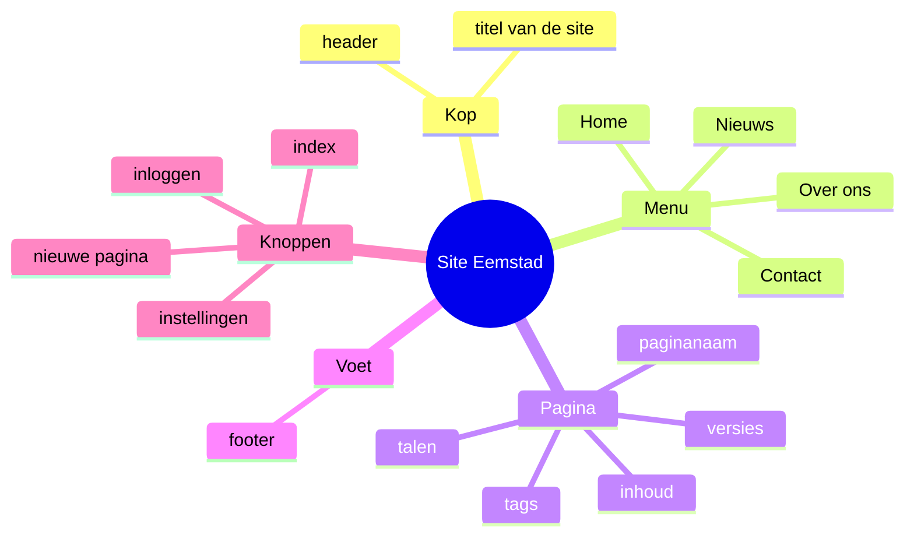
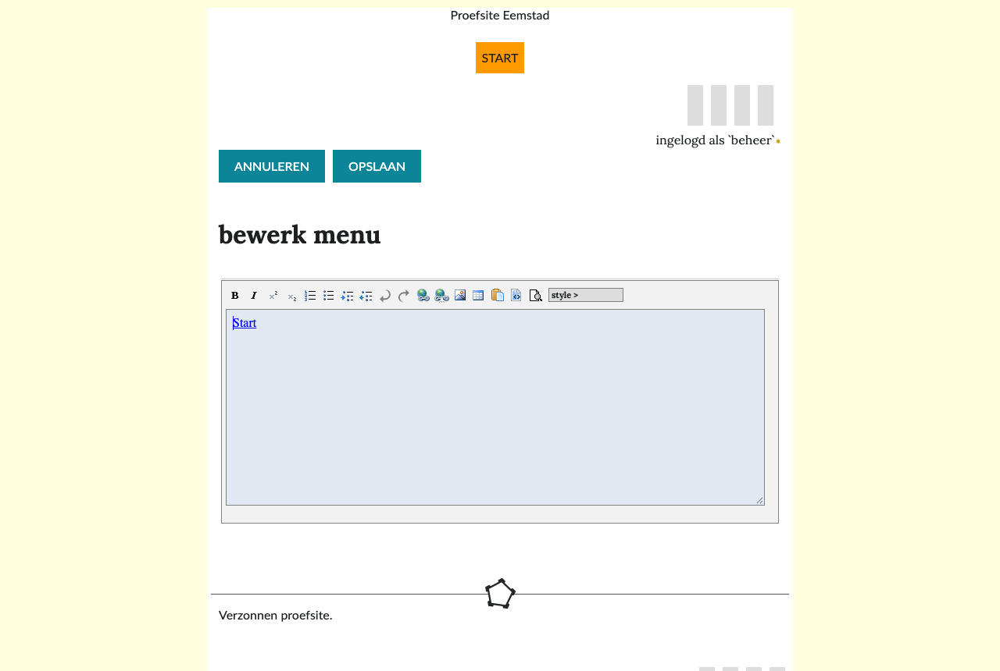
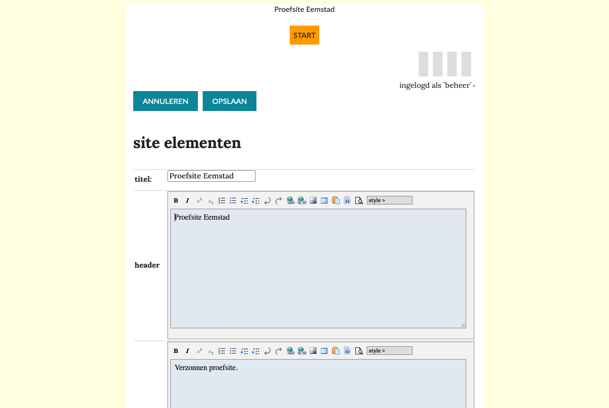

# Menu en navigatie

Deze pagina legt uit hoe een bezoeker de weg vindt op een Hypha-site: via het menu, de startpagina, de talen, de index en de tags. Ook lees je hoe een geprivilegieerde gebruiker het menu, de kop en de voet van de site instelt.

## De opbouw van een site

Het diagram laat zien uit welke delen een Hypha-site bestaat, met als voorbeeld een verzonnen nieuwssite in Eemstad.

| Deel | Waar | Wie stelt het in |
|---|---|---|
| titel, header, footer | bovenaan en onderaan elke pagina | geprivilegieerde gebruiker, bij **site elementen** |
| menu | onder de kop, op elke pagina | geprivilegieerde gebruiker, bij **menu** |
| knoppen | rechtsboven | vast in Hypha |
| talen | naast de naam van de pagina | volgt uit de vertalingen |
| tags | onder de pagina | gebruikers, bij elke pagina |

## Het menu

Het menu staat op elke pagina en is voor de hele site hetzelfde. Het bevat links naar de belangrijkste pagina's.

1. Een link in het menu wijst naar een pagina, niet naar een paginanaam. Krijgt de pagina een andere naam, dan blijft de link werken.
2. Bestaat de pagina in de taal van de bezoeker, dan gaat de link naar die vertaling.
3. Een link naar een privépagina ziet een bezoeker als gewone tekst.

### Het menu aanpassen (geprivilegieerde gebruiker)

1. Klik rechtsboven op **instellingen**.
2. Kies **menu**.
3. Het menu opent in de opmaakeditor. Zet elke link op een eigen regel.
4. Een link naar een pagina van de site maak je met de knop voor een link; kies als link type **lokale pagina**. Een link naar een andere website: kies **web pagina**.
5. Kies **opslaan**.

> [!tip] Een nieuwe pagina in het menu
> Een nieuwe pagina komt niet vanzelf in het menu. Vraag een geprivilegieerde gebruiker om haar toe te voegen als lezers haar moeten kunnen vinden.

## De startpagina

De **startpagina** is de pagina die een bezoeker ziet als hij alleen het adres van de site intikt. Een geprivilegieerde gebruiker kiest haar:

1. Klik op **instellingen** en kies **projectinstellingen**.
2. Vul bij **standaard pagina** de paginanaam in, bijvoorbeeld `Home`.
3. Kies bij **standaard taal** de taal waarin de site opent.
4. Kies **opslaan**.

## Talen

1. Het webadres begint met de taal: `/nl/Home` of `/en/Home`.
2. Naast de naam van een pagina staan de talen waarin ze bestaat. Klik op een taal om de vertaling te lezen.
3. Een link naar een pagina die niet bestaat in jouw taal, gaat naar een andere taal. De link heeft dan een eigen opmaak en een tip „Deze pagina bestaat alleen in een andere taal”.
4. De taal van de knoppen kies je in je account, bij **bedieningstaal**. Een geprivilegieerde gebruiker stelt in **projectinstellingen** de **standaard interface taal** in voor bezoekers.

Een pagina vertalen staat in [Een tekstpagina maken en bewerken](03-tekstpagina.md#vertalen).

## De index

Rechtsboven staat de knop **index** (het lijstje). Die toont de **Pagina-index**: alle pagina's van de site in de huidige taal. Een bezoeker ziet alleen openbare pagina's; een ingelogde gebruiker ziet ook de privépagina's. Via de index vind je ook pagina's die niet in het menu staan.

## Tags

Onder elke pagina staan haar **tags**. Klik op een tag voor een lijst van alle pagina's met die tag. Zie [Beeld, links en tags](06-beeld-links-tags.md#tags).

## Kop en voet (geprivilegieerde gebruiker)

1. Klik op **instellingen** en kies **site elementen**.
2. Vul de **titel** van de site in. Die staat in de titelbalk van de browser.
3. Vul de **header** (de kop) en de **footer** (de voet) in, bijvoorbeeld het logo, het adres van de redactie en een link naar de privacyverklaring.
4. Kies **opslaan**.

De vormgeving van het menu, de kop en de voet hoort bij het **thema**. Zie [Thema's](../techniek/05-themas.md).

## Meer lezen

1. [Wat is Hypha?](01-wat-is-hypha.md)
2. [Beeld, links en tags](06-beeld-links-tags.md)
