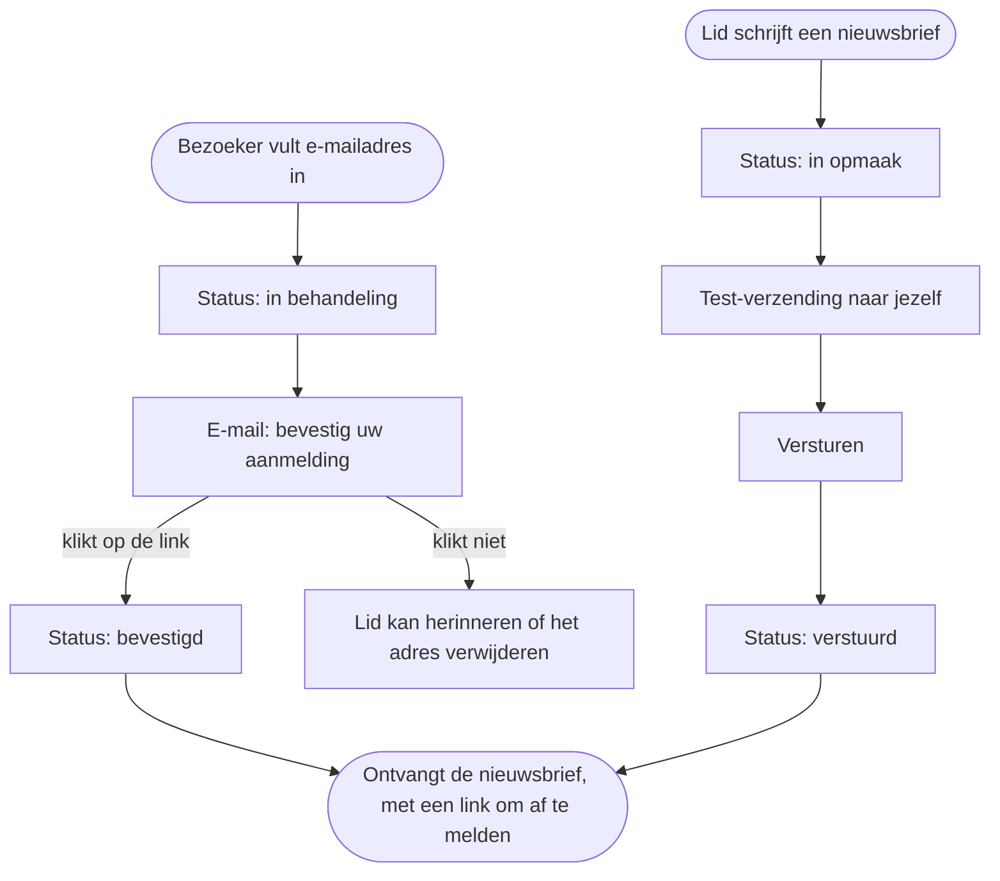
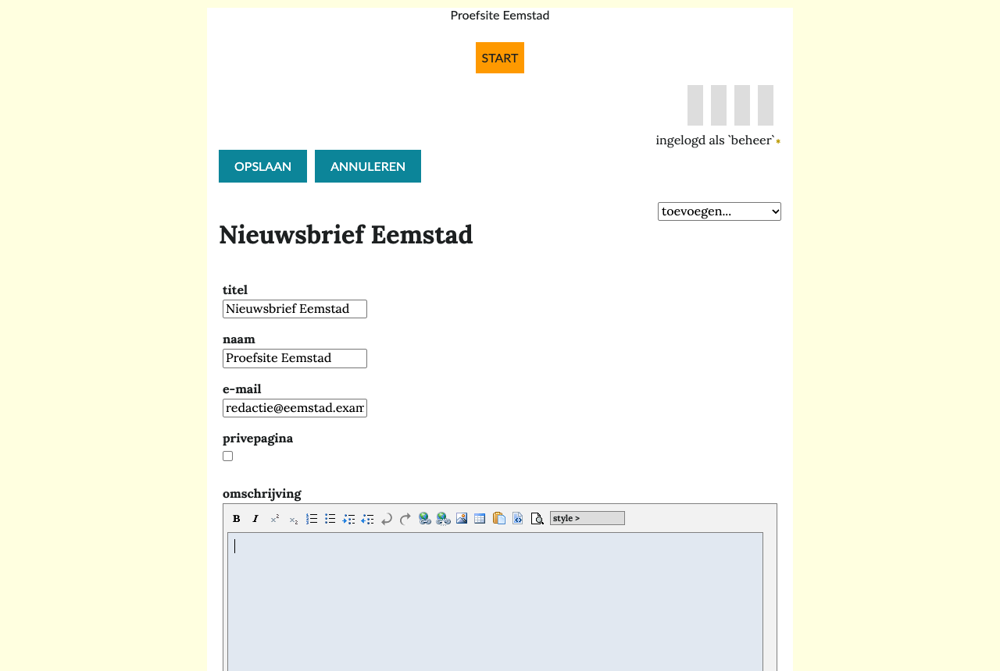
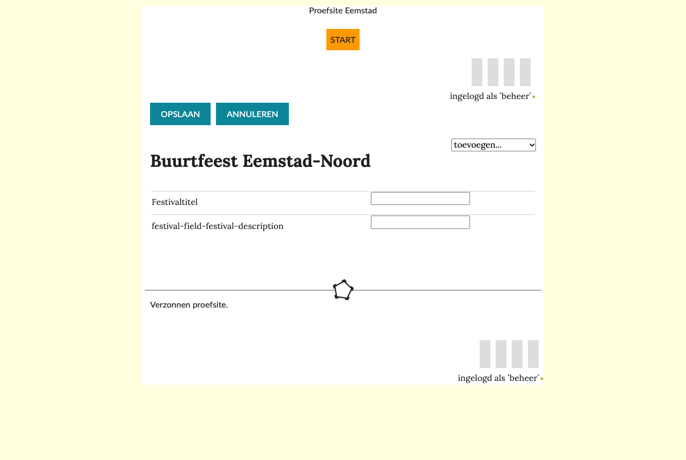
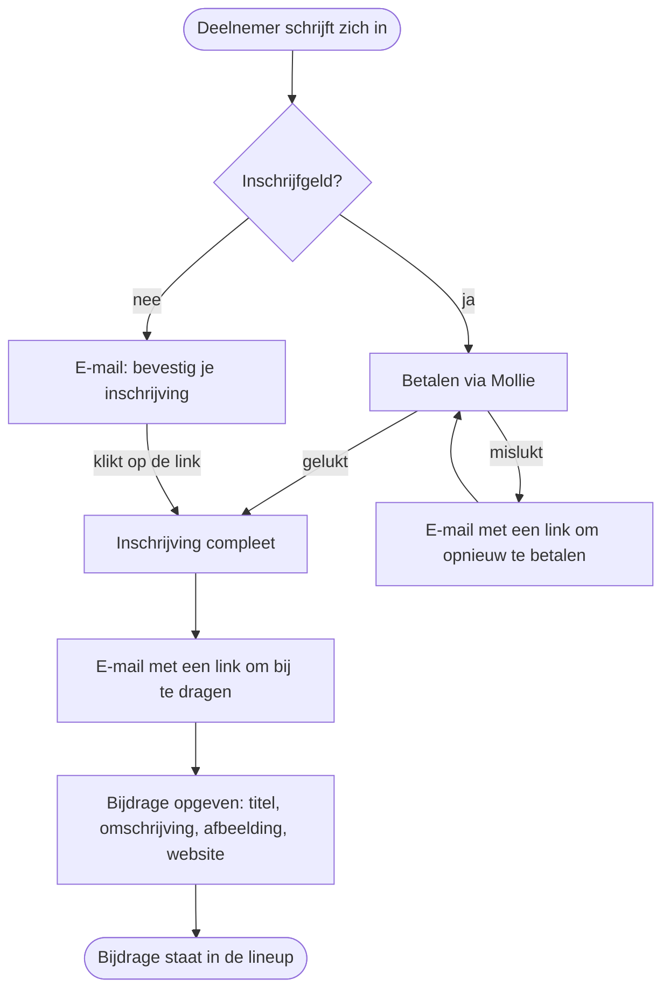

# Mailinglijst en festival

Naast tekstpagina's en artikelen kent Hypha twee andere paginatypes: de **mailinglijst** voor nieuwsbrieven en de **festivalpagina** voor een evenement. Deze pagina legt uit wat je ermee kunt. Je maakt ze zoals elke pagina: klik op **nieuwe pagina** en kies het type.

> [!info] Niet in de nieuwe tekst-editor
> De mailinglijst en de festivalpagina gebruiken de vertrouwde opmaakeditor. De nieuwe tekst-editor is er alleen voor tekstpagina's en artikelen met review.

## Mailinglijst

Een mailinglijst bewaart e-mailadressen van mensen die een nieuwsbrief willen, en verstuurt die nieuwsbrief. In de lijst met paginatypes heet ze **mailinglist**.

Het diagram laat zien hoe iemand zich aanmeldt en hoe een nieuwsbrief bij hem komt.

### De mailinglijst instellen

1. Maak een nieuwe pagina van het type **mailinglist**, bijvoorbeeld `Nieuwsbrief`.
2. Kies **bewerken** en vul in:
   1. de **naam** en het **e-mail**adres van de afzender, bijvoorbeeld `Redactie Eemstad` en `redactie@eemstad.example`;
   2. een **omschrijving**: wat lezers kunnen verwachten;
   3. eventueel **privepagina**, als alleen leden de pagina mogen zien.
3. Kies **opslaan**.

### Aanmelden en afmelden

1. Een bezoeker vult op de pagina zijn e-mailadres in en kiest **aanmelden**.
2. Hij krijgt een e-mail met een link. Pas als hij op de link klikt, is het adres **bevestigd**. Zo kan niemand een ander aanmelden.
3. Elke nieuwsbrief heeft onderaan een link om af te melden. Het adres krijgt dan de status **uitgeschreven**.

### Adressen beheren

1. Kies op de pagina **bekijk adressen**. Je ziet elk adres met zijn status.
2. Bij een adres dat nog **in behandeling** is, kun je **herinner** kiezen of het adres verwijderen. Een bevestigd adres kun je **afmelden**.
3. Een **beheerder** kan met **toevoegen** meer adressen tegelijk op de lijst zetten: scheid ze met een komma of zet ze elk op een eigen regel. Deze adressen zijn meteen bevestigd.

> [!warning] Alleen met toestemming
> Voeg alleen adressen toe van mensen die de nieuwsbrief willen ontvangen en daar toestemming voor hebben gegeven. Adressen die je zelf toevoegt, krijgen geen e-mail om te bevestigen.

### Een nieuwsbrief versturen

1. Kies **voeg nieuwsbrief toe**.
2. Vul het **onderwerp** en de tekst in en kies **opslaan**. De nieuwsbrief heeft de status **in opmaak**.
3. Kies **test-verzending**. De nieuwsbrief gaat naar jou, met „testnieuwsbrief, graag controleren!” in het onderwerp.
4. Is alles in orde, kies dan **versturen**. Hypha vraagt hoeveel adressen de nieuwsbrief krijgen; bevestig.
5. Laat het venster open tot alles is verstuurd. Hypha toont de voortgang.

Verstuurde nieuwsbrieven staan in het **archief** op de pagina. Bezoekers kunnen ze daar teruglezen.

## Festivalpagina

Een festivalpagina helpt bij het organiseren van een evenement: deelnemers schrijven zich in, betalen eventueel, en geven een bijdrage op, zoals een optreden of een workshop. In de lijst met paginatypes heet ze **festival pagina**.

Het diagram laat zien hoe een deelnemer zich inschrijft en een bijdrage opgeeft.

### Wat een deelnemer doet

1. **Inschrijven**: naam, e-mailadres, telefoonnummer en eventueel het inschrijfgeld.
2. Is er inschrijfgeld, dan **betaalt** hij via Mollie. Anders bevestigt hij zijn e-mailadres met de link in de e-mail.
3. Is de inschrijving compleet, dan krijgt hij een e-mail met een link om **bij te dragen**. Daarmee geeft hij een of meer bijdragen op: titel, naam van de organisator, korte omschrijving, afbeelding, website, categorie en opmerkingen voor de organisatie.
4. Met de link in de e-mail kan hij zijn bijdrage later nog **wijzigen**.

### Wat een lid ziet

Ingelogde leden hebben op de festivalpagina deze knoppen:

| Knop | Wat je ziet of doet |
|---|---|
| instellingen | de festivaltitel en de omschrijving |
| aanmelden | het inschrijfformulier |
| bijdragen (de eerste) | het formulier voor een bijdrage |
| deelnemers | alle inschrijvingen, met hun status en bedrag |
| bijdragen (de tweede) | alle bijdragen; twee knoppen hebben in het Nederlands dezelfde naam |
| lineup | het programma zoals bezoekers het zien |
| blokkenschema | het programma per dag en per locatie, met begin- en eindtijden |

> [!info] Betalen
> Betalen gaat via Mollie, een betaaldienst. De site heeft daarvoor een sleutel van Mollie nodig. Die stel je niet in op de pagina zelf; vraag het een beheerder.

## Meer lezen

1. [Wat is Hypha?](01-wat-is-hypha.md)
2. [Datatypes en macro's](../techniek/04-datatypes-en-macros.md), voor de techniek erachter
