# Handleiding van Hypha

Hypha is een website die een groep samen bijhoudt. Elke gebruiker kan pagina's maken en bewerken. Deze handleiding legt in gewoon Nederlands uit hoe dat gaat. Ze bestaat uit twee delen:

1. de **gebruikshandleiding**, voor gebruikers, auteurs, beoordelaars en de redactie;
2. de **technische handleiding**, op hoofdlijnen, voor wie de server beheert en voor ontwikkelaars.

De voorbeelden gaan over een verzonnen site in de stijl van De Stadsbron, met een verzonnen auteur (Sanne de Vries) en een verzonnen gemeente (Eemstad). Er staan geen gegevens van echte personen in.

> [!info] Over deze versie
> Dit is de eerste versie van de handleiding. Alle pagina's zijn er; ze zijn nog niet door een tweede persoon nagekeken. De pagina's over tekstpagina's en artikelen beschrijven ook de **nieuwe tekst-editor**, die in ontwikkeling is (issue [PlanBCode/hypha#520](https://github.com/PlanBCode/hypha/issues/520)). Wat nieuw is, staat steeds in een kader *Nieuw met de tekst-editor*.

## Zo lees je deze handleiding

Elke pagina beantwoordt één vraag en is los te lezen. Begin bij de vraag die je hebt. Wie nieuw is als auteur, leest eerst *Een artikel schrijven* en daarna *Beoordelen en publiceren*.

Het diagram toont de twee delen van de handleiding en de pagina's in de volgorde waarin je ze het beste leest.

```mermaid
flowchart LR
    start([Handleiding van Hypha]) --> gebruik[Gebruikshandleiding]
    start --> techniek[Technische handleiding]
    gebruik --> g1[Wat is Hypha] --> g2[Inloggen en account] --> g3[Tekstpagina] --> g4[Artikel schrijven] --> g5[Beoordelen en publiceren]
    g5 --> g6[Beeld, links en tags] --> g7[Menu en navigatie] --> g8[Mailinglijst en festival] --> g9[Vragen] --> g10[Gebruikersbeheer]
    techniek --> t1[Architectuur] --> t2[Installatie] --> t3[Opslag] --> t4[Datatypes en macro's]
    t4 --> t5[Thema's] --> t6[Beheer] --> t7[Beveiliging] --> t8[Tekens en talen] --> t9[Testen]
```

## Gebruikshandleiding

1. [Wat is Hypha?](gebruik/01-wat-is-hypha.md): pagina's, talen, gebruikers, menu, tags, openbaar en privé
2. [Inloggen en je account](gebruik/02-inloggen-en-account.md)
3. [Een tekstpagina maken en bewerken](gebruik/03-tekstpagina.md)
4. [Een artikel schrijven](gebruik/04-artikel-schrijven.md)
5. [Een artikel beoordelen en publiceren](gebruik/05-beoordelen-en-publiceren.md)
6. [Beeld, links en tags](gebruik/06-beeld-links-tags.md)
7. [Menu en navigatie](gebruik/07-menu-en-navigatie.md)
8. [Mailinglijst en festival](gebruik/08-andere-paginatypes.md)
9. [Veelgestelde vragen](gebruik/09-vragen.md)
10. [Gebruikersbeheer](gebruik/10-gebruikersbeheer.md)

## Technische handleiding

1. [Architectuur: van verzoek tot pagina](techniek/01-architectuur.md)
2. [Installatie, ook met Docker](techniek/02-installatie.md)
3. [Opslag: hypha.xml en de map data](techniek/03-opslag.md)
4. [Datatypes en macro's](techniek/04-datatypes-en-macros.md)
5. [Thema's](techniek/05-themas.md)
6. [Beheer: back-up, logboeken, e-mail en updates](techniek/06-beheer.md)
7. [Beveiliging](techniek/07-beveiliging.md)
8. [Tekens en talen (Unicode)](techniek/08-unicode.md)
9. [Testen als ontwikkelaar](techniek/09-testen.md)

## Openen en publiceren met Obsidian

1. Open in Obsidian de map `docs/handleiding/` als *vault* (**Open folder as vault**).
2. Obsidian toont de Frontmatter bovenaan elke pagina als *eigenschappen* en tekent de diagrammen zelf; er is geen plug-in nodig.
3. Publiceer met *Obsidian Publish*, of maak een PDF met **Export to PDF**.
4. De pagina's zijn gewone Markdown. Je kunt ze ook op GitHub of in een andere Markdown-viewer lezen.

De map `.obsidian/` met je eigen instellingen komt niet in git.

## Meer lezen

1. De Engelstalige documentatie, met meer detail: [`docs/`](../README.md).
2. Het ontwerp van de nieuwe tekst-editor: [`ai/design/concept/20261026_MARKDOWN_EDITOR.md`](../../ai/design/concept/20261026_MARKDOWN_EDITOR.md).
