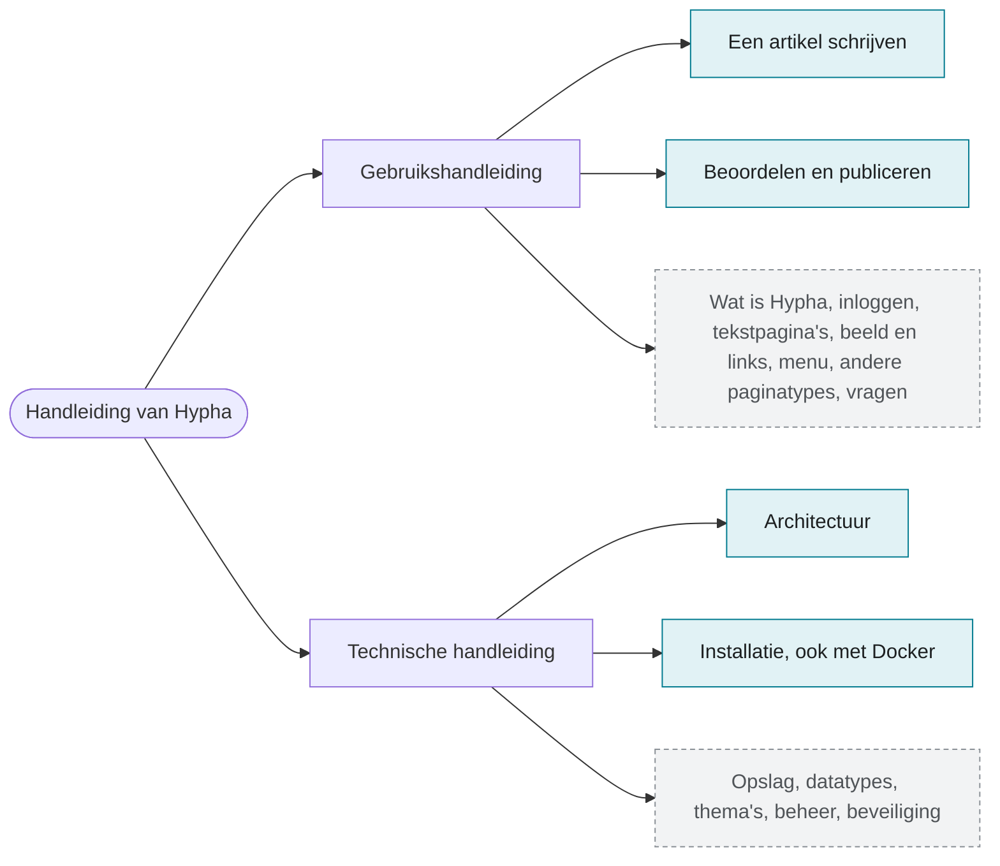

# Handleiding van Hypha

Hypha is een website die een groep samen bijhoudt. Elk lid kan pagina's maken en bewerken. Deze handleiding legt in gewoon Nederlands uit hoe dat gaat. Ze bestaat uit twee delen:

1. de **gebruikshandleiding**, voor leden, auteurs, beoordelaars en de redactie;
2. de **technische handleiding**, op hoofdlijnen, voor beheerders en ontwikkelaars.

De voorbeelden gaan over een verzonnen site in de stijl van De Stadsbron, met een verzonnen auteur (Sanne de Vries) en een verzonnen gemeente (Eemstad). Er staan geen gegevens van echte personen in.

> [!info] Over deze versie
> Dit is de eerste versie van de handleiding. Vijf pagina's zijn klaar; de andere volgen. De pagina's over artikelen beschrijven ook de **nieuwe tekst-editor**, die in ontwikkeling is (issue [PlanBCode/hypha#520](https://github.com/PlanBCode/hypha/issues/520)). Wat nieuw is, staat steeds in een kader *Nieuw met de tekst-editor*.

## Zo lees je deze handleiding

Elke pagina beantwoordt één vraag en is los te lezen. Begin bij de vraag die je hebt. Wie nieuw is als auteur, leest eerst *Een artikel schrijven* en daarna *Beoordelen en publiceren*.

Het diagram toont de twee delen van de handleiding en welke pagina's al klaar zijn (blauwgroen) en welke nog volgen (grijs).

## Gebruikshandleiding

1. Wat is Hypha: pagina's, talen, leden, menu, tags, openbaar en privé (volgt)
2. Inloggen en je account (volgt)
3. Een tekstpagina maken en bewerken (volgt)
4. [Een artikel schrijven](gebruik/04-artikel-schrijven.md)
5. [Een artikel beoordelen en publiceren](gebruik/05-beoordelen-en-publiceren.md)
6. Beeld, links en tags (volgt)
7. Menu en navigatie (volgt)
8. Andere paginatypes: mailinglijst en festival (volgt)
9. Veelgestelde vragen (volgt)

## Technische handleiding

1. [Architectuur: van verzoek tot pagina](techniek/01-architectuur.md)
2. [Installatie, ook met Docker](techniek/02-installatie.md)
3. Opslag (volgt)
4. Datatypes en macro's (volgt)
5. Thema's (volgt)
6. Beheer (volgt)
7. Beveiliging (volgt)

## Openen en publiceren met Obsidian

1. Open in Obsidian de map `docs/handleiding/` als *vault* (**Open folder as vault**).
2. Obsidian toont de Frontmatter bovenaan elke pagina als *eigenschappen* en tekent de diagrammen zelf; er is geen plug-in nodig.
3. Publiceer met *Obsidian Publish*, of maak een PDF met **Export to PDF**.
4. De pagina's zijn gewone Markdown. Je kunt ze ook op GitHub of in een andere Markdown-viewer lezen.

De map `.obsidian/` met je eigen instellingen komt niet in git.

## Meer lezen

1. De Engelstalige documentatie, met meer detail: [`docs/`](../README.md).
2. Het ontwerp van de nieuwe tekst-editor: [`ai/design/concept/20261026_MARKDOWN_EDITOR.md`](../../ai/design/concept/20261026_MARKDOWN_EDITOR.md).
