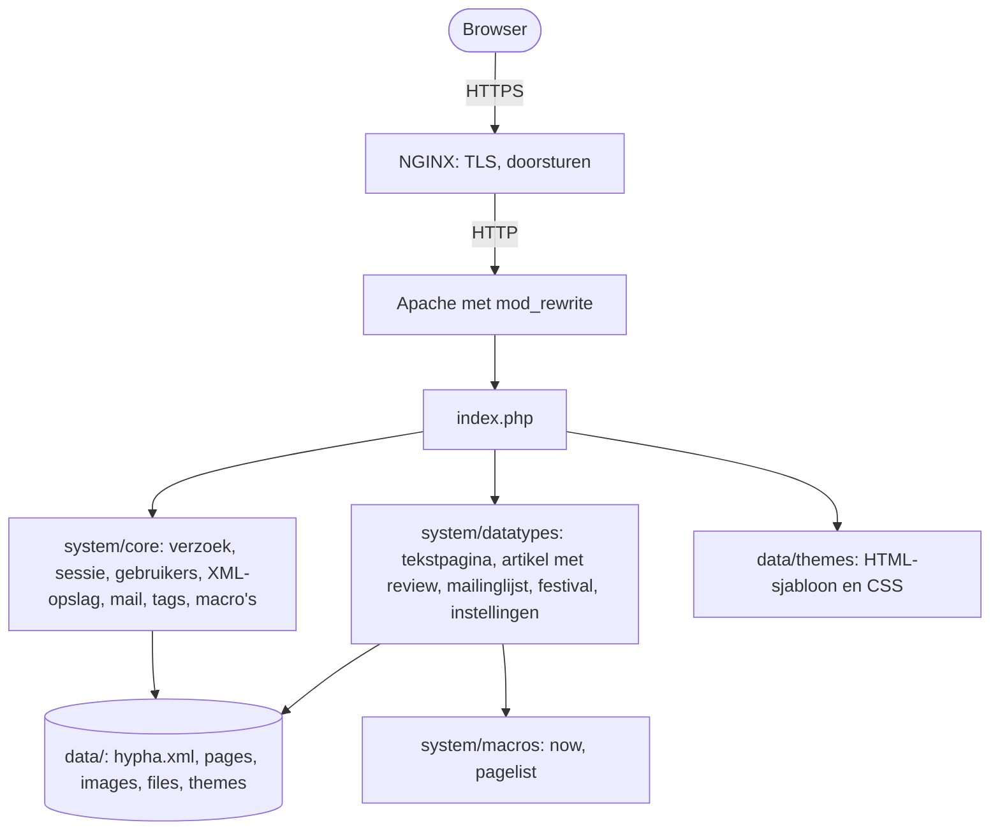
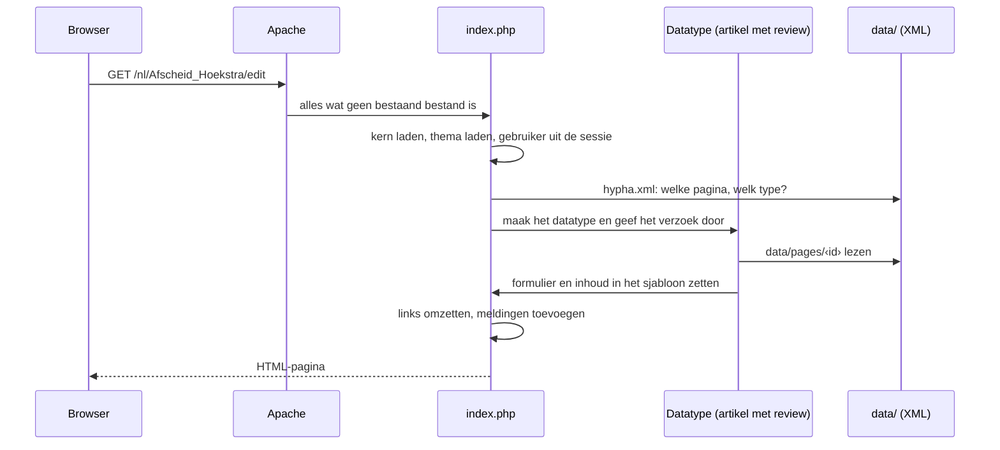
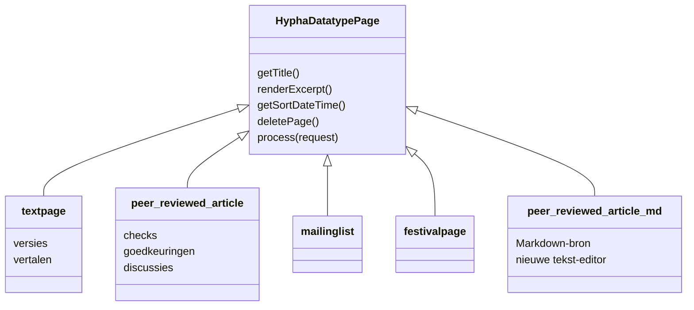
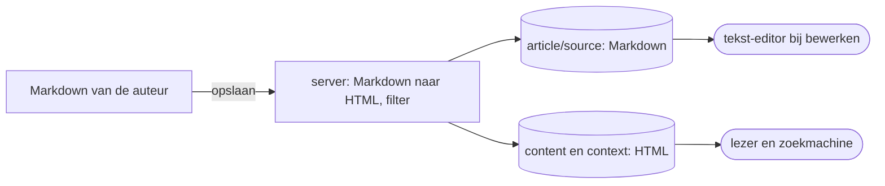

# Architectuur: van verzoek tot pagina

Deze pagina beschrijft op hoofdlijnen hoe Hypha werkt: welke onderdelen er zijn, hoe een verzoek van een browser een pagina wordt, en waar de gegevens staan. De volledige, Engelstalige beschrijving met regelnummers staat in [`ai/ARCHITECTURE.md`](../../../ai/ARCHITECTURE.md).

## Hypha in één alinea

Hypha is gewone PHP, zonder framework, zonder database en zonder build-stap. Eén bestand, `index.php`, behandelt elk verzoek. Alle gegevens van de site staan als **XML-bestanden** in de map `data/`. De HTML ontstaat door het HTML-sjabloon van het thema in te laden en aan te vullen. In de browser draaien jQuery 1.7.1 en de opmaakeditor WYMeditor; de nieuwe tekst-editor komt daarnaast.

## De onderdelen

Het diagram toont de onderdelen en hoe ze met elkaar samenhangen.

| Map of bestand | Rol |
|---|---|
| `index.php` | voorportaal: behandelt elk verzoek in zeven stappen |
| `hypha.php` | installatie, onderhoud en het bouwen van een installatiebestand |
| `system/core/` | de kern: verzoek, sessie, gebruikers, XML-opslag, pagina's, e-mail, tags, macro's, taal, afbeeldingen, editor |
| `system/datatypes/` | de paginatypes en de systeempagina's (instellingen, index, tags) |
| `system/macros/` | `<macro>`-elementen in de inhoud, zoals een lijst van de laatste artikelen |
| `system/languages/` | de teksten van de interface in het Nederlands en Engels |
| `system/assets/`, `system/wymeditor/` | jQuery, hulpscripts en de opmaakeditor |
| `data/` | de site zelf: instellingen, pagina's, uploads en thema's |

## Van verzoek tot pagina

Een adres als `/nl/Afscheid_Hoekstra/edit` bestaat uit drie delen: de taal (`nl`), de paginanaam (`Afscheid_Hoekstra`) en de weergave (`edit`). Het diagram laat zien wat er gebeurt als een lid die pagina opent.

De zeven stappen van `index.php`:

1. controles: PHP-versie, mod_rewrite, debugstand;
2. de kern laden en de datatypes registreren;
3. vaste bestanden (thema's, scripts, de editor) direct uitleveren;
4. het HTML-sjabloon van het thema laden, met kop, voet en menu;
5. gebruiker en taal uit de sessie halen;
6. opdrachten uitvoeren (bijvoorbeeld inloggen of opslaan) en de pagina laten verwerken door haar datatype;
7. nabewerking (links, meldingen), de samenvatting per e-mail als die aan de beurt is, en de pagina versturen.

## Paginatypes

Elk paginatype is een PHP-klasse in `system/datatypes/`. Het type wordt gekozen als de pagina wordt gemaakt en staat daarna vast.

1. Een nieuw paginatype is een nieuw bestand in `system/datatypes/`; Hypha vindt het vanzelf en toont het bij **nieuwe pagina**.
2. Het artikel met Markdown-bron (`peer_reviewed_article_md`) komt **naast** het bestaande artikeltype, zodat bestaande artikelen ongewijzigd blijven. Dit type is in ontwikkeling.

## Opslag

Alle gegevens zijn XML:

1. **`data/hypha.xml`**: instellingen van de site, gebruikers, de lijst van pagina's met hun type en naam per taal, en de tags.
2. **`data/pages/‹id›`**: één bestand per pagina. Een tekstpagina bewaart elke versie; een artikel bewaart alleen de laatste stand, met de discussies en goedkeuringen in hetzelfde bestand.
3. **`data/images/`** en **`data/files/`**: geüploade afbeeldingen en bestanden.
4. **`data/themes/`**: de thema's, elk met een HTML-sjabloon en CSS.

Schrijven gebeurt met een slot op het bestand: Hypha schrijft het hele bestand naar een tijdelijk bestand en zet dat in één keer op zijn plek. Wie tegelijk leest, ziet dus de oude of de nieuwe versie, nooit een half bestand.

Een artikel met Markdown-bron bewaart de Markdown naast de HTML. Lezers en zoekmachines krijgen altijd de HTML, die de server bij opslaan uit de Markdown maakt.

## Gebruikers en beveiliging

1. Leden komen erbij via een **uitnodiging**; zelf een account aanmaken kan niet.
2. Rollen: bezoeker, lid, beheerder, genodigde en oud-lid.
3. Wachtwoorden worden versleuteld bewaard (bcrypt). Bij inloggen krijgt de sessie een nieuwe id.
4. Elk formulier draagt een token tegen CSRF.
5. De mappen `data/` en `system/` zijn alleen via `index.php` bereikbaar; die levert alleen thema- en scriptbestanden uit en controleert of een pagina privé is.

## E-mail en periodiek werk

1. Hypha verstuurt e-mail met de PHP-functie `mail()`, zonder wachtrij.
2. De **samenvatting** (*digest*) voor leden gaat mee met een gewoon paginabezoek: als de ingestelde tijd voorbij is, verstuurt Hypha haar tijdens dat bezoek.

## Installeren en draaien

Hypha draait op **PHP 8.2 tot en met 8.5** met Apache en mod_rewrite, meestal achter NGINX. Je installeert met git, met het installatiebestand `hypha.php`, of in een **container met Docker of Podman**. Zie [Installatie](02-installatie.md).

## Meer lezen

1. [`docs/technical/`](../../technical/README.md): eisen, installatie, container, NGINX, opslag en beheer, in het Engels.
2. [`ai/ARCHITECTURE.md`](../../../ai/ARCHITECTURE.md): de volledige architectuur.
