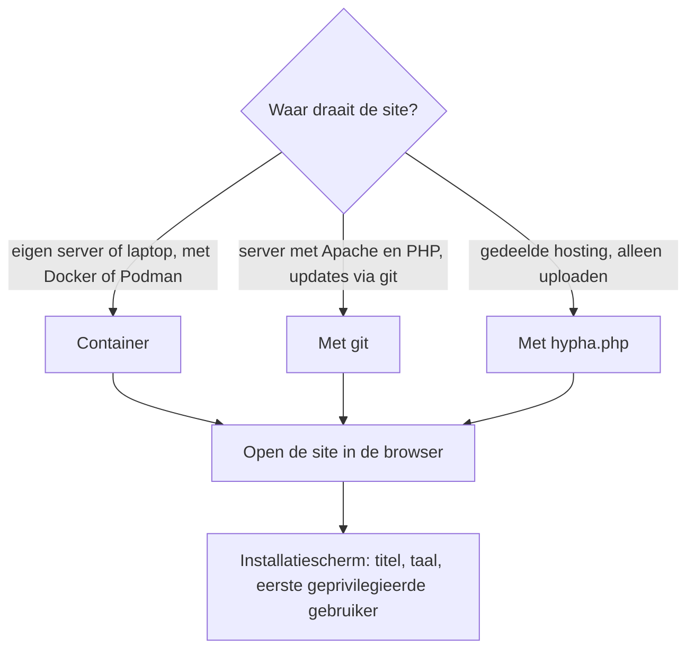
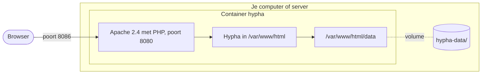

# Installatie, ook met Docker

Deze pagina legt uit hoe je Hypha installeert: met git, met het installatiebestand `hypha.php`, of in een **container met Docker** (of Podman). Docker blijft altijd een ondersteunde manier, ook met de nieuwe tekst-editor. De Engelstalige details staan in [`docs/technical/INSTALLATION.md`](../../technical/INSTALLATION.md) en [`docs/technical/CONTAINER.md`](../../technical/CONTAINER.md).

## Wat je nodig hebt

| Wat | Versie of instelling |
|---|---|
| PHP | 8.2, 8.3, 8.4 of 8.5 |
| PHP-extensies | dom, libxml, xml, mbstring, gd (met jpeg en png), curl, openssl, zlib, fileinfo, session |
| Webserver | Apache 2.4 met mod_rewrite; `AllowOverride FileInfo` voor de map van de site |
| Ervoor | meestal NGINX, die TLS afhandelt |
| E-mail | een werkende `mail()` (sendmail of een relay) |
| Schijf | een schrijfbare map `data/` voor de gebruiker van de webserver |

In een container zit dit allemaal, behalve e-mail.

## Drie manieren

Het diagram helpt kiezen.



## Met Docker

De bestanden staan in [`docs/container/`](../../container/). Het image is gebaseerd op het officiële image `php:<versie>-apache` en werkt met **Docker** en **Podman**: overal waar `docker` staat, kun je ook `podman` gebruiken.

### Het image bouwen

Voer de opdrachten uit in de hoofdmap van de repository.

```bash
docker build -t localhost/hypha:php8.2 -f docs/container/Containerfile .
```

Een andere PHP-versie kies je met een build-argument:

```bash
docker build --build-arg PHP_VERSION=8.5 -t localhost/hypha:php8.5 -f docs/container/Containerfile .
```

### Een nieuwe site starten

1. Zet de standaard-thema in de map die de gegevens van de site krijgt:

   ```bash
   mkdir -p hypha-data/themes && cp -R data/themes/default hypha-data/themes/
   ```

2. Zet vóór het bouwen de gebruikersnaam en het wachtwoord van de **systeemgebruiker** bovenin `hypha.php`. Laat je ze leeg, dan kan iedereen de installatie openen.
3. Start de container:

   ```bash
   docker run -d --name hypha -p 8086:8080 -v ./hypha-data:/var/www/html/data:Z localhost/hypha:php8.2
   ```

4. Open <http://localhost:8086/>. Je komt in het installatiescherm: log in als systeemgebruiker en vul de titel, de standaardtaal, de startpagina, de eerste geprivilegieerde gebruiker en het e-mailadres van het systeem in.

### Met Docker Compose

Eén opdracht bouwt en start alles, met de gegevens in `docs/container/hypha-data/`:

```bash
docker compose -f docs/container/compose.yaml up -d --build
```

### Een bestaande site in de container

1. Kopieer de map `data/` van de site naar `hypha-data/`. Daarin staan `hypha.xml`, `pages/`, `images/`, `files/` en het thema.
2. Gebruik een **kopie**: Hypha schrijft in de gegevens.
3. Start de container zoals hierboven.

### Wat er gebeurt

Het diagram laat zien wat er in de container zit en wat erbuiten blijft.



1. De code zit in het image; de mappen `.git`, `ai/` en `docs/` niet.
2. De **gegevens** staan buiten de container, in `hypha-data/`. Een nieuwe container met een nieuwer image gebruikt dezelfde gegevens.
3. Apache draait met hoogstens twee werkers in 256 MB geheugen; op een grotere server verhoog je `MaxRequestWorkers` in `mpm_prefork.conf` (ongeveer 100 MB per werker).
4. Er zit **geen mailserver** in het image. Wil je dat de site e-mail verstuurt, wijs `sendmail_path` dan naar een relay, bijvoorbeeld msmtp met de SMTP-server van je hosting.

### Logboek en fouten

1. Het logboek lees je met `docker logs -f hypha`.
2. Foutmeldingen in de browser zet je aan met een bestand `DEBUG`: `docker exec hypha touch /var/www/html/DEBUG`. Alleen om lokaal te testen; haal het daarna weg.

### Achter NGINX

Zet in `docs/container/hypha-vhost.conf` de regels `SetEnv HTTPS on`, `RemoteIPHeader` en `RemoteIPInternalProxy` aan. Stel NGINX in zoals in [`docs/technical/REVERSE_PROXY.md`](../../technical/REVERSE_PROXY.md): geef `Host` en `X-Real-IP` door, zet `client_max_body_size` op 20m en bewaar geen pagina's van ingelogde leden in de cache.

### Bijwerken

1. Haal de nieuwe code op met `git pull`.
2. Bouw het image opnieuw.
3. Stop en verwijder de oude container (`docker rm -f hypha`) en start een nieuwe met dezelfde map `hypha-data/`.

## Met git

1. Haal de code op:

   ```bash
   git clone https://github.com/PlanBCode/hypha.git /var/www/hypha
   ```

2. Geef de webserver alleen schrijfrechten op `data/`: `chown -R www-data:www-data /var/www/hypha/data`.
3. Zet de gebruikersnaam en het wachtwoord van de systeemgebruiker bovenin `hypha.php`.
4. Open de site in de browser en vul het installatiescherm in.
5. Haal daarna `hypha.php` weg uit de map van de site, of houd het wachtwoord sterk.

Bijwerken gaat met `git pull`; de map `data/` valt buiten git, behalve het standaardthema.

## Met hypha.php

1. Download `hypha.php` van hypha.net.
2. Zet de gebruikersnaam en het wachtwoord van de systeemgebruiker in de eerste regels.
3. Zet het bestand in de map van de site en open het in de browser. Het pakt de bestanden uit en opent het installatiescherm.

## Systeemgebruiker en gebruikers van de site

Bij de installatie maak je twee accounts die **los van elkaar** staan.

| | Systeemgebruiker | Eerste geprivilegieerde gebruiker |
|---|---|---|
| Waar | `$username` en `$password` bovenin `hypha.php`, leesbaar | `<user rights="admin">` in `data/hypha.xml`, met een hash van het wachtwoord |
| Inloggen | alleen op `hypha.php` | met de inlogknop op de site |
| Waarvoor | de installatie, en daarna `hypha.php?maintenance` om de bestanden van Hypha bij te werken | de site: instellingen, thema, menu, gebruikers |

1. Met de systeemgebruiker kun je **niet** op de site inloggen. Daarom vraagt het installatiescherm, na het inloggen als systeemgebruiker, apart om de gebruikersnaam en het wachtwoord van de eerste gebruiker van de site.
2. Kies voor de twee accounts verschillende wachtwoorden.
3. Na de installatie maak je via de site meer gebruikers aan: standaardgebruikers, en zo nodig meer geprivilegieerde gebruikers. Zie [Gebruikersbeheer](../gebruik/10-gebruikersbeheer.md), ook voor het met de hand instellen van een wachtwoord als niemand meer kan inloggen.

## Controleren of het werkt

Na de installatie, of na een update, vraag je alle pagina's op met de rooktest:

```bash
python3 -I docs/container/smoke_test.py http://localhost:8086 hypha-data/hypha.xml
```

Kijk daarna in het logboek of er PHP-meldingen zijn bijgekomen.
