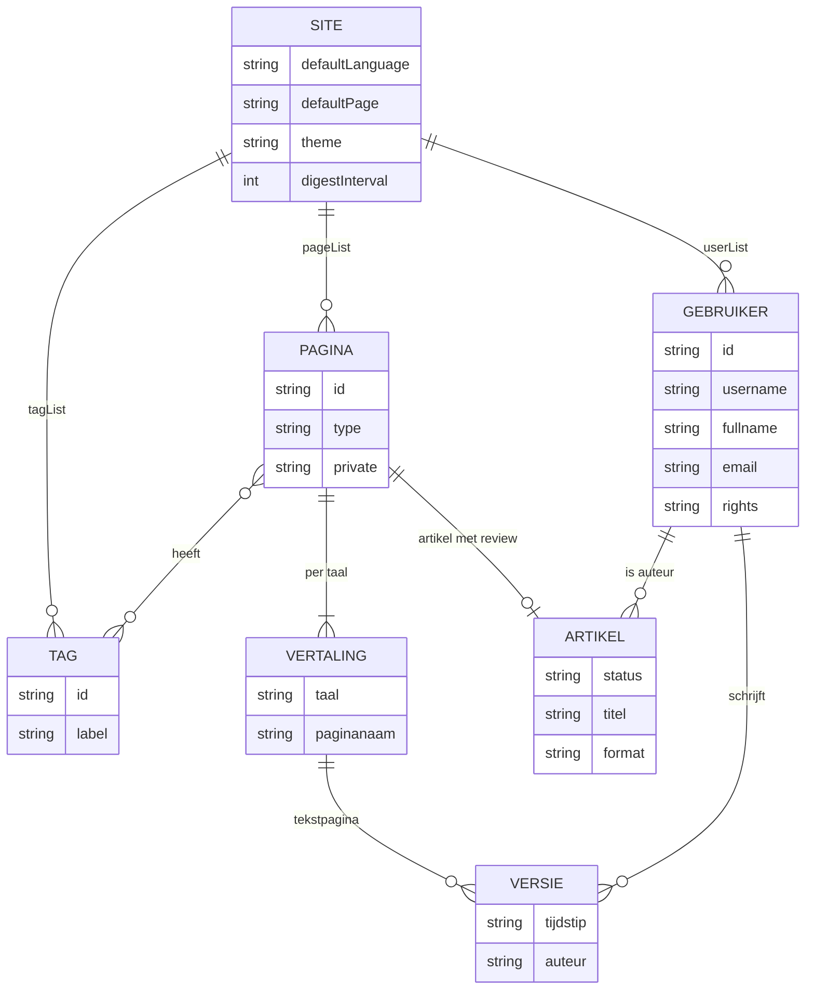

# Opslag: hypha.xml en de map data

Hypha heeft geen database. Alles wat een site bevat, staat als bestanden in de map `data/`: de instellingen, de leden, de pagina's, de foto's en het thema. Wie de map `data/` kopieert, kopieert de site. Deze pagina beschrijft wat waar staat. De Engelstalige details staan in [`docs/technical/DATA_MODEL.md`](../../technical/DATA_MODEL.md).

## De map data

| Pad | Inhoud |
|---|---|
| `data/hypha.xml` | instellingen van de site, leden, de lijst van pagina's, tags, menu, kop en voet, de wachtrij van de samenvatting |
| `data/pages/‹id›` | één XML-bestand per pagina: alle talen en alle versies; bij een artikel ook de discussies en goedkeuringen |
| `data/images/` | geüploade foto's; `images/org/` bewaart de originelen die groter waren dan 1120 bij 800 |
| `data/files/` | andere geüploade bestanden |
| `data/themes/‹naam›/` | het thema: `hypha.html` (sjabloon), `hypha.css` en bijbehorende bestanden |
| `data/digest` | wijzigingen voor de volgende samenvatting |
| `data/hypha.stats` | tellers van paginabezoeken |

Pagina's, leden en tags hebben een **id** van 13 tekens (letters en cijfers), bijvoorbeeld `69dfec633ce2a`. Een pagina verwijst naar een andere pagina met `hypha:‹id›`, niet met haar naam. Daardoor blijven links werken als een pagina een andere naam krijgt.

## Hoe de gegevens samenhangen

Het diagram laat zien hoe de site, de pagina's, de vertalingen, de versies, de artikelen, de tags en de leden met elkaar samenhangen.



## hypha.xml

`data/hypha.xml` is het hart van de site. Een nieuwe installatie ziet er zo uit (zonder persoonsgegevens):

```xml
<hypha type="project" defaultLanguage="nl" defaultPage="Home" email="redactie@eemstad.example"
       digestInterval="21600" schemaVersion="1">
  <title>Eemstad</title>
  <header>Eemstad</header>
  <footer>…</footer>
  <menu>
    <a href="hypha:69dfec633ce2a"/>
  </menu>
  <userList>
    <user id="69dfec633e055" username="sanne" fullname="Sanne de Vries"
          email="sanne.devries@eemstad.example" password="…" rights="admin"/>
  </userList>
  <pageList>
    <page id="69dfec633ce2a" type="textpage" private="off">
      <language id="nl" name="Home"/>
    </page>
  </pageList>
  <digest/>
</hypha>
```

| Element of attribuut | Betekenis |
|---|---|
| `@defaultLanguage`, `@defaultInterfaceLanguage`, `@defaultPage`, `@defaultNewPageType` | instellingen van de site, uit **projectinstellingen** |
| `@email` | afzender van de e-mail van het systeem |
| `@digestInterval`, `@lastDigestTime` | seconden tussen twee samenvattingen; tijdstip van de laatste |
| `@theme` | de map van het thema onder `data/themes/` |
| `title`, `header`, `footer`, `menu` | onderdelen van de site; links naar pagina's als `hypha:‹id›` |
| `userList/user` | leden: `rights` is `admin`, `user`, `invitee` (genodigde) of `exmember` (oud-lid); `password` is een bcrypt-hash; `key` staat er zolang een uitnodiging of herstel loopt |
| `pageList/page` | elke pagina met haar `type` (de PHP-klasse), `private` (`on` of `off`) en per taal een `language` met de paginanaam |
| `tagList/tag` | de tags, met per taal een label en een omschrijving |
| `mdeditor` | instellingen van de nieuwe tekst-editor (zie [Datatypes en macro's](04-datatypes-en-macros.md)) |

## Een tekstpagina in XML

Een tekstpagina bewaart per taal elke versie. De nieuwste versie staat er in zijn geheel; een oudere versie staat er als verschil met de versie erna. Zo blijft het bestand klein.

```xml
<hypha type="textpage" multiLingual="on" versions="on" schemaVersion="1">
  <language xml:id="nl">
    <version xml:id="t1793000500" author="sanne"><p>Over de redactie…</p></version>
    <version xml:id="t1793000000">…verschil…</version>
  </language>
</hypha>
```

Een tekstpagina uit de nieuwe tekst-editor heeft `format="markdown"` op de wortel en daarnaast een element `source` met de **Markdown-bron**, per taal en per versie, met hetzelfde tijdstip als de HTML:

```xml
<hypha type="textpage" multiLingual="on" versions="on" format="markdown">
  <language xml:id="nl"><version xml:id="t1793000500" author="sanne">XHTML</version></language>
  <source format="markdown" profile="hypha-1.0">
    <language id="nl"><version at="t1793000500" author="sanne"><![CDATA[## Over de redactie …]]></version></language>
  </source>
</hypha>
```

## Een artikel in XML

Een artikel met review bewaart alleen de **laatste stand**, geen eerdere versies. In hetzelfde bestand staan de discussies, de goedkeuringen, de status en de datums.

```xml
<hypha type="peer_reviewed_article">
  <article format="markdown" status="draft" author="…">
    <content><text>XHTML</text><sources>XHTML</sources></content>
    <context><title>…</title><section>Politiek en bestuur</section><excerpt>XHTML</excerpt><method>XHTML</method></context>
    <source format="markdown" profile="hypha-1.0">
      <text><![CDATA[…Markdown…]]></text><excerpt/><method/><sources/><frontmatter/>
    </source>
  </article>
  <featured_image alt="…" caption="…" credit="…">hoekstra.jpg</featured_image>
  <discussions><review>…</review><public>…</public></discussions>
  <approves>…</approves>
</hypha>
```

1. `article/@status` is `draft` (schets), `review` (in beoordeling), `approved` (goedgekeurd), `published` (gepubliceerd) of `retracted` (teruggetrokken).
2. Een **oud** artikel heeft geen `format="markdown"` en geen `source`: het opent in de oude opmaakeditor.
3. Een teruggetrokken artikel heeft een element `retraction` met de reden voor lezers.
4. De afbeelding bij het uittreksel staat onder de wortel (`featured_image`), niet in `context`: daar leest de bestaande code haar.

## De Markdown-bron en de HTML

Bij een pagina of artikel uit de nieuwe tekst-editor staan **twee** vormen van de tekst in het bestand:

1. de **Markdown-bron** in `source`, als CDATA, precies zoals de auteur haar schreef;
2. de **XHTML** in de gewone plek, gemaakt door de server bij opslaan.

Lezers, zoekmachines, de samenvatting en de lijst met versies gebruiken de XHTML. De editor gebruikt de Markdown-bron. Diagrammen en formules worden in de browser getekend en als SVG en MathML meegestuurd; de server zet ze in de XHTML. Zie [Beveiliging](07-beveiliging.md) voor het filter dat de XHTML controleert.

## Schrijven zonder kapotte bestanden

1. Elke wijziging gaat via de klasse `Xml`: eerst een slot op het bestand (`flock`), dan het bestand opnieuw lezen, wijzigen, het geheel naar een tijdelijk bestand schrijven en dat in één keer op zijn plek zetten.
2. Wie tegelijk leest, ziet de oude of de nieuwe versie, nooit een half bestand.
3. `hypha.xml` heeft één slot voor de hele site. Elke wijziging van een instelling, lid, tag of paginanaam schrijft het hele bestand opnieuw.
4. Een wijziging die twee bestanden raakt (een nieuwe pagina en haar regel in `hypha.xml`), is niet in één keer: een kopie op dat moment kan half zijn. Zie [Beheer](06-beheer.md#back-up).

> [!warning] Persoonsgegevens
> `hypha.xml` en de paginabestanden bevatten namen, e-mailadressen en wachtwoord-hashes van leden, en namen en e-mailadressen van mensen die reageren, zich aanmelden voor een nieuwsbrief of voor een festival. Behandel een kopie van `data/` als persoonsgegevens: niet in een repository of een ticket zetten.

## Meer lezen

1. [`docs/technical/DATA_MODEL.md`](../../technical/DATA_MODEL.md)
2. [Architectuur](01-architectuur.md#opslag)
