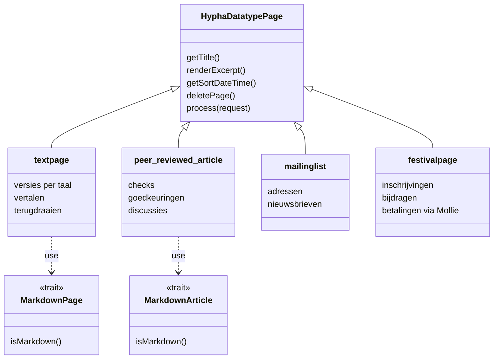

# Datatypes en macro's

In Hypha heeft elke pagina een **datatype**: een PHP-klasse die bepaalt hoe de pagina wordt opgeslagen, getoond en bewerkt. Een **macro** is een klein stukje code dat bij het tonen van een pagina iets invult, zoals een lijst van de laatste artikelen. Deze pagina beschrijft beide, en hoe de nieuwe tekst-editor in de bestaande datatypes is ingebouwd.

## De datatypes

Het diagram laat zien welke datatypes er zijn, wat ze van de basisklasse erven, en welke twee de nieuwe tekst-editor gebruiken via een *trait*.



| Klasse | Naam in Hypha | Bestand | Waarvoor |
|---|---|---|---|
| `textpage` | webpagina | `system/datatypes/text.php` | gewone pagina met versies per taal, vertalen en terugdraaien |
| `peer_reviewed_article` | artikel met review | `system/datatypes/peer_reviewed_article.php` | artikel met checks, drie goedkeuringen, beoordelingsopmerkingen en reacties van lezers |
| `mailinglist` | mailinglist | `system/datatypes/mailinglist.php` | adressen met bevestiging per e-mail, nieuwsbrieven met test-verzending |
| `festivalpage` | festival pagina | `system/datatypes/festival.php` | inschrijven, betalen via Mollie, bijdragen, lineup en blokkenschema |

Daarnaast zijn er **systeempagina's**, die geen eigen paginabestand hebben: `settingspage` (instellingen), `indexpage` (de index van pagina's, afbeeldingen en bestanden) en `tagindexpage` (pagina's per tag).

### Hoe Hypha een datatype vindt

1. Bij elk verzoek laadt Hypha alle bestanden in `system/datatypes/`.
2. Elke klasse die van `HyphaDatatypePage` erft en een statische functie `getDatatypeName()` heeft, komt in de lijst bij **nieuwe pagina**.
3. In `hypha.xml` staat bij elke pagina het `type`: de naam van de klasse. Hypha maakt bij het openen een object van die klasse.
4. Een nieuw datatype is dus een nieuw bestand in `system/datatypes/`. Haal je een bestand weg terwijl er nog pagina's van dat type zijn, dan geven die pagina's een fatale fout.

### Hoe een datatype een verzoek verwerkt

De functie `process()` krijgt het verzoek en kijkt naar de **weergave** (het deel van het adres na de paginanaam, zoals `edit`) en de **opdracht** (uit het formulier, zoals `save`). Een weergave schrijft HTML in het sjabloon; een opdracht wijzigt gegevens en stuurt de browser daarna door.

## De nieuwe tekst-editor in de bestaande datatypes

De nieuwe tekst-editor is **geen nieuw datatype**. Hij zit in twee *traits* in `system/core/`:

1. `MarkdownPage` (`markdown_page.php`), gebruikt door `textpage`;
2. `MarkdownArticle` (`markdown_article.php`), gebruikt door `peer_reviewed_article`.

Bovenin `process()` vraagt het datatype aan de trait of de pagina een **Markdown-bron** heeft (`isMarkdown()`). Zo ja, dan handelt de trait het verzoek af met de nieuwe editor; zo nee, dan gaat alles zoals vroeger, met WYMeditor.

| Situatie | Editor |
|---|---|
| nieuw artikel | nieuwe tekst-editor |
| nieuwe, nog lege tekstpagina | nieuwe tekst-editor |
| bestaand artikel of bestaande tekstpagina met HTML | oude opmaakeditor (WYMeditor); er wordt niets omgezet |
| mailinglijst, festival, menu, kop en voet | oude opmaakeditor |

Verschillen tussen een tekstpagina en een artikel in de nieuwe editor:

1. Een **tekstpagina** houdt haar **paginanaam als titel** en als webadres (`Over ons` wordt `/nl/Over_ons`). Ze heeft versies per taal, vertalen en terugdraaien, net als vroeger.
2. Een **artikel** krijgt een webadres uit de titel: kleine letters, streepjes, zonder accenten (`/nl/afscheid-van-bram-hoekstra`). Het heeft een artikelkop met rubriek en tags, een checklist en de beoordeling. Het bewaart alleen de laatste stand.

### Instellingen van de editor

De instellingen van de nieuwe editor staan in `hypha.xml`, in een element `mdeditor`. Er is nog geen scherm om ze te wijzigen; wie de server beheert, past het bestand aan. Zonder dit element gelden standaardwaarden.

```xml
<mdeditor level2="on" level2Off="user">
  <section>Politiek en bestuur</section>
  <section>Wonen en wijken</section>
  <statute>Feiten in het artikel zijn gecontroleerd met ten minste één betrouwbare bron.</statute>
  <frameHost>player.vimeo.com</frameHost>
  <scriptHost>cdn.jsdelivr.net</scriptHost>
</mdeditor>
```

| Element of attribuut | Betekenis |
|---|---|
| `section` | de **rubrieken** waaruit een auteur kiest |
| `statute` | de punten van het **redactiestatuut** die een beoordelaar bij goedkeuren aanvinkt |
| `frameHost`, `peertubeHost` | diensten waarvan een video, kaart of grafiek in een artikel mag (niveau 2) |
| `scriptHost` | websites waarvan een interactief blok scripts mag laden (niveau 2) |
| `@level2` | `off` zet niveau 2 voor de hele site uit |
| `@level2Off` | rollen zonder niveau 2, gescheiden door komma's: `user` voor standaardgebruikers, `admin` voor geprivilegieerde gebruikers |

Wat niveau 1 en 2 zijn, staat in [Beveiliging](07-beveiliging.md#de-vrijheidsniveaus-van-de-editor).

> [!warning] Let op bij het wijzigen van hypha.xml
> Wijzig `hypha.xml` alleen als niemand de site gebruikt, en maak eerst een kopie. Een fout in het bestand maakt de hele site onbruikbaar.

## Macro's

Een macro is een element `<macro>` in de HTML. Bij het tonen van de pagina vervangt Hypha het door de uitkomst van de macro. Er zijn twee macro's:

| Macro | Wat het doet | Voorbeeld |
|---|---|---|
| `now` | de datum en tijd van nu, in een vorm die je kiest | `<macro name="now" format="d-m-Y"/>` |
| `pagelist` | een lijst van pagina's met hun uittreksel, gefilterd en gesorteerd | zie hieronder |

De macro `pagelist` kent deze attributen:

| Attribuut | Betekenis |
|---|---|
| `tags` | alleen pagina's met een van deze tags (labels, gescheiden door komma's; eventueel met taal: `nl/Raadsnieuws`) |
| `exclude-tags` | geen pagina's met een van deze tags |
| `pagetypes` | alleen deze datatypes, bijvoorbeeld `peer_reviewed_article` |
| `languages` | alleen pagina's in deze talen |
| `include-private` | `yes`: ook privépagina's, als de bezoeker is ingelogd |
| `date-from`, `date-until` | alleen pagina's tussen deze datums (`JJJJ-MM-DD`) |
| `sort` | `date` of `title`; met een `-` ervoor omgekeerd, zoals `-date` |
| `limit` | hoogstens zoveel pagina's |

Een lijst van de tien nieuwste artikelen over raadsnieuws:

```html
<macro name="pagelist" tags="Raadsnieuws" pagetypes="peer_reviewed_article" sort="-date" limit="10"/>
```

1. Macro's werken in de HTML van de site: het sjabloon van het thema, de kop, de voet, en pagina's in de oude opmaakeditor.
2. In de **nieuwe tekst-editor** werken macro's niet. Het filter haalt een `<macro>` uit de HTML; in de Markdown-bron blijft hij staan. Dat is een bewuste keuze in het ontwerp.
3. Een macro die faalt, wordt „Macro failed”. Een ingelogde gebruiker ziet ook de reden; de fout staat in het PHP-logboek.
4. Een nieuwe macro is een PHP-bestand in `system/macros/` met een klasse die van `HyphaMacro` erft en de naam van de klasse teruggeeft.

## Meer lezen

1. [Architectuur](01-architectuur.md)
2. [Opslag](03-opslag.md)
3. [`ai/ARCHITECTURE.md`](../../../ai/ARCHITECTURE.md#pages-and-datatypes)
