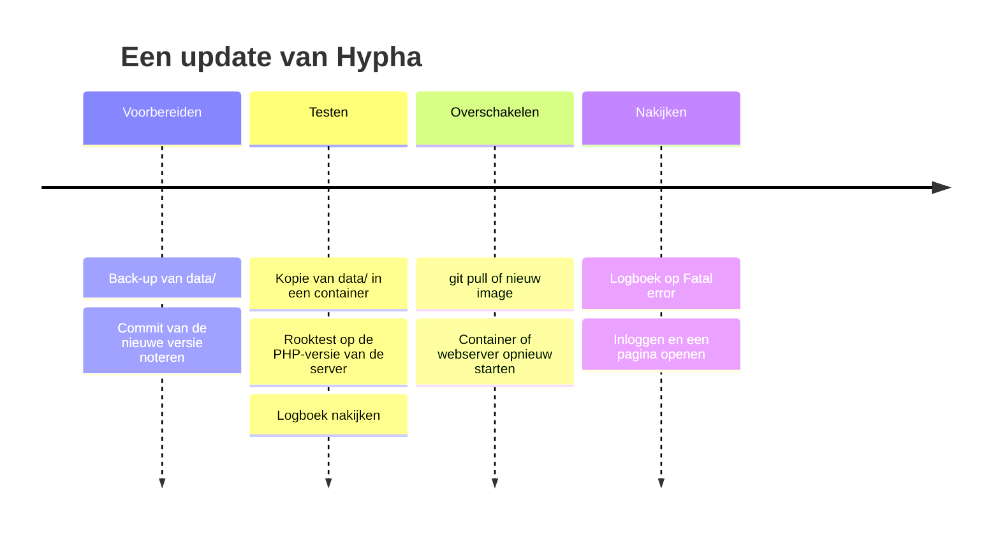
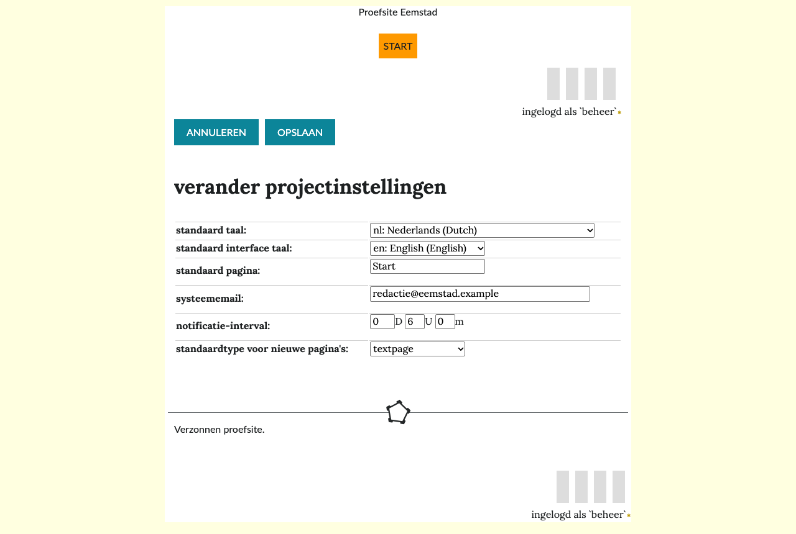

# Beheer: back-up, logboeken, e-mail en updates

Deze pagina is voor wie een Hypha-site draaiend houdt. Ze beschrijft de back-up, het logboek, e-mail en de samenvatting, updates en de capaciteit van de server. De Engelstalige details staan in [`docs/technical/OPERATIONS.md`](../../technical/OPERATIONS.md).

## Back-up

Hypha heeft geen eigen back-up. Alles van de site staat in de map `data/`; kopieer die map.

```bash
tar -czf hypha-data-$(date +%Y%m%d).tar.gz -C /var/www/hypha data
```

1. Een kopie terwijl de site draait, is per bestand heel: Hypha vervangt elk bestand in één keer.
2. Een wijziging die twee bestanden raakt, zoals een nieuwe pagina en haar regel in `hypha.xml`, kan half in de kopie staan. Maak de kopie daarom op een rustig moment, of met een momentopname (*snapshot*) van het bestandssysteem.
3. **Terugzetten**: zorg dat niemand schrijft, vervang `data/` door de kopie en controleer of de gebruiker van de webserver de eigenaar is.
4. Probeer af en toe of terugzetten lukt, bijvoorbeeld in een container. Zie [Installatie](02-installatie.md).

> [!warning] Een back-up bevat persoonsgegevens
> In `data/` staan namen, e-mailadressen en wachtwoord-hashes. Bewaar back-ups veilig en zet ze niet in een repository of een ticket.

## Logboeken

1. PHP-fouten gaan naar het PHP-logboek. In een container lees je het met `docker logs -f hypha`.
2. Zoek naar `Fatal error` en `Uncaught`. Dat zijn echte fouten.
3. Veel waarschuwingen over `DOMDocument::loadHTML()` en elementen als `macro` en `video` zijn onschuldig. Ze komen van de HTML-parser van PHP en staan bij elk paginabezoek in het logboek.
4. Een bestand `DEBUG` in de hoofdmap van de site toont fouten aan **elke bezoeker**. Gebruik het alleen op een testsite en haal het daarna weg.

## E-mail

Hypha verstuurt e-mail met de PHP-functie `mail()`. De server heeft dus `sendmail` of een relay nodig.

| E-mail | Wanneer |
|---|---|
| uitnodiging, herstel van het wachtwoord | meteen, als een gebruiker iemand uitnodigt of iemand **heraanmelden** kiest |
| samenvatting voor de gebruikers | tijdens het eerste paginabezoek nadat de ingestelde tijd voorbij is |
| artikel klaar voor beoordeling, nieuwe status, breekpunt | meteen, als iemand de actie uitvoert |
| bevestiging van een reactie, nieuwsbrief of inschrijving | meteen |
| nieuwsbrief van een mailinglijst | terwijl de gebruiker die **versturen** koos wacht, één e-mail per adres |

1. Er is geen wachtrij en geen tweede poging. Mislukt het versturen, dan ziet de gebruiker een melding.
2. De afzender is het **systeememail** uit **projectinstellingen**.
3. Een testsite hoort geen e-mail te versturen. Wijs `sendmail_path` daar naar `/bin/true` of naar een programma dat alle e-mail opvangt.

## De samenvatting

De samenvatting (*digest*) gaat naar alle gebruikers en bevat de wijzigingen sinds de vorige, met de verschillen gemarkeerd.

1. Hypha heeft geen geplande taak (*cron*). De samenvatting gaat mee met een gewoon paginabezoek, als de ingestelde tijd voorbij is.
2. Op een site met weinig bezoekers komt de samenvatting dus later. Is de mailserver traag, dan wacht die ene bezoeker.
3. De tijd stel je in bij **instellingen**, **projectinstellingen**, **notificatie-interval**, in dagen, uren en minuten. Na de installatie is het zes uur.

## Updates

Het diagram laat zien hoe je een update veilig uitvoert, stap voor stap.



1. Maak een **back-up** van `data/`.
2. Kies de nieuwe versie. Hypha heeft nog geen versienummers; schrijf de commit op waarnaar je bijwerkt.
3. **Test** eerst: start de nieuwe versie in een container met een kopie van `data/`, op dezelfde PHP-versie als de server, en draai de rooktest:

   ```bash
   python3 -I docs/container/smoke_test.py http://localhost:8086 hypha-data/hypha.xml
   ```

4. **Schakel over**: `git pull`, of een nieuw image en een nieuwe container met dezelfde map voor de gegevens.
5. **Kijk na**: lees het logboek op `Fatal error`, log in en open een paar pagina's en een artikel.

> [!info] De nieuwe tekst-editor
> De nieuwe tekst-editor brengt zijn bibliotheken mee in `system/vendor/` (PHP) en `system/mdeditor/vendor/` (browser). Er is geen Composer of npm nodig op de server. De bestanden in de browser hebben de versie in hun naam, zodat een browser na een update nooit een oude versie uit zijn cache haalt.

## Instellingen van de tekst-editor

Een geprivilegieerde gebruiker past de instellingen van de tekst-editor aan via **Instellingen → Tekst-editor** (`/settings/editor`): de rubrieken, het redactiestatuut, vrijheidsniveau 2 per rol, en de diensten en scripts die zijn toegestaan. Eén per regel; een leeg vak geeft de standaardlijst. De instellingen staan in het element `mdeditor` in `data/hypha.xml`, zoals hieronder; zonder dat element gelden de standaardwaarden uit `hypha_mdeditorDefaults()` in `system/core/markdown.php`.



```xml
<mdeditor level2="on" level2Off="user">
  <section>Politiek en bestuur</section>
  <statute>Feiten in het artikel zijn gecontroleerd met ten minste één betrouwbare bron.</statute>
  <frameHost>player.vimeo.com</frameHost>
  <peertubeHost>framatube.org</peertubeHost>
  <scriptHost>cdn.jsdelivr.net</scriptHost>
</mdeditor>
```

1. `section`: de rubrieken waaruit een auteur kiest. Elke rubriek is één element.
2. `statute`: de punten van het redactiestatuut. Wie een artikel goedkeurt, vinkt ze allemaal aan.
3. `frameHost` en `peertubeHost`: de diensten die je mag insluiten, zoals video en kaarten.
4. `scriptHost`: de enige plekken waar een interactief blok scripts en stijlen vandaan mag halen.
5. `level2="off"` zet ingesloten inhoud en interactieve blokken uit voor de hele site. Met `level2Off="user"` zet je ze alleen uit voor standaardgebruikers, met `level2Off="user,admin"` voor iedereen.
6. Het niveau hoort bij het artikel. Een gebruiker voor wie niveau 2 uit staat, kan een artikel met een interactief blok of een ingesloten video gewoon bewerken; die onderdelen blijven werken. Ze wijzigen of toevoegen kan die gebruiker niet: de editor meldt dat bij opslaan.

Een lijst die je invult, vervangt de standaardlijst helemaal. Pas je `hypha.xml` toch met de hand aan, doe dat dan als het rustig is op de site, en maak eerst een [back-up](#back-up).

## PHP-versies

Hypha draait op **PHP 8.2 tot en met 8.5**. Controleer de versie voor je van hosting wisselt, met `php -v` en de lijst met extensies in [Installatie](02-installatie.md#wat-je-nodig-hebt). PHP 8.2 krijgt van php.net beveiligingsupdates tot en met 31 december 2026.

## Specificaties en capaciteit

Hypha leest bij elk verzoek het hele bestand `hypha.xml` in: de gebruikers, de lijst met pagina's en de tags. Een pagina zelf staat in `data/pages/<id>`. Daarom bepalen het aantal pagina's en het aantal gebruikers hoeveel geheugen en rekentijd elk verzoek kost.

De getallen hieronder zijn gemeten op 27 oktober 2026, met verzonnen proefsites (`tests/gouden/maak.php`), PHP 8.4.27 met OPcache, Apache 2.4 met mod_php (prefork) in de container van [Installatie](02-installatie.md). De machine was een Apple M1 (8 kernen) met OrbStack (8 CPU's, 7,8 GB). Tegelijk draaiden er andere tests, dus reken op een paar procent ruis. Een steekproef op PHP 8.2.35 gaf dezelfde getallen (binnen 10%). Wat *afgeleid* heet, is berekend uit de metingen en niet zelf gemeten.

### Kort: wat heb je nodig

| Site | Geheugen | CPU | Schijf |
|---|---|---|---|
| tot 1.000 pagina's | 256 MB met 2 werkers is ruim genoeg | 1 kern | 15 MB plus afbeeldingen |
| tot 10.000 pagina's | 256 MB met 2 werkers, of 512 MB met 4 werkers | 1 tot 2 kernen | 130 MB plus afbeeldingen |
| tot 25.000 pagina's | 1 GB met 4 werkers (afgeleid) | 2 kernen | 330 MB plus afbeeldingen (afgeleid) |
| 50.000 pagina's | 1 GB met 2 werkers; de index duurt dan 2 seconden | 2 kernen | 625 MB plus afbeeldingen |

1. Afbeeldingen en bestanden in `data/images/` en `data/files/` tellen niet mee in deze tabel. Die zijn op een echte site vaak het grootste deel.
2. Boven ongeveer **25.000 pagina's** duurt de index van alle pagina's langer dan 1 seconde. Boven ongeveer **50.000 pagina's** duurt ook het openen van de editor langer dan 1 seconde. Gewone pagina's blijven onder 0,3 seconde.
3. **Gebruikers** kosten ongeveer evenveel als pagina's: 1.000 gebruikers voegen 185 kB toe aan `hypha.xml`, ongeveer zoveel als 1.200 pagina's. Gemeten is tot 10.000 gebruikers. Tel voor een grotere site 1.000 gebruikers als 1.200 pagina's (afgeleid).

### Schijf

| Pagina's | `hypha.xml` | `data/` op schijf |
|---|---|---|
| 100 | 17 kB | 2,9 MB |
| 1.000 | 154 kB | 14 MB |
| 10.000 | 1,5 MB | 126 MB |
| 50.000 | 7,6 MB | 625 MB |

| Soort pagina | Bestand in `data/pages/` |
|---|---|
| Markdown-artikel | gemiddeld 14 kB: een derde de Markdown-bron, twee derde de XHTML |
| Markdown-tekstpagina met 3 versies | gemiddeld 16,5 kB |
| oude HTML-pagina of -artikel | 1 tot 2 kB (de proefteksten zijn kort) |
| regel in `hypha.xml` per pagina | ongeveer 150 bytes |
| regel in `hypha.xml` per gebruiker | ongeveer 185 bytes |

1. Een Markdown-pagina bewaart de tekst twee keer: als bron en als XHTML. Ze is daardoor ongeveer 1,5 keer zo groot als een HTML-pagina met dezelfde tekst (afgeleid).
2. Een tekstpagina bewaart elke versie als verschil met de volgende. Een kleine wijziging kost ongeveer **0,2 kB** per versie, een helemaal nieuwe tekst van 4 kB ongeveer **2,4 kB** per versie.
3. Een artikel houdt geen versies bij. Opslaan vervangt het bestand; het groeit niet.
4. Het bestandssysteem rondt elk bestand af op 4 kB. Bij 10.000 pagina's is dat 129 MB op schijf voor 107 MB aan bestanden.

### Rekentijd per verzoek

Mediaan van de CPU-tijd in milliseconden. De wachttijd voor de bezoeker is ongeveer 1 ms meer.

| Verzoek | 100 pagina's | 1.000 | 10.000 | 50.000 |
|---|---|---|---|---|
| artikel bekijken, bezoeker | 3 | 6 | 23 | 104 |
| tekstpagina bekijken, bezoeker | 3 | 9 | 52 | 256 |
| startpagina, bezoeker | 3 | 8 | 51 | 258 |
| pagina bestaat niet (404) | 2 | 7 | 53 | 262 |
| artikel bekijken, ingelogd | 4 | 10 | 57 | 290 |
| startpagina, ingelogd | 3 | 11 | 89 | 457 |
| inloggen | 2 | 4 | 19 | 88 |
| editor openen (`/edit`) | 5 | 23 | 194 | 964 |
| artikel opslaan | 6 | 15 | 113 | 508 |
| pagina's met een tag (`/tag/nl/...`)¹ | 2 | 19 | 205 | 1.182 |
| index van alle pagina's (`/index/nl`) | 5 | 40 | 377 | 1.895 |

¹ Bij 50.000 pagina's gemeten in een container van 1 GB; in 256 MB stopte de werker (zie [Geheugen](#geheugen)).

1. De rekentijd groeit ongeveer **lineair** met het aantal pagina's: per 1.000 pagina's ongeveer 2 ms voor een artikel, 5 ms voor een tekstpagina of de startpagina en 38 ms voor de index.
2. Een pagina achteraan in de lijst is trager dan een pagina vooraan. Hypha zoekt een pagina op door de lijst van voor naar achter door te lopen. Bij 50.000 pagina's kost dat tot 150 ms extra.
3. **Gebruikers**: 10.000 gebruikers maken elk verzoek op een site met 1.000 pagina's ongeveer 17 ms trager. Opslaan wordt 45 ms trager. Met 1.000 gebruikers of minder is er geen merkbaar verschil.

| Gebruikers (site met 1.000 pagina's) | `hypha.xml` | artikel, bezoeker | startpagina | inloggen | opslaan | werker |
|---|---|---|---|---|---|---|
| 5 | 154 kB | 6 ms | 8 ms | 4 ms | 15 ms | 28 tot 35 MB |
| 100 | 173 kB | 5 ms | 7 ms | 5 ms | 15 ms | 28 tot 35 MB |
| 1.000 | 338 kB | 7 ms | 8 ms | 5 ms | 18 ms | 30 tot 37 MB |
| 10.000 | 2,0 MB | 22 ms | 27 ms | 21 ms | 60 ms | 49 tot 71 MB |

### Geheugen

Elke werker van Apache met PHP houdt `hypha.xml` als boom (DOM) in het geheugen. Het geheugen van een werker (RSS) is:

| Pagina's | na gewone pagina's | na de index of een tagpagina | `memory_get_peak_usage` |
|---|---|---|---|
| 100 | 26 MB | 26 MB | 0,4 tot 0,6 MB |
| 1.000 | 28 MB | 32 tot 35 MB | 0,5 tot 0,8 MB |
| 10.000 | 47 MB | 98 tot 103 MB | 1,8 tot 4,3 MB |
| 50.000 | 133 MB | 400 tot 420 MB | 7,6 tot 19 MB |

1. Een werker geeft geheugen niet terug. Na één keer de index of een tagpagina blijft hij groot, tot Apache hem vervangt (na 500 verzoeken, `MaxConnectionsPerChild`). Reken daarom met de kolom **na de index of een tagpagina**.
2. Vuistregel (afgeleid): een werker heeft **30 MB plus 7,5 MB per 1.000 pagina's** nodig, en ongeveer 2 MB per 1.000 gebruikers. Apache zelf heeft ongeveer 25 MB nodig.
3. **`memory_limit` beschermt niet.** De boom van `hypha.xml` valt buiten de geheugenteller van PHP: PHP meldt hooguit 19 MB terwijl de werker 420 MB gebruikt. Alleen de grens van de container of de server stopt een werker. Die stopt hem dan hard: de bezoeker krijgt geen antwoord.
4. Gemeten: bij 50.000 pagina's in een container van 256 MB stopte de tweede tagpagina de werker. Bij 10.000 pagina's met 8 werkers in 256 MB gebeurde hetzelfde onder drukte. Met 4 werkers in 512 MB of 8 in 1 GB ging het goed (300 en 600 MB in gebruik).

Hoeveel werkers passen er (afgeleid uit de tabel, met 30 MB voor Apache en wat ruimte):

| Pagina's | 256 MB | 512 MB | 1 GB |
|---|---|---|---|
| 1.000 | 6 | 12 | 25 |
| 10.000 | 2 | 4 | 8 |
| 50.000 | geen | 1 | 2 |

### Drukte

Bezoekers die tegelijk een artikel opvragen, aantal verzoeken per seconde. Gemeten met `ab`, 12 seconden per stap, met de standaardgrens van 2 werkers in 256 MB.

| Site | CPU | 1 tegelijk | 2 | 4 | 8 |
|---|---|---|---|---|---|
| 1.000 pagina's | 1 kern | 123 | 132 | 133 | 132 |
| 10.000 pagina's | 1 kern | 25 | 23 | 23 | 21 |
| 10.000 pagina's | 2 kernen | 25 | 46 | 40 | 40 |
| 10.000 pagina's, 4 werkers, 512 MB | 8 kernen | 24 | 46 | 81 | 64 |
| 10.000 pagina's, 8 werkers, 1 GB | 8 kernen | 25 | 44 | 81 | 84 |

1. Het aantal verzoeken per seconde is ongeveer **het aantal kernen gedeeld door de rekentijd** van één verzoek, met als grens het aantal werkers. Meer werkers dan kernen helpt niet.
2. Extra bezoekers wachten in de rij. Bij 10.000 pagina's, 1 kern en 8 bezoekers tegelijk duurde een verzoek 0,33 seconde in plaats van 0,04.
3. Afgeleid: een bezoeker vraagt tijdens het lezen ongeveer elke 10 seconden een pagina. Eén kern bedient dan bij 10.000 pagina's ongeveer **200 bezoekers tegelijk**, bij 1.000 pagina's ruim 1.000.
4. Een redacteur kost meer: openen van de editor en opslaan samen ongeveer 0,3 seconde CPU bij 10.000 pagina's. Tien redacteuren die elke minuut opslaan, gebruiken samen ongeveer 5% van één kern.

### Schalen over CPU's

Gemeten op 28 oktober 2026 met een verzonnen site van 1.000 tekstpagina's en 300 artikelen (`hypha.xml` 188 kB), PHP 8.5, een container van 256 MB, de startpagina voor een bezoeker, met `ab` binnen het netwerk van Docker. Het hele verslag staat in [`ai/measurement/20261029_SCALABILITY_CPUS.md`](../../../ai/measurement/20261029_SCALABILITY_CPUS.md).

| CPU's (werkers) | vóór de optimalisaties | erna (#675, #677) | met de paginacache van PR #518 |
|---|---|---|---|
| 1 (2) | 115 per seconde, soms een fout 500 | 211 per seconde | 2.179 per seconde |
| 2 (4) | 215 per seconde, soms een fout 500 | 345 per seconde | 4.129 per seconde |
| 8 (8) | 514 per seconde, soms een fout 500 | 733 per seconde | 6.192 per seconde |

1. Meer CPU's helpen alleen als het aantal werkers past: **één tot twee werkers per CPU**. Op 1 CPU gaf dezelfde code 211 verzoeken per seconde met 2 werkers, en 56 tot 59 met 4 of 16 werkers. Met een CPU-grens op de container is de rekentijd dan al vroeg in elke periode op en wachten de werkers op elkaar.
2. Het geheugen was niet de grens: 8 tot 16 werkers gebruikten 54 tot 161 MB van de 256 MB. Met 32 werkers zat de index tegen de grens aan en kwamen er minder verzoeken door dan met 16.
3. Meet vanuit het netwerk van Docker of vanaf een andere machine. Via de poortdoorgifte van Docker Desktop leek dezelfde container te stoppen bij ongeveer 2.300 verzoeken per seconde.
4. De index van alle pagina's wordt bij elk verzoek opgebouwd (240 tot 250 per seconde op 8 CPU's). De paginacache helpt daar niet.
5. 1.000 startpagina's per seconde zonder CDN vragen zonder paginacache 4 tot 8 CPU's, met de paginacache 1 CPU (afgeleid uit de tabel).

### Instellen

1. Zet het aantal werkers (`MaxRequestWorkers` of `pm.max_children`) op het geheugen voor de webserver gedeeld door het geheugen van een werker uit de tabel hierboven. Meer dan twee werkers per kern helpt niet, en met een CPU-grens op de container werkt het zelfs averechts (zie [Schalen over CPU's](#schalen-over-cpus)).
2. Te veel werkers laten de server swappen of de container stopt werkers. Dan reageert de site voor niemand meer. Met een grens wachten extra verzoeken even in de rij.
3. `memory_limit` mag op 128 MB blijven staan: PHP zelf gebruikte nooit meer dan 19 MB. Het echte geheugen bewaak je met de grens van de container of de server.
4. Houd de groei bij: kijk elke maand naar de grootte van `hypha.xml` en `data/`. Groeit `hypha.xml` boven 4 MB (ongeveer 25.000 pagina's), plan dan meer geheugen.

Wil je de meting herhalen: maak een proefsite met `tests/gouden/maak.php` en start die zoals `tests/integratie/gouden.sh` doet. Zie [`docs/technical/TESTING.md`](../../technical/TESTING.md).

## Achter NGINX

Controleer na elke wijziging aan NGINX:

1. links beginnen met `https://`;
2. het logboek toont de echte adressen van bezoekers;
3. uploads tot 16 MB komen door;
4. pagina's van ingelogde gebruikers komen niet uit een cache.

Zie [`docs/technical/REVERSE_PROXY.md`](../../technical/REVERSE_PROXY.md).

## Meer lezen

1. [Beveiliging](07-beveiliging.md), voor de aanbevelingen
2. [Installatie](02-installatie.md)
3. [`docs/technical/OPERATIONS.md`](../../technical/OPERATIONS.md) en [`docs/technical/TESTING.md`](../../technical/TESTING.md)
