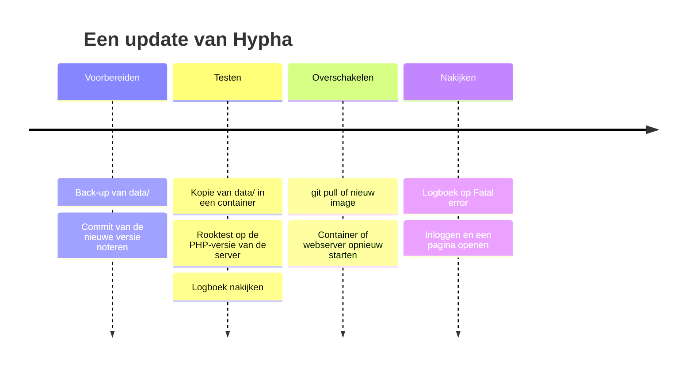

# Beheer: back-up, logboeken, e-mail en updates

Deze pagina is voor wie een Hypha-site draaiend houdt. Ze beschrijft de back-up, het logboek, e-mail en de samenvatting, updates en het geheugen van de server. De Engelstalige details staan in [`docs/technical/OPERATIONS.md`](../../technical/OPERATIONS.md).

## Back-up

Hypha heeft geen eigen back-up. Alles van de site staat in de map `data/`; kopieer die map.

```bash
tar -czf hypha-data-$(date +%Y%m%d).tar.gz -C /var/www/hypha data
```

1. Een kopie terwijl de site draait, is per bestand heel: Hypha vervangt elk bestand in één keer.
2. Een wijziging die twee bestanden raakt, zoals een nieuwe pagina en haar regel in `hypha.xml`, kan half in de kopie staan. Maak de kopie daarom op een rustig moment, of met een momentopname (*snapshot*) van het bestandssysteem.
3. **Terugzetten**: zorg dat niemand schrijft, vervang `data/` door de kopie en controleer of de gebruiker van de webserver de eigenaar is.
4. Probeer af en toe of terugzetten lukt, bijvoorbeeld in een container. Zie [Installatie](02-installatie.md).

> [!warning] Een back-up bevat persoonsgegevens
> In `data/` staan namen, e-mailadressen en wachtwoord-hashes. Bewaar back-ups veilig en zet ze niet in een repository of een ticket.

## Logboeken

1. PHP-fouten gaan naar het PHP-logboek. In een container lees je het met `docker logs -f hypha`.
2. Zoek naar `Fatal error` en `Uncaught`. Dat zijn echte fouten.
3. Veel waarschuwingen over `DOMDocument::loadHTML()` en elementen als `macro` en `video` zijn onschuldig. Ze komen van de HTML-parser van PHP en staan bij elk paginabezoek in het logboek.
4. Een bestand `DEBUG` in de hoofdmap van de site toont fouten aan **elke bezoeker**. Gebruik het alleen op een testsite en haal het daarna weg.

## E-mail

Hypha verstuurt e-mail met de PHP-functie `mail()`. De server heeft dus `sendmail` of een relay nodig.

| E-mail | Wanneer |
|---|---|
| uitnodiging, herstel van het wachtwoord | meteen, als een lid uitnodigt of iemand **heraanmelden** kiest |
| samenvatting voor de leden | tijdens het eerste paginabezoek nadat de ingestelde tijd voorbij is |
| artikel klaar voor beoordeling, nieuwe status, breekpunt | meteen, als iemand de actie uitvoert |
| bevestiging van een reactie, nieuwsbrief of inschrijving | meteen |
| nieuwsbrief van een mailinglijst | terwijl het lid dat **versturen** koos wacht, één e-mail per adres |

1. Er is geen wachtrij en geen tweede poging. Mislukt het versturen, dan ziet de gebruiker een melding.
2. De afzender is het **systeememail** uit **projectinstellingen**.
3. Een testsite hoort geen e-mail te versturen. Wijs `sendmail_path` daar naar `/bin/true` of naar een programma dat alle e-mail opvangt.

## De samenvatting

De samenvatting (*digest*) gaat naar alle leden en bevat de wijzigingen sinds de vorige, met de verschillen gemarkeerd.

1. Hypha heeft geen geplande taak (*cron*). De samenvatting gaat mee met een gewoon paginabezoek, als de ingestelde tijd voorbij is.
2. Op een site met weinig bezoekers komt de samenvatting dus later. Is de mailserver traag, dan wacht die ene bezoeker.
3. De tijd stel je in bij **instellingen**, **projectinstellingen**, **notificatie-interval**, in dagen, uren en minuten. Na de installatie is het zes uur.

## Updates

Het diagram laat zien hoe je een update veilig uitvoert, stap voor stap.



1. Maak een **back-up** van `data/`.
2. Kies de nieuwe versie. Hypha heeft nog geen versienummers; schrijf de commit op waarnaar je bijwerkt.
3. **Test** eerst: start de nieuwe versie in een container met een kopie van `data/`, op dezelfde PHP-versie als de server, en draai de rooktest:

   ```bash
   python3 -I docs/container/smoke_test.py http://localhost:8086 hypha-data/hypha.xml
   ```

4. **Schakel over**: `git pull`, of een nieuw image en een nieuwe container met dezelfde map voor de gegevens.
5. **Kijk na**: lees het logboek op `Fatal error`, log in en open een paar pagina's en een artikel.

> [!info] De nieuwe tekst-editor
> De nieuwe tekst-editor brengt zijn bibliotheken mee in `system/vendor/` (PHP) en `system/mdeditor/vendor/` (browser). Er is geen Composer of npm nodig op de server. De bestanden in de browser hebben de versie in hun naam, zodat een browser na een update nooit een oude versie uit zijn cache haalt.

## PHP-versies

Hypha draait op **PHP 8.2 tot en met 8.5**. Controleer de versie voor je van hosting wisselt, met `php -v` en de lijst met extensies in [Installatie](02-installatie.md#wat-je-nodig-hebt). PHP 8.2 krijgt van php.net beveiligingsupdates tot en met 31 december 2026.

## Geheugen en drukte

1. Elke werker van Apache met PHP gebruikt ongeveer 85 MB, vooral voor het inlezen van `hypha.xml`.
2. Zet het aantal werkers (`MaxRequestWorkers` of `pm.max_children`) op ongeveer het geheugen voor de webserver gedeeld door 100 MB.
3. Te veel werkers laten de server swappen, en dan reageert de site voor niemand meer. Met een grens wachten extra verzoeken even in de rij.

## Achter NGINX

Controleer na elke wijziging aan NGINX:

1. links beginnen met `https://`;
2. het logboek toont de echte adressen van bezoekers;
3. uploads tot 16 MB komen door;
4. pagina's van ingelogde leden komen niet uit een cache.

Zie [`docs/technical/REVERSE_PROXY.md`](../../technical/REVERSE_PROXY.md).

## Meer lezen

1. [Beveiliging](07-beveiliging.md), voor de aanbevelingen
2. [Installatie](02-installatie.md)
3. [`docs/technical/OPERATIONS.md`](../../technical/OPERATIONS.md) en [`docs/technical/TESTING.md`](../../technical/TESTING.md)
