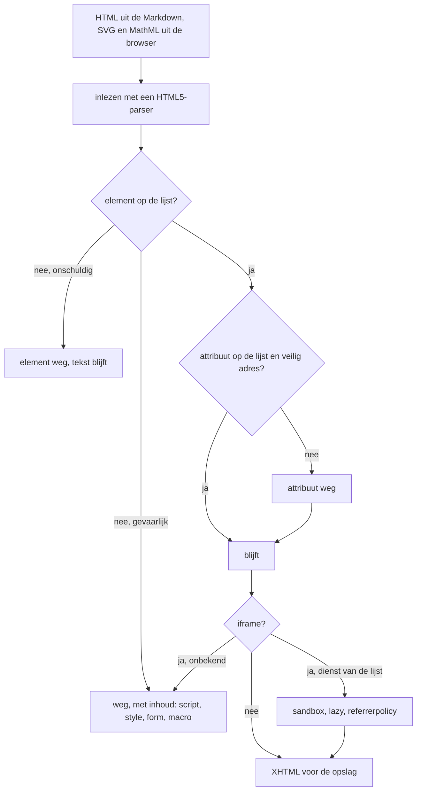

# Beveiliging

Deze pagina beschrijft hoe Hypha een site beschermt: de rollen, inloggen en sessies, de bescherming van formulieren, de vrijheidsniveaus van de nieuwe tekst-editor, het HTML-filter, en wat een beheerder zelf moet regelen. De bekende zwakke plekken staan in [`ai/investigation/open/20261026_SECURITY_REVIEW.md`](../../../ai/investigation/open/20261026_SECURITY_REVIEW.md).

## Rollen

Elke gebruiker in `hypha.xml` heeft een rol in het attribuut `rights`.

| Rol | `rights` | Wat mag |
|---|---|---|
| bezoeker | (geen account) | openbare pagina's lezen, reageren op gepubliceerde artikelen, aanmelden voor een mailinglijst of festival |
| genodigde | `invitee` | nog niets; kan alleen het aanmeldformulier invullen met de link uit de uitnodiging |
| lid | `user` | inloggen, pagina's maken en bewerken, privépagina's lezen, artikelen beoordelen, leden uitnodigen, bestaande tags geven |
| beheerder | `admin` | alles van een lid, plus instellingen, thema, menu, kop en voet, pagina's verwijderen, nieuwe tags, leden beheren, adressen aan een mailinglijst toevoegen |
| oud-lid | `exmember` | niets; inloggen wordt geweigerd |

Bij een artikel met review gelden extra regels, die de server controleert:

1. de auteur kan zijn eigen artikel niet goedkeuren;
2. alleen de auteur kan een artikel in beoordeling terugtrekken en de taal wijzigen;
3. alleen de auteur of een beheerder kan publiceren, een gepubliceerd artikel terugtrekken en het webadres bijwerken;
4. goedkeuren kan pas als elk punt van het redactiestatuut is aangevinkt.

## Inloggen en sessies

1. Wachtwoorden staan als **bcrypt-hash** in `hypha.xml`. Heel oude accounts kunnen nog een MD5-hash hebben.
2. Bij inloggen krijgt de sessie een **nieuwe id** en een nieuw token tegen CSRF.
3. Het sessiecookie is `HttpOnly`, `SameSite=Strict`, alleen voor het pad van de site, en `Secure` als de site via HTTPS loopt.
4. Een link uit een uitnodiging of voor een nieuw wachtwoord bevat een sleutel. Die vervalt zodra het formulier is ingevuld.

## Formulieren en CSRF

Elk formulier van Hypha bevat een **token** dat ook in een cookie staat (*double submit*). Klopt het token niet, dan voert Hypha de opdracht niet uit en meldt: „Er is een probleem bij het verzenden van een commando of formulier, probeer het nogmaals.” De opdrachten van de nieuwe tekst-editor controleren het token zelf.

## Toegang tot bestanden

1. Elk verzoek voor `system/…` of `data/…` gaat via `index.php`. Die levert alleen thema's, scripts en bestanden van de editor uit, en controleert of een pagina privé is.
2. Geüploade foto's en bestanden gaan via `images/…` en `files/…`, ook via `index.php`.
3. De mappen `ai/`, `docs/` en `tests/` en de Markdown-bestanden in de hoofdmap geven een weigering (403).

## De vrijheidsniveaus van de editor

De nieuwe tekst-editor kent twee niveaus van vrijheid voor auteurs. **Niveau 2 staat aan**; een beheerder kan het voor de hele site of per rol uitzetten in `hypha.xml` (zie [Datatypes en macro's](04-datatypes-en-macros.md#instellingen-van-de-editor)).

| Niveau | Wat een auteur mag |
|---|---|
| **1. Standaard** | Markdown met de uitbreidingen van Hypha (kaders, figuren, diagrammen, formules, voetnoten, tabellen) en een beperkte lijst eigen HTML, zoals `details`, `summary`, `kbd`, `abbr`, `sub`, `sup`, `mark`, `figure` en tabellen. Geen `on…`-attributen, geen `style` in HTML, geen `javascript:`-links. |
| **2. Ingesloten inhoud en interactieve blokken** | alles van niveau 1, plus (a) een video, kaart of grafiek van een bekende dienst, zoals YouTube (via `youtube-nocookie.com`), Vimeo, OpenStreetMap of Datawrapper, en (b) een **interactief blok** met eigen HTML, CSS en JavaScript |

Een interactief blok draait in een afgeschermd `<iframe sandbox="allow-scripts">` **zonder** `allow-same-origin`. Het script kan daardoor niet bij de cookies, de sessie of de pagina van Hypha, en kan geen formulieren versturen, geen pop-ups openen en de pagina niet wegsturen. Een interactief blok moet een **beschrijving** hebben: die lezen voorleessoftware, zoekmachines en lezers zonder JavaScript.

1. Ingesloten inhoud mag alleen naar het pad van de speler van een dienst op de lijst. Zo'n `<iframe>` krijgt altijd `sandbox`, `loading="lazy"` en een `referrerpolicy`. Omdat de spelers van YouTube en Vimeo anders niet werken, staat daar ook `allow-same-origin` in de sandbox.
2. Scripts in een interactief blok mogen alleen van een vaste lijst websites komen, zoals cdnjs en jsDelivr.
3. Een auteur voor wie niveau 2 uit staat, ziet ingesloten inhoud en interactieve blokken wel, maar kan ze niet wijzigen.
4. Hypha-macro's en vrije `<script>` of `<style>` in de tekst worden niet uitgevoerd. Ze blijven in de Markdown-bron staan, maar het filter haalt ze uit de HTML.

## Het HTML-filter

Bij elk opslaan in de nieuwe tekst-editor maakt de server HTML van de Markdown en stuurt die door een **filter met een toegestane lijst** (`HyphaFilter` in `system/core/markdown/`). De browser van de lezer krijgt alleen wat door het filter komt. Het diagram laat zien wat er met ingevoerde HTML gebeurt.

De regels van het filter:

1. alleen elementen en attributen van de lijst blijven, apart voor HTML, SVG en MathML;
2. `href` en `src` alleen met `https`, `http`, `mailto` of een relatief adres; in SVG alleen een verwijzing binnen het bestand (`#…`);
3. `style` alleen in SVG en MathML, en dan zonder `url(`, `expression`, `@import` of `javascript:`;
4. `script`, `style`, `form`, `object`, `embed`, `template`, `macro` en `foreignObject` verdwijnen met hun inhoud;
5. CDATA in SVG of MathML wordt gewone tekst;
6. een `<iframe>` alleen naar een dienst van de lijst, met een vaste sandbox;
7. links naar andere websites krijgen `rel="noopener nofollow"`.

De uitkomst is XHTML, die Hypha in het XML-bestand van de pagina bewaart. Het filter is getest met tientallen aanvallen; zie [`docs/technical/TESTING.md`](../../technical/TESTING.md).

> [!warning] De oude opmaakeditor
> Pagina's en artikelen in de oude opmaakeditor (WYMeditor) gaan **niet** door dit filter. Hypha weigert daar alleen `<script>`. Een lid kan in de oude editor dus meer HTML kwijt dan in de nieuwe. Geef alleen mensen die je vertrouwt een account.

## Aanbevelingen voor de beheerder

Tot de bevindingen van de beveiligingsreview zijn opgelost:

1. Haal `hypha.php` weg uit de map van de site na de installatie, of zet er een lange, unieke gebruikersnaam en wachtwoord voor onderhoud in. Laat ze nooit leeg.
2. Weiger `data/`, behalve `data/themes/`, ook in de configuratie van Apache, met `LocationMatch` zoals in [`docs/technical/INSTALLATION.md`](../../technical/INSTALLATION.md#apache-configuration).
3. Zet `ServerName` en `UseCanonicalName On`, zodat links in e-mails niet via een vervalste `Host` naar een andere site kunnen wijzen.
4. Gebruik alleen HTTPS, en zet `Strict-Transport-Security` in NGINX.
5. Geef de gebruiker van de webserver alleen schrijfrechten op `data/`.
6. Zet nooit een bestand `DEBUG` op de echte site.
7. Begrens het aantal `POST`-verzoeken in NGINX als er spam of gegok naar wachtwoorden komt.
8. Ontneem oud-leden hun account: verwijder ze in de ledenlijst, dan worden ze oud-lid en kunnen ze niet meer inloggen.

> [!tip] Wie mag beheerder zijn?
> Geef beheerrechten aan zo weinig mensen als nodig, maar altijd aan minstens twee, zodat de site niet afhangt van één persoon.

## Meer lezen

1. [Beheer](06-beheer.md)
2. [Architectuur](01-architectuur.md#gebruikers-en-beveiliging)
3. [`docs/technical/OPERATIONS.md`](../../technical/OPERATIONS.md#hardening)
