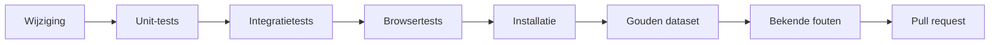

# Testen als ontwikkelaar

Deze pagina legt uit hoe je de tests van Hypha draait op je eigen computer, voordat je een wijziging voorstelt. Alle tests draaien in containers, op elke ondersteunde versie van PHP (8.2 tot en met 8.5), met een verzonnen proefsite. Er komt nooit inhoud van een echte site aan te pas. De Engelse uitleg met alle details staat in [`docs/technical/TESTING.md`](../../technical/TESTING.md).



## Wat je nodig hebt

1. **Docker of Podman.** De tests starten zelf de containers. Met `ENGINE=podman` gebruiken ze Podman.
2. **Python 3** voor de integratietests. Er zijn geen extra pakketten nodig.
3. **Node.js en Google Chrome** voor de browsertests, alleen op je eigen computer en nooit op de server. Voer eenmalig `npm install` uit in `tests/browser`.
4. **Ongeveer 2 GB vrije schijfruimte** voor de images van PHP 8.2 tot en met 8.5.

Voer elke opdracht uit vanuit de hoofdmap van de repository.

## 1. De gewone tests, één opdracht per versie van PHP

```bash
sh tests/run.sh 8.2
```

```bash
sh tests/run.sh 8.2 integratie
```

```bash
sh tests/run.sh 8.2 browser
```

1. **Zonder tweede woord** draaien alleen de **unit-tests**: `tests/HyphaRequestTest.php` en `tests/markdown/`. Ze nemen een paar seconden. Elke waarschuwing of melding over verouderde code (deprecation) laat de test falen die hem veroorzaakte.
2. **Met `integratie`** start ook een container met Hypha en een verzonnen proefsite (vijf leden, zeven tags). De tests in `tests/integratie/` doen verzoeken over HTTP. Na afloop faalt de run op elke PHP-melding in de log van de container, behalve de meldingen die op `main` al voorkomen. Die staan in `tests/bekend/meldingen.ndjson`, elk met het issue dat de melding weghaalt.
3. **Met `browser`** komen daar de tests in Chrome bij: de unit-pagina's in `tests/browser/unit/` en de end-to-end tests in `tests/browser/e2e/`.
4. Vervang `8.2` door `8.3`, `8.4` of `8.5`. Draai vóór een pull request **alle vier de versies**.

Een geslaagde run eindigt per onderdeel met een regel als `PHP 8.2.35: 107 tests, 107 passed, 0 failed` en `browser: 184 tests, 184 passed, 0 failed`.

## 2. Installeren met hypha.php

```bash
sh tests/packaging/run.sh 8.2
```

Deze test bouwt het installatiebestand `hypha.php`, installeert daarmee een lege site in een container en controleert dat die werkt.

## 3. De gouden dataset

De gouden dataset bestaat uit 10.000 verzonnen artikelen en pagina's, met elke opmaak die de editor kent, ook die van HedgeDoc. Bij elke run wordt elk item opnieuw gemaakt en vergeleken met `tests/gouden/manifest.tsv`.

1. Standaard controleren de unit-tests een selectie van 500 items. Alle 10.000 controleer je zo:

   ```bash
   HYPHA_GOUDEN=alle sh tests/run.sh 8.2
   ```

2. De hele dataset als site, met elke pagina opgevraagd als bezoeker en als lid:

   ```bash
   sh tests/integratie/gouden.sh 8.2
   ```

3. **Verandert er bewust iets aan de uitvoer?** Maak het manifest dan opnieuw met `php tests/gouden/maak.php manifest`, in een PHP-container. Leg in de commit uit waarom de uitkomst veranderd is.

## 4. Bekende fouten: wat nog niet werkt

Naast tests die moeten slagen, zijn er tests voor **bekende fouten**. Zo'n test beschrijft het gedrag zoals het hoort, voor een open issue op GitHub, en faalt zolang de fout bestaat.

```bash
sh tests/bekend.sh 8.2
```

1. **`known #N`:** de fout bestaat nog. Dat is normaal, en de run blijft groen.
2. **`FIXED? #N`:** de test slaagt, dus issue #N is waarschijnlijk opgelost. De run faalt, zodat iemand het issue sluit en de test omzet naar een gewone test.
3. **`FAIL`:** de test zelf is kapot, bijvoorbeeld omdat inloggen mislukt. Dat moet je herstellen.

Standaard draaien de tests tegen `main`. Je kunt ook een andere versie opgeven:

```bash
sh tests/bekend.sh 8.2 origin/mijn-branch
```

```bash
sh tests/bekend.sh 8.2 .
```

1. **Met een branch** zie je of een pull request de fout oplost: de tests van dat issue moeten dan `FIXED?` geven.
2. **Met `.`** test je je eigen checkout.
3. **`ONLY=paginas`** draait alleen de tests van één gebied: `beveiliging`, `inhoud`, `lijsten`, `paginas`, `platform`, `mime`, `i18n`, `php9`, `canonical`, `favicon` of `sitemap`.

Het register van alle bekende fouten staat in `tests/bekend/fouten.ndjson`, één regel per test. `python3 -I tests/bekend/register.py` controleert dat de code en het register overeenkomen.

## 5. Verouderde code in nieuwe versies van PHP

```bash
sh docs/container/check_deprecations.sh docker
```

Dit voert `php -l` uit op PHP 8.2 tot en met 8.5 en zoekt naar functies die verouderd zijn. Een release candidate, zoals PHP 8.6, test je met de gewone scripts door de versie op te geven als `8.6-rc` (bijvoorbeeld `sh tests/run.sh 8.6-rc`). Bij `tests/bekend.sh` stel je dan ook zelf `PORT` en `NAME` in, bijvoorbeeld:

```bash
PORT=8186 NAME=hypha-bekend-86 sh tests/bekend.sh 8.6-rc
```

## Veelvoorkomende problemen

1. **Een test faalt alleen soms bij veel verzoeken tegelijk, met `Cannot lock file` of `Failed to open stream`.** Op macOS ziet een container een bestand dat net wordt vervangen soms heel even niet. Dat ligt aan de bind mount van Docker Desktop, niet aan Hypha. Deze melding staat daarom in `tests/bekend/meldingen.ndjson`.
2. **Na een wijziging aan `docs/container/Containerfile` gebruiken de tests nog het oude image.** De tests bouwen het image alleen als het ontbreekt. Verwijder het met `docker rmi hypha-md:php8.2` (of de versie die je test).
3. **De browsertests vinden Chrome niet.** Zet het pad in `CHROME`, bijvoorbeeld `CHROME=/usr/bin/google-chrome`.
4. **Een poort is bezet.** De gewone tests gebruiken 8152 tot en met 8155, de gouden dataset 8172 tot en met 8175, de bekende fouten 8182 tot en met 8185. Stop de container die op die poort draait, of kies bij `tests/bekend.sh` een andere met `PORT`.
